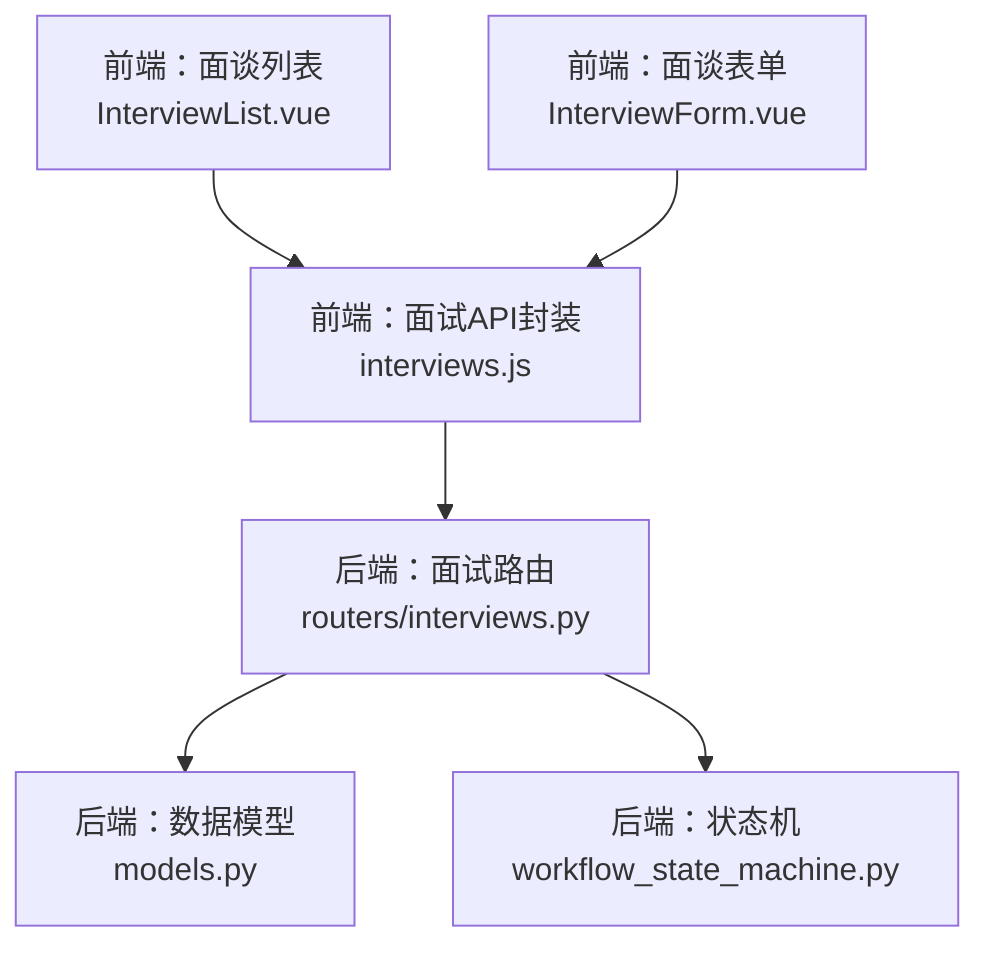
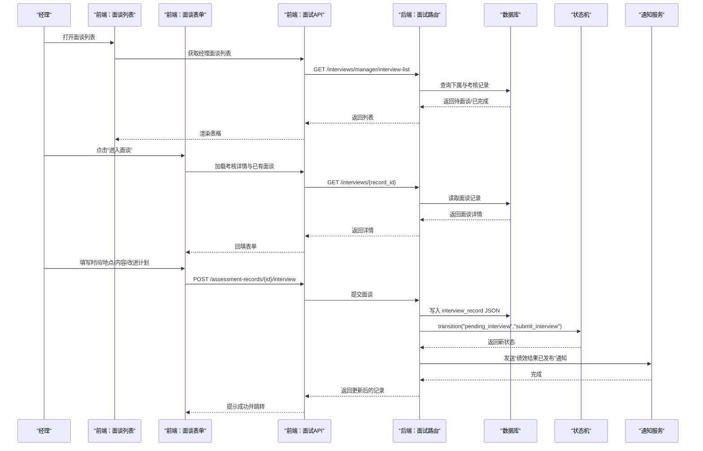
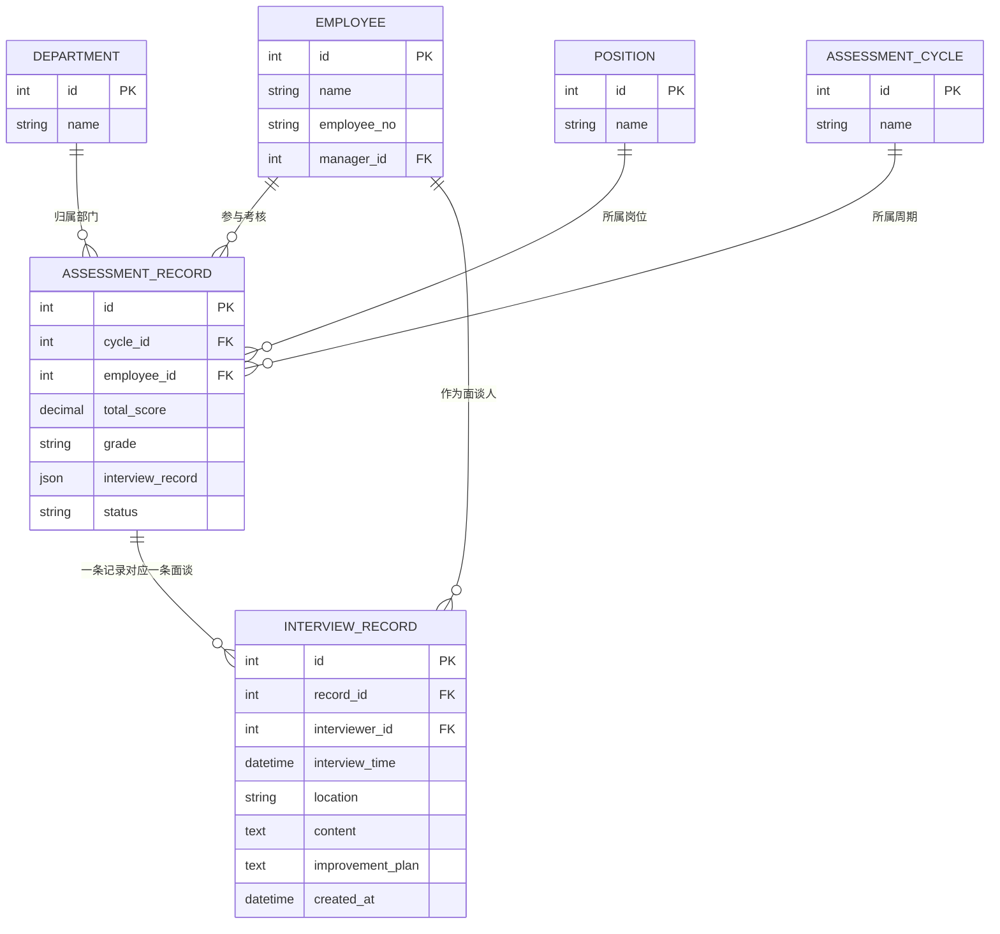
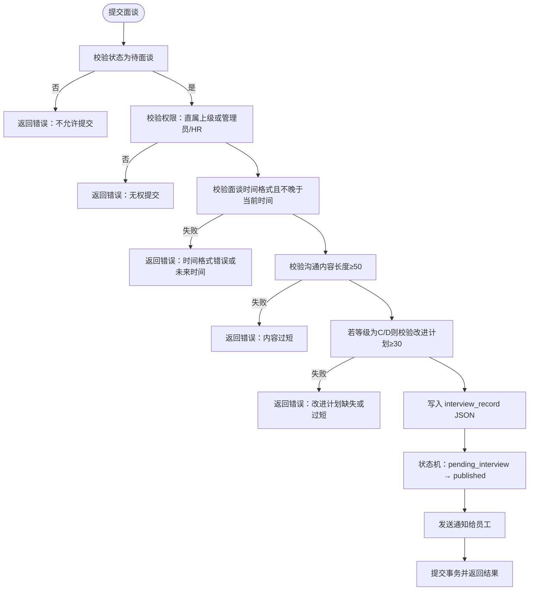
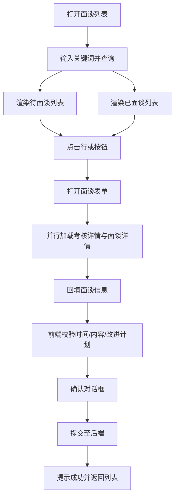
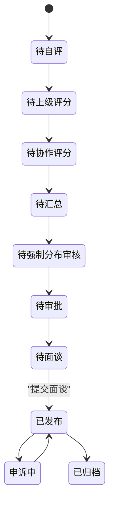
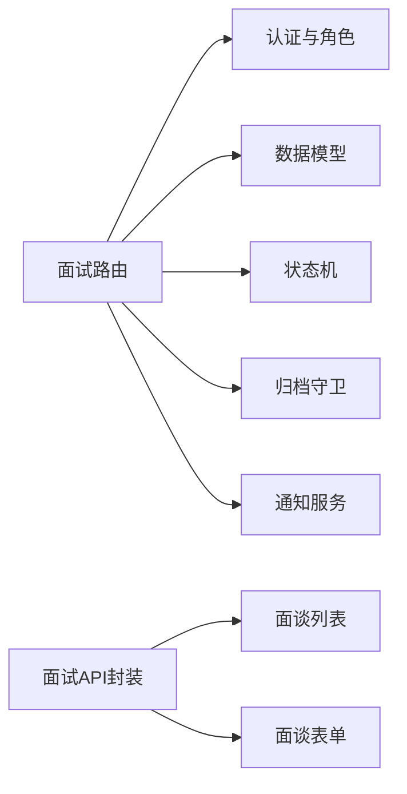

# 绩效面谈管理

<cite>
**本文引用的文件**   
- [backend/app/routers/interviews.py](file://backend/app/routers/interviews.py)
- [backend/app/models.py](file://backend/app/models.py)
- [backend/app/utils/workflow_state_machine.py](file://backend/app/utils/workflow_state_machine.py)
- [frontend/src/views/interview/InterviewList.vue](file://frontend/src/views/interview/InterviewList.vue)
- [frontend/src/views/interview/InterviewForm.vue](file://frontend/src/views/interview/InterviewForm.vue)
- [frontend/src/api/interviews.js](file://frontend/src/api/interviews.js)
- [backend/tests/test_p6_10_publish_requires_interview.py](file://backend/tests/test_p6_10_publish_requires_interview.py)
</cite>

## 目录
1. [引言](#引言)
2. [项目结构定位](#项目结构定位)
3. [核心组件总览](#核心组件总览)
4. [架构总览](#架构总览)
5. [详细组件分析](#详细组件分析)
6. [依赖关系分析](#依赖关系分析)
7. [性能与扩展性考虑](#性能与扩展性考虑)
8. [故障排查指南](#故障排查指南)
9. [结论](#结论)
10. [附录：API 接口清单与前端使用说明](#附录api-接口清单与前端使用说明)

## 引言
本模块聚焦“绩效面谈”的完整闭环管理，覆盖从预约、协调、记录录入到状态流转、结果发布的全流程。系统通过后端路由提供面谈数据与状态变更能力，通过前端列表与表单完成经理侧的面谈操作；同时与绩效考核主流程集成，确保“未面谈不可发布”，并在提交后触发通知与归档相关逻辑。

## 项目结构定位
绩效面谈功能在前后端分别由以下代码承担：
- 后端路由与业务校验集中在面试路由文件中，涉及待办查询、创建、详情、更新、历史查询、经理列表以及提交发布等能力。
- 数据模型中定义了独立的面谈记录表，并与考核记录关联。
- 状态机统一管控从审批通过进入“待面谈”，再到“已发布”的状态转换。
- 前端包含经理视角的面谈列表与面谈表单，调用统一的面试 API。

**图表来源**
- [frontend/src/views/interview/InterviewList.vue:1-173](file://frontend/src/views/interview/InterviewList.vue#L1-L173)
- [frontend/src/views/interview/InterviewForm.vue:1-230](file://frontend/src/views/interview/InterviewForm.vue#L1-L230)
- [frontend/src/api/interviews.js:1-30](file://frontend/src/api/interviews.js#L1-L30)
- [backend/app/routers/interviews.py:1-463](file://backend/app/routers/interviews.py#L1-L463)
- [backend/app/models.py:211-221](file://backend/app/models.py#L211-L221)
- [backend/app/utils/workflow_state_machine.py:10-78](file://backend/app/utils/workflow_state_machine.py#L10-L78)

**章节来源**
- [backend/app/routers/interviews.py:1-463](file://backend/app/routers/interviews.py#L1-L463)
- [backend/app/models.py:211-221](file://backend/app/models.py#L211-L221)
- [backend/app/utils/workflow_state_machine.py:10-78](file://backend/app/utils/workflow_state_machine.py#L10-L78)
- [frontend/src/views/interview/InterviewList.vue:1-173](file://frontend/src/views/interview/InterviewList.vue#L1-L173)
- [frontend/src/views/interview/InterviewForm.vue:1-230](file://frontend/src/views/interview/InterviewForm.vue#L1-L230)
- [frontend/src/api/interviews.js:1-30](file://frontend/src/api/interviews.js#L1-L30)

## 核心组件总览
- 面试路由层：提供待办、创建、详情、更新、历史、经理列表、提交发布等接口，并实现权限与数据隔离。
- 数据模型层：定义面谈记录实体，与考核记录、员工、部门、岗位、周期等实体建立关联。
- 状态机层：统一管理“待面谈→已发布”等关键状态转换，支持审计日志。
- 前端界面层：经理视角的面谈列表（待面谈/已面谈）与面谈表单（时间、地点、内容、改进计划）。

**章节来源**
- [backend/app/routers/interviews.py:24-41](file://backend/app/routers/interviews.py#L24-L41)
- [backend/app/models.py:99-130](file://backend/app/models.py#L99-L130)
- [backend/app/models.py:211-221](file://backend/app/models.py#L211-L221)
- [backend/app/utils/workflow_state_machine.py:10-78](file://backend/app/utils/workflow_state_machine.py#L10-L78)
- [frontend/src/views/interview/InterviewList.vue:1-173](file://frontend/src/views/interview/InterviewList.vue#L1-L173)
- [frontend/src/views/interview/InterviewForm.vue:1-230](file://frontend/src/views/interview/InterviewForm.vue#L1-L230)

## 架构总览
面谈管理贯穿“考核记录—面谈记录—状态机—通知”的主链路。经理在前端选择待面谈员工，填写面谈信息并提交；后端校验权限、时间与内容长度，写入面谈记录与考核记录的 JSON 字段，并通过状态机将状态从“待面谈”转为“已发布”，随后向员工发送通知。

**图表来源**
- [frontend/src/views/interview/InterviewList.vue:101-156](file://frontend/src/views/interview/InterviewList.vue#L101-L156)
- [frontend/src/views/interview/InterviewForm.vue:159-217](file://frontend/src/views/interview/InterviewForm.vue#L159-L217)
- [frontend/src/api/interviews.js:7-13](file://frontend/src/api/interviews.js#L7-L13)
- [backend/app/routers/interviews.py:289-350](file://backend/app/routers/interviews.py#L289-L350)
- [backend/app/routers/interviews.py:353-463](file://backend/app/routers/interviews.py#L353-L463)
- [backend/app/utils/workflow_state_machine.py:68-70](file://backend/app/utils/workflow_state_machine.py#L68-L70)

## 详细组件分析

### 数据模型与关系
面谈相关的数据模型包括：
- 面谈记录表：存储面谈时间、地点、沟通内容、改进计划、创建时间等。
- 考核记录表：通过 JSON 字段存储面试记录摘要，便于快速查看与统计。
- 员工、部门、岗位、周期等基础实体用于上下文展示与权限判断。

> 本图为局部关系片段，完整实体关系与约束以 [ER图设计.md](系统架构/数据库架构设计/ER图设计.md) 为唯一权威来源。

**图表来源**
- [backend/app/models.py:99-130](file://backend/app/models.py#L99-L130)
- [backend/app/models.py:211-221](file://backend/app/models.py#L211-L221)

**章节来源**
- [backend/app/models.py:99-130](file://backend/app/models.py#L99-L130)
- [backend/app/models.py:211-221](file://backend/app/models.py#L211-L221)

### 后端路由与业务逻辑
面试路由提供以下关键能力：
- 待办面谈列表：基于当前经理的下属集合，筛选处于“待面谈”或“已发布”状态的考核记录，并附带是否已有面谈记录。
- 创建面谈记录：校验是否为下属、是否已归档、C/D等级是否必填改进计划，写入面谈记录。
- 获取面谈详情：按角色进行数据隔离，员工仅能查看本人，经理需满足汇报链或部门可见性。
- 更新面谈记录：限制修改者为面谈人或管理员/HR。
- 员工面谈历史：按员工维度聚合其所有面谈记录。
- 经理面谈列表：返回“待面谈”和“已完成”两个分区，支持关键词搜索。
- 提交面谈并发布：严格校验状态、权限、时间、内容长度与改进计划，写入 interview_record JSON，使用状态机转换状态，并向员工发送通知。

**图表来源**
- [backend/app/routers/interviews.py:353-463](file://backend/app/routers/interviews.py#L353-L463)
- [backend/app/utils/workflow_state_machine.py:68-70](file://backend/app/utils/workflow_state_machine.py#L68-L70)

**章节来源**
- [backend/app/routers/interviews.py:43-89](file://backend/app/routers/interviews.py#L43-L89)
- [backend/app/routers/interviews.py:92-138](file://backend/app/routers/interviews.py#L92-L138)
- [backend/app/routers/interviews.py:141-186](file://backend/app/routers/interviews.py#L141-L186)
- [backend/app/routers/interviews.py:189-238](file://backend/app/routers/interviews.py#L189-L238)
- [backend/app/routers/interviews.py:241-285](file://backend/app/routers/interviews.py#L241-L285)
- [backend/app/routers/interviews.py:289-350](file://backend/app/routers/interviews.py#L289-L350)
- [backend/app/routers/interviews.py:353-463](file://backend/app/routers/interviews.py#L353-L463)

### 前端界面与交互
- 面谈列表页：展示“待面谈”和“已面谈”两个分区，支持按姓名/工号搜索，高亮 C/D 等级，点击行或按钮进入面谈表单。
- 面谈表单页：展示员工基本信息与各维度得分参考，提供面谈时间、地点、沟通内容、改进计划（C/D 等级必填）输入，并进行前端校验与确认提示，提交后跳转回列表。

**图表来源**
- [frontend/src/views/interview/InterviewList.vue:1-173](file://frontend/src/views/interview/InterviewList.vue#L1-L173)
- [frontend/src/views/interview/InterviewForm.vue:1-230](file://frontend/src/views/interview/InterviewForm.vue#L1-L230)

**章节来源**
- [frontend/src/views/interview/InterviewList.vue:1-173](file://frontend/src/views/interview/InterviewList.vue#L1-L173)
- [frontend/src/views/interview/InterviewForm.vue:1-230](file://frontend/src/views/interview/InterviewForm.vue#L1-L230)
- [frontend/src/api/interviews.js:1-30](file://frontend/src/api/interviews.js#L1-L30)

### 状态机与流程集成
状态机定义了完整的考核生命周期，其中与面谈相关的转换如下：
- “待面谈”状态下允许执行“提交面谈”动作，目标状态为“已发布”。
- 提交面谈时，后端调用状态机进行转换，并将操作写入审计日志。
- 发布阶段对“未面谈”进行阻断，确保所有必要面谈完成后才能发布周期。

**图表来源**
- [backend/app/utils/workflow_state_machine.py:10-78](file://backend/app/utils/workflow_state_machine.py#L10-L78)

**章节来源**
- [backend/app/utils/workflow_state_machine.py:10-78](file://backend/app/utils/workflow_state_machine.py#L10-L78)
- [backend/tests/test_p6_10_publish_requires_interview.py:66-88](file://backend/tests/test_p6_10_publish_requires_interview.py#L66-L88)

## 依赖关系分析
- 面试路由依赖：
  - 认证与角色控制：require_role 保护接口访问。
  - 数据模型：AssessmentRecord、Employee、Department、Position、User、InterviewRecord、AssessmentCycle。
  - 工具与组件：WorkflowStateMachine、check_record_not_archived、create_notification。
- 前端依赖：
  - 面试 API 封装：getPendingInterviews、getManagerInterviewList、submitInterview、createInterview、getInterview、updateInterview、getEmployeeInterviewHistory。
  - 视图组件：InterviewList.vue、InterviewForm.vue。

**图表来源**
- [backend/app/routers/interviews.py:1-20](file://backend/app/routers/interviews.py#L1-L20)
- [frontend/src/api/interviews.js:1-30](file://frontend/src/api/interviews.js#L1-L30)

**章节来源**
- [backend/app/routers/interviews.py:1-20](file://backend/app/routers/interviews.py#L1-L20)
- [frontend/src/api/interviews.js:1-30](file://frontend/src/api/interviews.js#L1-L30)

## 性能与扩展性考虑
- 查询优化：
  - 经理面谈列表通过直接下属 ID 过滤，避免全表扫描。
  - 关键词搜索在 Employee 表上进行模糊匹配，建议结合索引提升性能。
- 并发与一致性：
  - 提交面谈时先写 JSON 再调用状态机，若状态机抛出业务异常则回滚，保证原子性。
- 可扩展点：
  - 可在面谈路由中增加会议室资源冲突检测与预订提醒。
  - 可引入面谈质量评估指标（如内容完整性、改进计划可行性），纳入后续跟进任务。

[本节为通用指导，不直接分析具体文件]

## 故障排查指南
- 常见错误与处理：
  - 状态不允许提交：检查当前考核记录状态是否为“待面谈”。
  - 权限不足：确认当前用户是否为该员工的直属上级或具备管理员/HR 角色。
  - 面谈时间无效：确保时间为过去或当前时间，且格式正确。
  - 内容过短：沟通内容至少 50 字，C/D 等级改进计划至少 30 字。
  - 发布被阻断：存在未完成面谈的记录时，禁止发布周期。
- 定位步骤：
  - 查看面试路由中的校验逻辑与错误码。
  - 检查状态机允许的转换与审计日志。
  - 核对前端表单校验规则与后端约束是否一致。

**章节来源**
- [backend/app/routers/interviews.py:353-463](file://backend/app/routers/interviews.py#L353-L463)
- [backend/app/utils/workflow_state_machine.py:106-186](file://backend/app/utils/workflow_state_machine.py#L106-L186)
- [backend/tests/test_p6_10_publish_requires_interview.py:66-88](file://backend/tests/test_p6_10_publish_requires_interview.py#L66-L88)

## 结论
绩效面谈管理模块以清晰的后端路由与严格的前端校验为基础，结合统一的状态机与通知机制，实现了从预约、记录到发布的端到端闭环。通过与绩效考核主流程的深度集成，确保了面谈的必要性与结果的合规性。建议在后续迭代中增强会议室资源管理与面谈质量评估，以提升整体管理效率与效果。

[本节为总结性内容，不直接分析具体文件]

## 附录：API 接口清单与前端使用说明

### 后端 API 清单（面试相关）
- 获取待办面谈列表
  - 方法：GET
  - 路径：/interviews/pending
  - 说明：返回当前经理下属中处于“待面谈”或“已发布”的考核记录，含是否已有面谈记录。
- 创建面谈记录
  - 方法：POST
  - 路径：/interviews/{record_id}
  - 说明：为指定考核记录创建面谈记录，需校验下属关系与归档状态。
- 获取面谈详情
  - 方法：GET
  - 路径：/interviews/{record_id}
  - 说明：按角色进行数据隔离，返回面谈记录详情。
- 更新面谈记录
  - 方法：PUT
  - 路径：/interviews/{record_id}
  - 说明：仅面谈人或管理员/HR 可修改。
- 获取员工面谈历史
  - 方法：GET
  - 路径：/interviews/employee/{employee_id}
  - 说明：按员工维度聚合其面谈记录。
- 获取经理面谈列表
  - 方法：GET
  - 路径：/interviews/manager/interview-list
  - 参数：keyword（可选）
  - 说明：返回“待面谈”和“已完成”两个分区。
- 提交面谈并发布
  - 方法：POST
  - 路径：/assessment-records/{id}/interview
  - 说明：校验状态、权限、时间、内容与改进计划，写入 interview_record JSON，状态机转换并发布，发送通知。

**章节来源**
- [backend/app/routers/interviews.py:43-89](file://backend/app/routers/interviews.py#L43-L89)
- [backend/app/routers/interviews.py:92-138](file://backend/app/routers/interviews.py#L92-L138)
- [backend/app/routers/interviews.py:141-186](file://backend/app/routers/interviews.py#L141-L186)
- [backend/app/routers/interviews.py:189-238](file://backend/app/routers/interviews.py#L189-L238)
- [backend/app/routers/interviews.py:241-285](file://backend/app/routers/interviews.py#L241-L285)
- [backend/app/routers/interviews.py:289-350](file://backend/app/routers/interviews.py#L289-L350)
- [backend/app/routers/interviews.py:353-463](file://backend/app/routers/interviews.py#L353-L463)

### 前端使用说明
- 面谈列表
  - 功能：搜索、展示待面谈与已面谈分区、高亮 C/D 等级、点击进入表单。
  - 数据来源：调用 getManagerInterviewList。
- 面谈表单
  - 功能：展示员工信息与维度得分参考，填写面谈时间、地点、沟通内容、改进计划（C/D 等级必填），前端校验与确认提示，提交后返回列表。
  - 数据来源：并行调用 getAssessmentDetail 与 getInterview。
  - 提交接口：submitInterview。

**章节来源**
- [frontend/src/views/interview/InterviewList.vue:1-173](file://frontend/src/views/interview/InterviewList.vue#L1-L173)
- [frontend/src/views/interview/InterviewForm.vue:1-230](file://frontend/src/views/interview/InterviewForm.vue#L1-L230)
- [frontend/src/api/interviews.js:1-30](file://frontend/src/api/interviews.js#L1-L30)