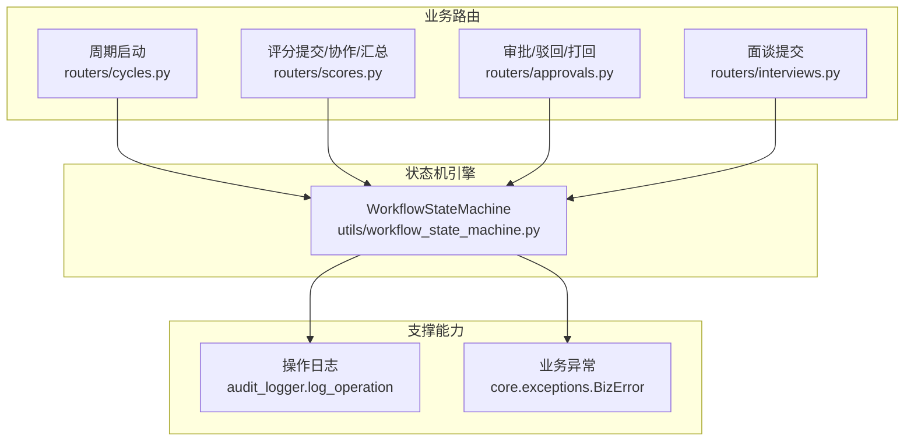
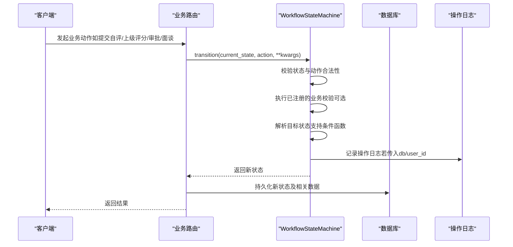
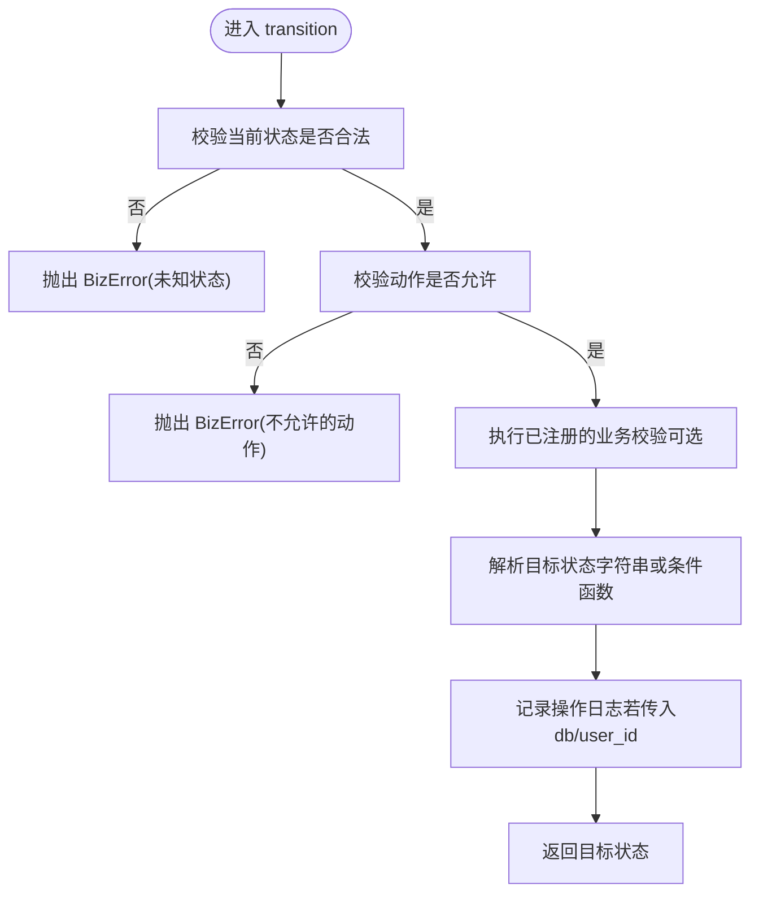
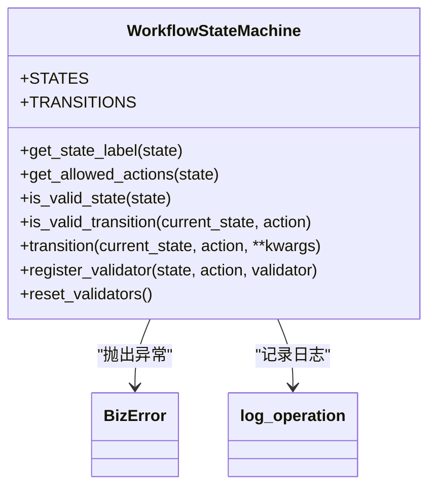
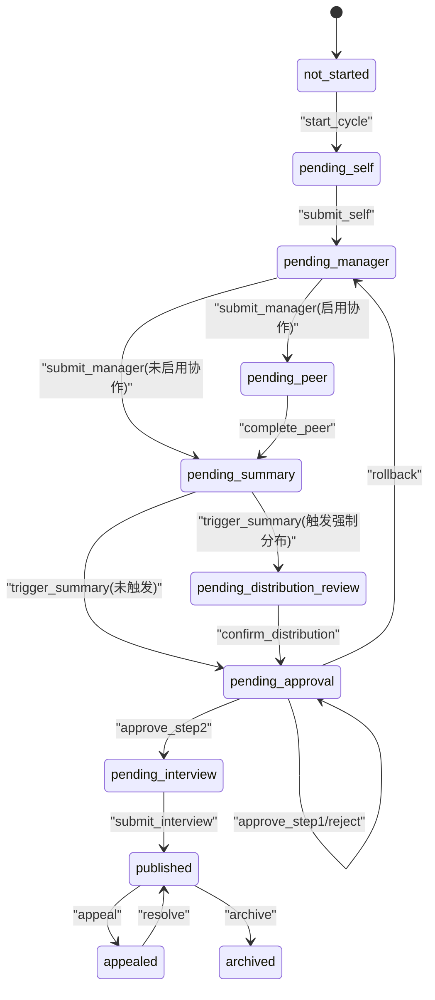

# 状态机工作流引擎

<cite>
**本文引用的文件**   
- [workflow_state_machine.py](file://backend/app/utils/workflow_state_machine.py)
- [cycles.py](file://backend/app/routers/cycles.py)
- [scores.py](file://backend/app/routers/scores.py)
- [approvals.py](file://backend/app/routers/approvals.py)
- [interviews.py](file://backend/app/routers/interviews.py)
- [test_p3_10_state_machine.py](file://backend/tests/test_p3_10_state_machine.py)
</cite>

## 目录
1. [引言](#引言)
2. [项目结构](#项目结构)
3. [核心组件](#核心组件)
4. [架构总览](#架构总览)
5. [详细组件分析](#详细组件分析)
6. [依赖关系分析](#依赖关系分析)
7. [性能与可扩展性](#性能与可扩展性)
8. [故障排查指南](#故障排查指南)
9. [结论](#结论)
10. [附录：状态转换图与使用示例](#附录状态转换图与使用示例)

## 引言
本文件面向绩效考核评分系统中的“状态机工作流引擎”，聚焦 WorkflowStateMachine 类的实现与业务集成。文档将系统阐述：
- 状态定义与业务含义
- 转换规则配置与条件分支
- 事件驱动的状态流转机制（动作/校验/日志）
- 合法性验证、前置条件检查与后置处理
- 与业务流程的集成方式（自动推进、人工干预、异常恢复）
- 状态转换图与典型场景用法

## 项目结构
状态机工作流引擎位于后端工具层，被多个业务路由模块调用，形成“路由触发 → 状态机校验与计算 → 持久化与通知”的闭环。

图表来源
- [workflow_state_machine.py:10-206](file://backend/app/utils/workflow_state_machine.py#L10-L206)
- [cycles.py:431-465](file://backend/app/routers/cycles.py#L431-L465)
- [scores.py:470-554](file://backend/app/routers/scores.py#L470-L554)
- [approvals.py:490-710](file://backend/app/routers/approvals.py#L490-L710)
- [interviews.py:395-463](file://backend/app/routers/interviews.py#L395-L463)

章节来源
- [workflow_state_machine.py:10-206](file://backend/app/utils/workflow_state_machine.py#L10-L206)
- [cycles.py:431-465](file://backend/app/routers/cycles.py#L431-L465)
- [scores.py:470-554](file://backend/app/routers/scores.py#L470-L554)
- [approvals.py:490-710](file://backend/app/routers/approvals.py#L490-L710)
- [interviews.py:395-463](file://backend/app/routers/interviews.py#L395-L463)

## 核心组件
- WorkflowStateMachine：提供状态常量、转换规则、合法性校验、条件目标状态解析、额外校验注册、操作日志记录等能力。
- 业务路由：在各自流程中调用状态机执行转换，并负责数据持久化、通知、审计等操作。

关键职责划分
- 状态机：只关注“当前状态 + 动作 → 目标状态”的规则与校验，不耦合具体业务实体细节。
- 路由层：负责权限校验、参数校验、业务数据落库、通知与审计。

章节来源
- [workflow_state_machine.py:10-206](file://backend/app/utils/workflow_state_machine.py#L10-L206)

## 架构总览
状态机作为无副作用的决策中心，所有涉及状态变更的路由统一通过其进行判定与计算，保证一致性。

图表来源
- [workflow_state_machine.py:105-186](file://backend/app/utils/workflow_state_machine.py#L105-L186)
- [scores.py:760-796](file://backend/app/routers/scores.py#L760-L796)
- [approvals.py:490-534](file://backend/app/routers/approvals.py#L490-L534)
- [interviews.py:416-451](file://backend/app/routers/interviews.py#L416-L451)

## 详细组件分析

### WorkflowStateMachine 类
- 状态集合 STATES：定义全部合法状态及其中文描述。
- 转换规则 TRANSITIONS：以“当前状态 → {动作: 目标状态或解析函数}”形式声明。
- 校验器 _validators：允许为特定“状态+动作”注册额外校验逻辑。
- 方法：
  - get_state_label(state)：获取状态中文标签
  - get_allowed_actions(state)：获取当前状态允许的动作列表
  - is_valid_state(state)：判断状态是否合法
  - is_valid_transition(current_state, action)：判断动作在当前状态下是否允许
  - transition(...)：核心入口，完成校验、解析、日志记录并返回目标状态
  - register_validator(state, action, validator)：注册自定义校验
  - reset_validators()：清空校验器（测试用）

复杂度与行为
- 时间复杂度：O(1) 查找与解析；日志写入为 I/O 但不影响主流程。
- 空间复杂度：O(1)，仅维护静态映射与少量局部变量。
- 错误处理：非法状态抛出 BizError(code=1100)，非法动作抛出 BizError(code=1101)。

章节来源
- [workflow_state_machine.py:10-206](file://backend/app/utils/workflow_state_machine.py#L10-L206)

### 状态定义与业务含义
- not_started：未开始。周期尚未启动。
- pending_self：待自评。员工需填写自评。
- pending_manager：待上级评分。上级对下属进行评分。
- pending_peer：待协作评分。协作人对被评人进行评分（可配置开启）。
- pending_summary：待汇总。系统汇总各维度分数与等级。
- pending_distribution_review：待强制分布审核。存在强制分布调整或覆盖时进入该状态。
- pending_approval：待审批。进入多级审批流程。
- pending_interview：待面谈。审批通过后进入绩效面谈阶段。
- published：已发布。面谈完成后结果对外可见。
- appealed：申诉中。员工对结果提出申诉。
- archived：已归档。最终归档结束。

说明
- 上述状态均来源于 STATES 字典，用于 UI 展示与校验。
- 部分状态仅在特定条件下出现（如 pending_peer、pending_distribution_review、appealed）。

章节来源
- [workflow_state_machine.py:22-35](file://backend/app/utils/workflow_state_machine.py#L22-L35)

### 转换规则与条件分支
- start_cycle：not_started → pending_self
- submit_self：pending_self → pending_manager
- submit_manager：pending_manager → pending_peer 或 pending_summary（取决于 peer_review_enabled）
- complete_peer：pending_peer → pending_summary
- trigger_summary：pending_summary → pending_distribution_review 或 pending_approval（取决于是否存在强制分布触发）
- confirm_distribution：pending_distribution_review → pending_approval
- approve_step1 / approve_step2：pending_approval 内部多步审批，approve_step2 后进入 pending_interview
- reject：pending_approval → pending_approval（保持待审批，记录驳回原因）
- rollback：pending_approval → pending_manager（打回重评）
- submit_interview：pending_interview → published
- appeal：published → appealed
- resolve：appealed → published
- archive：published → archived

条件解析
- 条件函数接收 **kwargs，根据业务上下文决定目标状态。例如：
  - submit_manager(peer_review_enabled)
  - trigger_summary(is_distribution_triggered)

章节来源
- [workflow_state_machine.py:37-78](file://backend/app/utils/workflow_state_machine.py#L37-L78)

### 事件驱动的状态流转机制
- 事件即“动作”。路由层在合适时机调用 transition(current_state, action, ...)。
- 前置校验：
  - 状态合法性校验
  - 动作合法性校验
  - 可选的自定义校验（register_validator）
- 后置处理：
  - 自动记录操作日志（当传入 db、user_id 等）
  - 路由层负责数据持久化、通知、审计等

图表来源
- [workflow_state_machine.py:105-186](file://backend/app/utils/workflow_state_machine.py#L105-L186)

章节来源
- [workflow_state_machine.py:105-186](file://backend/app/utils/workflow_state_machine.py#L105-L186)

### 与业务流程的集成方式
- 自动状态推进
  - 周期启动：调用 start_cycle，自动从 not_started 推进到 pending_self，并发送通知给相关员工。
  - 协作评分完成：当所有 PeerReviewTask 完成，自动调用 complete_peer 推进到 pending_summary。
  - 汇总触发：根据是否存在强制分布调整，自动选择 pending_distribution_review 或 pending_approval。
- 人工干预触发
  - 上级评分：submit_manager，依据周期配置决定是否进入 pending_peer。
  - 审批流程：approve_step1/2、reject、rollback，由审批角色触发。
  - 面谈提交：submit_interview，由管理者完成面谈后触发。
- 异常状态恢复
  - 驳回 reject：保持在 pending_approval，等待重新处理。
  - 打回 rollback：回到 pending_manager，清除相关评分数据，要求重新评分。
  - 申诉 resolve：从 appealed 回到 published，恢复正常流程。

章节来源
- [cycles.py:431-465](file://backend/app/routers/cycles.py#L431-L465)
- [scores.py:470-554](file://backend/app/routers/scores.py#L470-L554)
- [scores.py:1300-1355](file://backend/app/routers/scores.py#L1300-L1355)
- [approvals.py:490-710](file://backend/app/routers/approvals.py#L490-L710)
- [interviews.py:395-463](file://backend/app/routers/interviews.py#L395-L463)

## 依赖关系分析
- WorkflowStateMachine 依赖：
  - core.exceptions.BizError：用于抛出业务异常
  - utils.audit_logger.log_operation：记录操作日志
- 路由层依赖：
  - 数据库 Session、用户信息、模型对象（AssessmentRecord、AssessmentCycle、PeerReviewTask 等）
  - 通知服务 create_notification（在多处调用）

图表来源
- [workflow_state_machine.py:10-206](file://backend/app/utils/workflow_state_machine.py#L10-L206)

章节来源
- [workflow_state_machine.py:10-206](file://backend/app/utils/workflow_state_machine.py#L10-L206)

## 性能与可扩展性
- 性能特性
  - 状态与动作查找为 O(1)
  - 条件解析为轻量函数调用
  - 日志写入失败不影响主流程（try/except 包裹）
- 可扩展性
  - 新增状态：扩展 STATES 与 TRANSITIONS
  - 新增动作：在对应状态的 TRANSITIONS 中添加映射或条件函数
  - 新增业务校验：使用 register_validator 注入校验逻辑
  - 测试隔离：reset_validators 清理全局校验器，避免用例间污染

章节来源
- [workflow_state_machine.py:188-206](file://backend/app/utils/workflow_state_machine.py#L188-L206)

## 故障排查指南
常见错误码与定位
- 1100 未知状态：检查传入 current_state 是否在 STATES 中
- 1101 不允许的动作：检查当前状态下的 allowed actions 是否包含 action
- 自定义校验失败：检查 register_validator 注册的校验逻辑是否正确

排查步骤
- 确认当前状态与动作组合是否合法（使用 is_valid_transition）
- 查看允许的可用动作（使用 get_allowed_actions）
- 检查是否注册了额外的业务校验（使用 reset_validators 清理后复测）
- 核对路由层是否正确传递 kwargs（如 peer_review_enabled、is_distribution_triggered）

章节来源
- [workflow_state_machine.py:136-160](file://backend/app/utils/workflow_state_machine.py#L136-L160)
- [test_p3_10_state_machine.py:40-91](file://backend/tests/test_p3_10_state_machine.py#L40-L91)

## 结论
WorkflowStateMachine 以声明式的方式集中管理状态与转换规则，配合路由层的业务编排，实现了高内聚、低耦合的工作流引擎。通过条件解析与可扩展校验机制，既能满足现有考核流程，也能平滑演进新的业务规则。

## 附录：状态转换图与使用示例

### 状态转换图（代码级映射）

图表来源
- [workflow_state_machine.py:37-78](file://backend/app/utils/workflow_state_machine.py#L37-L78)

### 典型场景与调用路径
- 周期启动
  - 路由：POST /cycles/start-cycle
  - 调用：WorkflowStateMachine.transition("not_started", "start_cycle")
  - 后续：更新周期状态、发送通知、记录审计
  - 参考路径
    - [cycles.py:431-465](file://backend/app/routers/cycles.py#L431-L465)

- 员工自评提交
  - 路由：POST /scores/self/{record_id}
  - 调用：WorkflowStateMachine.transition("pending_self", "submit_self")
  - 后续：保存自评分数、更新状态
  - 参考路径
    - [scores.py:760-796](file://backend/app/routers/scores.py#L760-L796)

- 上级评分提交
  - 路由：POST /scores/manager/{record_id}
  - 调用：WorkflowStateMachine.transition("pending_manager", "submit_manager", peer_review_enabled=...)
  - 后续：创建协作任务（如需）、通知被评人、记录审计
  - 参考路径
    - [scores.py:470-554](file://backend/app/routers/scores.py#L470-L554)

- 协作评分完成
  - 路由：POST /scores/peer-review-task/{task_id}
  - 调用：WorkflowStateMachine.transition("pending_peer", "complete_peer")
  - 后续：通知 HR、更新状态
  - 参考路径
    - [scores.py:1300-1355](file://backend/app/routers/scores.py#L1300-L1355)

- 汇总触发
  - 路由：POST /scores/calculate
  - 调用：WorkflowStateMachine.transition("pending_summary", "trigger_summary", is_distribution_triggered=...)
  - 后续：统计待审核/待审批数量
  - 参考路径
    - [scores.py:293-331](file://backend/app/routers/scores.py#L293-L331)

- 强制分布确认
  - 路由：POST /scores/cycles/{cycle_id}/confirm-distribution
  - 调用：WorkflowStateMachine.transition("pending_distribution_review", "confirm_distribution")
  - 后续：批量更新状态至 pending_approval
  - 参考路径
    - [scores.py:1358-1414](file://backend/app/routers/scores.py#L1358-L1414)

- 审批流程
  - 路由：POST /approvals/{record_id}/approve /reject /rollback
  - 调用：WorkflowStateMachine.transition("pending_approval", "approve_step1"/"approve_step2"/"reject"/"rollback")
  - 后续：记录审批意见、更新状态
  - 参考路径
    - [approvals.py:490-710](file://backend/app/routers/approvals.py#L490-L710)

- 面谈提交
  - 路由：POST /interviews/{id}
  - 调用：WorkflowStateMachine.transition("pending_interview", "submit_interview")
  - 后续：通知员工、更新状态
  - 参考路径
    - [interviews.py:395-463](file://backend/app/routers/interviews.py#L395-L463)