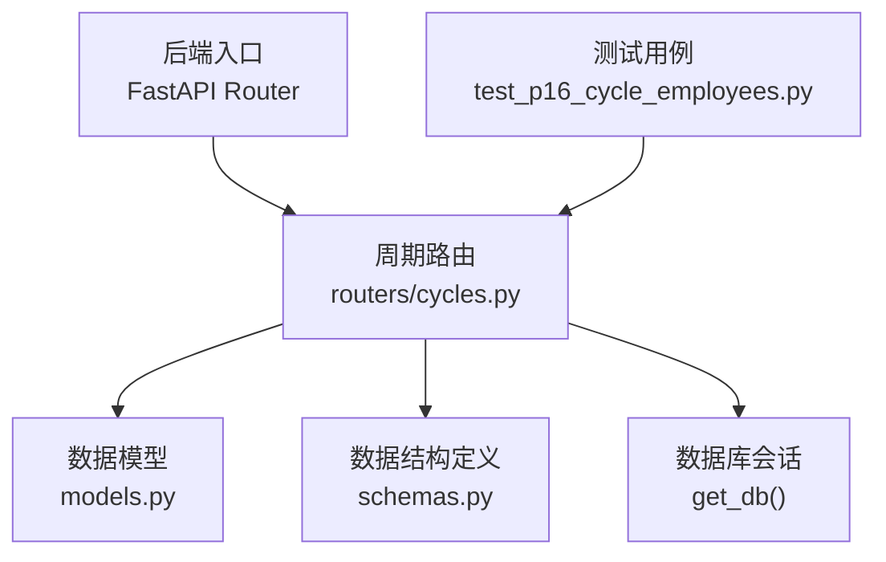
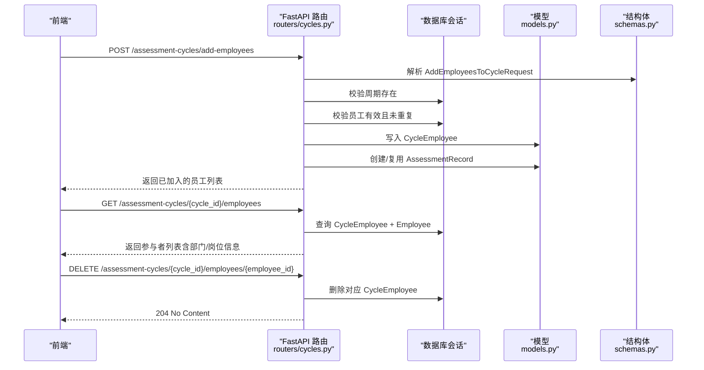
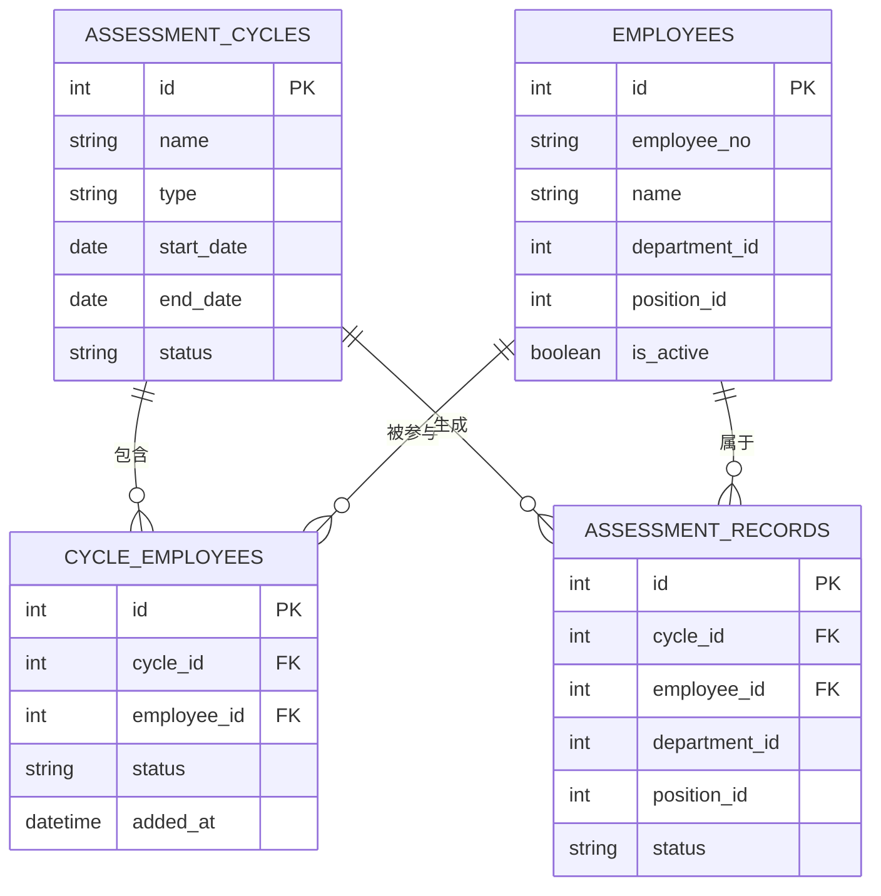
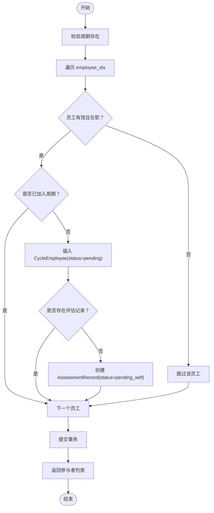
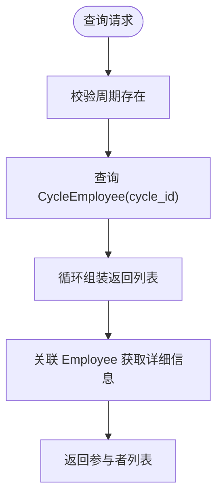

# 考核参与者管理

<cite>
**本文引用的文件**   
- [models.py](file://backend/app/models.py)
- [schemas.py](file://backend/app/schemas.py)
- [cycles.py](file://backend/app/routers/cycles.py)
- [test_p16_cycle_employees.py](file://backend/tests/test_p16_cycle_employees.py)
</cite>

## 目录
1. [引言](#引言)
2. [项目结构](#项目结构)
3. [核心组件](#核心组件)
4. [架构总览](#架构总览)
5. [详细组件分析](#详细组件分析)
6. [依赖关系分析](#依赖关系分析)
7. [性能与扩展性](#性能与扩展性)
8. [故障排查指南](#故障排查指南)
9. [结论](#结论)
10. [附录：API 与前端使用示例](#附录api-与前端使用示例)

## 引言
本文件围绕“考核参与者管理”展开，聚焦以下目标：
- 解释参与者的添加、移除、查询等核心功能实现。
- 深入说明 CycleEmployee 模型设计，包括员工与考核周期的关联关系、参与状态管理与唯一约束。
- 梳理当前代码中“自动筛选机制”的实现现状与边界。
- 说明手动添加参与者的流程，包括数据校验、重复检查与权限控制。
- 说明参与者列表查询的返回字段、过滤能力与分页支持现状。
- 总结批量操作（批量添加、批量移除、状态批量更新）的实现细节与改进建议。
- 提供相关 API 接口文档与前端组件使用示例。

## 项目结构
与“考核参与者管理”直接相关的后端代码主要位于：
- 数据模型：backend/app/models.py
- 请求/响应结构：backend/app/schemas.py
- 路由与业务逻辑：backend/app/routers/cycles.py
- 测试用例：backend/tests/test_p16_cycle_employees.py

**图表来源**
- [cycles.py:1-33](file://backend/app/routers/cycles.py#L1-L33)
- [models.py:167-174](file://backend/app/models.py#L167-L174)
- [schemas.py:317-340](file://backend/app/schemas.py#L317-L340)
- [test_p16_cycle_employees.py:33-57](file://backend/tests/test_p16_cycle_employees.py#L33-L57)

**章节来源**
- [cycles.py:1-33](file://backend/app/routers/cycles.py#L1-L33)
- [models.py:167-174](file://backend/app/models.py#L167-L174)
- [schemas.py:317-340](file://backend/app/schemas.py#L317-L340)
- [test_p16_cycle_employees.py:33-57](file://backend/tests/test_p16_cycle_employees.py#L33-L57)

## 核心组件
- CycleEmployee：记录某员工在某个考核周期中的参与关系与状态。
- AssessmentCycle：考核周期主表，作为参与者关系的父实体。
- Employee：员工主表，被 CycleEmployee 引用。
- AddEmployeesToCycleRequest / LaunchCycleRequest：用于批量添加参与者的请求结构。
- CycleEmployeeOut：参与者列表返回结构。

关键职责：
- 维护“周期-员工”多对多关系（通过中间表）。
- 保证同一周期内同一员工只出现一次（唯一约束）。
- 为参与者提供状态字段，便于后续流程推进。
- 在启动或添加参与者时，同步创建或复用评估记录。

**章节来源**
- [models.py:62-83](file://backend/app/models.py#L62-L83)
- [models.py:31-48](file://backend/app/models.py#L31-L48)
- [models.py:167-174](file://backend/app/models.py#L167-L174)
- [schemas.py:317-340](file://backend/app/schemas.py#L317-L340)

## 架构总览
参与者管理的整体调用链如下：

**图表来源**
- [cycles.py:468-510](file://backend/app/routers/cycles.py#L468-L510)
- [cycles.py:530-566](file://backend/app/routers/cycles.py#L530-L566)
- [cycles.py:513-527](file://backend/app/routers/cycles.py#L513-L527)
- [schemas.py:317-340](file://backend/app/schemas.py#L317-L340)
- [models.py:167-174](file://backend/app/models.py#L167-L174)

## 详细组件分析

### 数据模型与关系设计
- CycleEmployee 表包含 cycle_id、employee_id、status、added_at，并通过联合唯一约束避免重复。
- 与 AssessmentCycle 和 Employee 分别建立外键关系。
- 该设计将“参与关系”与“评估记录”解耦，便于独立管理参与状态与流程进度。

**图表来源**
- [models.py:62-83](file://backend/app/models.py#L62-L83)
- [models.py:99-129](file://backend/app/models.py#L99-L129)
- [models.py:167-174](file://backend/app/models.py#L167-L174)
- [models.py:31-48](file://backend/app/models.py#L31-L48)

**章节来源**
- [models.py:62-83](file://backend/app/models.py#L62-L83)
- [models.py:99-129](file://backend/app/models.py#L99-L129)
- [models.py:167-174](file://backend/app/models.py#L167-L174)
- [models.py:31-48](file://backend/app/models.py#L31-L48)

### 参与者添加流程（批量添加）
- 接口：POST /assessment-cycles/add-employees
- 入参：AddEmployeesToCycleRequest（cycle_id, employee_ids）
- 处理逻辑：
  - 校验周期是否存在。
  - 遍历 employee_ids，跳过无效或离职员工。
  - 若该员工尚未加入该周期，则插入 CycleEmployee（默认状态 pending）。
  - 若该员工尚无评估记录，则创建 AssessmentRecord（初始状态 pending_self），并携带部门与岗位快照。
  - 提交事务后返回该周期下所有参与者的 ID 与状态。

**图表来源**
- [cycles.py:468-510](file://backend/app/routers/cycles.py#L468-L510)

**章节来源**
- [schemas.py:317-323](file://backend/app/schemas.py#L317-L323)
- [cycles.py:468-510](file://backend/app/routers/cycles.py#L468-L510)

### 参与者移除流程
- 接口：DELETE /assessment-cycles/{cycle_id}/employees/{employee_id}
- 权限：admin/hr
- 处理逻辑：
  - 查找对应的 CycleEmployee。
  - 若存在则删除，并提交事务。
  - 返回 204 No Content。

注意：当前实现仅删除参与关系，不级联删除评估记录。

**章节来源**
- [cycles.py:513-527](file://backend/app/routers/cycles.py#L513-L527)

### 参与者列表查询
- 接口：GET /assessment-cycles/{cycle_id}/employees
- 权限：admin/hr
- 返回字段：id、cycle_id、employee_id、employee_no、name、department_id、department_name、position_id、position_name、status、added_at
- 过滤与排序：
  - 当前实现按周期过滤，无额外查询参数过滤（如部门、岗位、状态）。
  - 无分页参数。
- 数据来源：
  - 从 CycleEmployee 获取参与关系。
  - 关联 Employee 获取工号、姓名、部门、岗位等信息。

**图表来源**
- [cycles.py:530-566](file://backend/app/routers/cycles.py#L530-L566)

**章节来源**
- [schemas.py:326-340](file://backend/app/schemas.py#L326-L340)
- [cycles.py:530-566](file://backend/app/routers/cycles.py#L530-L566)

### 自动筛选机制现状与建议
- 现状：
  - 在“启动周期”与“添加参与者”的流程中，系统基于传入的 employee_ids 进行批量处理，并未根据部门、岗位、职级进行自动匹配。
  - AssessmentCycleCreate 中存在 department_ids 字段与校验逻辑，但当前路由未使用该字段进行自动筛选。
- 建议：
  - 在启动或添加参与者时，依据 department_ids、position_ids、职级规则等条件，自动计算候选员工集合。
  - 增加去重与冲突检测，避免重复添加。
  - 提供“预览候选名单”接口，便于 HR 确认。

**章节来源**
- [schemas.py:209-252](file://backend/app/schemas.py#L209-L252)
- [cycles.py:307-382](file://backend/app/routers/cycles.py#L307-L382)
- [cycles.py:385-465](file://backend/app/routers/cycles.py#L385-L465)

### 手动添加参与者的操作流程
- 前置条件：
  - 用户具备 admin 或 hr 角色。
  - 选择有效的考核周期。
  - 准备待添加的员工 ID 列表。
- 操作步骤：
  - 调用批量添加接口，传入 cycle_id 与 employee_ids。
  - 系统校验周期有效性、员工有效性及重复性。
  - 成功后返回该周期下的参与者列表。
- 注意事项：
  - 若员工不存在或已离职，会被忽略。
  - 若员工已加入该周期，不会重复插入。
  - 若员工尚无评估记录，会创建一条初始记录。

**章节来源**
- [cycles.py:468-510](file://backend/app/routers/cycles.py#L468-L510)

### 权限控制
- 参与者添加、移除、列表查询均要求 admin 或 hr 角色。
- 其他敏感操作（如归档、解冻、发布）也有相应权限限制。

**章节来源**
- [cycles.py:468-473](file://backend/app/routers/cycles.py#L468-L473)
- [cycles.py:513-519](file://backend/app/routers/cycles.py#L513-L519)
- [cycles.py:530-535](file://backend/app/routers/cycles.py#L530-L535)

### 批量操作支持
- 批量添加：
  - 通过 AddEmployeesToCycleRequest 支持一次性添加多个员工。
- 批量移除：
  - 当前仅提供单条移除接口；可考虑扩展批量移除接口。
- 状态批量更新：
  - 当前未提供批量更新参与者状态的接口；可在进度管理中按需扩展。

**章节来源**
- [schemas.py:317-323](file://backend/app/schemas.py#L317-L323)
- [cycles.py:468-510](file://backend/app/routers/cycles.py#L468-L510)
- [cycles.py:513-527](file://backend/app/routers/cycles.py#L513-L527)

## 依赖关系分析
- 路由层依赖：
  - FastAPI 路由、依赖注入 get_db、认证 require_role。
  - 业务服务：operation_logger、notification_service、workflow_state_machine、pdf_generator。
- 模型层依赖：
  - AssessmentCycle、Employee、CycleEmployee、AssessmentRecord、Position、Department、User。
- 结构体层依赖：
  - AddEmployeesToCycleRequest、LaunchCycleRequest、CycleEmployeeOut。

```mermaid
graph LR
R["routers/cycles.py"] --> M["models.py"]
R --> S["schemas.py"]
R --> O["services/operation_logger.py"]
R --> N["services/notification_service.py"]
R --> W["utils/workflow_state_machine.py"]
R --> P["utils/pdf_generator.py"]
```

**图表来源**
- [cycles.py:1-33](file://backend/app/routers/cycles.py#L1-L33)

**章节来源**
- [cycles.py:1-33](file://backend/app/routers/cycles.py#L1-L33)

## 性能与扩展性
- 当前参与者列表查询为全量加载，未分页，适合中小规模数据。
- 批量添加采用逐条校验与插入，建议在大数据量场景下引入批量插入与事务优化。
- 建议在参与者列表查询中增加分页、排序与过滤参数，以提升交互体验与查询效率。
- 自动筛选机制可扩展为预计算候选集，减少重复查询与分支判断。

[本节为通用指导，不涉及具体文件分析]

## 故障排查指南
- 常见问题：
  - 添加失败：检查周期是否存在、员工是否有效且在职。
  - 重复添加：系统会自动跳过已存在的参与关系。
  - 列表为空：确认周期是否存在且已有参与者。
  - 权限不足：确保使用 admin 或 hr 账号。
- 定位方法：
  - 查看接口返回码与错误消息。
  - 检查数据库中 CycleEmployee 与 AssessmentRecord 的数据一致性。
  - 结合测试用例验证预期行为。

**章节来源**
- [test_p16_cycle_employees.py:33-57](file://backend/tests/test_p16_cycle_employees.py#L33-L57)

## 结论
- CycleEmployee 清晰表达了“周期-员工”的参与关系，并通过唯一约束保障数据一致性。
- 当前参与者管理以手动批量添加为主，未实现基于部门、岗位、职级的自动筛选。
- 参与者列表查询返回丰富字段，但缺少分页与高级过滤。
- 建议在现有基础上扩展自动筛选、分页、排序与批量状态更新能力，以满足更复杂的业务场景。

[本节为总结性内容，不涉及具体文件分析]

## 附录：API 与前端使用示例

### API 接口定义

- 批量添加参与者
  - 方法：POST
  - 路径：/assessment-cycles/add-employees
  - 请求体：AddEmployeesToCycleRequest
  - 权限：admin/hr
  - 返回：该周期下所有参与者的 ID 与状态列表

- 移除参与者
  - 方法：DELETE
  - 路径：/assessment-cycles/{cycle_id}/employees/{employee_id}
  - 权限：admin/hr
  - 返回：204 No Content

- 查询参与者列表
  - 方法：GET
  - 路径：/assessment-cycles/{cycle_id}/employees
  - 权限：admin/hr
  - 返回：CycleEmployeeOut 列表

**章节来源**
- [schemas.py:317-340](file://backend/app/schemas.py#L317-L340)
- [cycles.py:468-510](file://backend/app/routers/cycles.py#L468-L510)
- [cycles.py:513-527](file://backend/app/routers/cycles.py#L513-L527)
- [cycles.py:530-566](file://backend/app/routers/cycles.py#L530-L566)

### 前端组件使用示例

- 添加参与者
  - 步骤：
    - 选择考核周期。
    - 选择多名员工。
    - 调用批量添加接口。
    - 刷新参与者列表。
  - 提示：
    - 若员工无效或已离职，将被忽略。
    - 若员工已加入，不会重复添加。

- 移除参与者
  - 步骤：
    - 在列表中勾选目标员工。
    - 调用移除接口。
    - 刷新列表。

- 查询参与者列表
  - 步骤：
    - 进入周期详情。
    - 调用列表接口。
    - 展示员工工号、姓名、部门、岗位、状态与加入时间。

[本节为概念性示例，不涉及具体文件分析]