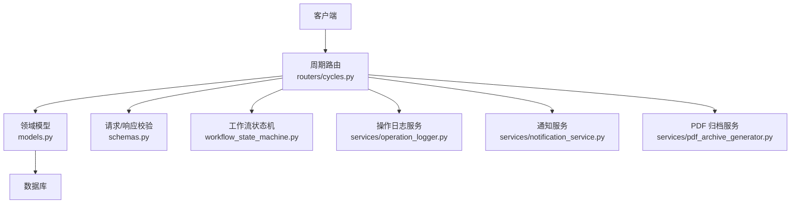
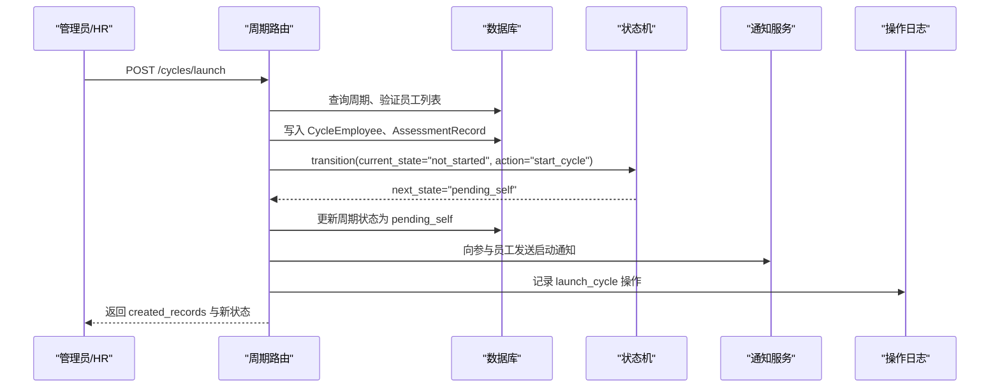
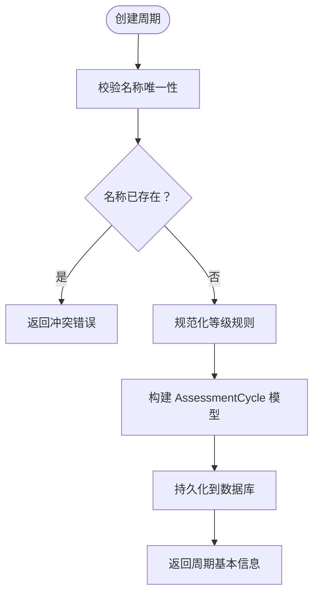
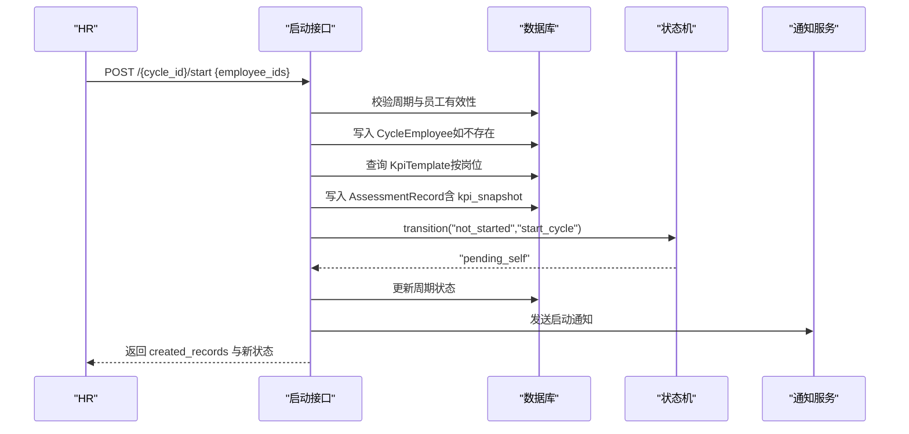
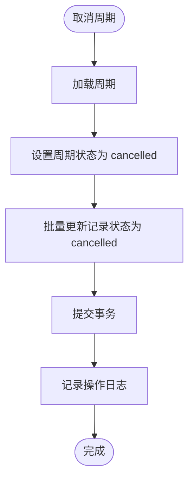
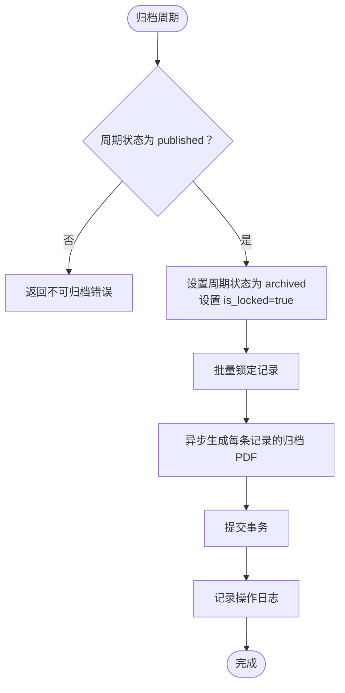
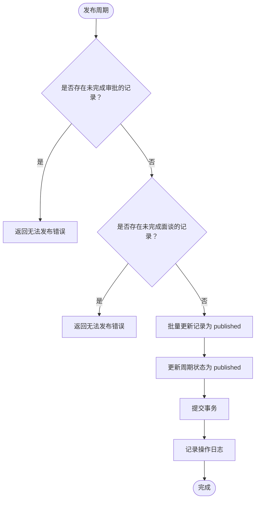
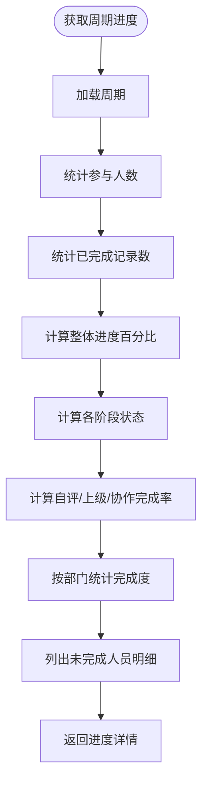
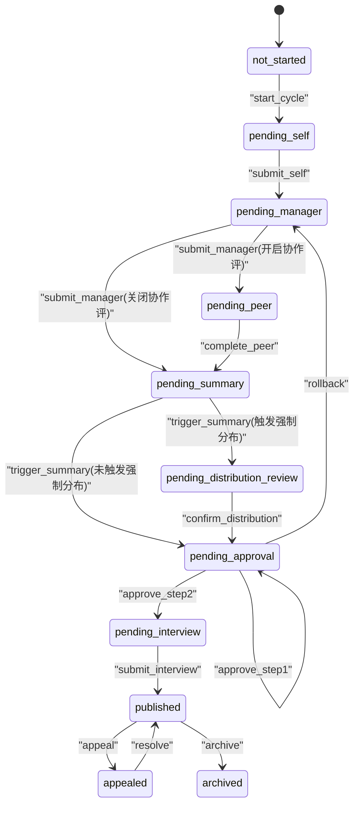
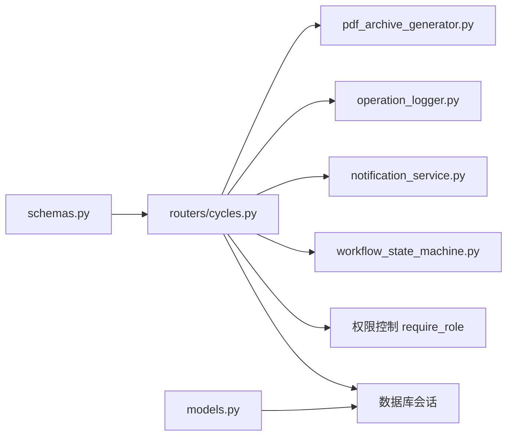

# 考核周期生命周期管理

<cite>
**本文引用的文件**   
- [backend/app/routers/cycles.py](file://backend/app/routers/cycles.py)
- [backend/app/models.py](file://backend/app/models.py)
- [backend/app/schemas.py](file://backend/app/schemas.py)
- [backend/app/utils/workflow_state_machine.py](file://backend/app/utils/workflow_state_machine.py)
- [backend/app/services/operation_logger.py](file://backend/app/services/operation_logger.py)
- [backend/app/services/notification_service.py](file://backend/app/services/notification_service.py)
- [backend/app/utils/pdf_generator.py](file://backend/app/utils/pdf_generator.py)
- [backend/app/services/pdf_archive_generator.py](file://backend/app/services/pdf_archive_generator.py)
</cite>

## 目录
1. [引言](#引言)
2. [项目结构定位](#项目结构定位)
3. [核心组件](#核心组件)
4. [架构总览](#架构总览)
5. [详细组件分析](#详细组件分析)
6. [依赖关系分析](#依赖关系分析)
7. [性能与一致性考虑](#性能与一致性考虑)
8. [故障排查指南](#故障排查指南)
9. [结论](#结论)
10. [附录：API 接口文档](#附录api-接口文档)

## 引言
本文围绕“考核周期”的完整生命周期，系统性说明其创建、编辑、删除、启动、取消、归档、发布、解冻等阶段的状态定义、转换规则、业务约束、数据模型变化以及 API 行为。重点覆盖以下能力：
- 周期参数校验：名称唯一性、维度权重总和、等级区间连续性、截止时间递增、日期未来性等。
- 周期启动流程：员工筛选、参与人员登记、考核记录创建、KPI 快照生成、通知发送、状态机驱动状态变更。
- 取消与归档：取消时级联更新记录状态；归档时锁定周期与记录、异步生成 PDF 档案。
- 进度监控：按阶段统计完成率、部门维度和未完成人员明细。
- 发布前置校验：审批完成、面谈强制节点检查。

## 项目结构定位
考核周期相关逻辑主要位于后端 FastAPI 路由层、领域模型、请求响应 Schema 以及通用工作流状态机中：
- 路由层：`backend/app/routers/cycles.py` 暴露周期 CRUD、启动、取消、归档、发布、导出等接口。
- 模型层：`backend/app/models.py` 定义 `AssessmentCycle`、`AssessmentRecord`、`CycleEmployee`、`KpiTemplate` 等实体。
- 校验层：`backend/app/schemas.py` 定义周期创建/更新/查询的 Pydantic 模型及字段校验。
- 状态机：`backend/app/utils/workflow_state_machine.py` 提供统一的状态转换入口和规则表。
- 辅助服务：操作日志、通知、PDF 归档等通过服务模块调用。

**图表来源**
- [backend/app/routers/cycles.py:1-33](file://backend/app/routers/cycles.py#L1-L33)
- [backend/app/models.py:62-174](file://backend/app/models.py#L62-L174)
- [backend/app/schemas.py:209-323](file://backend/app/schemas.py#L209-L323)
- [backend/app/utils/workflow_state_machine.py:10-78](file://backend/app/utils/workflow_state_machine.py#L10-L78)

**章节来源**
- [backend/app/routers/cycles.py:1-33](file://backend/app/routers/cycles.py#L1-L33)
- [backend/app/models.py:62-174](file://backend/app/models.py#L62-L174)
- [backend/app/schemas.py:209-323](file://backend/app/schemas.py#L209-L323)
- [backend/app/utils/workflow_state_machine.py:10-78](file://backend/app/utils/workflow_state_machine.py#L10-L78)

## 核心组件
- 周期实体 `AssessmentCycle`：承载周期基础信息、评分维度权重、等级规则、是否启用协作评、是否启用强制分布、小部门豁免、锁定标志、归档时间等。
- 考核记录 `AssessmentRecord`：每个员工在某个周期下的具体考核数据，包含 KPI 快照、各维度加权分、总分、等级、原始等级、草稿、面试、申诉、归档 PDF 路径、状态等。
- 周期参与人 `CycleEmployee`：周期与员工的关联，标记加入时间与参与状态。
- 状态机 `WorkflowStateMachine`：集中定义状态集合、允许动作、条件转换、额外校验注册、操作日志记录。
- 请求校验 `AssessmentCycleCreate/Update`：对名称、类型、日期范围、截止时间顺序、维度权重、等级规则等进行严格校验。

**章节来源**
- [backend/app/models.py:62-174](file://backend/app/models.py#L62-L174)
- [backend/app/utils/workflow_state_machine.py:10-78](file://backend/app/utils/workflow_state_machine.py#L10-L78)
- [backend/app/schemas.py:209-323](file://backend/app/schemas.py#L209-L323)

## 架构总览
考核周期的生命周期由“路由层 + 状态机 + 模型层 + 辅助服务”共同实现：
- 路由层负责接收请求、权限校验、参数解析、业务编排、事务提交、审计与通知。
- 状态机负责判定当前状态是否允许执行某动作，并返回目标状态（支持条件分支）。
- 模型层负责持久化周期、记录、参与人、模板等数据。
- 辅助服务负责操作日志、通知、PDF 归档等横切关注点。

**图表来源**
- [backend/app/routers/cycles.py:307-382](file://backend/app/routers/cycles.py#L307-L382)
- [backend/app/utils/workflow_state_machine.py:106-186](file://backend/app/utils/workflow_state_machine.py#L106-L186)
- [backend/app/services/notification_service.py](file://backend/app/services/notification_service.py)
- [backend/app/services/operation_logger.py](file://backend/app/services/operation_logger.py)

## 详细组件分析

### 周期创建与编辑
- 创建周期时，系统会：
  - 校验名称唯一性，若已存在则拒绝。
  - 规范化等级规则，兼容简单分数映射与详细区间配置。
  - 设置初始状态为未开始，默认维度权重与评审权重。
  - 保存周期并返回前端展示所需字段。
- 编辑周期时，仅允许在未开始状态下修改；会将 weights 与 grade_rules 序列化为 JSON 存储，并记录操作日志。

**图表来源**
- [backend/app/routers/cycles.py:159-222](file://backend/app/routers/cycles.py#L159-L222)
- [backend/app/schemas.py:209-283](file://backend/app/schemas.py#L209-L283)

**章节来源**
- [backend/app/routers/cycles.py:159-222](file://backend/app/routers/cycles.py#L159-L222)
- [backend/app/routers/cycles.py:225-279](file://backend/app/routers/cycles.py#L225-L279)
- [backend/app/schemas.py:209-283](file://backend/app/schemas.py#L209-L283)

### 周期删除
- 仅允许删除未开始的周期。
- 若该周期下已有考核记录，则禁止删除，防止数据不一致。
- 删除成功后返回空内容。

**章节来源**
- [backend/app/routers/cycles.py:282-304](file://backend/app/routers/cycles.py#L282-L304)

### 周期启动
启动周期是生命周期中的关键转折点，涉及员工筛选、参与人登记、考核记录创建、KPI 快照生成、通知发送与状态机驱动状态变更。

- 员工筛选：
  - 必须至少选择一名员工。
  - 仅允许激活状态的员工参与。
  - 若传入的员工 ID 中有不存在或已离职员工，直接报错。
- 参与人与记录：
  - 若员工尚未加入周期，则创建 `CycleEmployee` 记录。
  - 若员工尚无考核记录，则根据员工岗位查找活跃 KPI 模板，生成 `AssessmentRecord`，并写入 KPI 快照。
- 状态机：
  - 使用 `WorkflowStateMachine.transition` 将周期从 `not_started` 转换为 `pending_self`。
- 通知与审计：
  - 向参与员工发送“周期已启动”的通知。
  - 记录操作日志，包含旧状态、新状态、新增记录数与员工 ID 列表。

**图表来源**
- [backend/app/routers/cycles.py:385-465](file://backend/app/routers/cycles.py#L385-L465)
- [backend/app/utils/workflow_state_machine.py:106-186](file://backend/app/utils/workflow_state_machine.py#L106-L186)
- [backend/app/services/notification_service.py](file://backend/app/services/notification_service.py)

**章节来源**
- [backend/app/routers/cycles.py:307-382](file://backend/app/routers/cycles.py#L307-L382)
- [backend/app/routers/cycles.py:385-465](file://backend/app/routers/cycles.py#L385-L465)
- [backend/app/models.py:85-129](file://backend/app/models.py#L85-L129)
- [backend/app/utils/workflow_state_machine.py:106-186](file://backend/app/utils/workflow_state_machine.py#L106-L186)

### 周期取消
- 取消周期时，直接将周期状态设置为 `cancelled`。
- 同时将该周期下所有考核记录状态批量更新为 `cancelled`。
- 记录操作日志。

**图表来源**
- [backend/app/routers/cycles.py:712-736](file://backend/app/routers/cycles.py#L712-L736)

**章节来源**
- [backend/app/routers/cycles.py:712-736](file://backend/app/routers/cycles.py#L712-L736)

### 周期归档与解冻
- 归档：
  - 仅允许对已发布的周期进行归档。
  - 归档时将周期状态设为 `archived`，并设置 `is_locked=True` 与归档时间。
  - 将该周期下所有考核记录标记为锁定。
  - 异步触发 PDF 归档生成，逐条记录尝试生成归档 PDF，失败不影响其他记录。
  - 记录操作日志。
- 解冻：
  - 仅允许对已归档的周期进行解冻。
  - 解冻后将周期状态恢复为 `published`，并解除锁定。
  - 批量解锁该周期下所有考核记录。
  - 记录操作日志。

**图表来源**
- [backend/app/routers/cycles.py:739-794](file://backend/app/routers/cycles.py#L739-L794)
- [backend/app/services/pdf_archive_generator.py](file://backend/app/services/pdf_archive_generator.py)

**章节来源**
- [backend/app/routers/cycles.py:739-794](file://backend/app/routers/cycles.py#L739-L794)
- [backend/app/routers/cycles.py:797-831](file://backend/app/routers/cycles.py#L797-L831)

### 周期发布
- 发布前校验：
  - 周期下所有记录必须到达 `pending_interview`、`published` 或 `archived` 状态。
  - 处于 `pending_interview` 的记录必须有绩效面谈记录，否则阻断发布。
- 发布动作：
  - 批量将 `pending_interview` 记录更新为 `published`。
  - 将周期状态更新为 `published`。
  - 记录操作日志。

**图表来源**
- [backend/app/routers/cycles.py:928-999](file://backend/app/routers/cycles.py#L928-L999)

**章节来源**
- [backend/app/routers/cycles.py:928-999](file://backend/app/routers/cycles.py#L928-L999)

### 周期进度监控
- 计算整体进度：已完成（已发布或已归档）记录数除以参与人数。
- 分阶段状态：自评、上级评、协作评、汇总、审批，依据记录状态集合判断阶段完成度。
- 完成率统计：自评、上级评、协作评完成率。
- 部门维度统计：按部门统计参与数与完成数，计算完成率。
- 未完成人员明细：列出当前阶段未完成的人员及其阶段。

**图表来源**
- [backend/app/routers/cycles.py:569-709](file://backend/app/routers/cycles.py#L569-L709)

**章节来源**
- [backend/app/routers/cycles.py:569-709](file://backend/app/routers/cycles.py#L569-L709)

### 状态机与生命周期状态定义
状态机定义了完整的状态集合与转换规则，包括：
- 正常链路：`not_started → pending_self → pending_manager → pending_peer → pending_summary → pending_distribution_review → pending_approval → pending_interview → published → archived`
- 申诉分支：`published ↔ appealed`
- 条件转换：例如协作评开关影响 `pending_manager` 的目标状态；汇总后是否触发强制分布决定进入 `pending_distribution_review` 还是 `pending_approval`。

**图表来源**
- [backend/app/utils/workflow_state_machine.py:22-78](file://backend/app/utils/workflow_state_machine.py#L22-L78)

**章节来源**
- [backend/app/utils/workflow_state_machine.py:10-78](file://backend/app/utils/workflow_state_machine.py#L10-L78)

## 依赖关系分析
- 路由层依赖：
  - 数据库会话：用于查询与更新周期、记录、参与人、模板等。
  - 权限控制：仅 admin/hr/executive 可执行特定操作。
  - 状态机：用于统一状态转换与审计。
  - 通知服务：在周期启动时通知员工。
  - 操作日志：记录关键业务动作。
  - PDF 归档服务：在归档时异步生成 PDF。
- 模型层依赖：
  - 外键关系：周期与记录、记录与员工/岗位/部门、模板与岗位等。
- Schema 层依赖：
  - Pydantic 校验：确保输入数据的合法性与一致性。

**图表来源**
- [backend/app/routers/cycles.py:1-33](file://backend/app/routers/cycles.py#L1-L33)
- [backend/app/models.py:62-174](file://backend/app/models.py#L62-L174)
- [backend/app/schemas.py:209-323](file://backend/app/schemas.py#L209-L323)

**章节来源**
- [backend/app/routers/cycles.py:1-33](file://backend/app/routers/cycles.py#L1-L33)
- [backend/app/models.py:62-174](file://backend/app/models.py#L62-L174)
- [backend/app/schemas.py:209-323](file://backend/app/schemas.py#L209-L323)

## 性能与一致性考虑
- 批量更新：归档与取消时对记录状态进行批量更新，减少多次往返数据库。
- 异步任务：归档时异步生成 PDF，避免阻塞主流程。
- 幂等性：启动接口对重复员工与记录进行去重处理，避免重复插入。
- 事务边界：关键状态变更与数据写入在同一事务内提交，保证一致性。
- 索引建议：周期 ID、员工 ID、岗位 ID、部门 ID 等常用查询字段应建立索引以提升查询性能。

[本节为通用指导，不直接分析具体文件]

## 故障排查指南
- 名称冲突：创建周期时报 409，检查是否已存在同名周期。
- 员工无效：启动周期时报 422，检查员工 ID 是否存在且为激活状态。
- 状态非法：调用状态机时报 BizError，检查当前状态与动作是否匹配。
- 归档失败：归档时报 422，检查周期是否为已发布状态。
- 发布失败：发布时报 422，检查是否存在未完成审批或未面谈的记录。
- 日志缺失：检查操作日志服务是否正常写入。
- 通知未达：检查通知服务是否成功创建通知。

**章节来源**
- [backend/app/routers/cycles.py:159-222](file://backend/app/routers/cycles.py#L159-L222)
- [backend/app/routers/cycles.py:307-382](file://backend/app/routers/cycles.py#L307-L382)
- [backend/app/routers/cycles.py:739-794](file://backend/app/routers/cycles.py#L739-L794)
- [backend/app/routers/cycles.py:928-999](file://backend/app/routers/cycles.py#L928-L999)
- [backend/app/utils/workflow_state_machine.py:106-186](file://backend/app/utils/workflow_state_machine.py#L106-L186)

## 结论
考核周期生命周期管理通过清晰的状态机、严格的参数校验与完善的数据模型，实现了从创建到归档的全流程管控。启动阶段的员工筛选、记录创建与 KPI 快照生成确保了考核数据的准确性与可追溯性；取消与归档提供了必要的业务回退与数据保护能力；发布前的审批与面谈校验保障了结果发布的合规性。建议在后续迭代中进一步完善异常重试机制、并发控制与更细粒度的权限隔离。

[本节为总结性内容，不直接分析具体文件]

## 附录：API 接口文档

### 周期列表
- 方法：GET
- 路径：`/api/cycles`
- 查询参数：
  - status：按状态筛选
  - type：按类型筛选
  - start_date：开始日期
  - end_date：结束日期
  - page：页码
  - size：每页条数
- 响应：分页对象或周期列表，包含 id、name、type、日期、状态、权重、等级规则等。

**章节来源**
- [backend/app/routers/cycles.py:49-114](file://backend/app/routers/cycles.py#L49-L114)

### 周期详情
- 方法：GET
- 路径：`/api/cycles/{cycle_id}`
- 响应：周期详情与参与员工所属部门列表。

**章节来源**
- [backend/app/routers/cycles.py:117-156](file://backend/app/routers/cycles.py#L117-L156)

### 创建周期
- 方法：POST
- 路径：`/api/cycles`
- 请求体：`AssessmentCycleCreate`
  - name：周期名称（必填，长度限制）
  - type：周期类型（必填）
  - start_date/end_date：起止日期（必填）
  - self_due_date/manager_due_date/peer_due_date：截止时间（可选，需递增）
  - peer_review_enabled：是否启用协作评（可选）
  - department_ids：考核对象部门列表（可选）
  - weights：维度权重（必填，总和为 100）
  - grade_rules：等级规则（必填，区间连续且不重叠）
  - small_dept_exemption：小部门豁免（可选）
- 响应：周期基本信息与状态。

**章节来源**
- [backend/app/routers/cycles.py:159-222](file://backend/app/routers/cycles.py#L159-L222)
- [backend/app/schemas.py:209-283](file://backend/app/schemas.py#L209-L283)

### 更新周期
- 方法：PUT
- 路径：`/api/cycles/{cycle_id}`
- 请求体：`AssessmentCycleUpdate`
- 约束：仅未开始周期可编辑。
- 响应：更新后的周期信息。

**章节来源**
- [backend/app/routers/cycles.py:225-279](file://backend/app/routers/cycles.py#L225-L279)

### 删除周期
- 方法：DELETE
- 路径：`/api/cycles/{cycle_id}`
- 约束：仅未开始且无考核记录的周期可删除。
- 响应：空内容。

**章节来源**
- [backend/app/routers/cycles.py:282-304](file://backend/app/routers/cycles.py#L282-L304)

### 启动周期
- 方法：POST
- 路径：`/api/cycles/launch` 或 `/api/cycles/{cycle_id}/start`
- 请求体：`LaunchCycleRequest`
  - cycle_id：周期 ID
  - employee_ids：员工 ID 列表（至少一个）
- 行为：
  - 校验员工有效性
  - 写入参与人与考核记录
  - 生成 KPI 快照
  - 状态机驱动状态变更
  - 发送通知与记录日志
- 响应：created_records 与新状态。

**章节来源**
- [backend/app/routers/cycles.py:307-382](file://backend/app/routers/cycles.py#L307-L382)
- [backend/app/routers/cycles.py:385-465](file://backend/app/routers/cycles.py#L385-L465)
- [backend/app/schemas.py:317-323](file://backend/app/schemas.py#L317-L323)

### 添加员工到周期
- 方法：POST
- 路径：`/api/cycles/add-employees`
- 请求体：`AddEmployeesToCycleRequest`
- 行为：添加参与人并创建对应考核记录（如不存在）。
- 响应：参与人员列表。

**章节来源**
- [backend/app/routers/cycles.py:468-510](file://backend/app/routers/cycles.py#L468-L510)
- [backend/app/schemas.py:321-323](file://backend/app/schemas.py#L321-L323)

### 移除员工
- 方法：DELETE
- 路径：`/api/cycles/{cycle_id}/employees/{employee_id}`
- 响应：空内容。

**章节来源**
- [backend/app/routers/cycles.py:513-527](file://backend/app/routers/cycles.py#L513-L527)

### 周期参与人员列表
- 方法：GET
- 路径：`/api/cycles/{cycle_id}/employees`
- 响应：参与人员详细信息。

**章节来源**
- [backend/app/routers/cycles.py:530-566](file://backend/app/routers/cycles.py#L530-L566)

### 周期进度
- 方法：GET
- 路径：`/api/cycles/{cycle_id}/progress`
- 响应：整体进度、阶段状态、完成率、部门统计、未完成人员明细。

**章节来源**
- [backend/app/routers/cycles.py:569-709](file://backend/app/routers/cycles.py#L569-L709)

### 取消周期
- 方法：POST
- 路径：`/api/cycles/{cycle_id}/cancel`
- 行为：设置周期与记录状态为 cancelled。
- 响应：消息与周期 ID。

**章节来源**
- [backend/app/routers/cycles.py:712-736](file://backend/app/routers/cycles.py#L712-L736)

### 归档周期
- 方法：POST
- 路径：`/api/cycles/{cycle_id}/archive`
- 行为：设置周期为 archived，锁定周期与记录，异步生成 PDF。
- 响应：消息与周期 ID。

**章节来源**
- [backend/app/routers/cycles.py:739-794](file://backend/app/routers/cycles.py#L739-L794)

### 解冻周期
- 方法：POST
- 路径：`/api/cycles/{cycle_id}/unarchive`
- 行为：将 archived 周期恢复为 published，解锁记录。
- 响应：消息与周期 ID。

**章节来源**
- [backend/app/routers/cycles.py:797-831](file://backend/app/routers/cycles.py#L797-L831)

### 导出 Excel
- 方法：GET
- 路径：`/api/cycles/{cycle_id}/export-excel`
- 查询参数：department_id（可选）
- 响应：Excel 文件流。

**章节来源**
- [backend/app/routers/cycles.py:834-925](file://backend/app/routers/cycles.py#L834-L925)

### 发布周期
- 方法：POST
- 路径：`/api/cycles/{cycle_id}/publish`
- 行为：校验审批与面谈完成，批量更新记录与周期状态为 published。
- 响应：消息、周期 ID 与更新记录数。

**章节来源**
- [backend/app/routers/cycles.py:928-999](file://backend/app/routers/cycles.py#L928-L999)

### 测试辅助接口
- 推进到审批：`POST /api/cycles/{cycle_id}/advance-to-approval`
- 推进到面谈：`POST /api/cycles/{cycle_id}/advance-to-interview`
- 行为：批量更新记录状态，用于 E2E 测试。

**章节来源**
- [backend/app/routers/cycles.py:1002-1027](file://backend/app/routers/cycles.py#L1002-L1027)