基于我对代码的分析，我现在了解了考核周期管理模块的数据库事务修复变更。让我更新文档：

# 考核周期管理

<cite>
**本文引用的文件**   
- [backend/app/routers/cycles.py](file://backend/app/routers/cycles.py)
- [backend/app/services/operation_logger.py](file://backend/app/services/operation_logger.py)
- [backend/app/services/notification_service.py](file://backend/app/services/notification_service.py)
- [backend/app/services/config_service.py](file://backend/app/services/config_service.py)
- [backend/app/services/distribution_enforcer.py](file://backend/app/services/distribution_enforcer.py)
- [backend/app/utils/workflow_state_machine.py](file://backend/app/utils/workflow_state_machine.py)
- [backend/app/models.py](file://backend/app/models.py)
- [backend/app/routers/config.py](file://backend/app/routers/config.py)
- [backend/app/routers/approvals.py](file://backend/app/routers/approvals.py)
- [frontend/src/views/cycles/CycleList.vue](file://frontend/src/views/cycles/CycleList.vue)
- [frontend/src/views/cycles/CycleEdit.vue](file://frontend/src/views/cycles/CycleEdit.vue)
- [frontend/src/views/config/ConfigView.vue](file://frontend/src/views/config/ConfigView.vue)
- [frontend/src/api/cycles.js](file://frontend/src/api/cycles.js)
</cite>

## 更新摘要
**变更内容**   
- **重要修复**：解决了数据库事务问题，确保启动周期时的操作日志和通知能够正确持久化
- 增强了强制分布算法，新增自动等级规则标准化功能
- 实现了默认比例限制（A20%/B70%/C10%），当ratio_limit缺失时自动应用
- 新增了周期级别的强制分布控制开关 `is_distribution_enabled`
- 新增了部门分布统计端点 `/api/v1/approvals/department-distribution`
- 改进了小部门豁免逻辑和等级映射算法

## 目录
1. [引言](#引言)
2. [项目结构定位](#项目结构定位)
3. [核心组件总览](#核心组件总览)
4. [架构总览](#架构总览)
5. [详细组件分析](#详细组件分析)
6. [依赖关系分析](#依赖关系分析)
7. [性能与扩展性考虑](#性能与扩展性考虑)
8. [故障排查指南](#故障排查指南)
9. [结论](#结论)
10. [附录：API 与前端使用示例](#附录api-与前端使用示例)

## 引言
本文件围绕"考核周期管理"模块，系统性说明其完整生命周期、状态机驱动工作流、强制分布算法、参与者管理、进度监控、归档发布能力，以及后端 API 与前端组件的使用方式。文档面向具备不同技术背景的读者，既提供高层架构图，也给出代码级实现路径和可追溯来源。

**更新** 本次更新重点反映了数据库事务修复的重大改进，包括操作日志和通知的正确持久化机制，以及强制分布算法的重大增强，包括自动等级规则标准化、默认比例限制、周期级别控制开关，以及新的部门分布统计功能。

## 项目结构定位
考核周期管理在系统中属于"流程编排 + 数据治理"的核心模块：
- 后端路由负责周期 CRUD、启动、参与者增删、进度统计、发布、归档、解冻、导出等能力。
- 状态机统一约束周期及记录的状态流转。
- 强制分布服务负责按部门维度控制等级分布，现已增强为支持自动规则标准化和默认比例限制。
- 全局配置服务统一管理权重配置，提供缓存和默认值管理。
- **重要修复** 操作日志和通知服务现在通过正确的数据库事务管理确保数据持久化。
- **新增** 部门分布统计端点提供实时分布分析和超限检测。
- 前端通过列表、编辑、发起、协作人分配、进度查看等页面完成交互。

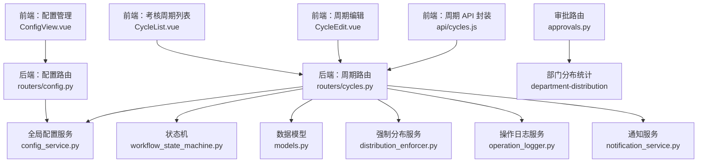

**图表来源**
- [backend/app/routers/cycles.py:1-33](file://backend/app/routers/cycles.py#L1-L33)
- [backend/app/routers/approvals.py:853-922](file://backend/app/routers/approvals.py#L853-L922)
- [backend/app/routers/config.py:100-188](file://backend/app/routers/config.py#L100-L188)
- [backend/app/services/config_service.py:1-100](file://backend/app/services/config_service.py#L1-L100)
- [backend/app/utils/workflow_state_machine.py:10-78](file://backend/app/utils/workflow_state_machine.py#L10-L78)
- [backend/app/services/distribution_enforcer.py:30-128](file://backend/app/services/distribution_enforcer.py#L30-L128)
- [backend/app/services/operation_logger.py:1-40](file://backend/app/services/operation_logger.py#L1-L40)
- [backend/app/services/notification_service.py:1-39](file://backend/app/services/notification_service.py#L1-L39)
- [backend/app/models.py:62-174](file://backend/app/models.py#L62-L174)
- [frontend/src/views/cycles/CycleList.vue:1-239](file://frontend/src/views/cycles/CycleList.vue#L1-L239)
- [frontend/src/views/cycles/CycleEdit.vue:1-40](file://frontend/src/views/cycles/CycleEdit.vue#L1-L40)
- [frontend/src/views/config/ConfigView.vue:193-221](file://frontend/src/views/config/ConfigView.vue#L193-L221)
- [frontend/src/api/cycles.js:1-38](file://frontend/src/api/cycles.js#L1-L38)

**章节来源**
- [backend/app/routers/cycles.py:1-33](file://backend/app/routers/cycles.py#L1-L33)
- [backend/app/models.py:62-174](file://backend/app/models.py#L62-L174)
- [frontend/src/views/cycles/CycleList.vue:1-239](file://frontend/src/views/cycles/CycleList.vue#L1-L239)
- [frontend/src/views/cycles/CycleEdit.vue:1-40](file://frontend/src/views/cycles/CycleEdit.vue#L1-L40)
- [frontend/src/api/cycles.js:1-38](file://frontend/src/api/cycles.js#L1-L38)

## 核心组件总览
- 周期路由层：提供周期创建、查询、更新、删除、启动、取消、归档、解冻、发布、进度、导出等接口。
- 状态机：定义从"未开始 → 自评 → 上级评 → 协作评 → 汇总 → 审批 → 面谈 → 已发布 → 已归档"的完整转换规则，并支持申诉分支。
- **增强版** 强制分布服务：按部门人数与等级比例上限进行自动降级调整，支持自动规则标准化、默认比例限制、小部门豁免与特批候选人标记。
- **重要修复** 操作日志和通知服务：通过正确的数据库事务管理确保数据持久化，避免会话关闭导致的数据丢失。
- **新增** 部门分布统计：提供实时部门等级分布分析和超限检测。
- 全局配置服务：统一管理维度权重和评价人权重，提供缓存机制和默认值管理。
- 数据模型：周期、员工、记录、协作评审、申诉、面试、归档等实体支撑全链路数据。
- 前端界面：周期列表、新增/编辑、发起参与人员、协作人分配、进度查看、详情展示。

**章节来源**
- [backend/app/routers/cycles.py:49-114](file://backend/app/routers/cycles.py#L49-L114)
- [backend/app/utils/workflow_state_machine.py:22-78](file://backend/app/utils/workflow_state_machine.py#L22-L78)
- [backend/app/services/distribution_enforcer.py:30-128](file://backend/app/services/distribution_enforcer.py#L30-L128)
- [backend/app/routers/approvals.py:853-922](file://backend/app/routers/approvals.py#L853-L922)
- [backend/app/services/config_service.py:41-100](file://backend/app/services/config_service.py#L41-L100)
- [backend/app/models.py:62-174](file://backend/app/models.py#L62-L174)
- [frontend/src/views/cycles/CycleList.vue:1-239](file://frontend/src/views/cycles/CycleList.vue#L1-L239)

## 架构总览
考核周期管理的整体调用链如下：
- 前端通过 `api/cycles.js` 调用后端 `/assessment-cycles` 系列接口。
- 后端路由校验权限、参数，操作数据库模型，必要时调用状态机和强制分布服务。
- 权重配置通过全局config_service统一管理，支持缓存和动态配置。
- 状态机负责校验动作合法性、计算目标状态、记录审计日志。
- **重要修复** 操作日志和通知服务现在通过正确的flush和commit机制确保数据持久化。
- **增强版** 强制分布服务现在支持自动等级规则标准化和默认比例限制。
- **新增** 部门分布统计端点提供实时分布分析。

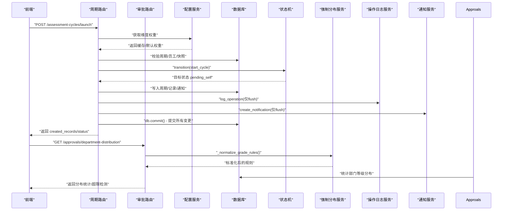

**图表来源**
- [backend/app/routers/cycles.py:307-382](file://backend/app/routers/cycles.py#L307-L382)
- [backend/app/routers/approvals.py:853-922](file://backend/app/routers/approvals.py#L853-L922)
- [backend/app/services/distribution_enforcer.py:40-63](file://backend/app/services/distribution_enforcer.py#L40-L63)
- [backend/app/services/config_service.py:41-100](file://backend/app/services/config_service.py#L41-L100)
- [backend/app/utils/workflow_state_machine.py:106-186](file://backend/app/utils/workflow_state_machine.py#L106-L186)
- [backend/app/services/operation_logger.py:29-39](file://backend/app/services/operation_logger.py#L29-L39)
- [backend/app/services/notification_service.py:5-17](file://backend/app/services/notification_service.py#L5-L17)

## 详细组件分析

### 数据库事务修复（重要）
**重要修复** 系统修复了数据库事务问题，确保启动周期时的操作日志和通知能够正确持久化。

#### 问题背景
在之前的实现中，`log_operation` 和 `create_notification` 函数只执行 `db.flush()` 而不执行 `db.commit()`，导致这些变更在会话关闭时丢失。

#### 修复方案
1. **操作日志服务优化**：`log_operation` 函数现在使用 `db.add(log)` 和 `db.flush()` 来暂存日志记录，由调用方负责最终提交。
2. **通知服务优化**：`create_notification` 函数同样采用 flush 机制，确保通知记录在事务内暂存。
3. **事务边界明确**：在 `launch_cycle` 和 `start_cycle` 方法中，显式调用 `db.commit()` 来提交所有变更，包括主业务数据和辅助数据（日志、通知）。

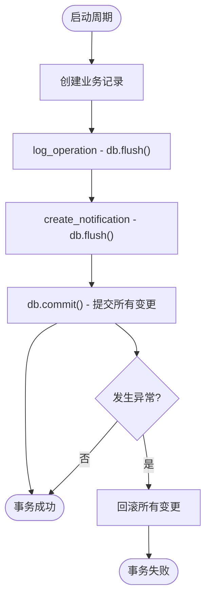

**图表来源**
- [backend/app/routers/cycles.py:366-391](file://backend/app/routers/cycles.py#L366-L391)
- [backend/app/routers/cycles.py:446-476](file://backend/app/routers/cycles.py#L446-L476)
- [backend/app/services/operation_logger.py:29-39](file://backend/app/services/operation_logger.py#L29-L39)
- [backend/app/services/notification_service.py:5-17](file://backend/app/services/notification_service.py#L5-L17)

#### 关键改进点
- **数据一致性**：确保业务数据、操作日志、通知记录在同一事务中保持一致性。
- **错误处理**：任何步骤失败都会触发事务回滚，避免部分数据持久化。
- **性能优化**：减少数据库往返次数，提高批量操作效率。
- **可追踪性**：所有操作都有完整的审计日志，便于问题排查。

**章节来源**
- [backend/app/routers/cycles.py:366-391](file://backend/app/routers/cycles.py#L366-L391)
- [backend/app/routers/cycles.py:446-476](file://backend/app/routers/cycles.py#L446-L476)
- [backend/app/services/operation_logger.py:29-39](file://backend/app/services/operation_logger.py#L29-L39)
- [backend/app/services/notification_service.py:5-17](file://backend/app/services/notification_service.py#L5-L17)

### 增强版强制分布算法
**更新** 强制分布算法得到了重大增强，新增了自动等级规则标准化、默认比例限制和周期级别控制。

#### 自动等级规则标准化
新增的 `_normalize_grade_rules` 函数能够：
- 将数值简写格式（如 `{"A": 90}`）转换为详细区间格式（如 `{"A": {"min": 90, "max": 100}}`）
- 自动补全缺失的 `ratio_limit` 字段，使用默认比例 A20%/B70%/C10%
- 处理混合格式的等级规则

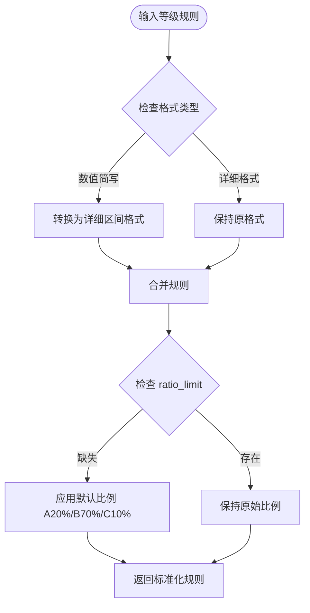

**图表来源**
- [backend/app/services/distribution_enforcer.py:40-63](file://backend/app/services/distribution_enforcer.py#L40-L63)

#### 默认比例限制机制
系统定义了默认的比例限制：
- A等级（优秀）：20%
- B等级（良好）：70%  
- C等级（待改进）：10%
- D等级（不合格）：不设上限

当等级规则中缺少 `ratio_limit` 字段时，自动应用这些默认值。

#### 周期级别控制开关
新增了 `is_distribution_enabled` 字段用于控制是否启用强制分布：
- 默认为 `True`（启用）
- 可在创建或更新周期时设置
- 在评分计算时根据此标志决定是否执行强制分布

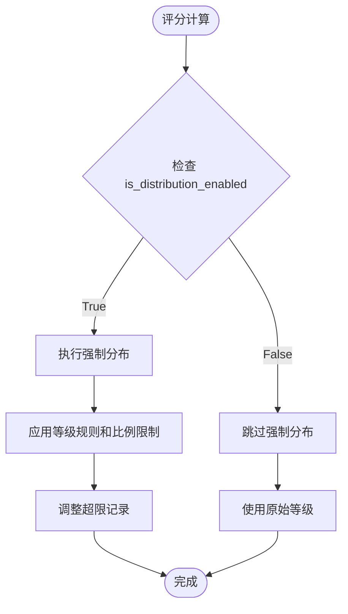

**图表来源**
- [backend/app/models.py:83](file://backend/app/models.py#L83)
- [backend/app/routers/scores.py:277](file://backend/app/routers/scores.py#L277)

#### 小部门豁免逻辑优化
改进了小部门（≤5人）的豁免逻辑：
- A等级和D等级仍限制为最多1人
- B等级和C等级放宽限制，允许更多灵活性
- 避免过于严格的分布对小型团队造成不合理影响

**章节来源**
- [backend/app/services/distribution_enforcer.py:6-165](file://backend/app/services/distribution_enforcer.py#L6-L165)
- [backend/app/models.py:83](file://backend/app/models.py#L83)

### 部门分布统计端点（新增）
**新增** 提供了专门的部门分布统计API，用于审批工作台显示实时分布情况。

#### API端点
- **URL**: `GET /api/v1/approvals/department-distribution`
- **参数**: 
  - `department_id`: 必需，部门ID
  - `cycle_id`: 可选，考核周期ID（不传则取该部门最近周期）
- **权限**: admin, hr, manager, executive

#### 响应结构
```json
{
  "grades": [
    {
      "grade": "A",
      "count": 3,
      "ratio": 30.0,
      "is_over_limit": true
    }
  ],
  "total": 10,
  "cycle_id": 1,
  "cycle_name": "2024 Q1",
  "is_distribution_enabled": true
}
```

#### 功能特性
- 实时统计各部门等级分布
- 自动检测是否超过等级比例限制
- 支持小部门豁免规则
- 自动标准化等级规则
- 返回周期信息和强制分布开关状态

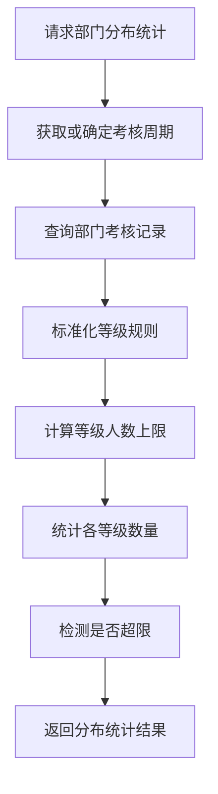

**图表来源**
- [backend/app/routers/approvals.py:853-922](file://backend/app/routers/approvals.py#L853-L922)
- [backend/app/services/distribution_enforcer.py:40-63](file://backend/app/services/distribution_enforcer.py#L40-L63)

**章节来源**
- [backend/app/routers/approvals.py:853-922](file://backend/app/routers/approvals.py#L853-L922)

### 权重配置管理机制
权重配置机制已重构，维度权重和评价人权重现在通过全局config_service统一管理。

#### 全局配置服务
配置服务提供统一的权重配置管理，包括：
- 维度权重配置：业绩(60%)、能力(20%)、态度(20%)
- 评价人权重配置：按维度分别配置自评、上级、协作评分权重
- 内存缓存机制：避免频繁数据库访问
- 默认值管理：当配置不存在时使用预设默认值

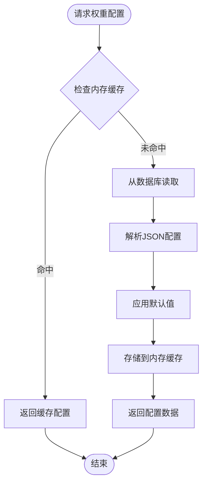

**图表来源**
- [backend/app/services/config_service.py:22-28](file://backend/app/services/config_service.py#L22-L28)
- [backend/app/services/config_service.py:55-81](file://backend/app/services/config_service.py#L55-L81)

#### 权重配置API接口
新增的配置管理API包括：
- GET `/config/dimension-weights`：获取维度权重配置
- PUT `/config/dimension-weights`：更新维度权重配置
- GET `/config/reviewer-weights`：获取评价人权重配置  
- PUT `/config/reviewer-weights`：更新评价人权重配置

**章节来源**
- [backend/app/services/config_service.py:41-100](file://backend/app/services/config_service.py#L41-L100)
- [backend/app/routers/config.py:100-188](file://backend/app/routers/config.py#L100-L188)

### 状态机驱动的工作流
状态机定义了完整的状态集合与转换规则，支持条件转换（如是否启用协作评、是否触发强制分布），并提供额外校验注册机制。

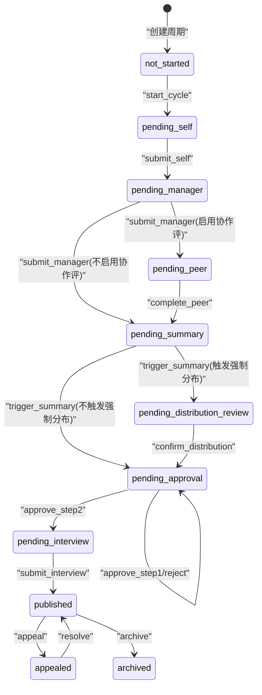

**图表来源**
- [backend/app/utils/workflow_state_machine.py:22-78](file://backend/app/utils/workflow_state_machine.py#L22-L78)

关键要点：
- 状态常量包含中文描述，便于前端展示。
- 转换规则允许函数式目标状态，例如根据配置决定下一步。
- 转换过程会执行额外校验、记录审计日志，失败时抛出业务异常。

**章节来源**
- [backend/app/utils/workflow_state_machine.py:10-207](file://backend/app/utils/workflow_state_machine.py#L10-L207)

### 考核周期生命周期管理
周期生命周期包括创建、编辑、删除、启动、取消、归档、解冻、发布等关键节点。

**更新** 创建周期时，权重配置现在从全局config_service获取默认值，并且新增了 `is_distribution_enabled` 字段用于控制强制分布。**重要修复** 启动周期时确保操作日志和通知的正确持久化。

- 创建周期：校验名称唯一性，规范化等级规则，**从config_service获取维度权重和评价人权重默认值**，**新增 is_distribution_enabled 字段**。
- 启动周期：校验员工有效性，创建周期参与关系与考核记录，KPI 快照，发送通知，状态机推进到"待自评"，**确保操作日志和通知正确持久化**。
- 进度监控：统计总体完成率、阶段状态、各部门完成率、未完成人员名单。
- 发布结果：校验所有记录到达"待发布"，检查面谈要求，批量更新为"已发布"。
- 归档与解冻：归档后锁定周期与记录，异步生成 PDF 归档；仅管理员可解冻。

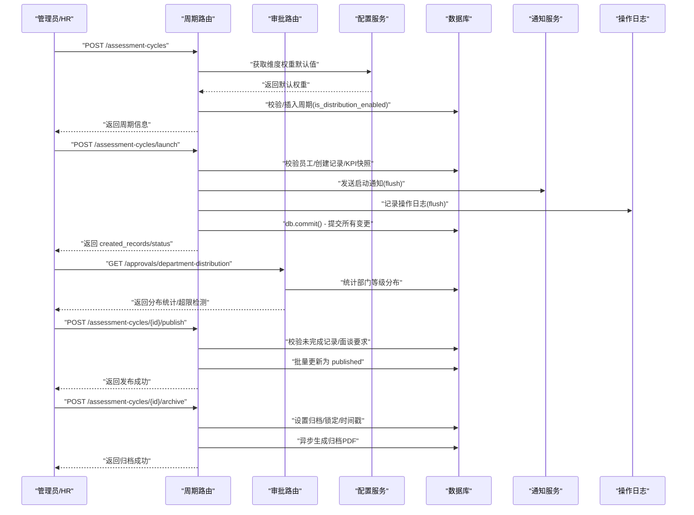

**图表来源**
- [backend/app/routers/cycles.py:159-222](file://backend/app/routers/cycles.py#L159-L222)
- [backend/app/routers/cycles.py:307-382](file://backend/app/routers/cycles.py#L307-L382)
- [backend/app/routers/approvals.py:853-922](file://backend/app/routers/approvals.py#L853-L922)
- [backend/app/routers/cycles.py:928-999](file://backend/app/routers/cycles.py#L928-L999)
- [backend/app/routers/cycles.py:739-794](file://backend/app/routers/cycles.py#L739-L794)

**章节来源**
- [backend/app/routers/cycles.py:159-222](file://backend/app/routers/cycles.py#L159-L222)
- [backend/app/routers/cycles.py:307-382](file://backend/app/routers/cycles.py#L307-L382)
- [backend/app/routers/cycles.py:569-709](file://backend/app/routers/cycles.py#L569-L709)
- [backend/app/routers/cycles.py:928-999](file://backend/app/routers/cycles.py#L928-L999)
- [backend/app/routers/cycles.py:739-794](file://backend/app/routers/cycles.py#L739-L794)

### 考核参与者管理
参与者管理包括：
- 启动周期时批量添加员工，创建 CycleEmployee 与 AssessmentRecord。
- 动态添加/移除参与者。
- 列出周期内参与者及其基本信息（工号、姓名、部门、岗位、状态）。
- 协作评审人分配：为每个员工选择协作评分人，支持添加与移除。


**图表来源**
- [backend/app/routers/cycles.py:307-382](file://backend/app/routers/cycles.py#L307-L382)
- [backend/app/routers/cycles.py:468-510](file://backend/app/routers/cycles.py#L468-L510)
- [backend/app/routers/cycles.py:513-566](file://backend/app/routers/cycles.py#L513-L566)

**章节来源**
- [backend/app/routers/cycles.py:307-382](file://backend/app/routers/cycles.py#L307-L382)
- [backend/app/routers/cycles.py:468-510](file://backend/app/routers/cycles.py#L468-L510)
- [backend/app/routers/cycles.py:513-566](file://backend/app/routers/cycles.py#L513-L566)

### 考核进度实时监控
进度接口提供：
- 总体完成率（已完成/总数）。
- 阶段状态（自评、上级评、协作评、汇总、审批）的完成/进行中/待开始。
- 自评、上级评、协作评完成率。
- 各部门完成率。
- 未完成人员名单（当前阶段、状态）。

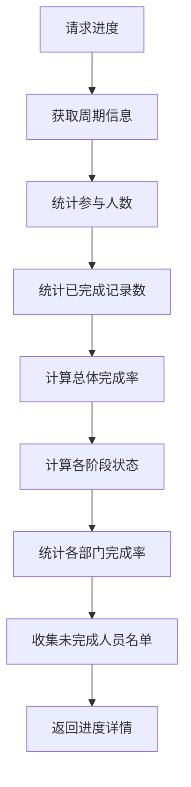

**图表来源**
- [backend/app/routers/cycles.py:569-709](file://backend/app/routers/cycles.py#L569-L709)

**章节来源**
- [backend/app/routers/cycles.py:569-709](file://backend/app/routers/cycles.py#L569-L709)

### 数据模型与关系
周期与记录、员工、部门、岗位、协作评审、申诉、面试、归档等实体之间的关系如下：

**更新** 数据模型中的权重字段现在与config_service保持一致的默认值，新增了 `is_distribution_enabled` 字段。

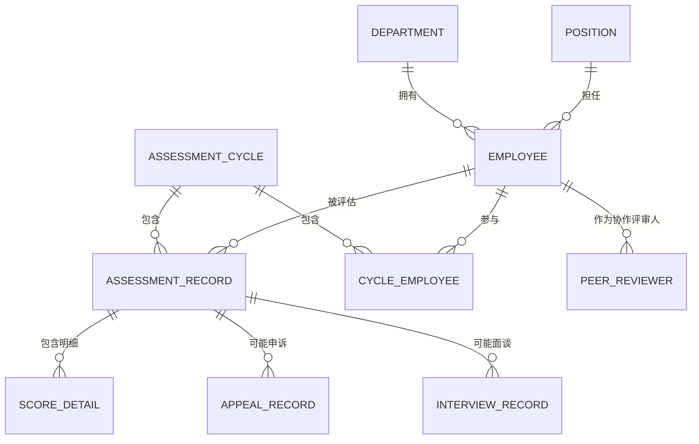

**图表来源**
- [backend/app/models.py:62-174](file://backend/app/models.py#L62-L174)
- [backend/app/models.py:176-266](file://backend/app/models.py#L176-L266)

**章节来源**
- [backend/app/models.py:62-174](file://backend/app/models.py#L62-L174)
- [backend/app/models.py:176-266](file://backend/app/models.py#L176-L266)

## 依赖关系分析
- 路由层依赖：
  - 认证与权限：`get_current_user`、`require_role`。
  - 数据库会话：`get_db`。
  - 全局配置服务：`config_service.get_dimension_weights`、`config_service.get_reviewer_weights`。
  - 状态机：`WorkflowStateMachine.transition`。
  - 通知服务：`create_notification`。
  - 操作日志服务：`log_operation`。
  - PDF 归档：`generate_archive_pdf`。
  - **增强版** 强制分布服务：`enforce_distribution`、`_normalize_grade_rules`。
  - **新增** 部门分布统计：`get_department_distribution`。
- 强制分布服务独立于路由，可被其他服务复用。
- 前端依赖：
  - `api/cycles.js` 封装 HTTP 请求。
  - `CycleList.vue` 聚合周期列表、发起、协作人分配、进度查看。
  - `CycleEdit.vue` 提供周期新增/编辑表单。
  - `ConfigView.vue` 提供权重配置管理界面。

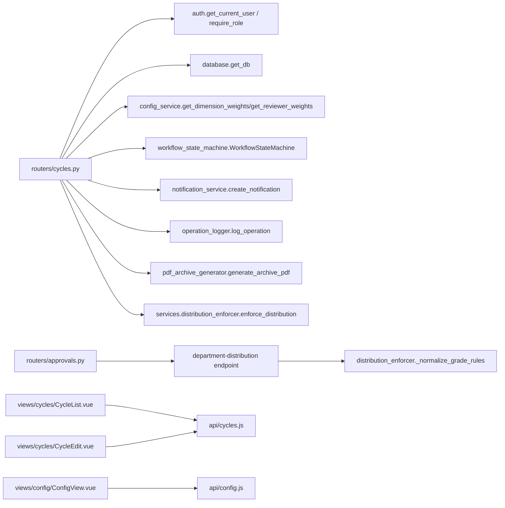

**图表来源**
- [backend/app/routers/cycles.py:1-33](file://backend/app/routers/cycles.py#L1-L33)
- [backend/app/routers/approvals.py:853-922](file://backend/app/routers/approvals.py#L853-L922)
- [backend/app/routers/config.py:100-188](file://backend/app/routers/config.py#L100-L188)
- [frontend/src/views/cycles/CycleList.vue:233-239](file://frontend/src/views/cycles/CycleList.vue#L233-L239)
- [frontend/src/views/cycles/CycleEdit.vue:39-40](file://frontend/src/views/cycles/CycleEdit.vue#L39-L40)
- [frontend/src/views/config/ConfigView.vue:193-221](file://frontend/src/views/config/ConfigView.vue#L193-L221)
- [frontend/src/api/cycles.js:1-38](file://frontend/src/api/cycles.js#L1-L38)

**章节来源**
- [backend/app/routers/cycles.py:1-33](file://backend/app/routers/cycles.py#L1-L33)
- [frontend/src/views/cycles/CycleList.vue:233-239](file://frontend/src/views/cycles/CycleList.vue#L233-L239)
- [frontend/src/views/cycles/CycleEdit.vue:39-40](file://frontend/src/views/cycles/CycleEdit.vue#L39-L40)
- [frontend/src/api/cycles.js:1-38](file://frontend/src/api/cycles.js#L1-L38)

## 性能与扩展性考虑
- 进度统计采用计数与分组聚合，避免全表扫描；分页查询减少响应体积。
- 归档 PDF 生成使用后台任务异步执行，避免阻塞主流程。
- 强制分布算法限制最大迭代次数，防止无限循环。
- 配置服务使用内存缓存，避免频繁的数据库访问。
- **重要修复** 数据库事务优化减少了不必要的数据库往返，提高了批量操作性能。
- **新增** 部门分布统计端点使用高效的数据库查询和Counter聚合。
- 可扩展点：
  - 状态机支持注册额外校验函数，便于扩展业务规则。
  - 强制分布服务可按部门维度扩展更多策略（如加权比例、历史趋势约束）。
  - 进度接口可加入逾期检测与异常告警（当前未完成名单可用于此类扩展）。
  - 配置服务支持动态配置，无需重启服务即可生效。
  - **新增** 部门分布统计可扩展更多维度的分析指标。
  - **重要修复** 事务管理优化为未来更复杂的业务流程奠定了基础。

[本节为通用指导，不直接分析具体文件]

## 故障排查指南
常见问题与定位建议：
- 状态转换失败：
  - 检查当前状态与动作是否合法，参考状态机的允许动作列表。
  - 关注状态机抛出的业务异常信息与允许动作提示。
- 发布失败：
  - 确认周期下所有记录是否到达"待发布"状态。
  - 检查面谈要求是否满足（存在面谈记录或面试记录）。
- 归档失败：
  - 确认周期状态为"已发布"。
  - 检查异步 PDF 生成任务是否成功，单条失败不影响其他记录。
- 进度数据异常：
  - 检查参与人数与记录数是否一致。
  - 核对阶段状态判定逻辑与已完成状态集合。
- 权重配置问题：
  - 检查config_service缓存是否正确加载。
  - 验证维度权重总和是否为100%。
  - 确认评价人权重各维度总和是否为100%。
  - 检查配置API权限是否正确。
- **重要修复** 事务相关问题：
  - 检查操作日志是否正确持久化，确认 `db.commit()` 调用位置。
  - 验证通知记录是否成功创建，检查 `create_notification` 的事务边界。
  - 确认数据库会话的生命周期管理是否正确。
  - 检查是否有未提交的事务导致的数据不一致。
- **新增** 强制分布相关问题：
  - 检查 `is_distribution_enabled` 字段是否正确设置。
  - 验证等级规则格式是否正确，是否需要标准化。
  - 确认默认比例限制是否符合预期（A20%/B70%/C10%）。
  - 检查小部门豁免逻辑是否正常工作。
  - 验证部门分布统计端点返回的数据准确性。

**章节来源**
- [backend/app/utils/workflow_state_machine.py:136-186](file://backend/app/utils/workflow_state_machine.py#L136-L186)
- [backend/app/routers/cycles.py:928-999](file://backend/app/routers/cycles.py#L928-L999)
- [backend/app/routers/cycles.py:739-794](file://backend/app/routers/cycles.py#L739-L794)
- [backend/app/routers/cycles.py:569-709](file://backend/app/routers/cycles.py#L569-L709)
- [backend/app/services/config_service.py:22-38](file://backend/app/services/config_service.py#L22-L38)
- [backend/app/services/distribution_enforcer.py:40-63](file://backend/app/services/distribution_enforcer.py#L40-L63)
- [backend/app/routers/approvals.py:853-922](file://backend/app/routers/approvals.py#L853-L922)
- [backend/app/routers/cycles.py:366-391](file://backend/app/routers/cycles.py#L366-L391)

## 结论
考核周期管理模块以状态机为核心，结合增强版强制分布算法与完善的参与者管理、进度监控、归档发布能力，形成闭环的绩效考核流程。**重要修复** 数据库事务问题的解决确保了操作日志和通知的正确持久化，提升了系统的可靠性和数据一致性。**新增的全局配置服务**进一步提升了系统的灵活性和可维护性，使权重配置更加动态化和集中化。**增强版的强制分布算法**提供了更智能的规则标准化和默认比例限制，**新增的部门分布统计端点**则为管理者提供了实时的分布分析能力。后端路由提供丰富的 API，前端组件覆盖主要用户场景。系统具备良好的扩展性与可维护性，适合在企业环境中落地。

[本节为总结性内容，不直接分析具体文件]

## 附录：API 与前端使用示例

### 后端 API 定义（周期相关）
- 列表与筛选
  - GET `/assessment-cycles`
    - 查询参数：status、type、start_date、end_date、page、size
    - 返回：周期列表或分页对象
- 详情
  - GET `/assessment-cycles/{cycle_id}`
    - 返回：周期详情与考核对象部门列表
- 创建
  - POST `/assessment-cycles`
    - 请求体：名称、类型、起止日期、截止日、权重、等级规则等
    - **更新** 权重字段现在从config_service获取默认值，新增 `is_distribution_enabled` 字段
    - 返回：创建后的周期信息
- 更新
  - PUT `/assessment-cycles/{cycle_id}`
    - 权限：admin/hr
    - 限制：仅"未开始"可修改
- 删除
  - DELETE `/assessment-cycles/{cycle_id}`
    - 权限：admin/hr
    - 限制：仅"未开始"且无考核数据可删除
- 启动
  - POST `/assessment-cycles/launch`
    - 请求体：cycle_id、employee_ids
    - 行为：创建参与者与记录、KPI 快照、通知、状态推进，**确保操作日志和通知正确持久化**
- 进度
  - GET `/assessment-cycles/{cycle_id}/progress`
    - 返回：总体进度、阶段状态、部门完成率、未完成名单
- 发布
  - POST `/assessment-cycles/{cycle_id}/publish`
    - 权限：admin/hr
    - 校验：所有记录到达"待发布"，面谈要求满足
- 归档/解冻
  - POST `/assessment-cycles/{cycle_id}/archive`
  - POST `/assessment-cycles/{cycle_id}/unarchive`
    - 权限：归档 admin/hr；解冻 admin
- 导出
  - GET `/assessment-cycles/{cycle_id}/export-excel`
    - 权限：admin/hr/executive
    - 可选参数：department_id

### 新增：部门分布统计API
- 部门等级分布统计
  - GET `/api/v1/approvals/department-distribution`
    - 权限：admin/hr/manager/executive
    - 参数：
      - `department_id`: 必需，部门ID
      - `cycle_id`: 可选，考核周期ID（不传则取最近周期）
    - 返回：部门等级分布统计，包含超限检测
    - 响应示例：
      ```json
      {
        "grades": [
          {"grade": "A", "count": 3, "ratio": 30.0, "is_over_limit": true},
          {"grade": "B", "count": 6, "ratio": 60.0, "is_over_limit": false},
          {"grade": "C", "count": 1, "ratio": 10.0, "is_over_limit": false}
        ],
        "total": 10,
        "cycle_id": 1,
        "cycle_name": "2024 Q1",
        "is_distribution_enabled": true
      }
      ```

### 新增：系统配置API
- 维度权重配置
  - GET `/config/dimension-weights`
    - 权限：admin
    - 返回：维度权重配置（performance、ability、attitude）
  - PUT `/config/dimension-weights`
    - 权限：admin
    - 请求体：{"performance": 60, "ability": 20, "attitude": 20}
    - 验证：权重总和必须等于100
- 评价人权重配置
  - GET `/config/reviewer-weights`
    - 权限：admin
    - 返回：按维度的评价人权重配置
  - PUT `/config/reviewer-weights`
    - 权限：admin
    - 请求体：{"performance": {"self": 30, "manager": 70, "peer": 0}, ...}
    - 验证：每个维度的权重总和必须等于100

**章节来源**
- [backend/app/routers/cycles.py:49-114](file://backend/app/routers/cycles.py#L49-L114)
- [backend/app/routers/cycles.py:117-156](file://backend/app/routers/cycles.py#L117-L156)
- [backend/app/routers/cycles.py:159-222](file://backend/app/routers/cycles.py#L159-L222)
- [backend/app/routers/cycles.py:225-279](file://backend/app/routers/cycles.py#L225-L279)
- [backend/app/routers/cycles.py:282-304](file://backend/app/routers/cycles.py#L282-L304)
- [backend/app/routers/cycles.py:307-382](file://backend/app/routers/cycles.py#L307-L382)
- [backend/app/routers/cycles.py:569-709](file://backend/app/routers/cycles.py#L569-L709)
- [backend/app/routers/cycles.py:928-999](file://backend/app/routers/cycles.py#L928-L999)
- [backend/app/routers/cycles.py:739-794](file://backend/app/routers/cycles.py#L739-L794)
- [backend/app/routers/cycles.py:801-831](file://backend/app/routers/cycles.py#L801-L831)
- [backend/app/routers/cycles.py:834-925](file://backend/app/routers/cycles.py#L834-L925)
- [backend/app/routers/approvals.py:853-922](file://backend/app/routers/approvals.py#L853-L922)
- [backend/app/routers/config.py:100-188](file://backend/app/routers/config.py#L100-L188)

### 前端组件使用示例
- 周期列表页 `CycleList.vue`
  - 功能：筛选、分页、新增/编辑、发起、协作人分配、进度查看、详情展示。
  - 关键方法：
    - `loadData()`：调用 `listCycles` 获取列表。
    - `openLaunchDialog()` / `submitLaunch()`：发起周期，选择员工。
    - `viewProgress()`：调用 `getCycleProgress` 显示进度。
    - `openPeerDialog()` / `handleAddPeer()` / `handleRemovePeer()`：协作人分配。
- 周期编辑页 `CycleEdit.vue`
  - 功能：新增/编辑周期表单，提交 `createCycle` / `updateCycle`。
- 配置管理页 `ConfigView.vue`
  - 功能：管理维度权重和评价人权重配置
  - 关键特性：
    - 实时显示权重总和验证
    - 支持按维度配置评价人权重
    - 集成到系统配置界面
- API 封装 `api/cycles.js`
  - 提供 `listCycles`、`getCycleDetail`、`createCycle`、`updateCycle`、`deleteCycle`、`launchCycle`、`getCycleProgress`、`publishCycle`、`listCycleEmployees`。

**章节来源**
- [frontend/src/views/cycles/CycleList.vue:1-635](file://frontend/src/views/cycles/CycleList.vue#L1-L635)
- [frontend/src/views/cycles/CycleEdit.vue:1-120](file://frontend/src/views/cycles/CycleEdit.vue#L1-L120)
- [frontend/src/views/config/ConfigView.vue:193-221](file://frontend/src/views/config/ConfigView.vue#L193-L221)
- [frontend/src/api/cycles.js:1-38](file://frontend/src/api/cycles.js#L1-L38)