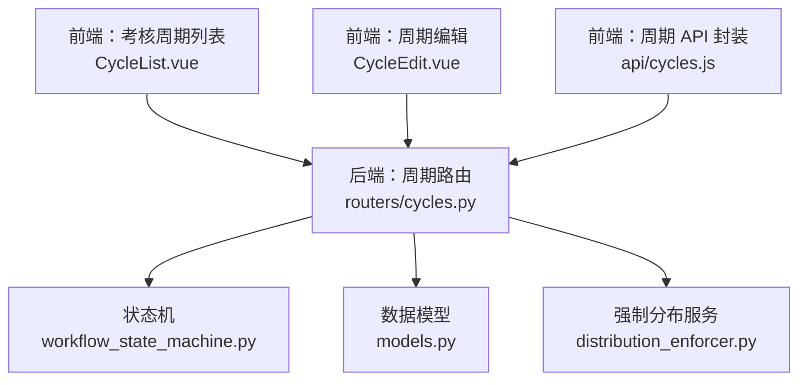
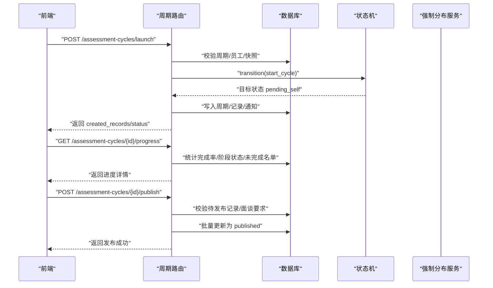
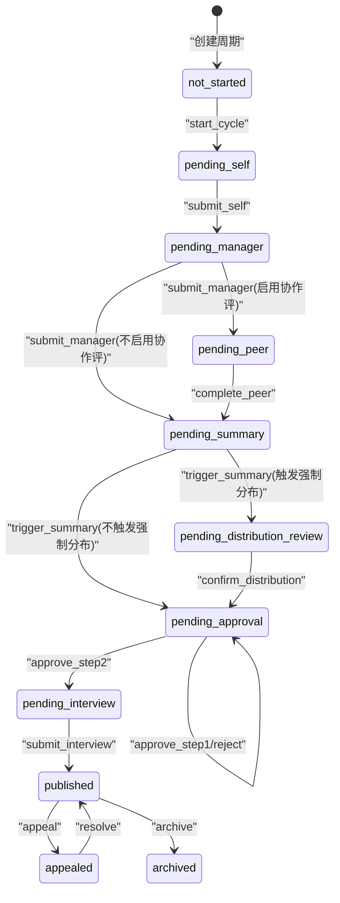
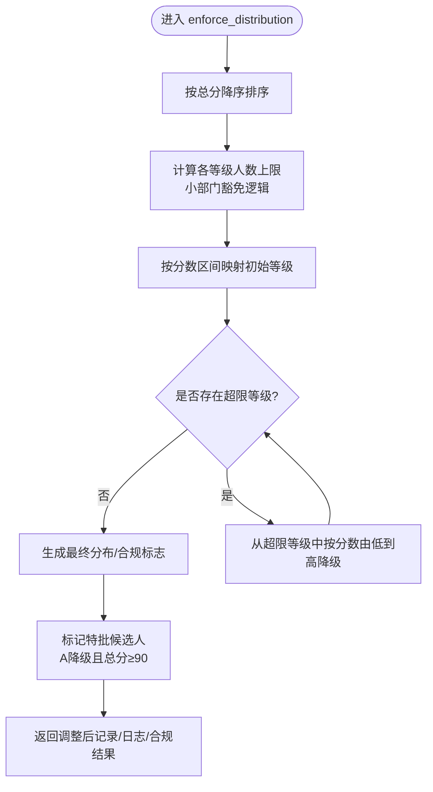
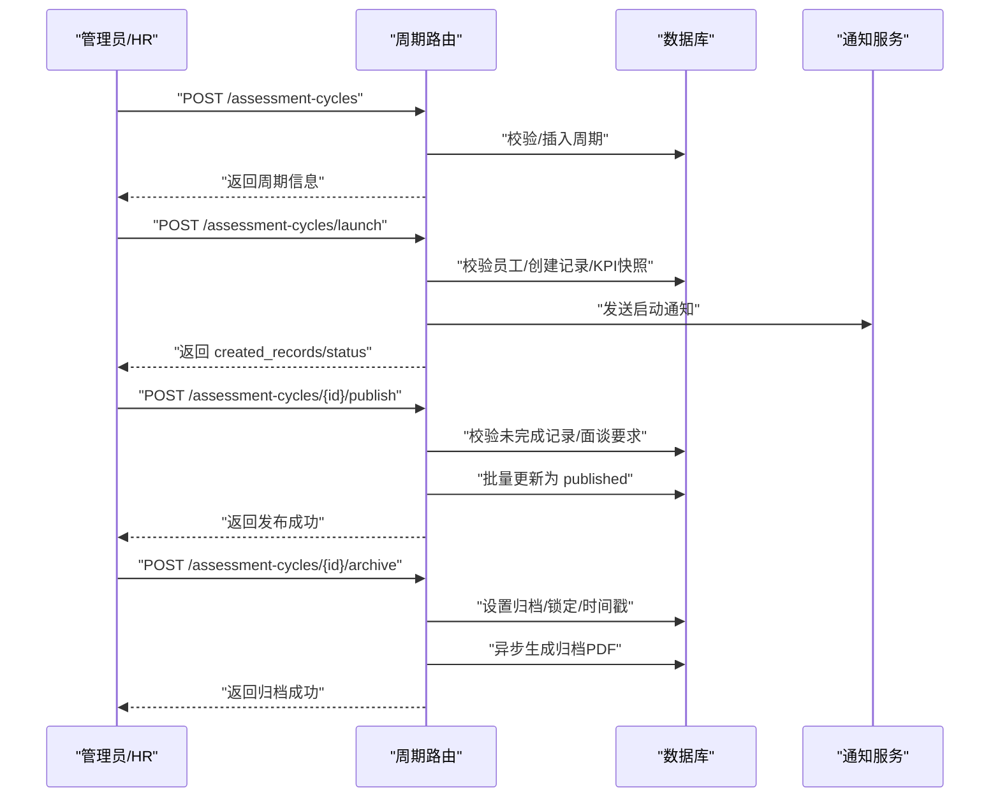
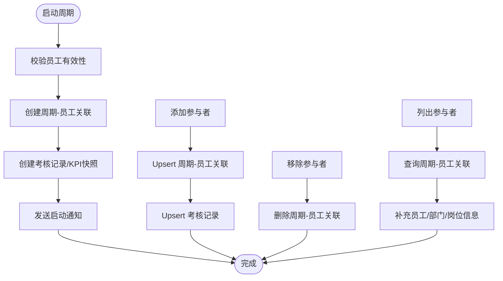
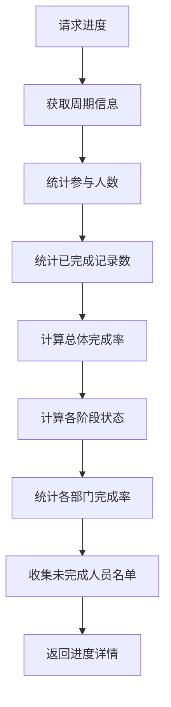
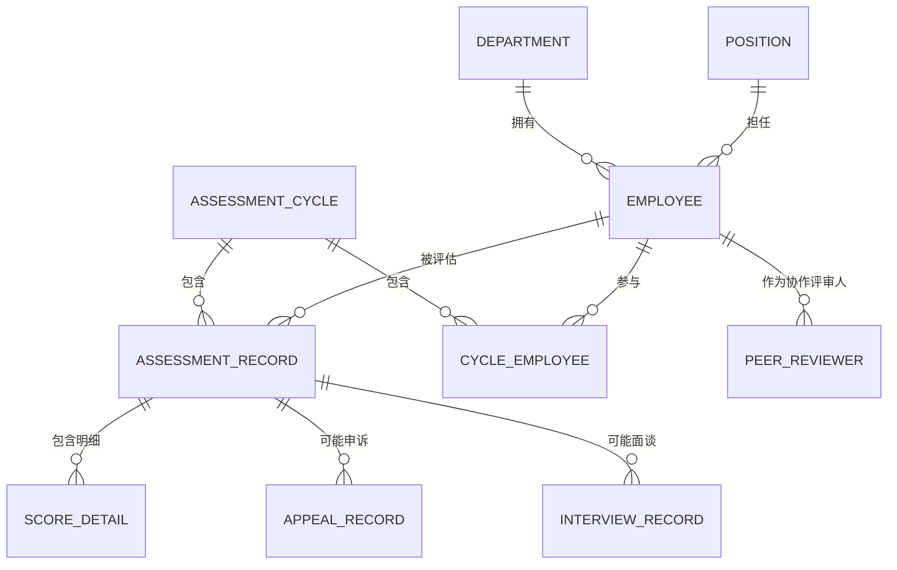
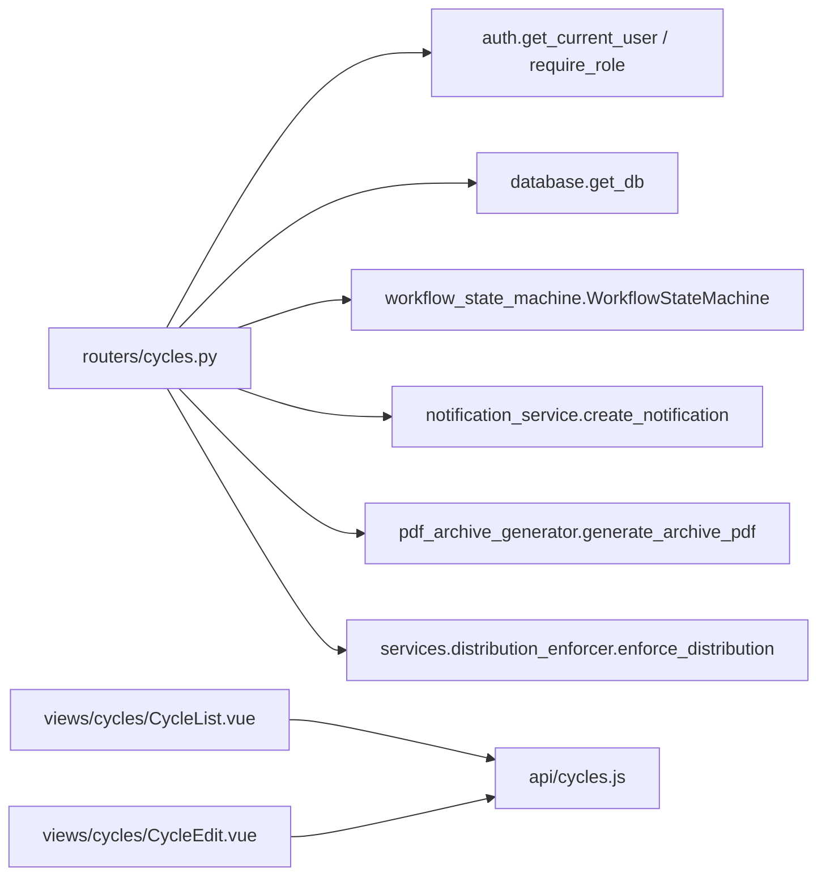

# 考核周期管理

<cite>
**本文引用的文件**   
- [backend/app/routers/cycles.py](file://backend/app/routers/cycles.py)
- [backend/app/services/distribution_enforcer.py](file://backend/app/services/distribution_enforcer.py)
- [backend/app/utils/workflow_state_machine.py](file://backend/app/utils/workflow_state_machine.py)
- [backend/app/models.py](file://backend/app/models.py)
- [frontend/src/views/cycles/CycleList.vue](file://frontend/src/views/cycles/CycleList.vue)
- [frontend/src/views/cycles/CycleEdit.vue](file://frontend/src/views/cycles/CycleEdit.vue)
- [frontend/src/api/cycles.js](file://frontend/src/api/cycles.js)
</cite>

## 目录
1. [引言](#引言)
2. [项目结构定位](#项目结构定位)
3. [核心组件总览](#核心组件总览)
4. [架构总览](#架构总览)
5. [详细组件分析](#详细组件分析)
6. [依赖关系分析](#依赖关系分析)
7. [性能与扩展性考虑](#性能与扩展性考虑)
8. [故障排查指南](#故障排查指南)
9. [结论](#结论)
10. [附录：API 与前端使用示例](#附录api-与前端使用示例)

## 引言
本文件围绕“考核周期管理”模块，系统性说明其完整生命周期、状态机驱动工作流、强制分布算法、参与者管理、进度监控、归档发布能力，以及后端 API 与前端组件的使用方式。文档面向具备不同技术背景的读者，既提供高层架构图，也给出代码级实现路径和可追溯来源。

## 项目结构定位
考核周期管理在系统中属于“流程编排 + 数据治理”的核心模块：
- 后端路由负责周期 CRUD、启动、参与者增删、进度统计、发布、归档、解冻、导出等能力。
- 状态机统一约束周期及记录的状态流转。
- 强制分布服务负责按部门维度控制等级分布。
- 前端通过列表、编辑、发起、协作人分配、进度查看等页面完成交互。

**图表来源**
- [backend/app/routers/cycles.py:1-33](file://backend/app/routers/cycles.py#L1-L33)
- [backend/app/utils/workflow_state_machine.py:10-78](file://backend/app/utils/workflow_state_machine.py#L10-L78)
- [backend/app/services/distribution_enforcer.py:30-128](file://backend/app/services/distribution_enforcer.py#L30-L128)
- [backend/app/models.py:62-174](file://backend/app/models.py#L62-L174)
- [frontend/src/views/cycles/CycleList.vue:1-239](file://frontend/src/views/cycles/CycleList.vue#L1-L239)
- [frontend/src/views/cycles/CycleEdit.vue:1-40](file://frontend/src/views/cycles/CycleEdit.vue#L1-L40)
- [frontend/src/api/cycles.js:1-38](file://frontend/src/api/cycles.js#L1-L38)

**章节来源**
- [backend/app/routers/cycles.py:1-33](file://backend/app/routers/cycles.py#L1-L33)
- [backend/app/models.py:62-174](file://backend/app/models.py#L62-L174)
- [frontend/src/views/cycles/CycleList.vue:1-239](file://frontend/src/views/cycles/CycleList.vue#L1-L239)
- [frontend/src/views/cycles/CycleEdit.vue:1-40](file://frontend/src/views/cycles/CycleEdit.vue#L1-L40)
- [frontend/src/api/cycles.js:1-38](file://frontend/src/api/cycles.js#L1-L38)

## 核心组件总览
- 周期路由层：提供周期创建、查询、更新、删除、启动、取消、归档、解冻、发布、进度、导出等接口。
- 状态机：定义从“未开始 → 自评 → 上级评 → 协作评 → 汇总 → 审批 → 面谈 → 已发布 → 已归档”的完整转换规则，并支持申诉分支。
- 强制分布服务：按部门人数与等级比例上限进行自动降级调整，支持小部门豁免与特批候选人标记。
- 数据模型：周期、员工、记录、协作评审、申诉、面试、归档等实体支撑全链路数据。
- 前端界面：周期列表、新增/编辑、发起参与人员、协作人分配、进度查看、详情展示。

**章节来源**
- [backend/app/routers/cycles.py:49-114](file://backend/app/routers/cycles.py#L49-L114)
- [backend/app/utils/workflow_state_machine.py:22-78](file://backend/app/utils/workflow_state_machine.py#L22-L78)
- [backend/app/services/distribution_enforcer.py:30-128](file://backend/app/services/distribution_enforcer.py#L30-L128)
- [backend/app/models.py:62-174](file://backend/app/models.py#L62-L174)
- [frontend/src/views/cycles/CycleList.vue:1-239](file://frontend/src/views/cycles/CycleList.vue#L1-L239)

## 架构总览
考核周期管理的整体调用链如下：
- 前端通过 `api/cycles.js` 调用后端 `/assessment-cycles` 系列接口。
- 后端路由校验权限、参数，操作数据库模型，必要时调用状态机和强制分布服务。
- 状态机负责校验动作合法性、计算目标状态、记录审计日志。
- 强制分布服务根据部门规模与等级规则输出调整结果与建议。

**图表来源**
- [backend/app/routers/cycles.py:307-382](file://backend/app/routers/cycles.py#L307-L382)
- [backend/app/routers/cycles.py:569-709](file://backend/app/routers/cycles.py#L569-L709)
- [backend/app/routers/cycles.py:928-999](file://backend/app/routers/cycles.py#L928-L999)
- [backend/app/utils/workflow_state_machine.py:106-186](file://backend/app/utils/workflow_state_machine.py#L106-L186)

## 详细组件分析

### 状态机驱动的工作流
状态机定义了完整的状态集合与转换规则，支持条件转换（如是否启用协作评、是否触发强制分布），并提供额外校验注册机制。

**图表来源**
- [backend/app/utils/workflow_state_machine.py:22-78](file://backend/app/utils/workflow_state_machine.py#L22-L78)

关键要点：
- 状态常量包含中文描述，便于前端展示。
- 转换规则允许函数式目标状态，例如根据配置决定下一步。
- 转换过程会执行额外校验、记录审计日志，失败时抛出业务异常。

**章节来源**
- [backend/app/utils/workflow_state_machine.py:10-207](file://backend/app/utils/workflow_state_machine.py#L10-L207)

### 强制分布算法
强制分布服务按部门维度对等级分布进行校验与自动调整：
- 按总分从高到低排序。
- 根据部门人数与等级比例上限计算各等级人数上限；小部门豁免时仅限制 A/D 各不超过 1 人。
- 首次基于分数区间映射等级。
- 循环处理超限等级，将低分者依次降级，直到合规或达到最大迭代次数。
- 标记特批候选人：被从 A 降级且总分仍 ≥ 90 的记录。

**图表来源**
- [backend/app/services/distribution_enforcer.py:6-128](file://backend/app/services/distribution_enforcer.py#L6-L128)

实现细节：
- `_small_dept_caps` 针对 ≤5 人的部门放宽 B/C 上限。
- `_map_grade` 依据 grade_rules 的 min/max 区间映射等级。
- 调整日志包含员工 ID、总分、原等级、新等级、原因，便于审计。

**章节来源**
- [backend/app/services/distribution_enforcer.py:6-128](file://backend/app/services/distribution_enforcer.py#L6-L128)

### 考核周期生命周期管理
周期生命周期包括创建、编辑、删除、启动、取消、归档、解冻、发布等关键节点。

- 创建周期：校验名称唯一性，规范化等级规则，默认权重与开关字段。
- 启动周期：校验员工有效性，创建周期参与关系与考核记录，KPI 快照，发送通知，状态机推进到“待自评”。
- 进度监控：统计总体完成率、阶段状态、各部门完成率、未完成人员名单。
- 发布结果：校验所有记录到达“待发布”，检查面谈要求，批量更新为“已发布”。
- 归档与解冻：归档后锁定周期与记录，异步生成 PDF 归档；仅管理员可解冻。

**图表来源**
- [backend/app/routers/cycles.py:159-222](file://backend/app/routers/cycles.py#L159-L222)
- [backend/app/routers/cycles.py:307-382](file://backend/app/routers/cycles.py#L307-L382)
- [backend/app/routers/cycles.py:928-999](file://backend/app/routers/cycles.py#L928-L999)
- [backend/app/routers/cycles.py:739-794](file://backend/app/routers/cycles.py#L739-L794)

**章节来源**
- [backend/app/routers/cycles.py:159-222](file://backend/app/routers/cycles.py#L159-L222)
- [backend/app/routers/cycles.py:307-382](file://backend/app/routers/cycles.py#L307-L382)
- [backend/app/routers/cycles.py:569-709](file://backend/app/routers/cycles.py#L569-L709)
- [backend/app/routers/cycles.py:928-999](file://backend/app/routers/cycles.py#L928-L999)
- [backend/app/routers/cycles.py:739-794](file://backend/app/routers/cycles.py#L739-L794)

### 考核参与者管理
参与者管理包括：
- 启动周期时批量添加员工，创建 CycleEmployee 与 AssessmentRecord。
- 动态添加/移除参与者。
- 列出周期内参与者及其基本信息（工号、姓名、部门、岗位、状态）。
- 协作评审人分配：为每个员工选择协作评分人，支持添加与移除。

**图表来源**
- [backend/app/routers/cycles.py:307-382](file://backend/app/routers/cycles.py#L307-L382)
- [backend/app/routers/cycles.py:468-510](file://backend/app/routers/cycles.py#L468-L510)
- [backend/app/routers/cycles.py:513-566](file://backend/app/routers/cycles.py#L513-L566)

**章节来源**
- [backend/app/routers/cycles.py:307-382](file://backend/app/routers/cycles.py#L307-L382)
- [backend/app/routers/cycles.py:468-510](file://backend/app/routers/cycles.py#L468-L510)
- [backend/app/routers/cycles.py:513-566](file://backend/app/routers/cycles.py#L513-L566)

### 考核进度实时监控
进度接口提供：
- 总体完成率（已完成/总数）。
- 阶段状态（自评、上级评、协作评、汇总、审批）的完成/进行中/待开始。
- 自评、上级评、协作评完成率。
- 各部门完成率。
- 未完成人员名单（当前阶段、状态）。

**图表来源**
- [backend/app/routers/cycles.py:569-709](file://backend/app/routers/cycles.py#L569-L709)

**章节来源**
- [backend/app/routers/cycles.py:569-709](file://backend/app/routers/cycles.py#L569-L709)

### 数据模型与关系
周期与记录、员工、部门、岗位、协作评审、申诉、面试、归档等实体之间的关系如下：

> 本图为局部关系片段，完整实体关系与约束以 [ER图设计.md](../系统架构/数据库架构设计/ER图设计.md) 为唯一权威来源。

**图表来源**
- [backend/app/models.py:62-174](file://backend/app/models.py#L62-L174)
- [backend/app/models.py:176-266](file://backend/app/models.py#L176-L266)

**章节来源**
- [backend/app/models.py:62-174](file://backend/app/models.py#L62-L174)
- [backend/app/models.py:176-266](file://backend/app/models.py#L176-L266)

## 依赖关系分析
- 路由层依赖：
  - 认证与权限：`get_current_user`、`require_role`。
  - 数据库会话：`get_db`。
  - 状态机：`WorkflowStateMachine.transition`。
  - 通知服务：`create_notification`。
  - PDF 归档：`generate_archive_pdf`。
- 强制分布服务独立于路由，可被其他服务复用。
- 前端依赖：
  - `api/cycles.js` 封装 HTTP 请求。
  - `CycleList.vue` 聚合周期列表、发起、协作人分配、进度查看。
  - `CycleEdit.vue` 提供周期新增/编辑表单。

**图表来源**
- [backend/app/routers/cycles.py:1-33](file://backend/app/routers/cycles.py#L1-L33)
- [frontend/src/views/cycles/CycleList.vue:233-239](file://frontend/src/views/cycles/CycleList.vue#L233-L239)
- [frontend/src/views/cycles/CycleEdit.vue:39-40](file://frontend/src/views/cycles/CycleEdit.vue#L39-L40)
- [frontend/src/api/cycles.js:1-38](file://frontend/src/api/cycles.js#L1-L38)

**章节来源**
- [backend/app/routers/cycles.py:1-33](file://backend/app/routers/cycles.py#L1-L33)
- [frontend/src/views/cycles/CycleList.vue:233-239](file://frontend/src/views/cycles/CycleList.vue#L233-L239)
- [frontend/src/views/cycles/CycleEdit.vue:39-40](file://frontend/src/views/cycles/CycleEdit.vue#L39-L40)
- [frontend/src/api/cycles.js:1-38](file://frontend/src/api/cycles.js#L1-L38)

## 性能与扩展性考虑
- 进度统计采用计数与分组聚合，避免全表扫描；分页查询减少响应体积。
- 归档 PDF 生成使用后台任务异步执行，避免阻塞主流程。
- 强制分布算法限制最大迭代次数，防止无限循环。
- 可扩展点：
  - 状态机支持注册额外校验函数，便于扩展业务规则。
  - 强制分布服务可按部门维度扩展更多策略（如加权比例、历史趋势约束）。
  - 进度接口可加入逾期检测与异常告警（当前未完成名单可用于此类扩展）。

[本节为通用指导，不直接分析具体文件]

## 故障排查指南
常见问题与定位建议：
- 状态转换失败：
  - 检查当前状态与动作是否合法，参考状态机的允许动作列表。
  - 关注状态机抛出的业务异常信息与允许动作提示。
- 发布失败：
  - 确认周期下所有记录是否到达“待发布”状态。
  - 检查面谈要求是否满足（存在面谈记录或面试记录）。
- 归档失败：
  - 确认周期状态为“已发布”。
  - 检查异步 PDF 生成任务是否成功，单条失败不影响其他记录。
- 进度数据异常：
  - 检查参与人数与记录数是否一致。
  - 核对阶段状态判定逻辑与已完成状态集合。

**章节来源**
- [backend/app/utils/workflow_state_machine.py:136-186](file://backend/app/utils/workflow_state_machine.py#L136-L186)
- [backend/app/routers/cycles.py:928-999](file://backend/app/routers/cycles.py#L928-L999)
- [backend/app/routers/cycles.py:739-794](file://backend/app/routers/cycles.py#L739-L794)
- [backend/app/routers/cycles.py:569-709](file://backend/app/routers/cycles.py#L569-L709)

## 结论
考核周期管理模块以状态机为核心，结合强制分布算法与完善的参与者管理、进度监控、归档发布能力，形成闭环的绩效考核流程。后端路由提供丰富的 API，前端组件覆盖主要用户场景。系统具备良好的扩展性与可维护性，适合在企业环境中落地。

[本节为总结性内容，不直接分析具体文件]

## 附录：API 与前端使用示例

### 后端 API 定义（周期相关）
- 列表与筛选
  - GET `/assessment-cycles`
    - 查询参数：status、type、start_date、end_date、page、size
    - 返回：周期列表或分页对象
- 详情
  - GET `/assessment-cycles/{cycle_id}`
    - 返回：周期详情与考核对象部门列表
- 创建
  - POST `/assessment-cycles`
    - 请求体：名称、类型、起止日期、截止日、权重、等级规则等
    - 返回：创建后的周期信息
- 更新
  - PUT `/assessment-cycles/{cycle_id}`
    - 权限：admin/hr
    - 限制：仅“未开始”可修改
- 删除
  - DELETE `/assessment-cycles/{cycle_id}`
    - 权限：admin/hr
    - 限制：仅“未开始”且无考核数据可删除
- 启动
  - POST `/assessment-cycles/launch`
    - 请求体：cycle_id、employee_ids
    - 行为：创建参与者与记录、KPI 快照、通知、状态推进
- 进度
  - GET `/assessment-cycles/{cycle_id}/progress`
    - 返回：总体进度、阶段状态、部门完成率、未完成名单
- 发布
  - POST `/assessment-cycles/{cycle_id}/publish`
    - 权限：admin/hr
    - 校验：所有记录到达“待发布”，面谈要求满足
- 归档/解冻
  - POST `/assessment-cycles/{cycle_id}/archive`
  - POST `/assessment-cycles/{cycle_id}/unarchive`
    - 权限：归档 admin/hr；解冻 admin
- 导出
  - GET `/assessment-cycles/{cycle_id}/export-excel`
    - 权限：admin/hr/executive
    - 可选参数：department_id

**章节来源**
- [backend/app/routers/cycles.py:49-114](file://backend/app/routers/cycles.py#L49-L114)
- [backend/app/routers/cycles.py:117-156](file://backend/app/routers/cycles.py#L117-L156)
- [backend/app/routers/cycles.py:159-222](file://backend/app/routers/cycles.py#L159-L222)
- [backend/app/routers/cycles.py:225-279](file://backend/app/routers/cycles.py#L225-L279)
- [backend/app/routers/cycles.py:282-304](file://backend/app/routers/cycles.py#L282-L304)
- [backend/app/routers/cycles.py:307-382](file://backend/app/routers/cycles.py#L307-L382)
- [backend/app/routers/cycles.py:569-709](file://backend/app/routers/cycles.py#L569-L709)
- [backend/app/routers/cycles.py:928-999](file://backend/app/routers/cycles.py#L928-L999)
- [backend/app/routers/cycles.py:739-794](file://backend/app/routers/cycles.py#L739-L794)
- [backend/app/routers/cycles.py:801-831](file://backend/app/routers/cycles.py#L801-L831)
- [backend/app/routers/cycles.py:834-925](file://backend/app/routers/cycles.py#L834-L925)

### 前端组件使用示例
- 周期列表页 `CycleList.vue`
  - 功能：筛选、分页、新增/编辑、发起、协作人分配、进度查看、详情展示。
  - 关键方法：
    - `loadData()`：调用 `listCycles` 获取列表。
    - `openLaunchDialog()` / `submitLaunch()`：发起周期，选择员工。
    - `viewProgress()`：调用 `getCycleProgress` 显示进度。
    - `openPeerDialog()` / `handleAddPeer()` / `handleRemovePeer()`：协作人分配。
- 周期编辑页 `CycleEdit.vue`
  - 功能：新增/编辑周期表单，提交 `createCycle` / `updateCycle`。
- API 封装 `api/cycles.js`
  - 提供 `listCycles`、`getCycleDetail`、`createCycle`、`updateCycle`、`deleteCycle`、`launchCycle`、`getCycleProgress`、`publishCycle`、`listCycleEmployees`。

**章节来源**
- [frontend/src/views/cycles/CycleList.vue:1-635](file://frontend/src/views/cycles/CycleList.vue#L1-L635)
- [frontend/src/views/cycles/CycleEdit.vue:1-120](file://frontend/src/views/cycles/CycleEdit.vue#L1-L120)
- [frontend/src/api/cycles.js:1-38](file://frontend/src/api/cycles.js#L1-L38)