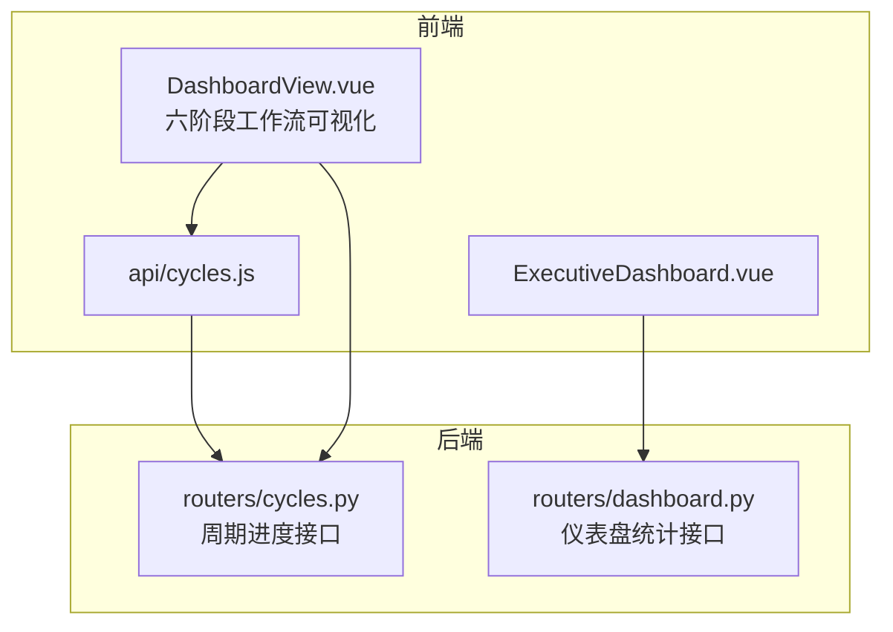
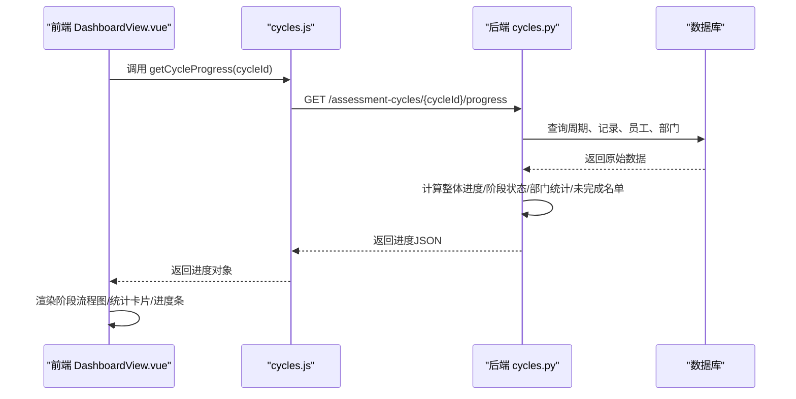
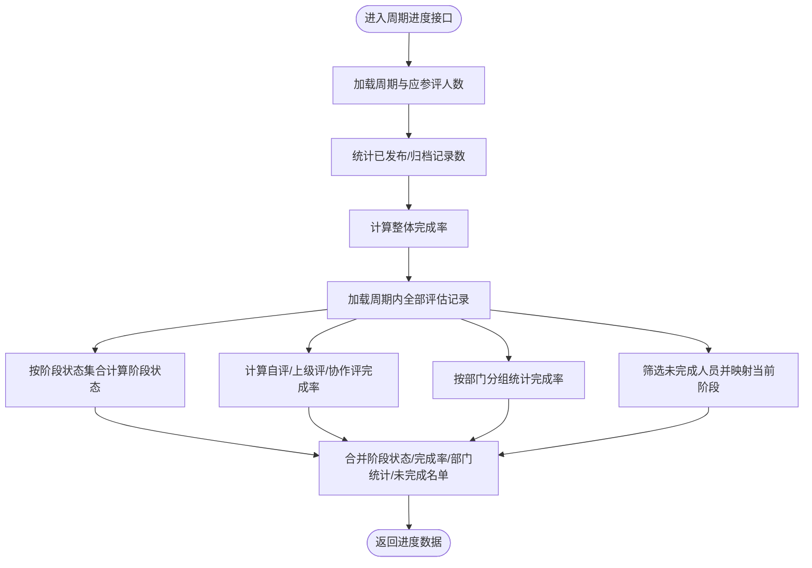
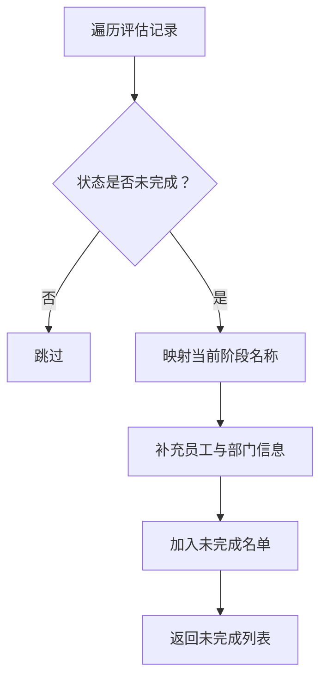
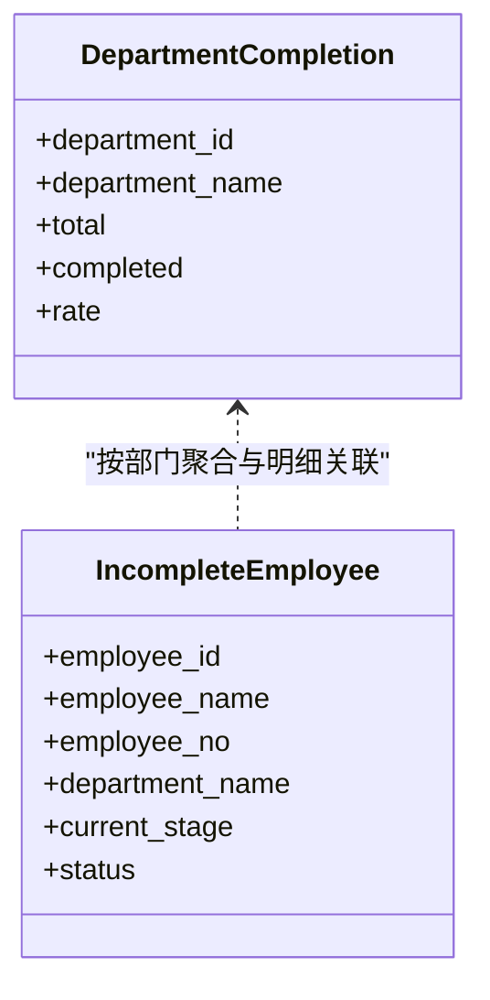
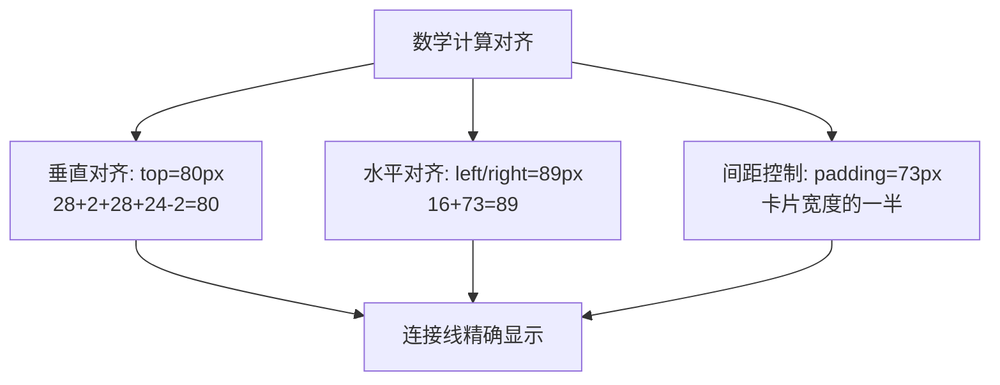
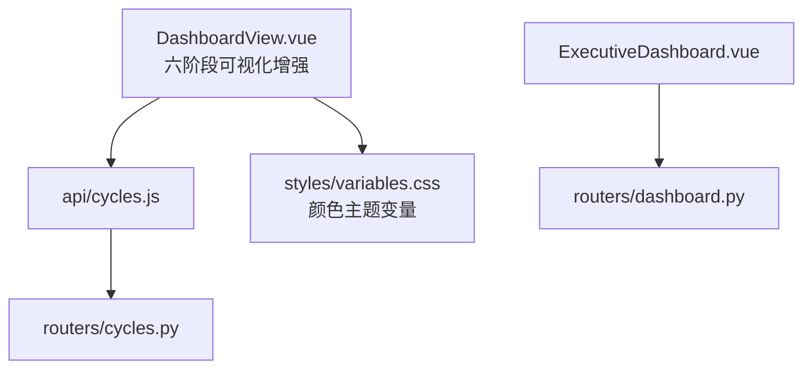

# 进度监控与统计

<cite>
**本文引用的文件**   
- [backend/app/routers/cycles.py](file://backend/app/routers/cycles.py)
- [backend/app/routers/dashboard.py](file://backend/app/routers/dashboard.py)
- [frontend/src/views/dashboard/DashboardView.vue](file://frontend/src/views/dashboard/DashboardView.vue)
- [frontend/src/api/cycles.js](file://frontend/src/api/cycles.js)
- [frontend/src/views/dashboard/ExecutiveDashboard.vue](file://frontend/src/views/dashboard/ExecutiveDashboard.vue)
- [frontend/src/styles/variables.css](file://frontend/src/styles/variables.css)
</cite>

## 更新摘要
**变更内容**   
- 增强了仪表盘六阶段工作流可视化的连接线精确对齐算法
- 改进了不同阶段的视觉状态设计和动画效果
- 添加了可访问性支持（减少动效设置）
- 优化了流程前沿的渐变动画和交互体验

## 目录
1. [引言](#引言)
2. [项目结构](#项目结构)
3. [核心组件](#核心组件)
4. [架构总览](#架构总览)
5. [详细组件分析](#详细组件分析)
6. [依赖关系分析](#依赖关系分析)
7. [性能考虑](#性能考虑)
8. [故障排查指南](#故障排查指南)
9. [结论](#结论)
10. [附录：接口定义与前端绑定说明](#附录接口定义与前端绑定说明)

## 引言
本文件聚焦"进度监控与统计"能力，围绕考核周期内整体完成率、各阶段完成率、部门维度统计、未完成人员识别、逾期提醒与异常检测等关键指标进行系统化说明。文档同时给出后端计算逻辑、数据聚合算法、API 接口规范以及前端可视化组件的数据绑定方式，帮助读者从业务到实现全面理解进度监控体系。

**更新** 本次更新重点增强了仪表盘六阶段工作流可视化功能，包括连接线的精确数学计算对齐、不同阶段的视觉状态设计、动画效果和可访问性改进。

## 项目结构
与进度监控相关的前后端代码主要分布在以下位置：
- 后端：周期进度计算与部门维度统计在路由层直接实现；仪表盘统计用于高管视图与角色化概览。
- 前端：仪表盘页面负责展示流程阶段、统计卡片、最近周期及进度条；高管仪表盘提供部门平均分对比、绩效分布与趋势图。



**图表来源**
- [frontend/src/views/dashboard/DashboardView.vue:18-67](file://frontend/src/views/dashboard/DashboardView.vue#L18-L67)
- [frontend/src/api/cycles.js:27-29](file://frontend/src/api/cycles.js#L27-L29)
- [backend/app/routers/cycles.py:569-709](file://backend/app/routers/cycles.py#L569-L709)
- [backend/app/routers/dashboard.py:256-402](file://backend/app/routers/dashboard.py#L256-L402)

**章节来源**
- [backend/app/routers/cycles.py:569-709](file://backend/app/routers/cycles.py#L569-L709)
- [backend/app/routers/dashboard.py:256-402](file://backend/app/routers/dashboard.py#L256-L402)
- [frontend/src/views/dashboard/DashboardView.vue:18-67](file://frontend/src/views/dashboard/DashboardView.vue#L18-L67)
- [frontend/src/api/cycles.js:27-29](file://frontend/src/api/cycles.js#L27-L29)

## 核心组件
- 周期进度接口：返回整体进度、阶段状态、自评/上级评/协作评完成率、部门完成率、未完成人员名单。
- 仪表盘统计接口：按角色（管理员、HR、经理、协作人、普通员工、高管）返回待办数量、覆盖率、平均分、等级分布等。
- 前端仪表盘：展示六阶段流程图、统计卡片、最近周期进度条、快捷操作。**更新** 六阶段流程图现在具备精确的连接线对齐、动态视觉效果和可访问性支持。
- 高管仪表盘：展示绩效分布饼图、部门平均分柱状图、季度趋势折线图、强制调整人员列表。

**章节来源**
- [backend/app/routers/cycles.py:569-709](file://backend/app/routers/cycles.py#L569-L709)
- [backend/app/routers/dashboard.py:256-402](file://backend/app/routers/dashboard.py#L256-L402)
- [frontend/src/views/dashboard/DashboardView.vue:18-67](file://frontend/src/views/dashboard/DashboardView.vue#L18-L67)
- [frontend/src/views/dashboard/ExecutiveDashboard.vue:1-135](file://frontend/src/views/dashboard/ExecutiveDashboard.vue#L1-L135)

## 架构总览
下图展示了从前端到后端的请求链路，以及进度数据的生成与消费路径。



**图表来源**
- [frontend/src/views/dashboard/DashboardView.vue:511-549](file://frontend/src/views/dashboard/DashboardView.vue#L511-L549)
- [frontend/src/api/cycles.js:27-29](file://frontend/src/api/cycles.js#L27-L29)
- [backend/app/routers/cycles.py:569-709](file://backend/app/routers/cycles.py#L569-L709)

## 详细组件分析

### 周期进度计算与聚合算法
- 整体完成率：基于已发布或归档的记录数占周期内应参评人数的比例计算。
- 阶段状态判定：对每个阶段定义"已完成状态集合"和"进行中状态集合"，根据当前周期所有记录的计数结果判断阶段为"未开始/进行中/已完成"。
- 分阶段完成率：分别以自评、上级评、协作评的"已完成状态集合"占比计算；当协作评分关闭时，协作评完成率固定为 100%。
- 部门维度统计：按部门分组统计应参与人数与自评完成人数，并计算部门完成率。
- 未完成人员识别：筛选处于自评、上级评、协作评、汇总、审批、待发布状态的记录，映射当前阶段名称并输出员工与部门信息。



**图表来源**
- [backend/app/routers/cycles.py:569-709](file://backend/app/routers/cycles.py#L569-L709)

**章节来源**
- [backend/app/routers/cycles.py:580-584](file://backend/app/routers/cycles.py#L580-L584)
- [backend/app/routers/cycles.py:590-636](file://backend/app/routers/cycles.py#L590-L636)
- [backend/app/routers/cycles.py:638-650](file://backend/app/routers/cycles.py#L638-L650)
- [backend/app/routers/cycles.py:652-671](file://backend/app/routers/cycles.py#L652-L671)
- [backend/app/routers/cycles.py:673-694](file://backend/app/routers/cycles.py#L673-L694)

### 未完成人员识别机制
- 当前阶段判断：依据记录状态映射至"自评/上级评/协作评/汇总/审批/待发布"。
- 逾期提醒：当前实现通过未完成名单暴露当前阶段；若需逾期提醒，可在前端结合周期截止日期与当前时间进行提示（例如将"待发布"视为即将发布的节点）。
- 异常检测：可结合部门完成率与个人状态进行异常标记，如某部门完成率显著低于其他部门，或在同一阶段滞留过久。



**图表来源**
- [backend/app/routers/cycles.py:673-694](file://backend/app/routers/cycles.py#L673-L694)

**章节来源**
- [backend/app/routers/cycles.py:673-694](file://backend/app/routers/cycles.py#L673-L694)

### 部门维度进度分析
- 完成率对比：后端按部门统计自评完成率，前端可据此排序或高亮低完成率部门。
- 瓶颈识别：结合未完成名单中的部门分布，定位滞留环节（如协作评或审批）。
- 资源调配建议：对低完成率部门优先推送提醒、安排辅导或临时增派协作评分人员。



**图表来源**
- [backend/app/routers/cycles.py:652-671](file://backend/app/routers/cycles.py#L652-L671)
- [backend/app/routers/cycles.py:673-694](file://backend/app/routers/cycles.py#L673-L694)

**章节来源**
- [backend/app/routers/cycles.py:652-671](file://backend/app/routers/cycles.py#L652-L671)
- [backend/app/routers/cycles.py:673-694](file://backend/app/routers/cycles.py#L673-L694)

### 仪表盘统计与高管视图
- 角色化统计：管理员、HR、经理、协作人、普通员工、高管各自看到不同的待办与统计项。
- 高管视图：包含覆盖率、公司平均分、等级分布、部门平均分对比、近四期趋势、强制调整人员列表。


**图表来源**
- [backend/app/routers/dashboard.py:256-402](file://backend/app/routers/dashboard.py#L256-L402)
- [frontend/src/views/dashboard/ExecutiveDashboard.vue:177-197](file://frontend/src/views/dashboard/ExecutiveDashboard.vue#L177-L197)

**章节来源**
- [backend/app/routers/dashboard.py:256-402](file://backend/app/routers/dashboard.py#L256-L402)
- [frontend/src/views/dashboard/ExecutiveDashboard.vue:1-135](file://frontend/src/views/dashboard/ExecutiveDashboard.vue#L1-L135)

### 六阶段工作流可视化增强

**新增** 仪表盘六阶段工作流可视化得到了全面增强，包括连接线的精确对齐、不同阶段的视觉状态设计、动画效果和可访问性改进。

#### 连接线精确对齐算法
连接线使用数学计算确保与圆形图标完美对齐：
- **垂直对齐**：`top: 80px` - 通过精确计算容器padding(28px) + 卡片边框(2px) + 卡片padding-top(28px) + 图标半径(24px) - 线高一半(2px)得出
- **水平对齐**：`left: 89px; right: 89px` - 通过容器padding(16px) + 卡片宽度一半(73px)计算得出
- **间距控制**：`padding: 0 73px` - 两端各让出半个卡片宽，避免透过半透明卡片背景



**图表来源**
- [frontend/src/views/dashboard/DashboardView.vue:637-657](file://frontend/src/views/dashboard/DashboardView.vue#L637-L657)

#### 视觉状态设计与动画效果
- **已完成状态**：绿色渐变背景，带阴影效果
- **进行中状态**：靛蓝色渐变背景，带脉冲动画
- **未开始状态**：灰色虚线背景
- **流程前沿**：绿→靛蓝渐变动画，指向当前阶段

```mermaid
stateDiagram-v2
[*] --> 未开始
未开始 --> 进行中 : 任务开始
进行中 --> 已完成 : 任务完成
已完成 --> [*]
state 进行中 {
[*] --> 流程前沿
流程前沿 --> 进行中 : 动画循环
}
```

**图表来源**
- [frontend/src/views/dashboard/DashboardView.vue:694-725](file://frontend/src/views/dashboard/DashboardView.vue#L694-L725)

#### 可访问性改进
- **减少动效支持**：通过 `@media (prefers-reduced-motion: reduce)` 媒体查询禁用动画
- **键盘导航**：所有交互元素支持键盘操作
- **屏幕阅读器**：添加适当的ARIA属性和语义化标签

**章节来源**
- [frontend/src/views/dashboard/DashboardView.vue:637-657](file://frontend/src/views/dashboard/DashboardView.vue#L637-L657)
- [frontend/src/views/dashboard/DashboardView.vue:694-725](file://frontend/src/views/dashboard/DashboardView.vue#L694-L725)
- [frontend/src/views/dashboard/DashboardView.vue:721-725](file://frontend/src/views/dashboard/DashboardView.vue#L721-L725)

## 依赖关系分析
- 前端 DashboardView.vue 依赖 cycles.js 提供的 getCycleProgress 方法，进而调用后端周期进度接口。
- 后端 cycles.py 依赖 AssessmentRecord、CycleEmployee、Department、Employee 等模型进行统计与聚合。
- 前端 ExecutiveDashboard.vue 依赖 dashboard.py 的高管统计接口，使用 ECharts 渲染图表。
- **更新** DashboardView.vue 现在依赖精确的CSS数学计算来实现连接线对齐，并使用系统变量定义颜色主题。



**图表来源**
- [frontend/src/views/dashboard/DashboardView.vue:18-67](file://frontend/src/views/dashboard/DashboardView.vue#L18-L67)
- [frontend/src/api/cycles.js:27-29](file://frontend/src/api/cycles.js#L27-L29)
- [backend/app/routers/cycles.py:569-709](file://backend/app/routers/cycles.py#L569-L709)
- [backend/app/routers/dashboard.py:256-402](file://backend/app/routers/dashboard.py#L256-L402)
- [frontend/src/views/dashboard/ExecutiveDashboard.vue:177-197](file://frontend/src/views/dashboard/ExecutiveDashboard.vue#L177-L197)
- [frontend/src/styles/variables.css:1-68](file://frontend/src/styles/variables.css#L1-L68)

**章节来源**
- [frontend/src/views/dashboard/DashboardView.vue:18-67](file://frontend/src/views/dashboard/DashboardView.vue#L18-L67)
- [frontend/src/api/cycles.js:27-29](file://frontend/src/api/cycles.js#L27-L29)
- [backend/app/routers/cycles.py:569-709](file://backend/app/routers/cycles.py#L569-L709)
- [backend/app/routers/dashboard.py:256-402](file://backend/app/routers/dashboard.py#L256-L402)
- [frontend/src/views/dashboard/ExecutiveDashboard.vue:177-197](file://frontend/src/views/dashboard/ExecutiveDashboard.vue#L177-L197)
- [frontend/src/styles/variables.css:1-68](file://frontend/src/styles/variables.css#L1-L68)

## 性能考虑
- 单次周期进度接口会加载周期内全部评估记录并进行内存聚合，建议在大数据量场景下：
  - 在后端增加分页或增量更新（例如仅返回变更过的部门与未完成人员）。
  - 对常用指标（整体进度、阶段状态、部门完成率）引入缓存层（Redis），设置合理过期时间。
  - 对未完成人员列表增加过滤参数（如按部门、按阶段），减少不必要的数据传输。
- 前端应避免频繁刷新，采用按需加载与防抖策略，仅在用户切换周期或主动刷新时重新拉取进度。
- **更新** 六阶段工作流可视化的动画效果已通过CSS优化，支持减少动效设置以提升性能。

[本节为通用性能建议，不直接分析具体文件]

## 故障排查指南
- 进度为 0 或 100% 异常：
  - 检查周期是否存在、应参评人数是否为 0。
  - 检查记录状态是否正确推进至"已发布/归档"。
- 阶段状态不正确：
  - 核对阶段"已完成状态集合"和"进行中状态集合"是否与业务流程一致。
- 部门完成率异常：
  - 确认部门归属是否正确，员工与部门关联是否完整。
- 未完成名单缺失：
  - 检查记录状态是否仍为未完成状态，或是否被误标为已完成。
- **更新** 连接线显示异常：
  - 检查CSS数学计算是否正确应用（top: 80px, left/right: 89px, padding: 73px）。
  - 确认浏览器是否支持CSS动画和媒体查询。
  - 检查用户是否启用了减少动效设置。

**章节来源**
- [backend/app/routers/cycles.py:569-709](file://backend/app/routers/cycles.py#L569-L709)
- [frontend/src/views/dashboard/DashboardView.vue:637-657](file://frontend/src/views/dashboard/DashboardView.vue#L637-L657)

## 结论
本系统通过后端周期进度接口与前端仪表盘组件，实现了考核进度的实时计算与可视化展示。整体完成率、阶段完成率、部门维度统计与未完成人员识别构成了完整的进度监控闭环。**更新** 六阶段工作流可视化增强提供了更精确的连接线对齐、丰富的视觉状态设计和完善的可访问性支持，进一步提升了用户体验和管理效率。未来可在数据聚合层引入缓存与增量更新，在前端增加更丰富的交互与预警能力。

[本节为总结性内容，不直接分析具体文件]

## 附录：接口定义与前端绑定说明

### 周期进度接口
- 接口路径：GET /assessment-cycles/{cycleId}/progress
- 权限：需要登录用户（由依赖注入获取当前用户）
- 查询参数：
  - cycleId：整数，考核周期 ID
- 返回数据结构：
  - cycle_id：周期 ID
  - status：周期状态
  - stages：阶段数组，每项包含 name、status（pending/in_progress/completed）
  - overall_progress：整体完成率（百分比）
  - total_employees：应参评人数
  - completed：已完成人数（已发布/归档）
  - last_updated：最后更新时间
  - self_completion_rate：自评完成率
  - manager_completion_rate：上级评完成率
  - peer_completion_rate：协作评完成率（若协作评分关闭则为 100%）
  - department_completion：部门完成率数组，每项包含 department_id、department_name、total、completed、rate
  - incomplete_employees：未完成人员数组，每项包含 employee_id、employee_name、employee_no、department_name、current_stage、status

**章节来源**
- [backend/app/routers/cycles.py:569-709](file://backend/app/routers/cycles.py#L569-L709)

### 仪表盘统计接口（角色化）
- 接口路径：GET /dashboard、/dashboard/admin、/dashboard/hr、/dashboard/manager、/dashboard/peer、/dashboard/employee、/dashboard/executive
- 权限：不同角色对应不同访问控制
- 返回数据结构（示例）：
  - admin/hr：待汇总、待审批、申诉数、强制分布超标等
  - manager：待评分、待审批、待面谈、下属总数
  - peer：待协作评分、已完成、总协作任务
  - employee：当前周期、自评状态、历史考核数、申诉记录
  - executive：覆盖率、公司平均分、等级分布、部门平均分、季度趋势、强制调整人员

**章节来源**
- [backend/app/routers/dashboard.py:256-402](file://backend/app/routers/dashboard.py#L256-L402)

### 前端组件使用说明与数据绑定
- DashboardView.vue：
  - 使用 getCycleProgress 获取周期进度，并在"最近考核周期"表格中显示自评完成率进度条。
  - 根据角色渲染不同统计卡片与快捷操作。
  - **更新** 六阶段工作流可视化现在具备精确的连接线对齐、动态视觉效果和可访问性支持。
- ExecutiveDashboard.vue：
  - 调用 /dashboard/executive 获取高管统计数据，使用 ECharts 渲染饼图、柱状图、折线图。
  - 支持部门筛选，动态更新部门平均分对比图。

**章节来源**
- [frontend/src/views/dashboard/DashboardView.vue:181-203](file://frontend/src/views/dashboard/DashboardView.vue#L181-L203)
- [frontend/src/views/dashboard/DashboardView.vue:511-549](file://frontend/src/views/dashboard/DashboardView.vue#L511-L549)
- [frontend/src/views/dashboard/DashboardView.vue:18-67](file://frontend/src/views/dashboard/DashboardView.vue#L18-L67)
- [frontend/src/views/dashboard/ExecutiveDashboard.vue:177-197](file://frontend/src/views/dashboard/ExecutiveDashboard.vue#L177-L197)
- [frontend/src/api/cycles.js:27-29](file://frontend/src/api/cycles.js#L27-L29)

### 六阶段工作流可视化技术规格

**新增** 六阶段工作流可视化的技术实现细节：

#### 连接线数学计算
- **垂直定位公式**：`top = containerPaddingTop + cardBorderWidth + cardPaddingTop + iconRadius - lineWidthHalf`
- **水平定位公式**：`left/right = containerPadding + cardWidthHalf`
- **间距计算公式**：`padding = cardWidth / 2`

#### 视觉状态定义
- **已完成**：`background: linear-gradient(90deg, #10b981 0%, #34d399 100%)`
- **进行中**：`background: linear-gradient(90deg, #10b981 0%, #4f46e5 55%, #818cf8 100%)`
- **未开始**：`background-image: repeating-linear-gradient(90deg, #cbd5e1 0 5px, transparent 5px 10px)`

#### 动画配置
- **流程前沿动画**：`animation: flow-sweep 2.6s linear infinite`
- **脉冲发光动画**：`animation: pulse-glow 2.5s infinite ease-in-out`
- **减少动效支持**：`@media (prefers-reduced-motion: reduce)`

**章节来源**
- [frontend/src/views/dashboard/DashboardView.vue:637-657](file://frontend/src/views/dashboard/DashboardView.vue#L637-L657)
- [frontend/src/views/dashboard/DashboardView.vue:694-725](file://frontend/src/views/dashboard/DashboardView.vue#L694-L725)
- [frontend/src/views/dashboard/DashboardView.vue:821-824](file://frontend/src/views/dashboard/DashboardView.vue#L821-L824)
- [frontend/src/styles/variables.css:1-68](file://frontend/src/styles/variables.css#L1-L68)