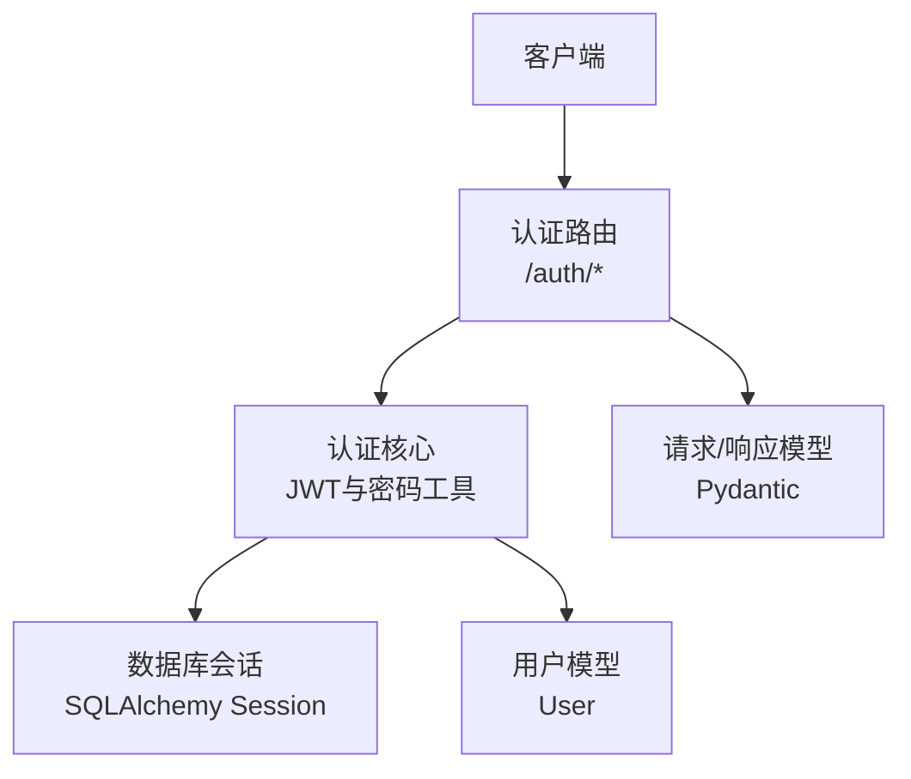
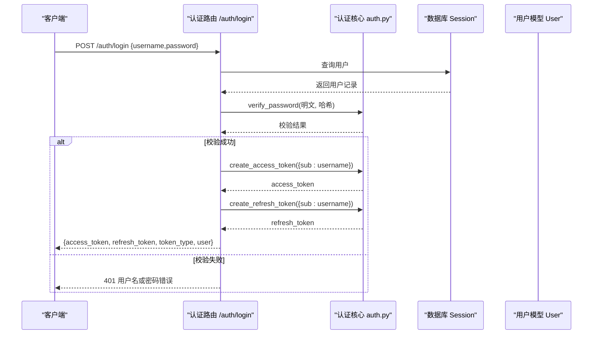
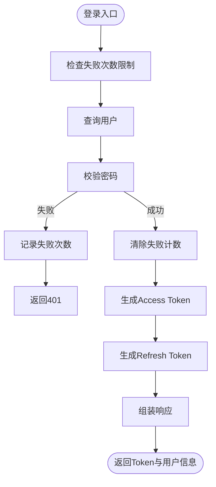
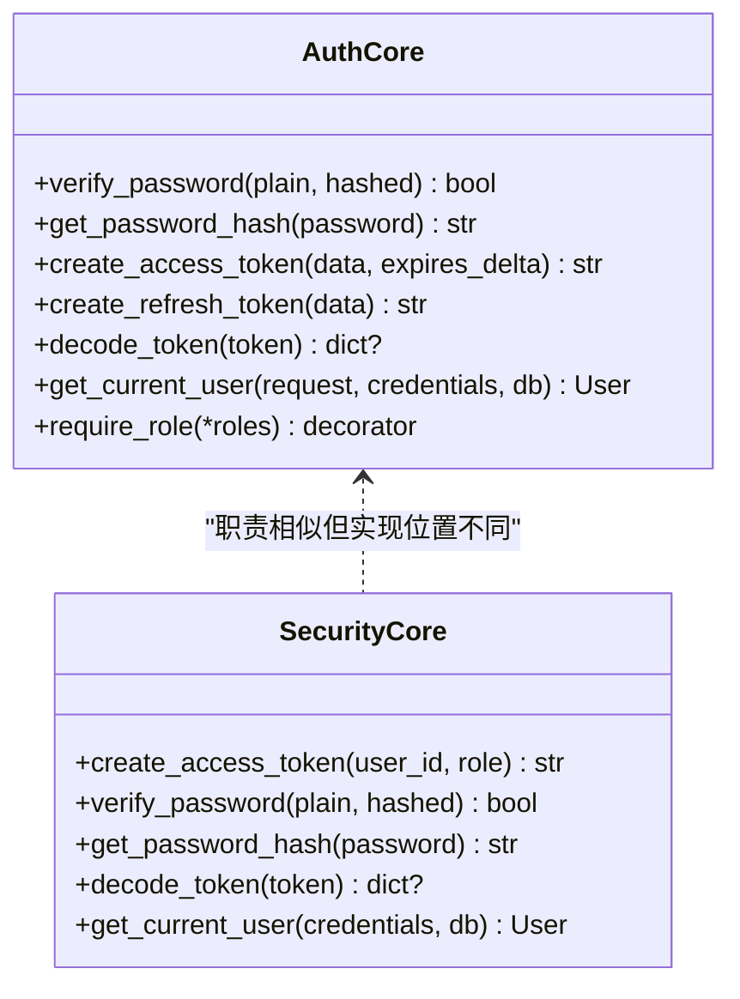
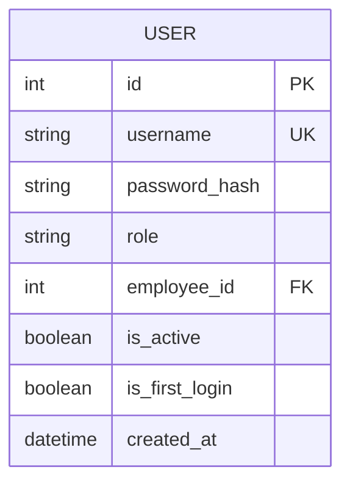
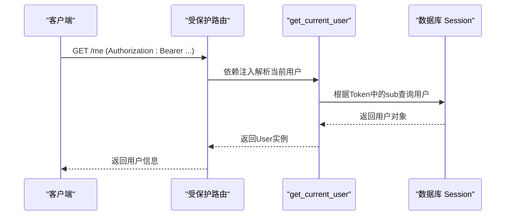
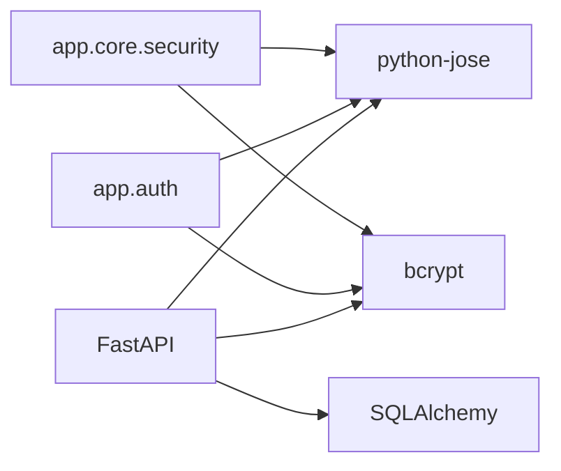

# JWT令牌认证

<cite>
**本文引用的文件**   
- [backend/app/auth.py](file://backend/app/auth.py)
- [backend/app/core/security.py](file://backend/app/core/security.py)
- [backend/app/routers/auth.py](file://backend/app/routers/auth.py)
- [backend/app/schemas.py](file://backend/app/schemas.py)
- [backend/app/models.py](file://backend/app/models.py)
- [backend/requirements.txt](file://backend/requirements.txt)
</cite>

## 目录
1. [引言](#引言)
2. [项目结构](#项目结构)
3. [核心组件](#核心组件)
4. [架构总览](#架构总览)
5. [详细组件分析](#详细组件分析)
6. [依赖关系分析](#依赖关系分析)
7. [性能与安全性考虑](#性能与安全性考虑)
8. [故障排查指南](#故障排查指南)
9. [结论](#结论)
10. [附录：JWT结构与配置清单](#附录jwt结构与配置清单)

## 引言
本文件面向后端开发者与安全审计人员，系统性说明本项目的JWT令牌认证机制。内容覆盖：
- Access Token与Refresh Token的生成、验证与刷新流程
- 密码加密存储（bcrypt）与用户身份验证逻辑
- 令牌过期处理策略与错误处理机制
- 令牌载荷结构、安全配置项
- 与FastAPI的集成方式与依赖注入使用模式
- 基于仓库现有代码的最小可运行示例路径指引

## 项目结构
本项目在FastAPI中实现认证相关能力，主要涉及以下模块：
- 路由层：提供登录、刷新、个人信息、修改密码、登出等接口
- 认证核心：封装JWT生成/解码、密码哈希/校验、当前用户解析、角色权限检查
- 数据模型：用户实体包含用户名、密码哈希、角色、首次登录标记等字段
- 请求/响应模型：定义登录、刷新、改密等接口的输入输出结构

图表来源
- [backend/app/routers/auth.py:1-179](file://backend/app/routers/auth.py#L1-L179)
- [backend/app/auth.py:1-130](file://backend/app/auth.py#L1-L130)
- [backend/app/models.py:49-61](file://backend/app/models.py#L49-L61)
- [backend/app/schemas.py:13-29](file://backend/app/schemas.py#L13-L29)

章节来源
- [backend/app/routers/auth.py:1-179](file://backend/app/routers/auth.py#L1-L179)
- [backend/app/auth.py:1-130](file://backend/app/auth.py#L1-L130)
- [backend/app/models.py:49-61](file://backend/app/models.py#L49-L61)
- [backend/app/schemas.py:13-29](file://backend/app/schemas.py#L13-L29)

## 核心组件
- 认证路由：负责接收登录、刷新、个人信息、修改密码、登出请求，并调用认证核心完成业务逻辑
- 认证核心：封装JWT创建/解码、密码哈希/校验、当前用户解析、角色检查
- 数据模型：User表承载用户认证所需信息
- 请求/响应模型：统一描述认证相关接口的输入输出

关键职责划分：
- 路由层不直接操作JWT或密码，仅做参数校验与结果组装
- 认证核心集中管理安全相关算法与常量
- 模型与Schema解耦业务数据与传输数据

章节来源
- [backend/app/routers/auth.py:1-179](file://backend/app/routers/auth.py#L1-L179)
- [backend/app/auth.py:1-130](file://backend/app/auth.py#L1-L130)
- [backend/app/schemas.py:13-29](file://backend/app/schemas.py#L13-L29)
- [backend/app/models.py:49-61](file://backend/app/models.py#L49-L61)

## 架构总览
下图展示从客户端发起登录到获取Access Token与Refresh Token的完整时序，以及后续刷新Access Token的流程。

图表来源
- [backend/app/routers/auth.py:63-93](file://backend/app/routers/auth.py#L63-L93)
- [backend/app/auth.py:38-57](file://backend/app/auth.py#L38-L57)
- [backend/app/models.py:49-61](file://backend/app/models.py#L49-L61)

## 详细组件分析

### 1. 认证路由（/auth/*）
职责：
- 登录：校验用户名密码，生成Access Token与Refresh Token，返回用户基本信息
- 刷新：校验Refresh Token，签发新的Access Token
- 个人信息：依赖当前用户解析器，返回当前用户信息
- 修改密码：校验旧密码、复杂度规则，更新密码哈希并清除“首次登录”标记
- 登出：返回退出成功提示

关键点：
- 登录失败次数限制：内存中记录失败尝试，达到阈值后短时间锁定
- 首次登录强制改密：通过白名单控制允许访问的路径

图表来源
- [backend/app/routers/auth.py:31-93](file://backend/app/routers/auth.py#L31-L93)

章节来源
- [backend/app/routers/auth.py:31-93](file://backend/app/routers/auth.py#L31-L93)

### 2. 认证核心（JWT与密码工具）
职责：
- 密码哈希与校验：使用bcrypt进行安全的单向哈希与比对
- JWT创建与解码：HS256算法，支持Access Token与Refresh Token
- 当前用户解析：从Authorization头提取Bearer Token，解码并加载用户对象
- 角色检查：装饰器形式限定特定角色访问

重要细节：
- 两个模块均定义了SECRET_KEY与ALGORITHM，但过期时间常量不一致，需在生产环境统一
- get_current_user会检查用户是否禁用、是否首次登录且未改密

图表来源
- [backend/app/auth.py:38-129](file://backend/app/auth.py#L38-L129)
- [backend/app/core/security.py:20-138](file://backend/app/core/security.py#L20-L138)

章节来源
- [backend/app/auth.py:38-129](file://backend/app/auth.py#L38-L129)
- [backend/app/core/security.py:20-138](file://backend/app/core/security.py#L20-L138)

### 3. 用户模型与密码存储
- User模型包含username、password_hash、role、is_active、is_first_login等字段
- 密码以bcrypt哈希值存储，避免明文泄露风险
- is_first_login用于强制首次登录改密策略

图表来源
- [backend/app/models.py:49-61](file://backend/app/models.py#L49-L61)

章节来源
- [backend/app/models.py:49-61](file://backend/app/models.py#L49-L61)

### 4. 请求与响应模型
- LoginRequest：包含username、password、remember_me
- LoginResponse：包含access_token、refresh_token、token_type、user
- ChangePasswordRequest：包含old_password、new_password
- RefreshTokenRequest：包含refresh_token

章节来源
- [backend/app/schemas.py:13-29](file://backend/app/schemas.py#L13-L29)

### 5. Access Token与Refresh Token的区别与使用场景
- Access Token：短期有效，携带用户标识（如用户名或ID），用于访问受保护资源
- Refresh Token：长期有效，用于换取新的Access Token，减少频繁登录
- 本项目登录时同时返回两者；刷新接口仅返回新的Access Token

章节来源
- [backend/app/routers/auth.py:63-111](file://backend/app/routers/auth.py#L63-L111)
- [backend/app/auth.py:46-57](file://backend/app/auth.py#L46-L57)

### 6. 令牌过期处理策略
- Access Token默认较短有效期（例如分钟级），降低泄露影响面
- Refresh Token较长有效期（例如天级），便于无感续期
- 解码失败或过期时，返回401并提示Token无效或已过期
- 前端可在收到401时自动调用刷新接口，若刷新失败则引导重新登录

章节来源
- [backend/app/auth.py:46-65](file://backend/app/auth.py#L46-L65)
- [backend/app/routers/auth.py:96-111](file://backend/app/routers/auth.py#L96-L111)

### 7. 与FastAPI集成与依赖注入
- 使用HTTPBearer从Authorization头提取Bearer Token
- get_current_user作为依赖注入函数，被其他路由复用
- require_role作为装饰器，限制特定角色访问

图表来源
- [backend/app/auth.py:68-113](file://backend/app/auth.py#L68-L113)
- [backend/app/routers/auth.py:114-122](file://backend/app/routers/auth.py#L114-L122)

章节来源
- [backend/app/auth.py:68-113](file://backend/app/auth.py#L68-L113)
- [backend/app/routers/auth.py:114-122](file://backend/app/routers/auth.py#L114-L122)

### 8. 密码加密存储机制（bcrypt）
- 使用bcrypt.hashpw生成哈希值，bcrypt.checkpw进行比对
- 密码长度与复杂度校验在改密接口中进行，防止弱密码

章节来源
- [backend/app/auth.py:38-43](file://backend/app/auth.py#L38-L43)
- [backend/app/core/security.py:36-62](file://backend/app/core/security.py#L36-L62)
- [backend/app/routers/auth.py:125-164](file://backend/app/routers/auth.py#L125-L164)

### 9. 用户身份验证逻辑
- 登录时先检查失败次数限制，再查询用户并校验密码
- 成功后清除失败计数，签发双Token
- 首次登录强制改密：对非白名单路径返回403

章节来源
- [backend/app/routers/auth.py:31-93](file://backend/app/routers/auth.py#L31-L93)
- [backend/app/auth.py:19-35](file://backend/app/auth.py#L19-L35)
- [backend/app/auth.py:107-113](file://backend/app/auth.py#L107-L113)

### 10. 错误处理机制
- 未提供凭据：401未认证
- Token无效或过期：401未认证
- 用户不存在或被禁用：401未认证
- 首次登录未改密访问非白名单接口：403禁止访问
- 密码错误次数过多：429请求过多

章节来源
- [backend/app/auth.py:68-113](file://backend/app/auth.py#L68-L113)
- [backend/app/routers/auth.py:31-56](file://backend/app/routers/auth.py#L31-L56)

## 依赖关系分析
- FastAPI：提供路由、依赖注入、HTTP异常
- python-jose：JWT编解码
- bcrypt：密码哈希与校验
- SQLAlchemy：ORM与数据库会话

图表来源
- [backend/requirements.txt:6](file://backend/requirements.txt#L6)
- [backend/app/auth.py:1-10](file://backend/app/auth.py#L1-L10)
- [backend/app/core/security.py:1-11](file://backend/app/core/security.py#L1-L11)

章节来源
- [backend/requirements.txt:6](file://backend/requirements.txt#L6)
- [backend/app/auth.py:1-10](file://backend/app/auth.py#L1-L10)
- [backend/app/core/security.py:1-11](file://backend/app/core/security.py#L1-L11)

## 性能与安全性考虑
- 性能
  - bcrypt计算开销较高，建议仅在注册/改密时执行，登录路径避免重复哈希
  - Access Token短时效，减少泄露窗口；Refresh Token长时效，减少频繁登录
  - 登录失败次数限制采用内存存储，适合单进程部署；多进程需迁移至Redis等共享存储
- 安全性
  - SECRET_KEY必须从环境变量或密钥管理服务读取，严禁硬编码
  - 建议使用HTTPS传输，防止Token与密码在网络中被窃听
  - 建议对Refresh Token进行服务端黑名单或短期滚动刷新策略
  - 建议对敏感日志脱敏，避免记录Token与密码

[本节为通用指导，不直接分析具体文件]

## 故障排查指南
常见问题与定位要点：
- 401未认证
  - 检查Authorization头是否正确携带Bearer Token
  - 检查Token是否过期或签名无效
  - 检查用户是否存在且未被禁用
- 403禁止访问
  - 检查是否首次登录且未改密，访问了非白名单路径
- 429请求过多
  - 检查登录失败次数是否超过阈值，等待冷却时间后再试
- 密码校验失败
  - 确认密码是否为bcrypt哈希值，避免明文存储
  - 检查改密接口的复杂度校验规则

章节来源
- [backend/app/auth.py:68-113](file://backend/app/auth.py#L68-L113)
- [backend/app/routers/auth.py:31-56](file://backend/app/routers/auth.py#L31-L56)
- [backend/app/routers/auth.py:125-164](file://backend/app/routers/auth.py#L125-L164)

## 结论
本项目在FastAPI中实现了完整的JWT认证体系，涵盖Access Token与Refresh Token的生成、验证与刷新，结合bcrypt进行安全的密码存储，并通过依赖注入将认证逻辑解耦到路由层。建议在生产环境中统一安全配置、引入环境变量管理密钥、完善Refresh Token刷新策略与失效机制，并加强日志脱敏与监控告警。

[本节为总结性内容，不直接分析具体文件]

## 附录：JWT结构与配置清单

### JWT载荷结构
- Access Token
  - sub：用户标识（用户名或ID，取决于实现）
  - exp：过期时间
  - role：角色（部分实现中包含）
- Refresh Token
  - sub：用户标识
  - exp：过期时间

章节来源
- [backend/app/auth.py:46-57](file://backend/app/auth.py#L46-L57)
- [backend/app/core/security.py:20-33](file://backend/app/core/security.py#L20-L33)

### 安全配置选项
- SECRET_KEY：JWT签名密钥，必须保密
- ALGORITHM：签名算法，当前为HS256
- ACCESS_TOKEN_EXPIRE_MINUTES/HOURS：Access Token有效期
- REFRESH_TOKEN_EXPIRE_DAYS：Refresh Token有效期

注意：
- backend/app/auth.py与backend/app/core/security.py中存在不同的过期时间常量，需在统一配置中心或环境变量中收敛

章节来源
- [backend/app/auth.py:12-15](file://backend/app/auth.py#L12-L15)
- [backend/app/core/security.py:13-15](file://backend/app/core/security.py#L13-L15)

### 代码示例路径（不直接展示代码内容）
- 创建Access Token
  - 参考路径：[backend/app/auth.py:46-50](file://backend/app/auth.py#L46-L50)
  - 参考路径：[backend/app/core/security.py:20-33](file://backend/app/core/security.py#L20-L33)
- 创建Refresh Token
  - 参考路径：[backend/app/auth.py:53-57](file://backend/app/auth.py#L53-L57)
- 解码与验证Token
  - 参考路径：[backend/app/auth.py:60-65](file://backend/app/auth.py#L60-L65)
  - 参考路径：[backend/app/core/security.py:65-79](file://backend/app/core/security.py#L65-L79)
- 解析当前用户（依赖注入）
  - 参考路径：[backend/app/auth.py:68-113](file://backend/app/auth.py#L68-L113)
  - 参考路径：[backend/app/core/security.py:82-138](file://backend/app/core/security.py#L82-L138)
- 登录与刷新接口
  - 参考路径：[backend/app/routers/auth.py:63-111](file://backend/app/routers/auth.py#L63-L111)