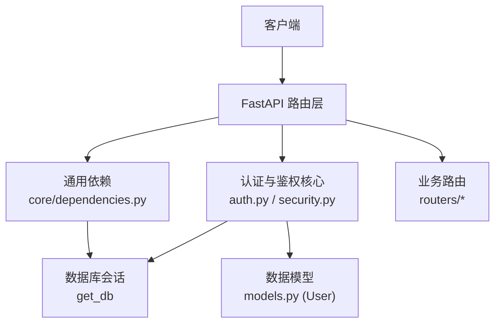
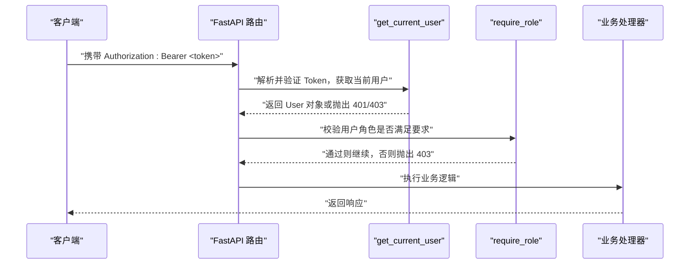
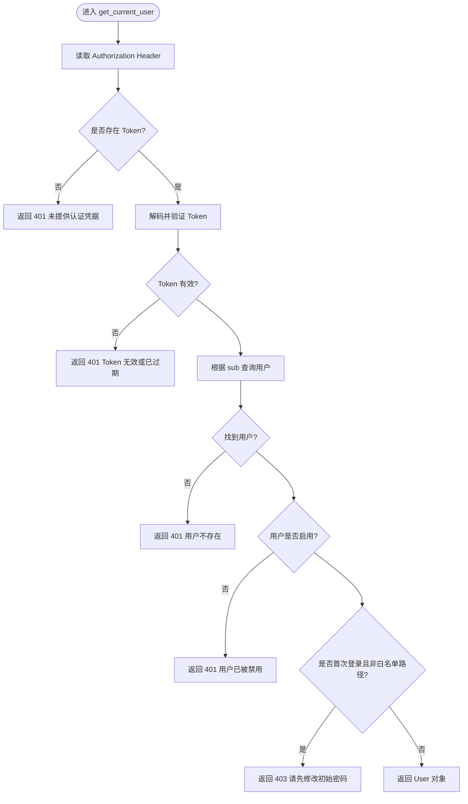
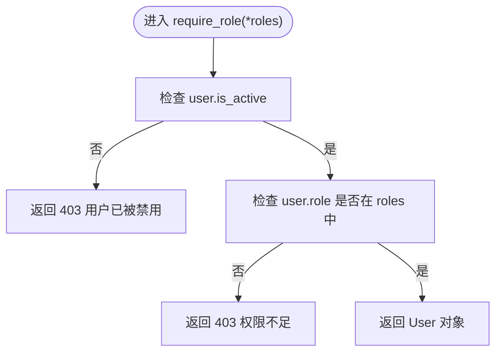
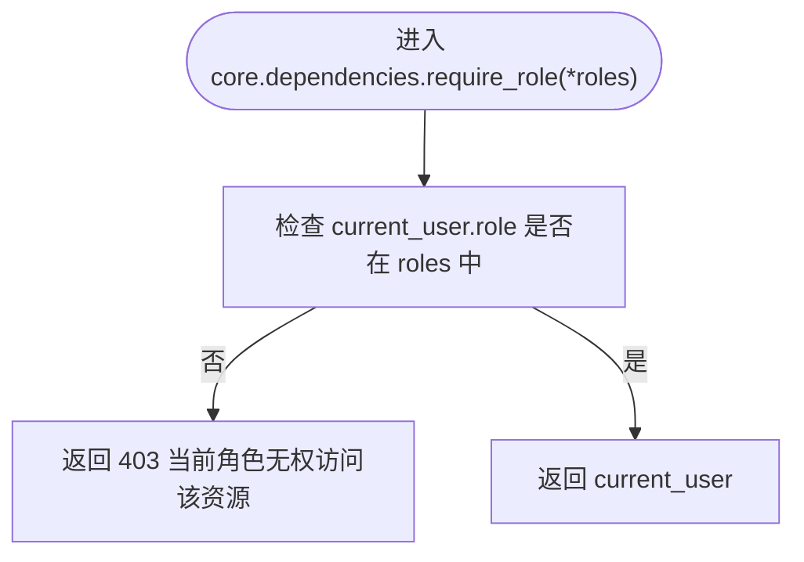
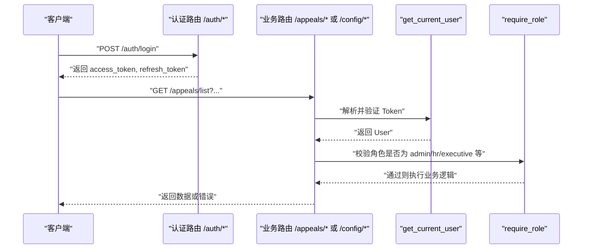
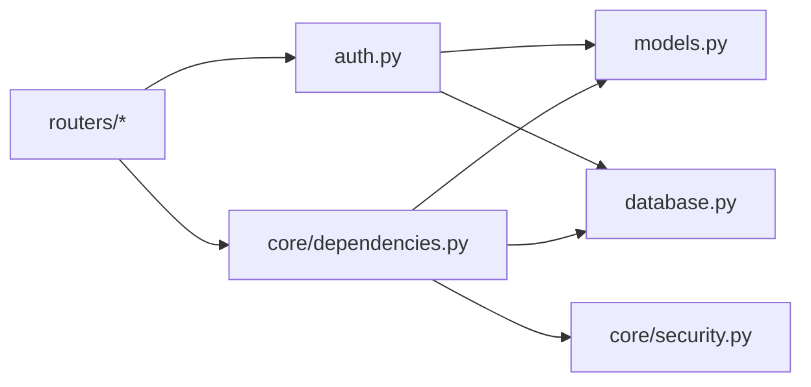

# RBAC权限控制

<cite>
**本文引用的文件**   
- [backend/app/auth.py](file://backend/app/auth.py)
- [backend/app/core/dependencies.py](file://backend/app/core/dependencies.py)
- [backend/app/core/security.py](file://backend/app/core/security.py)
- [backend/app/models.py](file://backend/app/models.py)
- [backend/app/main.py](file://backend/app/main.py)
- [backend/app/routers/auth.py](file://backend/app/routers/auth.py)
- [backend/app/routers/appeals.py](file://backend/app/routers/appeals.py)
- [backend/app/routers/config.py](file://backend/app/routers/config.py)
</cite>

## 目录
1. [引言](#引言)
2. [项目结构](#项目结构)
3. [核心组件](#核心组件)
4. [架构总览](#架构总览)
5. [详细组件分析](#详细组件分析)
6. [依赖关系分析](#依赖关系分析)
7. [性能与扩展性](#性能与扩展性)
8. [故障排查指南](#故障排查指南)
9. [结论](#结论)
10. [附录：使用示例与最佳实践](#附录使用示例与最佳实践)

## 引言
本文面向“基于角色的访问控制（RBAC）”子系统，系统性说明角色定义、权限分配与资源访问控制的实现原理。重点包括：
- 用户认证流程与当前用户解析
- `require_role` 装饰器的工作原理与权限检查逻辑
- 系统预置角色（管理员、HR、部门经理、普通员工）及其权限范围
- 在路由中使用权限装饰器保护接口的方法
- 权限继承与动态权限检查的扩展思路
- 使用示例与最佳实践建议

## 项目结构
本项目的 RBAC 能力主要分布在以下模块：
- 认证与鉴权核心：`backend/app/auth.py`、`backend/app/core/security.py`
- 通用依赖与可复用权限校验：`backend/app/core/dependencies.py`
- 数据模型（含用户与角色字段）：`backend/app/models.py`
- 应用初始化与预置账号：`backend/app/main.py`
- 认证路由与典型受保护路由示例：`backend/app/routers/auth.py`、`backend/app/routers/appeals.py`、`backend/app/routers/config.py`

**图表来源**
- [backend/app/auth.py:68-129](file://backend/app/auth.py#L68-L129)
- [backend/app/core/security.py:82-138](file://backend/app/core/security.py#L82-L138)
- [backend/app/core/dependencies.py:10-50](file://backend/app/core/dependencies.py#L10-L50)
- [backend/app/models.py:49-60](file://backend/app/models.py#L49-L60)

**章节来源**
- [backend/app/auth.py:68-129](file://backend/app/auth.py#L68-L129)
- [backend/app/core/security.py:82-138](file://backend/app/core/security.py#L82-L138)
- [backend/app/core/dependencies.py:10-50](file://backend/app/core/dependencies.py#L10-L50)
- [backend/app/models.py:49-60](file://backend/app/models.py#L49-L60)

## 核心组件
- 用户模型与角色字段
  - User 模型包含 username、role、is_active、is_first_login 等关键字段，用于身份识别、角色判定与首次登录策略。
- 认证依赖 get_current_user
  - 从请求头提取 Bearer Token，解码 JWT，查询并返回当前用户对象；对未认证、Token 无效、用户不存在、用户被禁用进行统一错误处理。
- 角色校验 require_role
  - 提供两种实现：
    - auth.py 中的 require_role：作为装饰器式依赖，先校验 is_active，再校验 user.role 是否在允许列表中。
    - core/dependencies.py 中的 require_role：作为 FastAPI 依赖函数，直接校验 role 是否在允许列表。
- 预置角色与初始数据
  - main.py 在应用启动时创建默认部门、岗位及若干预置用户（admin、hr、manager、employee、peer），用于演示不同角色的权限边界。

**章节来源**
- [backend/app/models.py:49-60](file://backend/app/models.py#L49-L60)
- [backend/app/auth.py:68-129](file://backend/app/auth.py#L68-L129)
- [backend/app/core/dependencies.py:27-50](file://backend/app/core/dependencies.py#L27-L50)
- [backend/app/main.py:130-278](file://backend/app/main.py#L130-L278)

## 架构总览
下图展示一次受保护接口的调用链路，涵盖认证、鉴权与业务处理：

**图表来源**
- [backend/app/auth.py:68-129](file://backend/app/auth.py#L68-L129)
- [backend/app/core/dependencies.py:27-50](file://backend/app/core/dependencies.py#L27-L50)

## 详细组件分析

### 用户模型与角色字段
- User 表字段说明
  - id：主键
  - username：用户名（唯一）
  - password_hash：密码哈希
  - role：角色标识（如 admin、hr、manager、employee、peer）
  - employee_id：关联员工信息
  - is_active：账户是否启用
  - is_first_login：是否首次登录（影响强制改密策略）

该模型是 RBAC 的基础，所有鉴权逻辑均围绕 role 与 is_active 展开。

**章节来源**
- [backend/app/models.py:49-60](file://backend/app/models.py#L49-L60)

### 认证依赖 get_current_user
- 职责
  - 从请求中读取 Bearer Token
  - 解码并校验 Token 有效性
  - 根据 token 内容查询用户
  - 校验用户状态（is_active）
  - 对首次登录且未修改密码的用户进行访问限制（除白名单路径外）
- 异常处理
  - 未提供凭据、Token 无效或过期、用户不存在、用户被禁用均返回 401
  - 首次登录强制改密拦截返回 403

**图表来源**
- [backend/app/auth.py:68-113](file://backend/app/auth.py#L68-L113)

**章节来源**
- [backend/app/auth.py:68-113](file://backend/app/auth.py#L68-L113)

### 角色校验 require_role（auth.py 版本）
- 设计要点
  - 作为装饰器式依赖，内部再次调用 get_current_user 以复用认证逻辑
  - 二次校验 is_active（防御性编程）
  - 校验 user.role 是否在传入的 roles 列表中
  - 不匹配时返回 403 权限不足
- 适用场景
  - 需要同时保证“已认证 + 指定角色”的接口保护

**图表来源**
- [backend/app/auth.py:116-129](file://backend/app/auth.py#L116-L129)

**章节来源**
- [backend/app/auth.py:116-129](file://backend/app/auth.py#L116-L129)

### 角色校验 require_role（core/dependencies.py 版本）
- 设计要点
  - 作为 FastAPI 依赖函数，可直接注入到路由参数或 dependencies 列表
  - 仅校验当前用户的 role 是否在允许列表中
  - 不匹配时返回 403 当前角色无权访问该资源
- 适用场景
  - 更简洁的角色校验，适合在路由级集中声明权限

**图表来源**
- [backend/app/core/dependencies.py:27-50](file://backend/app/core/dependencies.py#L27-L50)

**章节来源**
- [backend/app/core/dependencies.py:27-50](file://backend/app/core/dependencies.py#L27-L50)

### 预置角色与权限范围
系统在应用启动时创建若干预置用户，体现不同角色的权限边界：
- 管理员（admin）
  - 拥有最高权限，负责系统配置、组织管理、数据治理、最终审批等
- HR（hr）
  - 负责考核发起、流程推进、部分配置与报表查看
- 部门经理（manager）
  - 负责下属评分、面谈、审批等管理操作
- 普通员工（employee）
  - 自评、查看个人绩效、参与协作评价等
- 协作人（peer）
  - 参与协作评分等

这些角色值直接对应 User.role 字段，并在各路由中通过 require_role 或角色判断进行访问控制。

**章节来源**
- [backend/app/main.py:130-278](file://backend/app/main.py#L130-L278)

### 路由中的权限装饰器使用
- 认证路由
  - 登录、刷新令牌、个人信息、修改密码、登出等接口使用 get_current_user 进行认证保护
- 受保护业务路由
  - 例如申诉、配置管理等接口通过 require_role 限定特定角色访问

**图表来源**
- [backend/app/routers/auth.py:63-179](file://backend/app/routers/auth.py#L63-L179)
- [backend/app/routers/appeals.py:6-301](file://backend/app/routers/appeals.py#L6-L301)
- [backend/app/routers/config.py:6-203](file://backend/app/routers/config.py#L6-L203)

**章节来源**
- [backend/app/routers/auth.py:63-179](file://backend/app/routers/auth.py#L63-L179)
- [backend/app/routers/appeals.py:6-301](file://backend/app/routers/appeals.py#L6-L301)
- [backend/app/routers/config.py:6-203](file://backend/app/routers/config.py#L6-L203)

## 依赖关系分析
- 模块耦合
  - auth.py 依赖 models.py（User）、database.py（get_db）、fastapi.security（HTTPBearer）
  - core/dependencies.py 依赖 core/security.py（get_current_user）、models.py、database.py
  - routers/* 依赖 auth.py 与 core/dependencies.py 提供的依赖函数
- 外部依赖
  - JWT（jose）用于 Token 编解码
  - bcrypt 用于密码哈希
- 潜在循环依赖
  - 当前结构清晰，未见明显循环依赖

**图表来源**
- [backend/app/auth.py:1-11](file://backend/app/auth.py#L1-L11)
- [backend/app/core/dependencies.py:1-7](file://backend/app/core/dependencies.py#L1-L7)
- [backend/app/core/security.py:1-11](file://backend/app/core/security.py#L1-L11)

**章节来源**
- [backend/app/auth.py:1-11](file://backend/app/auth.py#L1-L11)
- [backend/app/core/dependencies.py:1-7](file://backend/app/core/dependencies.py#L1-L7)
- [backend/app/core/security.py:1-11](file://backend/app/core/security.py#L1-L11)

## 性能与扩展性
- 性能特性
  - 每次请求都会解码 JWT 并查询数据库获取用户对象，属于 O(1) 查找，开销可控
  - 建议在高频接口引入缓存（如 Redis）以减少重复查询
- 可扩展性
  - 支持将 require_role 扩展为权限点（permission）级别，结合策略模式实现细粒度控制
  - 支持角色继承（如 manager 继承 employee 的部分权限），可通过组合权限集合实现
  - 支持动态权限检查（如基于部门、岗位、数据归属的动态授权）

[本节为通用指导，不涉及具体文件分析]

## 故障排查指南
- 常见错误码
  - 401 未认证：未提供凭据、Token 无效或过期、用户不存在、用户被禁用
  - 403 无权限：用户被禁用、首次登录未改密、角色不匹配
- 排查步骤
  - 确认 Authorization Header 是否正确携带 Bearer Token
  - 检查 Token 是否过期或无效
  - 确认用户是否启用（is_active）
  - 确认用户是否完成首次改密（is_first_login）
  - 确认路由要求的角色是否与当前用户角色一致

**章节来源**
- [backend/app/auth.py:68-129](file://backend/app/auth.py#L68-L129)
- [backend/app/core/dependencies.py:27-50](file://backend/app/core/dependencies.py#L27-L50)

## 结论
本项目实现了基于角色的访问控制（RBAC），通过统一的认证依赖与角色校验依赖，为各路由提供了清晰的权限保护机制。预置角色覆盖了管理员、HR、部门经理与普通员工等典型场景，配合首次登录强制改密策略，提升了安全性与合规性。未来可在权限粒度、角色继承与动态授权方面进一步扩展，以满足更复杂的业务需求。

[本节为总结性内容，不涉及具体文件分析]

## 附录：使用示例与最佳实践

### 在路由中使用 require_role 保护接口
- 方式一：使用 auth.py 的 require_role
  - 适用于需要同时复用认证逻辑并进行角色校验的场景
- 方式二：使用 core/dependencies.py 的 require_role
  - 适用于仅需角色校验的简洁场景，可直接注入到路由参数或 dependencies 列表

**章节来源**
- [backend/app/auth.py:116-129](file://backend/app/auth.py#L116-L129)
- [backend/app/core/dependencies.py:27-50](file://backend/app/core/dependencies.py#L27-L50)

### 预置角色与权限范围参考
- 管理员（admin）：系统配置、组织管理、数据治理、最终审批
- HR（hr）：考核发起、流程推进、部分配置与报表查看
- 部门经理（manager）：下属评分、面谈、审批
- 普通员工（employee）：自评、查看个人绩效、协作评价
- 协作人（peer）：协作评分

**章节来源**
- [backend/app/main.py:130-278](file://backend/app/main.py#L130-L278)

### 高级特性建议
- 权限继承
  - 通过组合权限集合实现角色继承（如 manager 继承 employee 的只读权限）
- 动态权限检查
  - 基于部门、岗位、数据归属进行动态授权（如仅允许本部门经理查看本部门数据）
- 细粒度权限点
  - 将 require_role 扩展为 require_permission，支持更细粒度的资源级控制

[本节为概念性建议，不涉及具体文件分析]