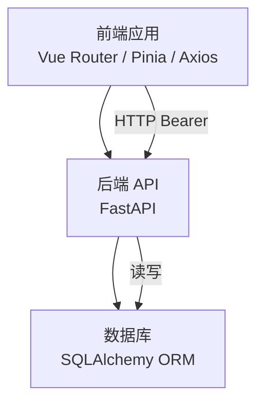
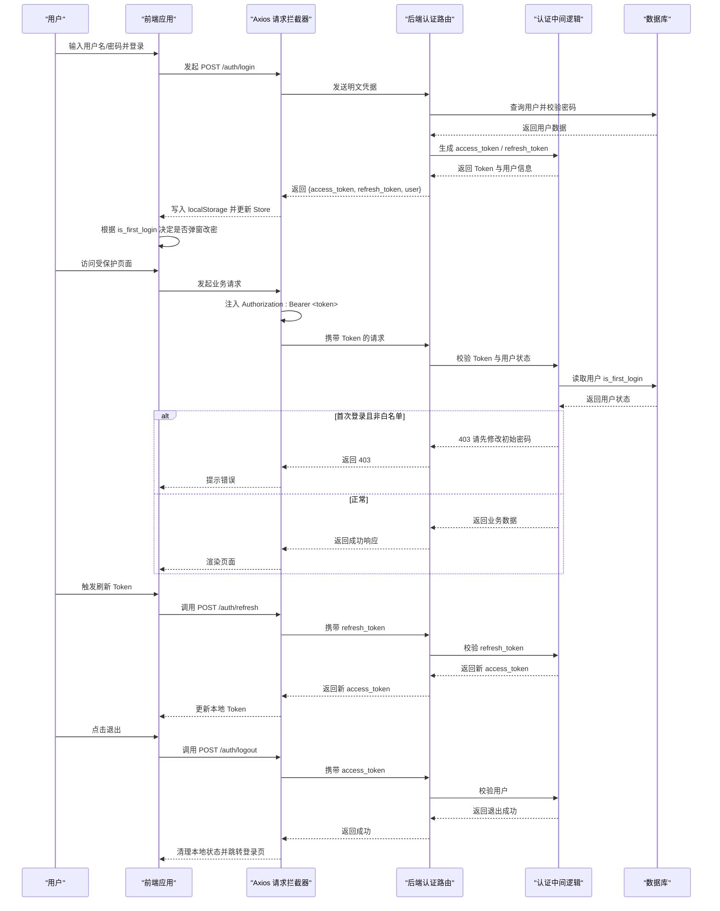
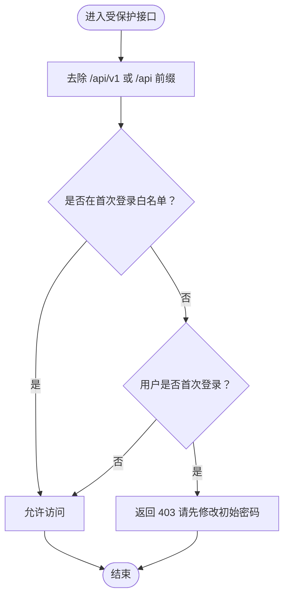
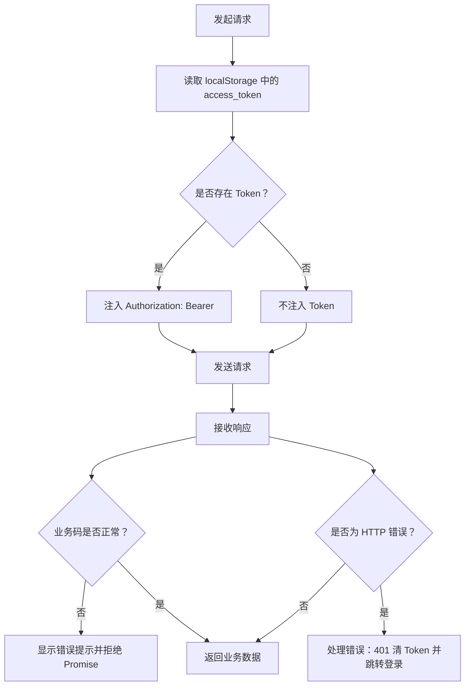
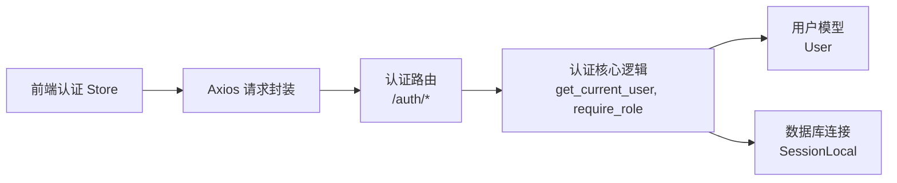

# 会话管理与安全

<cite>
**本文引用的文件**   
- [backend/app/main.py](file://backend/app/main.py)
- [backend/app/auth.py](file://backend/app/auth.py)
- [backend/app/routers/auth.py](file://backend/app/routers/auth.py)
- [frontend/src/api/request.js](file://frontend/src/api/request.js)
- [frontend/src/stores/auth.js](file://frontend/src/stores/auth.js)
- [frontend/src/utils/auth.js](file://frontend/src/utils/auth.js)
- [frontend/src/router/index.js](file://frontend/src/router/index.js)
- [frontend/src/views/login/LoginView.vue](file://frontend/src/views/login/LoginView.vue)
- [backend/tests/test_p0_15_first_login_guard.py](file://backend/tests/test_p0_15_first_login_guard.py)
</cite>

## 目录
1. [引言](#引言)
2. [项目结构](#项目结构)
3. [核心组件](#核心组件)
4. [架构总览](#架构总览)
5. [详细组件分析](#详细组件分析)
6. [依赖关系分析](#依赖关系分析)
7. [性能与并发特性](#性能与并发特性)
8. [故障排查指南](#故障排查指南)
9. [结论](#结论)
10. [附录：配置与安全最佳实践](#附录配置与安全最佳实践)

## 引言
本文件聚焦“会话管理与安全”，围绕以下目标展开：
- 首次登录强制改密机制：白名单、状态检查、错误处理。
- 前端 Token 存储策略、请求拦截器、自动刷新机制。
- 并发登录控制、会话超时处理、安全退出。
- 前后端协作的认证流程：Token 传递、状态同步、错误处理。
- 安全最佳实践：CSRF、XSS、敏感信息保护等。

## 项目结构
本项目采用前后端分离架构：
- 后端基于 FastAPI，提供 RESTful API，负责用户认证、权限校验、密码管理、Token 签发与校验。
- 前端基于 Vue + Pinia + Axios，负责页面路由守卫、本地 Token 存储、请求拦截、响应错误处理。

图表来源
- [backend/app/main.py:9-28](file://backend/app/main.py#L9-L28)
- [backend/app/routers/auth.py:1-28](file://backend/app/routers/auth.py#L1-L28)
- [frontend/src/router/index.js:1-10](file://frontend/src/router/index.js#L1-L10)
- [frontend/src/api/request.js:1-12](file://frontend/src/api/request.js#L1-L12)

章节来源
- [backend/app/main.py:9-28](file://backend/app/main.py#L9-L28)
- [frontend/src/router/index.js:1-10](file://frontend/src/router/index.js#L1-L10)

## 核心组件
- 后端认证模块
  - Token 签发与解码、密码哈希、当前用户解析、角色校验、首次登录限制。
- 认证路由
  - 登录、刷新、获取当前用户、修改密码、退出。
- 前端认证 Store
  - 登录、获取用户信息、修改密码、登出、状态计算。
- 前端请求封装
  - Axios 实例、请求/响应拦截器、Token 注入、错误提示、过期跳转。
- 路由守卫
  - 未登录跳转、角色权限校验。

章节来源
- [backend/app/auth.py:12-113](file://backend/app/auth.py#L12-L113)
- [backend/app/routers/auth.py:63-179](file://backend/app/routers/auth.py#L63-L179)
- [frontend/src/stores/auth.js:1-73](file://frontend/src/stores/auth.js#L1-L73)
- [frontend/src/api/request.js:1-89](file://frontend/src/api/request.js#L1-L89)
- [frontend/src/router/index.js:61-85](file://frontend/src/router/index.js#L61-L85)

## 架构总览
下图展示认证相关的关键交互：登录、鉴权、强制改密、刷新、退出。

图表来源
- [backend/app/routers/auth.py:63-179](file://backend/app/routers/auth.py#L63-L179)
- [backend/app/auth.py:46-113](file://backend/app/auth.py#L46-L113)
- [frontend/src/api/request.js:14-86](file://frontend/src/api/request.js#L14-L86)
- [frontend/src/stores/auth.js:21-58](file://frontend/src/stores/auth.js#L21-L58)

## 详细组件分析

### 首次登录强制改密机制
- 白名单机制
  - 后端维护一个白名单集合，包含登录、刷新、获取当前用户、修改密码、退出等路径。
  - 首次登录用户仅能访问这些接口；其他接口将被拒绝。
- 状态检查
  - 每次受保护接口请求都会解析当前用户，并检查 is_first_login 字段。
  - 若为首次登录且请求路径不在白名单内，则返回 403。
- 错误处理
  - 当首次登录用户尝试访问非白名单接口时，后端返回明确的错误消息。
  - 前端在响应拦截器中统一处理错误提示。

图表来源
- [backend/app/auth.py:19-35](file://backend/app/auth.py#L19-L35)
- [backend/app/auth.py:107-113](file://backend/app/auth.py#L107-L113)

章节来源
- [backend/app/auth.py:19-35](file://backend/app/auth.py#L19-L35)
- [backend/app/auth.py:107-113](file://backend/app/auth.py#L107-L113)
- [backend/tests/test_p0_15_first_login_guard.py:34-58](file://backend/tests/test_p0_15_first_login_guard.py#L34-L58)

### 前端 Token 存储策略
- 存储位置
  - 使用 localStorage 保存 access_token 和用户信息。
  - Key 分别为 pes_access_token 和 pes_user_info。
- 生命周期
  - 登录成功后写入；登出时删除。
  - 路由守卫在未登录状态下跳转到登录页。
- 安全性建议
  - 避免将敏感信息以明文形式长期存储在 localStorage。
  - 生产环境建议使用 HttpOnly Cookie 承载 Token（需配合 CSRF 防护）。

章节来源
- [frontend/src/stores/auth.js:5-27](file://frontend/src/stores/auth.js#L5-L27)
- [frontend/src/utils/auth.js:1-13](file://frontend/src/utils/auth.js#L1-L13)
- [frontend/src/router/index.js:61-75](file://frontend/src/router/index.js#L61-L75)

### 请求拦截器实现
- 请求拦截器
  - 从 localStorage 读取 access_token，并注入到 Authorization 头。
  - 开发模式下打印请求日志便于调试。
- 响应拦截器
  - 统一处理业务错误码，显示错误提示。
  - 对 401 错误进行特殊处理：清除本地 Token、提示重新登录、跳转登录页。

图表来源
- [frontend/src/api/request.js:14-86](file://frontend/src/api/request.js#L14-L86)

章节来源
- [frontend/src/api/request.js:14-86](file://frontend/src/api/request.js#L14-L86)

### 自动刷新机制
- 后端支持通过 refresh_token 换取新的 access_token。
- 前端目前未在请求拦截器中实现自动刷新逻辑；可在响应拦截器中增加对 401 的处理分支，先尝试调用 /auth/refresh，成功后重试原请求。
- 建议在刷新失败时清理本地状态并跳转登录页。

章节来源
- [backend/app/routers/auth.py:96-111](file://backend/app/routers/auth.py#L96-L111)
- [frontend/src/api/request.js:63-86](file://frontend/src/api/request.js#L63-L86)

### 并发登录控制与会话超时
- 并发登录控制
  - 当前实现未限制同一账号的多设备同时在线。
  - 如需限制，可在服务端维护用户会话表，记录登录时间、设备信息等，并在登录时校验是否已有活跃会话。
- 会话超时处理
  - access_token 有效期较短，refresh_token 有效期较长。
  - 前端在 401 时清理本地状态并跳转登录页。
  - 可结合心跳检测或定时任务主动刷新 Token。

章节来源
- [backend/app/auth.py:12-17](file://backend/app/auth.py#L12-L17)
- [backend/app/routers/auth.py:96-111](file://backend/app/routers/auth.py#L96-L111)
- [frontend/src/api/request.js:63-86](file://frontend/src/api/request.js#L63-L86)

### 安全退出
- 前端调用 /auth/logout 后，清理本地 Token 和用户信息。
- 后端当前 logout 接口仅校验用户身份并返回成功，未做服务端 Token 失效处理。
- 建议在生产环境中结合黑名单或短期 Token 策略增强安全性。

章节来源
- [backend/app/routers/auth.py:176-179](file://backend/app/routers/auth.py#L176-L179)
- [frontend/src/stores/auth.js:53-58](file://frontend/src/stores/auth.js#L53-L58)

### 前后端协作的认证流程
- 登录流程
  - 前端提交用户名和密码，后端验证通过后返回 access_token、refresh_token 和用户信息。
  - 前端将 Token 和用户信息存入 localStorage，并根据 is_first_login 决定是否弹出修改密码对话框。
- 状态同步
  - 前端在修改密码成功后更新 is_first_login 状态。
  - 路由守卫根据 Token 和角色控制页面访问。
- 错误处理
  - 前端统一处理业务错误和 HTTP 错误，提示用户并执行相应操作。

章节来源
- [backend/app/routers/auth.py:63-93](file://backend/app/routers/auth.py#L63-L93)
- [frontend/src/stores/auth.js:21-51](file://frontend/src/stores/auth.js#L21-L51)
- [frontend/src/views/login/LoginView.vue:61-106](file://frontend/src/views/login/LoginView.vue#L61-L106)

## 依赖关系分析

图表来源
- [backend/app/routers/auth.py:1-28](file://backend/app/routers/auth.py#L1-L28)
- [backend/app/auth.py:68-113](file://backend/app/auth.py#L68-L113)
- [frontend/src/stores/auth.js:1-73](file://frontend/src/stores/auth.js#L1-L73)
- [frontend/src/api/request.js:1-89](file://frontend/src/api/request.js#L1-L89)

章节来源
- [backend/app/routers/auth.py:1-28](file://backend/app/routers/auth.py#L1-L28)
- [backend/app/auth.py:68-113](file://backend/app/auth.py#L68-L113)
- [frontend/src/stores/auth.js:1-73](file://frontend/src/stores/auth.js#L1-L73)
- [frontend/src/api/request.js:1-89](file://frontend/src/api/request.js#L1-L89)

## 性能与并发特性
- 登录频率限制
  - 后端对同一用户的失败登录次数进行计数，超过阈值后暂时锁定账户一段时间。
- 并发测试
  - 测试用例中包含高并发登录场景，确保系统在压力下仍能稳定运行。

章节来源
- [backend/app/routers/auth.py:31-61](file://backend/app/routers/auth.py#L31-L61)
- [tests/scripts/test_perf.py:266-272](file://tests/scripts/test_perf.py#L266-L272)

## 故障排查指南
- 401 未授权
  - 检查前端是否正确注入 Authorization 头。
  - 检查 Token 是否过期或无效。
  - 确认用户是否被禁用或首次登录未改密。
- 403 禁止访问
  - 检查用户角色是否满足路由或接口的权限要求。
  - 确认是否处于首次登录状态且访问了非白名单接口。
- 网络错误
  - 检查后端服务是否正常运行。
  - 检查跨域配置是否正确。

章节来源
- [frontend/src/api/request.js:63-86](file://frontend/src/api/request.js#L63-L86)
- [backend/app/auth.py:68-113](file://backend/app/auth.py#L68-L113)

## 结论
本系统实现了较为完整的会话管理与安全机制，包括首次登录强制改密、Token 签发与校验、前端请求拦截与错误处理、路由守卫与权限控制。后续可进一步增强自动刷新、并发登录控制、会话超时管理等能力，并完善安全最佳实践如 CSRF、XSS 防护等。

## 附录：配置与安全最佳实践
- CSRF 防护
  - 当前 CORS 配置允许所有来源，建议在生产环境中限制允许的域名。
  - 若使用 Cookie 传输 Token，应启用 SameSite 属性并结合 CSRF Token。
- XSS 防护
  - 前端应避免直接渲染用户输入，使用框架提供的安全渲染方法。
  - 后端可对输入数据进行清洗和转义。
- 敏感信息保护
  - 避免在日志中输出敏感信息。
  - 生产环境关闭调试日志。
- HTTPS 强制
  - 建议在前端和反向代理层强制使用 HTTPS。
  - 设置安全的 Cookie 属性（HttpOnly、Secure、SameSite）。

章节来源
- [backend/app/main.py:15-21](file://backend/app/main.py#L15-L21)
- [frontend/src/api/request.js:21-36](file://frontend/src/api/request.js#L21-L36)