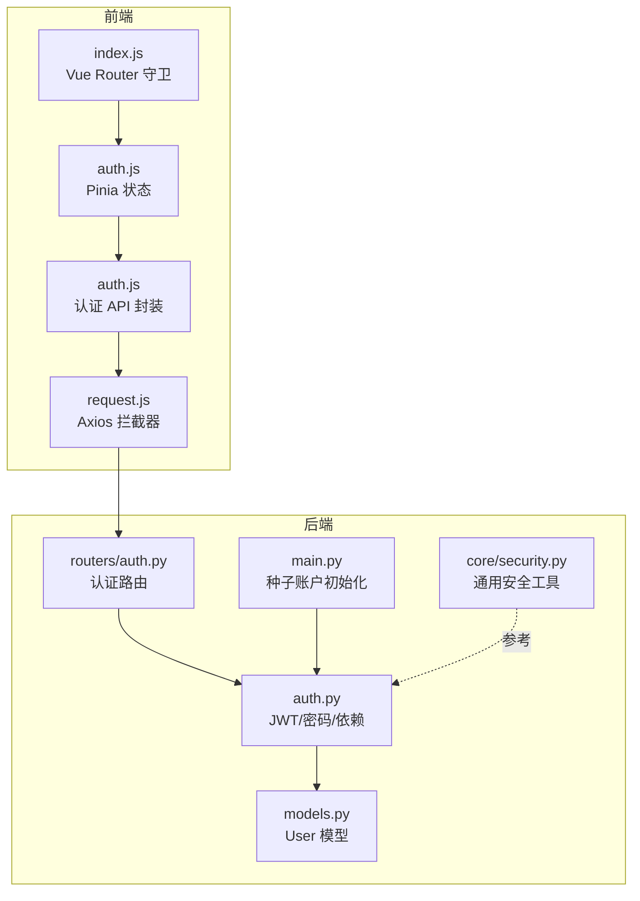
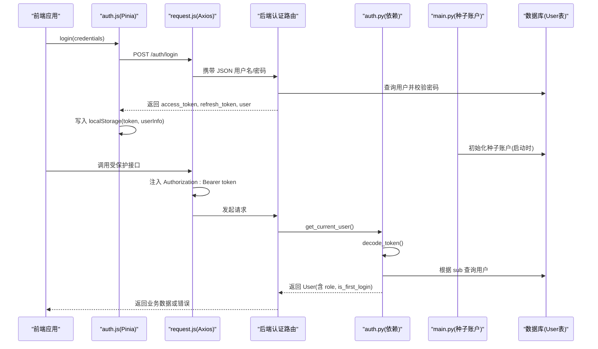
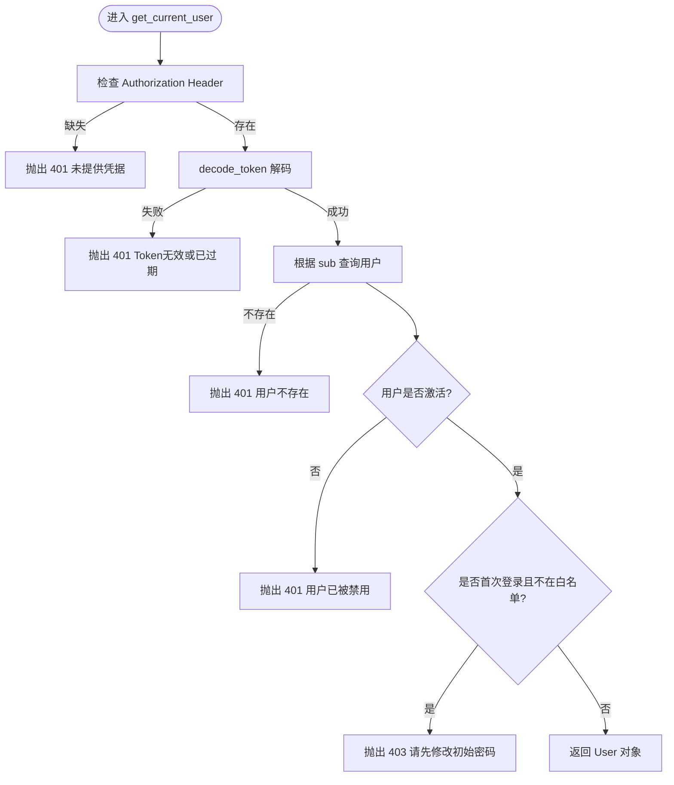
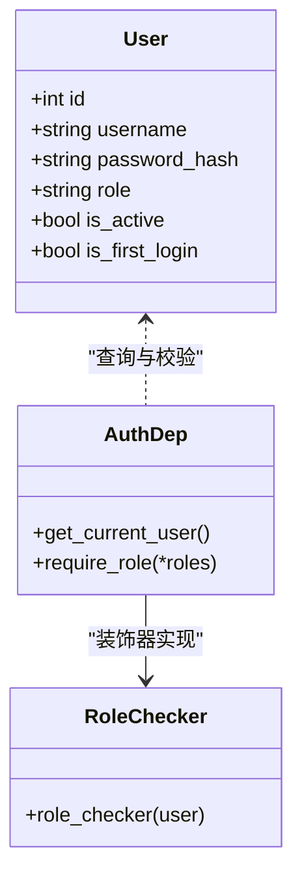
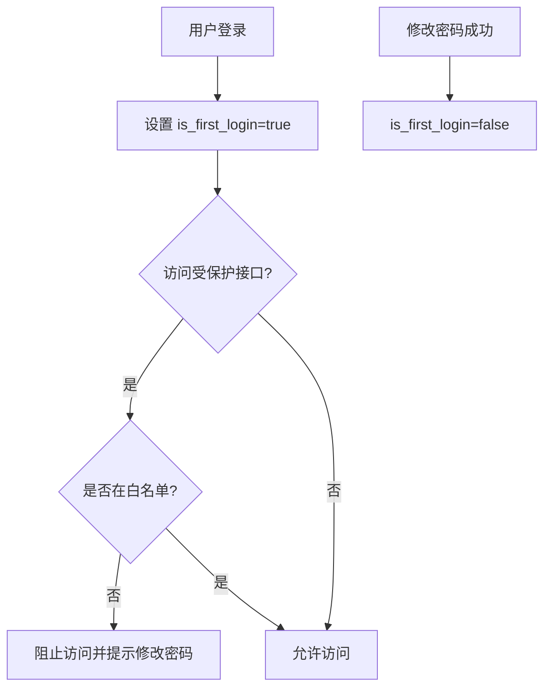
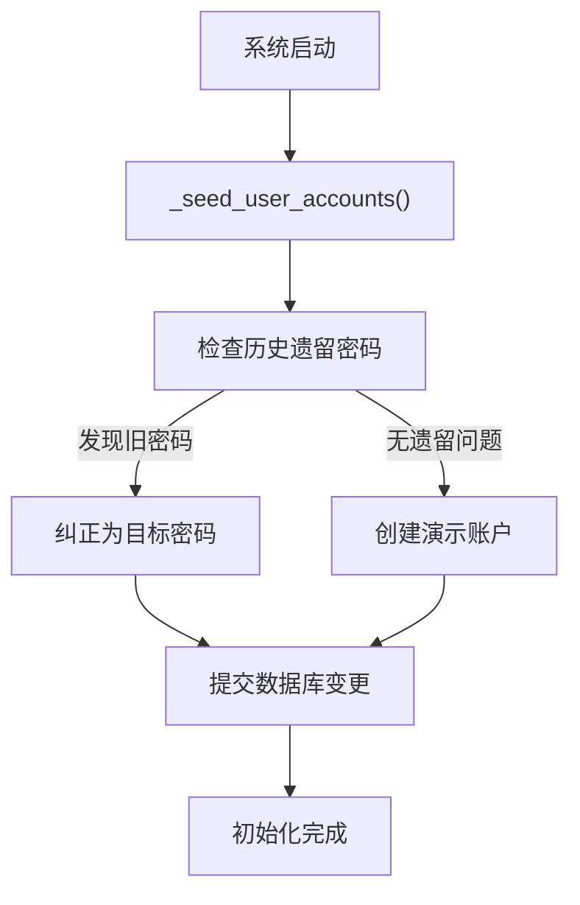
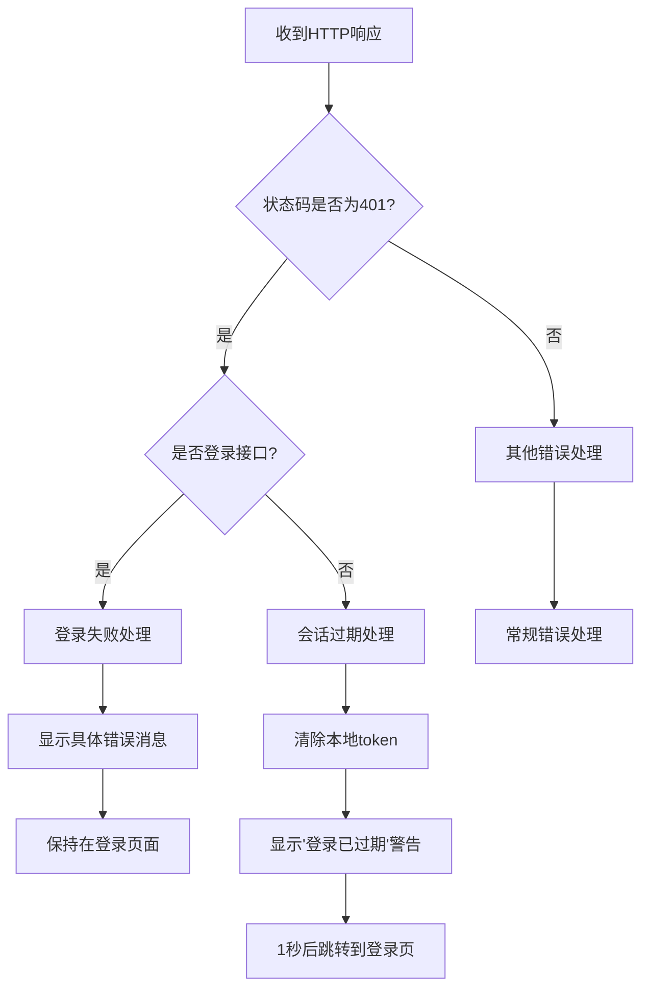
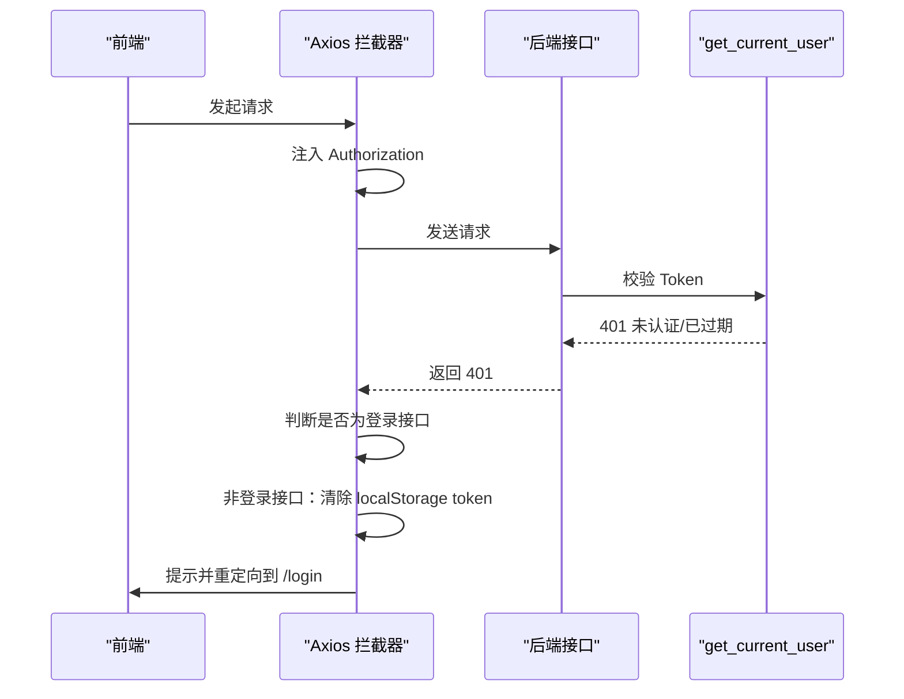
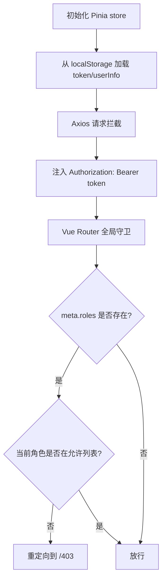
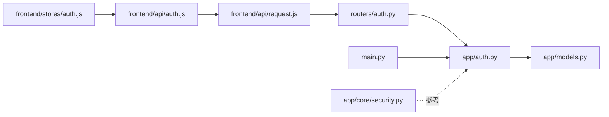

# 认证与授权

<cite>
**本文引用的文件**   
- [backend/app/auth.py](file://backend/app/auth.py)
- [backend/app/core/security.py](file://backend/app/core/security.py)
- [backend/app/routers/auth.py](file://backend/app/routers/auth.py)
- [backend/app/models.py](file://backend/app/models.py)
- [backend/app/main.py](file://backend/app/main.py)
- [frontend/src/stores/auth.js](file://frontend/src/stores/auth.js)
- [frontend/src/api/auth.js](file://frontend/src/api/auth.js)
- [frontend/src/utils/auth.js](file://frontend/src/utils/auth.js)
- [frontend/src/api/request.js](file://frontend/src/api/request.js)
- [frontend/src/router/index.js](file://frontend/src/router/index.js)
</cite>

## 更新摘要
**变更内容**   
- 后端种子账户初始化逻辑完整重写，新增智能密码纠正机制
- 集中化默认账户管理，支持多角色演示账号
- 前端认证拦截器增强登录错误处理，正确区分登录失败和会话过期场景
- 改进首次登录强制改密机制的白名单控制

## 目录
1. [引言](#引言)
2. [项目结构](#项目结构)
3. [核心组件](#核心组件)
4. [架构总览](#架构总览)
5. [详细组件分析](#详细组件分析)
6. [依赖关系分析](#依赖关系分析)
7. [性能与安全特性](#性能与安全特性)
8. [故障排查指南](#故障排查指南)
9. [结论](#结论)
10. [附录：API 接口文档](#附录api-接口文档)

## 引言
本文件面向"认证与授权"子系统，系统性说明以下能力：
- JWT 令牌认证机制：令牌生成、校验、刷新流程。
- 基于角色的访问控制（RBAC）：角色定义、权限分配、资源访问控制逻辑。
- 首次登录强制改密的安全机制。
- 会话管理、令牌过期处理、并发登录控制等安全特性。
- 前端认证状态管理：token 存储、请求拦截、权限检查。
- 认证相关 API 接口文档与安全最佳实践建议。

## 项目结构
认证与授权涉及后端 FastAPI 路由、JWT/密码工具、用户模型，以及前端的 Pinia 状态、Axios 拦截器与 Vue Router 守卫。

**图表来源**
- [frontend/src/stores/auth.js:1-73](file://frontend/src/stores/auth.js#L1-L73)
- [frontend/src/api/request.js:1-117](file://frontend/src/api/request.js#L1-L117)
- [frontend/src/router/index.js:1-85](file://frontend/src/router/index.js#L1-L85)
- [frontend/src/api/auth.js:1-14](file://frontend/src/api/auth.js#L1-L14)
- [backend/app/routers/auth.py:1-158](file://backend/app/routers/auth.py#L1-L158)
- [backend/app/auth.py:1-131](file://backend/app/auth.py#L1-L131)
- [backend/app/main.py:160-236](file://backend/app/main.py#L160-L236)
- [backend/app/core/security.py:1-139](file://backend/app/core/security.py#L1-L139)
- [backend/app/models.py:49-60](file://backend/app/models.py#L49-L60)

**章节来源**
- [frontend/src/stores/auth.js:1-73](file://frontend/src/stores/auth.js#L1-L73)
- [frontend/src/api/request.js:1-117](file://frontend/src/api/request.js#L1-L117)
- [frontend/src/router/index.js:1-85](file://frontend/src/router/index.js#L1-L85)
- [backend/app/routers/auth.py:1-158](file://backend/app/routers/auth.py#L1-L158)
- [backend/app/auth.py:1-131](file://backend/app/auth.py#L1-L131)
- [backend/app/main.py:160-236](file://backend/app/main.py#L160-L236)
- [backend/app/core/security.py:1-139](file://backend/app/core/security.py#L1-L139)
- [backend/app/models.py:49-60](file://backend/app/models.py#L49-L60)

## 核心组件
- 后端认证与授权
  - JWT 令牌生成与解码：access_token、refresh_token。
  - 密码哈希与校验：bcrypt。
  - 当前用户解析依赖：从 Authorization Header 提取 Bearer Token，解码并查询数据库。
  - 首次登录强制改密白名单控制。
  - 基于角色的访问控制装饰器 require_role。
  - **新增** 智能种子账户初始化与密码纠正机制。
- 前端认证状态与拦截
  - Pinia store 维护 token 与用户信息，持久化到 localStorage。
  - Axios 请求拦截自动注入 Authorization 头；响应拦截统一处理 401 跳转登录。
  - Vue Router 全局守卫进行登录态与角色权限校验。
  - **增强** 登录错误处理，正确区分登录失败和会话过期场景。

**章节来源**
- [backend/app/auth.py:12-131](file://backend/app/auth.py#L12-L131)
- [backend/app/routers/auth.py:63-158](file://backend/app/routers/auth.py#L63-L158)
- [backend/app/main.py:160-236](file://backend/app/main.py#L160-L236)
- [frontend/src/stores/auth.js:1-73](file://frontend/src/stores/auth.js#L1-L73)
- [frontend/src/api/request.js:14-117](file://frontend/src/api/request.js#L14-L117)
- [frontend/src/router/index.js:61-82](file://frontend/src/router/index.js#L61-L82)

## 架构总览
下图展示一次典型登录与受保护资源访问的端到端流程。

**图表来源**
- [frontend/src/stores/auth.js:21-28](file://frontend/src/stores/auth.js#L21-L28)
- [frontend/src/api/request.js:14-20](file://frontend/src/api/request.js#L14-L20)
- [backend/app/routers/auth.py:63-93](file://backend/app/routers/auth.py#L63-L93)
- [backend/app/auth.py:68-113](file://backend/app/auth.py#L68-L113)
- [backend/app/main.py:231-236](file://backend/app/main.py#L231-L236)
- [backend/app/models.py:49-60](file://backend/app/models.py#L49-L60)

## 详细组件分析

### JWT 令牌认证机制
- 令牌生成
  - access_token：包含用户标识与过期时间，默认短期有效。
  - refresh_token：用于换取新的 access_token，有效期更长。
- 令牌验证
  - 从 Authorization Header 中解析 Bearer Token。
  - 使用密钥与算法解码 payload，校验签名与过期时间。
  - 根据 payload 中的用户标识查询数据库，获取完整用户对象。
  - 校验用户是否激活、是否处于首次登录强制改密限制。
- 令牌刷新
  - 提供独立刷新接口，校验 refresh_token 后签发新 access_token。

**图表来源**
- [backend/app/auth.py:68-113](file://backend/app/auth.py#L68-L113)

**章节来源**
- [backend/app/auth.py:46-65](file://backend/app/auth.py#L46-L65)
- [backend/app/auth.py:68-113](file://backend/app/auth.py#L68-L113)
- [backend/app/routers/auth.py:93-102](file://backend/app/routers/auth.py#L93-L102)

### 基于角色的访问控制（RBAC）
- 角色定义
  - 用户模型包含 role 字段，常见角色包括 admin、hr、manager、employee、peer、executive 等。
- 权限分配
  - 后端通过 require_role(*roles) 装饰器对接口进行角色校验。
  - 前端在路由 meta.roles 中声明允许的角色列表，并在 beforeEach 守卫中进行前端侧权限判断。
- 资源访问控制逻辑
  - 后端：依赖 get_current_user 先完成认证，再在 require_role 中校验角色是否在允许集合内。
  - 前端：若当前用户角色不在目标路由允许的 roles 列表中，则重定向至 403 页面。

**图表来源**
- [backend/app/models.py:49-60](file://backend/app/models.py#L49-L60)
- [backend/app/auth.py:117-131](file://backend/app/auth.py#L117-L131)

**章节来源**
- [backend/app/auth.py:117-131](file://backend/app/auth.py#L117-L131)
- [frontend/src/router/index.js:21-53](file://frontend/src/router/index.js#L21-L53)
- [frontend/src/router/index.js:61-75](file://frontend/src/router/index.js#L61-L75)

### 首次登录强制改密机制
- 后端策略
  - 用户模型包含 is_first_login 标志位，默认首次登录为真。
  - 首次登录用户仅能访问认证白名单路径（如登录、刷新、个人信息、改密、退出）。
  - 修改密码成功后，将 is_first_login 置为 false，并记录操作日志。
- 前端配合
  - 登录成功后从后端返回的 user.is_first_login 同步到本地状态。
  - 可结合路由守卫或页面级逻辑引导用户前往改密页。

**图表来源**
- [backend/app/auth.py:20-28](file://backend/app/auth.py#L20-L28)
- [backend/app/auth.py:108-113](file://backend/app/auth.py#L108-L113)
- [backend/app/routers/auth.py:116-143](file://backend/app/routers/auth.py#L116-L143)
- [frontend/src/stores/auth.js:43-50](file://frontend/src/stores/auth.js#L43-L50)

**章节来源**
- [backend/app/models.py:49-60](file://backend/app/models.py#L49-L60)
- [backend/app/auth.py:20-28](file://backend/app/auth.py#L20-L28)
- [backend/app/auth.py:108-113](file://backend/app/auth.py#L108-L113)
- [backend/app/routers/auth.py:116-143](file://backend/app/routers/auth.py#L116-L143)
- [frontend/src/stores/auth.js:43-50](file://frontend/src/stores/auth.js#L43-L50)

### 智能种子账户初始化与密码纠正机制
**新增功能** 系统启动时自动初始化演示账户，并具备智能密码纠正能力：

- 集中化默认账户管理
  - 定义 DEFAULT_ACCOUNTS 数组，包含7个预配置演示账户（admin、hr001、mgr001、emp001、peer001、exec001、testuser）。
  - 每个账户包含用户名、密码、角色、员工编号、姓名、职位和首次登录标志。
- 智能密码纠正机制
  - 检测历史遗留的错误密码（旧种子统一使用 admin123）。
  - 如果用户密码仍是旧种子值且未被修改过，自动纠正为目标密码。
  - 如果用户已经修改过密码，保持现有密码不变。
- 幂等性保证
  - 账户创建过程具有幂等性，重复执行不会产生重复数据。
  - 自动创建所需的部门、岗位和员工基础数据。

**图表来源**
- [backend/app/main.py:180-228](file://backend/app/main.py#L180-L228)

**章节来源**
- [backend/app/main.py:160-236](file://backend/app/main.py#L160-L236)

### 增强的前端认证拦截器
**增强功能** 前端认证拦截器现在能够正确区分登录失败和会话过期场景：

- 登录失败处理
  - 当登录接口返回 401 时，显示具体的错误消息（如"用户名或密码错误"）。
  - 不会误报为"登录已过期"，避免误导用户。
  - 不跳转到登录页面，保持在当前登录表单。
- 会话过期处理
  - 非登录接口的 401 响应被视为会话过期。
  - 清除本地存储的 token，显示"登录已过期，请重新登录"提示。
  - 1秒后自动跳转到登录页面。
- 网络错误处理
  - 网络错误时显示原始错误消息。
  - 不进行特殊的路由跳转处理。

**图表来源**
- [frontend/src/api/request.js:86-113](file://frontend/src/api/request.js#L86-L113)

**章节来源**
- [frontend/src/api/request.js:86-113](file://frontend/src/api/request.js#L86-L113)

### 会话管理与令牌过期处理
- 会话管理
  - 前端将 access_token 与用户信息持久化到 localStorage。
  - 每次请求通过 Axios 拦截器自动附加 Authorization 头。
- 令牌过期处理
  - 后端对过期或无效 Token 返回 401。
  - 前端响应拦截器捕获 401，清除本地 token 并跳转到登录页。
- 并发登录控制
  - 当前实现未引入设备/会话绑定或并发登录数量限制。
  - 如需限制，可在 refresh_token 中增加 device/session 标识，并在服务端维护会话表进行校验。

**图表来源**
- [frontend/src/api/request.js:14-20](file://frontend/src/api/request.js#L14-L20)
- [frontend/src/api/request.js:86-113](file://frontend/src/api/request.js#L86-L113)
- [backend/app/auth.py:68-113](file://backend/app/auth.py#L68-L113)

**章节来源**
- [frontend/src/stores/auth.js:5-27](file://frontend/src/stores/auth.js#L5-L27)
- [frontend/src/api/request.js:14-20](file://frontend/src/api/request.js#L14-L20)
- [frontend/src/api/request.js:86-113](file://frontend/src/api/request.js#L86-L113)
- [backend/app/auth.py:68-113](file://backend/app/auth.py#L68-L113)

### 前端认证状态管理
- token 存储
  - 使用 localStorage 键 pes_access_token 保存 access_token。
  - 用户信息以 JSON 形式保存在 pes_user_info。
- 请求拦截
  - 请求拦截器自动读取 localStorage 中的 token 并注入 Authorization 头。
- 权限检查
  - 路由守卫根据 authStore.role 与路由 meta.roles 进行前端权限判断。
  - 工具函数 hasRole 可用于组件内权限判断。

**图表来源**
- [frontend/src/stores/auth.js:5-18](file://frontend/src/stores/auth.js#L5-L18)
- [frontend/src/api/request.js:14-20](file://frontend/src/api/request.js#L14-L20)
- [frontend/src/router/index.js:61-75](file://frontend/src/router/index.js#L61-L75)
- [frontend/src/utils/auth.js:15-18](file://frontend/src/utils/auth.js#L15-L18)

**章节来源**
- [frontend/src/stores/auth.js:5-18](file://frontend/src/stores/auth.js#L5-L18)
- [frontend/src/api/request.js:14-20](file://frontend/src/api/request.js#L14-L20)
- [frontend/src/router/index.js:61-75](file://frontend/src/router/index.js#L61-L75)
- [frontend/src/utils/auth.js:1-18](file://frontend/src/utils/auth.js#L1-L18)

## 依赖关系分析
- 模块耦合
  - routers/auth.py 依赖 app.auth 提供的认证工具与依赖。
  - app.auth 依赖 models.User 与 database.get_db。
  - main.py 依赖 app.auth 进行种子账户初始化。
  - core/security.py 提供通用安全工具，但当前主要被 app.auth 复用。
- 外部依赖
  - jose：JWT 编解码。
  - bcrypt：密码哈希与校验。
  - fastapi.security.HTTPBearer：从请求头提取 Bearer Token。
  - axios：前端 HTTP 客户端。
  - pinia/vue-router：前端状态与路由管理。

**图表来源**
- [backend/app/routers/auth.py:1-27](file://backend/app/routers/auth.py#L1-L27)
- [backend/app/auth.py:1-17](file://backend/app/auth.py#L1-L17)
- [backend/app/main.py:180-236](file://backend/app/main.py#L180-L236)
- [backend/app/models.py:49-60](file://backend/app/models.py#L49-L60)
- [backend/app/core/security.py:1-12](file://backend/app/core/security.py#L1-L12)
- [frontend/src/stores/auth.js:1-4](file://frontend/src/stores/auth.js#L1-L4)
- [frontend/src/api/auth.js:1-4](file://frontend/src/api/auth.js#L1-L4)
- [frontend/src/api/request.js:1-12](file://frontend/src/api/request.js#L1-L12)

**章节来源**
- [backend/app/routers/auth.py:1-27](file://backend/app/routers/auth.py#L1-L27)
- [backend/app/auth.py:1-17](file://backend/app/auth.py#L1-L17)
- [backend/app/main.py:180-236](file://backend/app/main.py#L180-L236)
- [backend/app/models.py:49-60](file://backend/app/models.py#L49-L60)
- [backend/app/core/security.py:1-12](file://backend/app/core/security.py#L1-L12)
- [frontend/src/stores/auth.js:1-4](file://frontend/src/stores/auth.js#L1-L4)
- [frontend/src/api/auth.js:1-4](file://frontend/src/api/auth.js#L1-L4)
- [frontend/src/api/request.js:1-12](file://frontend/src/api/request.js#L1-L12)

## 性能与安全特性
- 性能
  - JWT 解码轻量，避免频繁鉴权开销；access_token 短期有效减少长期凭证泄露风险。
  - 首次登录强制改密仅在认证阶段进行一次路径白名单匹配，影响较小。
  - 种子账户初始化在系统启动时执行一次，具有幂等性保证。
- 安全
  - 密码使用 bcrypt 哈希存储，防止明文泄露。
  - 登录失败次数限制与锁定：同一用户名短时间内多次失败将被临时锁定。
  - 首次登录强制改密：新用户必须修改初始密码才能访问受保护资源。
  - 前端 401 自动跳转：避免过期 token 继续被使用。
  - **新增** 智能密码纠正机制，自动修复历史遗留的弱密码问题。
- 可扩展点
  - 并发登录控制：可通过 refresh_token 绑定设备/会话 ID，在服务端维护会话表进行限制。
  - RBAC 扩展：可将角色与权限解耦，引入权限点与资源映射，支持更细粒度控制。

**章节来源**
- [backend/app/routers/auth.py:31-60](file://backend/app/routers/auth.py#L31-L60)
- [backend/app/auth.py:38-43](file://backend/app/auth.py#L38-L43)
- [backend/app/auth.py:108-113](file://backend/app/auth.py#L108-L113)
- [backend/app/main.py:180-228](file://backend/app/main.py#L180-L228)
- [frontend/src/api/request.js:86-113](file://frontend/src/api/request.js#L86-L113)

## 故障排查指南
- 常见问题
  - 401 未认证：检查 Authorization 头是否正确注入；确认 token 未过期。
  - 403 无权限：检查用户角色是否符合路由 meta.roles 或后端 require_role 要求。
  - 首次登录强制改密：确认用户 is_first_login 是否为 true；尝试访问白名单接口或前往改密页。
  - 登录失败锁定：检查用户名是否触发失败次数限制，等待解锁或清理内存计数。
  - **新增** 种子账户问题：检查系统启动日志，确认 _seed_user_accounts() 是否正常执行。
- 定位步骤
  - 前端：查看浏览器控制台与网络面板，确认请求是否携带 Authorization。
  - 后端：检查 get_current_user 抛出的异常信息与白名单路径匹配逻辑。
  - 数据库：核对 users 表的 role、is_active、is_first_login 字段值。
  - **新增** 种子账户：检查 DEFAULT_ACCOUNTS 配置和历史密码纠正逻辑。

**章节来源**
- [frontend/src/api/request.js:86-113](file://frontend/src/api/request.js#L86-L113)
- [frontend/src/router/index.js:61-75](file://frontend/src/router/index.js#L61-L75)
- [backend/app/auth.py:68-113](file://backend/app/auth.py#L68-L113)
- [backend/app/routers/auth.py:31-60](file://backend/app/routers/auth.py#L31-L60)
- [backend/app/main.py:180-236](file://backend/app/main.py#L180-L236)

## 结论
该认证与授权系统采用 JWT + bcrypt 的组合方案，结合前后端协作实现了安全的登录、鉴权与会话管理。通过首次登录强制改密、登录失败锁定、前端 401 自动跳转等机制提升了安全性。**新增的智能种子账户初始化与密码纠正机制**解决了历史遗留的密码问题，**增强的前端认证拦截器**能够正确区分登录失败和会话过期场景，显著改善了用户体验。RBAC 在后端通过装饰器实现，在前端通过路由守卫与工具函数辅助，形成双层防护。后续可进一步扩展并发登录控制与细粒度权限管理。

## 附录：API 接口文档

### 认证相关接口
- 登录
  - 方法：POST
  - 路径：/auth/login
  - 请求体：用户名、密码
  - 响应：access_token、refresh_token、token_type、user（含角色与首次登录标志）
  - 行为：失败次数过多将返回 429 并提示锁定时间
- 刷新令牌
  - 方法：POST
  - 路径：/auth/refresh
  - 请求体：refresh_token
  - 响应：新的 access_token、token_type
- 获取当前用户
  - 方法：GET
  - 路径：/auth/me
  - 认证：需要有效的 Bearer Token
  - 响应：用户基本信息（id、username、name、role、employee_id）
- 修改密码
  - 方法：PUT/POST
  - 路径：/auth/password 或 /auth/change-password
  - 认证：需要有效的 Bearer Token
  - 请求体：旧密码、新密码
  - 校验：旧密码正确、新密码长度与复杂度、不能与旧密码相同
  - 行为：成功后将 is_first_login 置为 false，并记录操作日志
- 退出登录
  - 方法：POST
  - 路径：/auth/logout
  - 认证：需要有效的 Bearer Token
  - 响应：退出成功消息

**章节来源**
- [backend/app/routers/auth.py:63-158](file://backend/app/routers/auth.py#L63-L158)