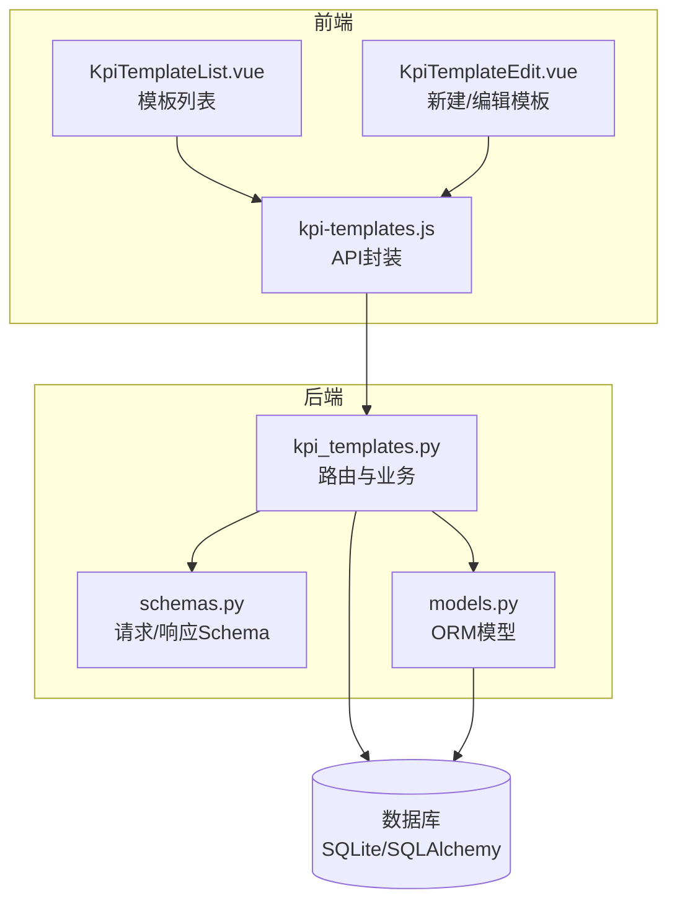
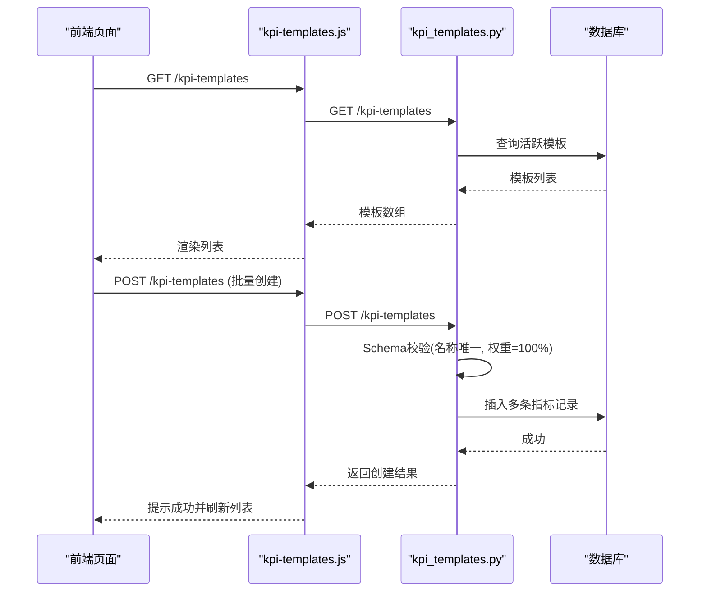
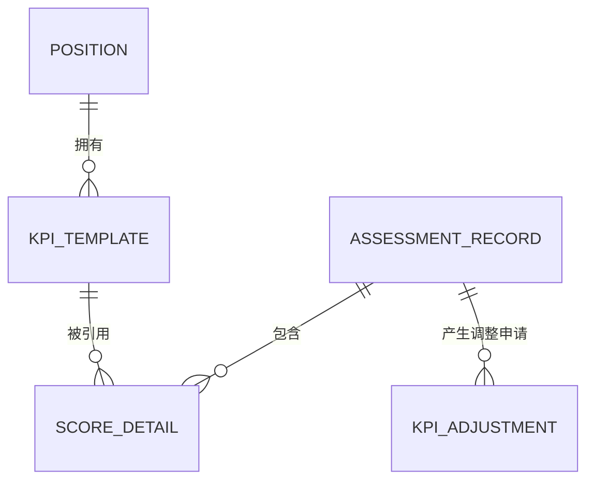
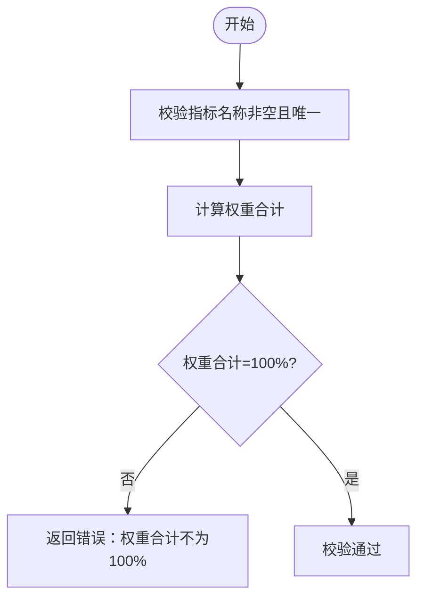
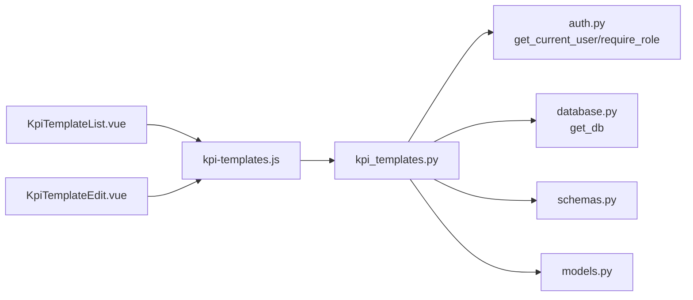

# KPI模板管理

<cite>
**本文引用的文件**   
- [backend/app/routers/kpi_templates.py](file://backend/app/routers/kpi_templates.py)
- [backend/app/models.py](file://backend/app/models.py)
- [backend/app/schemas.py](file://backend/app/schemas.py)
- [frontend/src/views/kpi-templates/KpiTemplateList.vue](file://frontend/src/views/kpi-templates/KpiTemplateList.vue)
- [frontend/src/views/kpi-templates/KpiTemplateEdit.vue](file://frontend/src/views/kpi-templates/KpiTemplateEdit.vue)
- [frontend/src/api/kpi-templates.js](file://frontend/src/api/kpi-templates.js)
</cite>

## 目录
1. [简介](#简介)
2. [项目结构](#项目结构)
3. [核心组件](#核心组件)
4. [架构总览](#架构总览)
5. [详细组件分析](#详细组件分析)
6. [依赖关系分析](#依赖关系分析)
7. [性能与扩展性](#性能与扩展性)
8. [故障排查指南](#故障排查指南)
9. [结论](#结论)
10. [附录：API定义与使用说明](#附录api定义与使用说明)

## 简介
本文件面向KPI模板管理子系统，系统性说明其数据模型、后端CRUD接口、前端交互流程、指标配置规则以及模板复用机制。当前实现以“岗位维度”组织KPI模板，支持批量创建/更新、单条编辑、复制、删除与查询；同时提供KPI调整申请与审批流程。文档将帮助读者快速理解并正确使用该功能模块。

## 项目结构
围绕KPI模板的前后端关键文件如下：
- 后端路由：负责HTTP接口、权限校验、业务逻辑与数据库操作
- 数据模型：定义KPI模板、评分明细、考核记录等实体
- 请求/响应Schema：定义输入输出结构与校验规则
- 前端页面：模板列表与在线编辑界面
- 前端API封装：统一调用后端接口

图表来源
- [backend/app/routers/kpi_templates.py:1-366](file://backend/app/routers/kpi_templates.py#L1-L366)
- [backend/app/schemas.py:118-207](file://backend/app/schemas.py#L118-L207)
- [backend/app/models.py:85-143](file://backend/app/models.py#L85-L143)
- [frontend/src/views/kpi-templates/KpiTemplateList.vue:1-91](file://frontend/src/views/kpi-templates/KpiTemplateList.vue#L1-L91)
- [frontend/src/views/kpi-templates/KpiTemplateEdit.vue:1-235](file://frontend/src/views/kpi-templates/KpiTemplateEdit.vue#L1-L235)
- [frontend/src/api/kpi-templates.js:1-34](file://frontend/src/api/kpi-templates.js#L1-L34)

章节来源
- [backend/app/routers/kpi_templates.py:1-366](file://backend/app/routers/kpi_templates.py#L1-L366)
- [backend/app/models.py:85-143](file://backend/app/models.py#L85-L143)
- [backend/app/schemas.py:118-207](file://backend/app/schemas.py#L118-L207)
- [frontend/src/views/kpi-templates/KpiTemplateList.vue:1-91](file://frontend/src/views/kpi-templates/KpiTemplateList.vue#L1-L91)
- [frontend/src/views/kpi-templates/KpiTemplateEdit.vue:1-235](file://frontend/src/views/kpi-templates/KpiTemplateEdit.vue#L1-L235)
- [frontend/src/api/kpi-templates.js:1-34](file://frontend/src/api/kpi-templates.js#L1-L34)

## 核心组件
- 后端路由层（FastAPI）
  - 提供KPI模板的列表、详情、批量创建/更新、单条创建/更新、复制、删除、KPI调整申请与审批等接口
  - 使用角色守卫限制管理员/经理等角色的写操作
- 数据模型层（SQLAlchemy ORM）
  - KpiTemplate：KPI模板主表，关联岗位Position
  - ScoreDetail：评分明细，引用KPI模板ID，用于删除保护
  - AssessmentRecord：考核记录，承载KPI快照与分数
  - KpiAdjustment：KPI调整申请与状态
- Schema校验层（Pydantic）
  - KpiItemCreate：指标项定义（名称、权重、目标值、计分方式、评分标准）
  - KpiTemplateCreate/Update：批量创建/更新模板的请求体，内置指标去重与权重和=100%校验
  - KpiTemplateSingleCreate/Update：单指标模板的创建/更新
- 前端视图层（Vue + Element Plus）
  - 模板列表页：展示岗位、指标名称、权重、目标值、说明，支持编辑、复制、删除
  - 模板编辑页：选择岗位、动态维护指标列表、实时校验权重合计为100%，提交批量创建或更新
- API封装层（Axios）
  - 统一封装KPI模板相关REST接口调用

章节来源
- [backend/app/routers/kpi_templates.py:22-253](file://backend/app/routers/kpi_templates.py#L22-L253)
- [backend/app/models.py:85-143](file://backend/app/models.py#L85-L143)
- [backend/app/schemas.py:118-207](file://backend/app/schemas.py#L118-L207)
- [frontend/src/views/kpi-templates/KpiTemplateList.vue:1-91](file://frontend/src/views/kpi-templates/KpiTemplateList.vue#L1-L91)
- [frontend/src/views/kpi-templates/KpiTemplateEdit.vue:1-235](file://frontend/src/views/kpi-templates/KpiTemplateEdit.vue#L1-L235)
- [frontend/src/api/kpi-templates.js:1-34](file://frontend/src/api/kpi-templates.js#L1-L34)

## 架构总览
KPI模板管理的端到端流程如下：
- 前端在模板列表页发起GET请求获取活跃模板
- 新建/编辑时，前端校验表单（岗位必填、指标非空、名称唯一、权重合计=100%），再POST/PUT到后端
- 后端通过Schema进行二次校验，持久化到数据库，返回结果
- 删除前检查是否被评分明细引用，防止误删
- 复制功能基于现有模板生成新记录，便于复用

图表来源
- [frontend/src/api/kpi-templates.js:15-17](file://frontend/src/api/kpi-templates.js#L15-L17)
- [backend/app/routers/kpi_templates.py:105-130](file://backend/app/routers/kpi_templates.py#L105-L130)
- [backend/app/schemas.py:131-150](file://backend/app/schemas.py#L131-L150)

## 详细组件分析

### 数据模型设计
- KpiTemplate
  - 字段：id、position_id、name、weight、target_value、scoring_method、description、is_active、created_at
  - 关系：与Position一对多，与ScoreDetail存在引用关系
- ScoreDetail
  - 字段：record_id、kpi_template_id、kpi_name、weight、self_score、manager_score、target_value、created_at
  - 作用：保存每次评分明细，包含对KPI模板的快照引用
- AssessmentRecord
  - 字段：包含cycle_id、employee_id、position_id、department_id、kpi_snapshot、各类分数、等级、状态等
  - 作用：承载一次完整考核过程的数据
- KpiAdjustment
  - 字段：record_id、original_kpi、adjusted_kpi、reason、status、created_at
  - 作用：记录KPI目标的临时调整申请与审批结果

图表来源
- [backend/app/models.py:20-29](file://backend/app/models.py#L20-L29)
- [backend/app/models.py:85-98](file://backend/app/models.py#L85-L98)
- [backend/app/models.py:99-143](file://backend/app/models.py#L99-L143)
- [backend/app/models.py:145-153](file://backend/app/models.py#L145-L153)

章节来源
- [backend/app/models.py:85-153](file://backend/app/models.py#L85-L153)

### 指标定义与业务规则
- 指标字段
  - name：指标名称，必填且模板内唯一
  - weight：权重，Decimal类型，范围0~100，同一模板内所有指标权重之和必须等于100%
  - target_value：目标值，字符串描述，如“≥ 95%”
  - scoring_method：计分方式，默认percentage，可选包括percentage、qualitative、quantitative
  - description：评分标准说明，文本字段
- 校验规则
  - 后端Schema在批量创建/更新时对items进行校验：名称去重、权重总和=100%
  - 前端在编辑页也进行同名检测与权重合计校验，提升用户体验

图表来源
- [backend/app/schemas.py:118-150](file://backend/app/schemas.py#L118-L150)
- [frontend/src/views/kpi-templates/KpiTemplateEdit.vue:166-183](file://frontend/src/views/kpi-templates/KpiTemplateEdit.vue#L166-L183)

章节来源
- [backend/app/schemas.py:118-150](file://backend/app/schemas.py#L118-L150)
- [frontend/src/views/kpi-templates/KpiTemplateEdit.vue:166-183](file://frontend/src/views/kpi-templates/KpiTemplateEdit.vue#L166-L183)

### CRUD接口实现

#### 列表与详情
- GET /kpi-templates
  - 返回所有活跃模板（is_active=true），包含岗位名称
- GET /kpi-templates/{template_id}
  - 返回单个模板详情，不存在则404

章节来源
- [backend/app/routers/kpi_templates.py:22-65](file://backend/app/routers/kpi_templates.py#L22-L65)
- [backend/app/routers/kpi_templates.py:175-195](file://backend/app/routers/kpi_templates.py#L175-L195)

#### 批量创建与更新
- POST /kpi-templates
  - 请求体：position_id、items[]
  - 行为：为指定岗位批量创建多个指标记录
  - 权限：admin
- PUT /kpi-templates/{template_id}
  - 请求体：items[]
  - 行为：先停用同岗位已有模板，再批量创建新指标记录
  - 权限：admin

章节来源
- [backend/app/routers/kpi_templates.py:105-172](file://backend/app/routers/kpi_templates.py#L105-L172)
- [backend/app/schemas.py:131-187](file://backend/app/schemas.py#L131-L187)

#### 单条创建与更新
- POST /kpi-templates/single
  - 请求体：position_id、name、weight、target_value、scoring_method、description
  - 权限：admin
- PUT /kpi-templates/single/{template_id}
  - 请求体：可更新字段集合
  - 权限：admin

章节来源
- [backend/app/routers/kpi_templates.py:68-102](file://backend/app/routers/kpi_templates.py#L68-L102)
- [backend/app/schemas.py:152-167](file://backend/app/schemas.py#L152-L167)

#### 复制与删除
- POST /kpi-templates/{template_id}/copy
  - 行为：复制模板，名称追加“-副本”，其他字段拷贝
  - 权限：admin
- DELETE /kpi-templates/{template_id}
  - 行为：若存在ScoreDetail引用则拒绝删除，否则物理删除
  - 权限：admin

章节来源
- [backend/app/routers/kpi_templates.py:198-253](file://backend/app/routers/kpi_templates.py#L198-L253)

#### KPI调整申请与审批
- POST /kpi-templates/{record_id}/adjust
  - 行为：提交KPI目标调整申请，状态pending
  - 权限：manager/admin
- GET /kpi-templates/kpi-adjustments/pending
  - 行为：列出待审批的调整申请，manager仅可见其下属员工相关申请
  - 权限：admin/hr/executive/manager
- POST /kpi-templates/kpi-adjustments/{adj_id}/approve
  - 行为：批准调整，更新考核记录的kpi_snapshot，并记录审计日志
  - 权限：admin/hr/manager
- POST /kpi-templates/kpi-adjustments/{adj_id}/reject
  - 行为：驳回调整申请，并记录审计日志
  - 权限：admin/hr/manager

章节来源
- [backend/app/routers/kpi_templates.py:256-365](file://backend/app/routers/kpi_templates.py#L256-L365)

### 前端模板管理界面

#### 模板列表
- 功能
  - 展示岗位、指标名称、权重、目标值、说明
  - 支持新建、编辑、复制、删除
- 交互
  - 点击“新建模板”跳转至编辑页
  - 点击“复制”弹出确认框后调用复制接口
  - 点击“删除”弹出确认框后调用删除接口

章节来源
- [frontend/src/views/kpi-templates/KpiTemplateList.vue:1-91](file://frontend/src/views/kpi-templates/KpiTemplateList.vue#L1-L91)
- [frontend/src/api/kpi-templates.js:1-34](file://frontend/src/api/kpi-templates.js#L1-L34)

#### 模板编辑（新建/编辑）
- 功能
  - 选择岗位（新建时可切换，编辑时禁用）
  - 动态添加/删除指标行
  - 实时显示权重合计，强制为100%才可提交
  - 编辑模式下加载岗位下所有活跃模板作为指标初始数据
- 校验
  - 前端：岗位必填、指标非空、名称非空且唯一、权重合计=100%
  - 后端：Schema再次校验名称唯一与权重合计=100%
- 提交
  - 新建：POST /kpi-templates
  - 编辑：PUT /kpi-templates/{template_id}

章节来源
- [frontend/src/views/kpi-templates/KpiTemplateEdit.vue:1-235](file://frontend/src/views/kpi-templates/KpiTemplateEdit.vue#L1-L235)
- [backend/app/schemas.py:131-187](file://backend/app/schemas.py#L131-L187)

### 模板复用机制
- 模板复制
  - 通过复制接口快速生成新模板，便于在不同岗位或不同版本间复用基础指标
- 版本管理
  - 当前实现采用“按岗位停用旧模板+创建新模板”的方式模拟版本替换
  - 编辑时会将同岗位已有模板标记为非活跃，随后批量创建新指标
- 继承与组合
  - 当前未实现模板继承；可通过复制+编辑逐步演进模板结构
- 建议扩展
  - 引入version字段与parent_template_id，支持真正的版本树与继承
  - 增加模板分组与标签，便于分类复用

章节来源
- [backend/app/routers/kpi_templates.py:133-172](file://backend/app/routers/kpi_templates.py#L133-L172)
- [backend/app/routers/kpi_templates.py:198-230](file://backend/app/routers/kpi_templates.py#L198-L230)

## 依赖关系分析
- 路由依赖
  - FastAPI路由依赖get_current_user与require_role进行鉴权
  - 数据库会话通过get_db注入
- 模型依赖
  - KpiTemplate依赖Position外键
  - ScoreDetail依赖AssessmentRecord与KpiTemplate外键
- Schema依赖
  - KpiTemplateCreate/Update依赖KpiItemCreate
- 前端依赖
  - 列表与编辑页依赖kpi-templates.js提供的API方法
  - 编辑页依赖departments接口获取岗位列表

图表来源
- [backend/app/routers/kpi_templates.py:1-18](file://backend/app/routers/kpi_templates.py#L1-L18)
- [frontend/src/views/kpi-templates/KpiTemplateList.vue:26-34](file://frontend/src/views/kpi-templates/KpiTemplateList.vue#L26-L34)
- [frontend/src/views/kpi-templates/KpiTemplateEdit.vue:70-84](file://frontend/src/views/kpi-templates/KpiTemplateEdit.vue#L70-L84)
- [frontend/src/api/kpi-templates.js:1-34](file://frontend/src/api/kpi-templates.js#L1-L34)

章节来源
- [backend/app/routers/kpi_templates.py:1-18](file://backend/app/routers/kpi_templates.py#L1-L18)
- [frontend/src/views/kpi-templates/KpiTemplateList.vue:26-34](file://frontend/src/views/kpi-templates/KpiTemplateList.vue#L26-L34)
- [frontend/src/views/kpi-templates/KpiTemplateEdit.vue:70-84](file://frontend/src/views/kpi-templates/KpiTemplateEdit.vue#L70-L84)
- [frontend/src/api/kpi-templates.js:1-34](file://frontend/src/api/kpi-templates.js#L1-L34)

## 性能与扩展性
- 查询优化
  - 列表与详情使用joinedload预加载Position，减少N+1查询
- 写入策略
  - 批量创建一次性插入多条记录，减少事务次数
  - 编辑更新采用“停用旧模板+批量新建”的策略，避免复杂更新逻辑
- 可扩展点
  - 引入分页与筛选（按岗位、关键词、状态）
  - 增加索引（position_id、is_active）提升查询效率
  - 引入模板版本与继承字段，支持更复杂的复用场景
  - 增加导入导出接口（Excel/CSV），支持批量导入指标与模板

[本节为通用指导，不直接分析具体文件]

## 故障排查指南
- 删除失败
  - 现象：删除时报错提示“该KPI模板已被考核记录引用，无法删除”
  - 原因：ScoreDetail中存在对该模板的引用
  - 处理：先清理相关评分明细或解除引用后再删除
- 权重校验失败
  - 现象：保存时报错“权重总和必须等于100%”
  - 原因：指标权重合计不为100%
  - 处理：调整各指标权重使合计为100%
- 名称重复
  - 现象：保存时报错“指标名称不能重复”
  - 原因：同一模板内存在同名指标
  - 处理：修改指标名称确保唯一
- 权限不足
  - 现象：写操作返回403/401
  - 原因：当前用户不具备admin/manager等所需角色
  - 处理：使用具备相应角色的账号操作

章节来源
- [backend/app/routers/kpi_templates.py:233-253](file://backend/app/routers/kpi_templates.py#L233-L253)
- [backend/app/schemas.py:131-187](file://backend/app/schemas.py#L131-L187)

## 结论
KPI模板管理模块在后端提供了完善的CRUD能力与严格的校验规则，在前端实现了直观的列表与编辑体验。通过复制与“停用旧模板+创建新模板”的方式实现了基础的模板复用与版本替代。建议在后续迭代中增强版本管理、导入导出与分页筛选能力，以提升系统的易用性与扩展性。

[本节为总结性内容，不直接分析具体文件]

## 附录：API定义与使用说明

### REST接口清单
- 列表与详情
  - GET /kpi-templates
  - GET /kpi-templates/{template_id}
- 批量创建与更新
  - POST /kpi-templates
  - PUT /kpi-templates/{template_id}
- 单条创建与更新
  - POST /kpi-templates/single
  - PUT /kpi-templates/single/{template_id}
- 复制与删除
  - POST /kpi-templates/{template_id}/copy
  - DELETE /kpi-templates/{template_id}
- KPI调整申请与审批
  - POST /kpi-templates/{record_id}/adjust
  - GET /kpi-templates/kpi-adjustments/pending
  - POST /kpi-templates/kpi-adjustments/{adj_id}/approve
  - POST /kpi-templates/kpi-adjustments/{adj_id}/reject

章节来源
- [backend/app/routers/kpi_templates.py:22-365](file://backend/app/routers/kpi_templates.py#L22-L365)
- [frontend/src/api/kpi-templates.js:1-34](file://frontend/src/api/kpi-templates.js#L1-L34)

### 请求/响应示例（路径参考）
- 批量创建
  - 请求路径：POST /kpi-templates
  - 请求体关键字段：position_id、items[]
  - 参考实现：[backend/app/routers/kpi_templates.py:105-130](file://backend/app/routers/kpi_templates.py#L105-L130)
- 批量更新
  - 请求路径：PUT /kpi-templates/{template_id}
  - 请求体关键字段：items[]
  - 参考实现：[backend/app/routers/kpi_templates.py:133-172](file://backend/app/routers/kpi_templates.py#L133-L172)
- 复制
  - 请求路径：POST /kpi-templates/{template_id}/copy
  - 参考实现：[backend/app/routers/kpi_templates.py:198-230](file://backend/app/routers/kpi_templates.py#L198-L230)
- 删除
  - 请求路径：DELETE /kpi-templates/{template_id}
  - 参考实现：[backend/app/routers/kpi_templates.py:233-253](file://backend/app/routers/kpi_templates.py#L233-L253)

### 前端交互要点
- 列表页
  - 数据来源：GET /kpi-templates
  - 操作入口：新建、编辑、复制、删除
  - 参考实现：[frontend/src/views/kpi-templates/KpiTemplateList.vue:1-91](file://frontend/src/views/kpi-templates/KpiTemplateList.vue#L1-L91)
- 编辑页
  - 数据来源：岗位列表接口、模板详情接口
  - 校验规则：岗位必填、指标非空、名称唯一、权重合计=100%
  - 提交逻辑：新建走批量创建，编辑走批量更新
  - 参考实现：[frontend/src/views/kpi-templates/KpiTemplateEdit.vue:1-235](file://frontend/src/views/kpi-templates/KpiTemplateEdit.vue#L1-L235)

章节来源
- [frontend/src/views/kpi-templates/KpiTemplateList.vue:1-91](file://frontend/src/views/kpi-templates/KpiTemplateList.vue#L1-L91)
- [frontend/src/views/kpi-templates/KpiTemplateEdit.vue:1-235](file://frontend/src/views/kpi-templates/KpiTemplateEdit.vue#L1-L235)