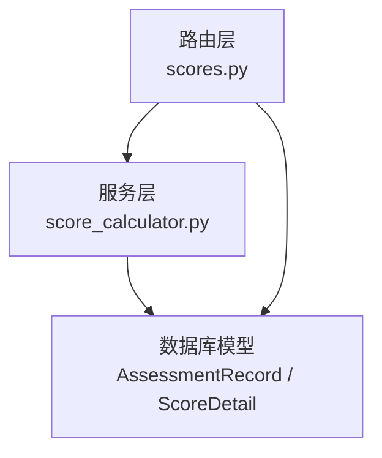
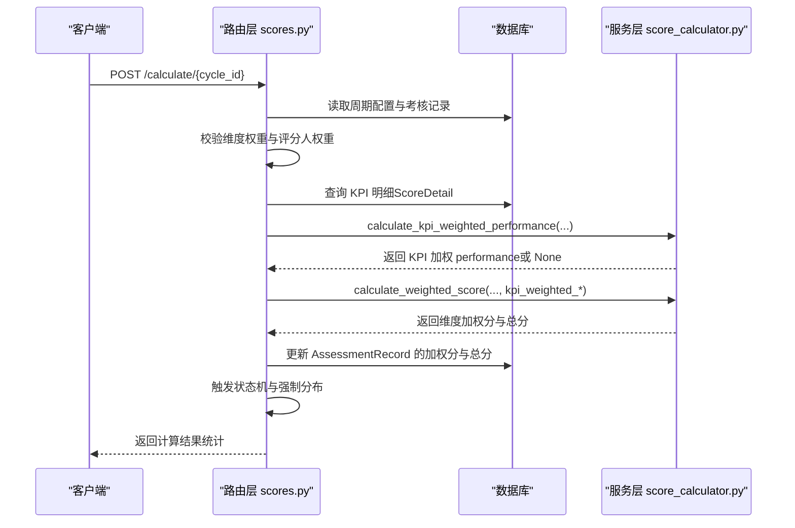
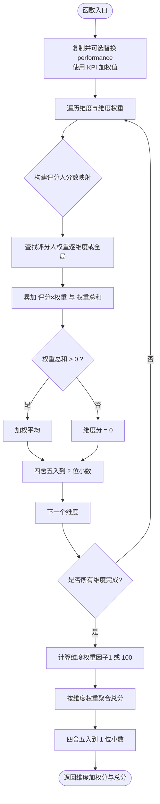
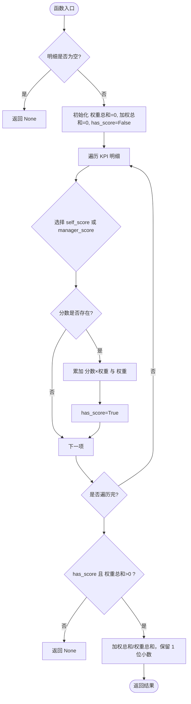
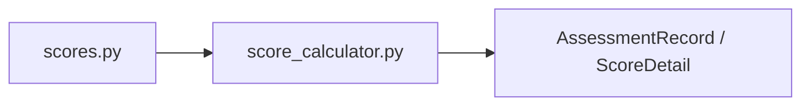

# 加权计算引擎

<cite>
**本文引用的文件**   
- [score_calculator.py](file://backend/app/services/score_calculator.py)
- [scores.py](file://backend/app/routers/scores.py)
- [test_score_calculator.py](file://backend/tests/test_score_calculator.py)
</cite>

## 目录
1. [引言](#引言)
2. [项目结构](#项目结构)
3. [核心组件](#核心组件)
4. [架构总览](#架构总览)
5. [详细组件分析](#详细组件分析)
6. [依赖关系分析](#依赖关系分析)
7. [性能与精度特性](#性能与精度特性)
8. [异常处理与健壮性](#异常处理与健壮性)
9. [计算示例与公式说明](#计算示例与公式说明)
10. [故障排查指南](#故障排查指南)
11. [结论](#结论)

## 引言
本文件面向“绩效考核评分系统”中的加权计算引擎，聚焦以下目标：
- 解释维度权重配置与评分人权重的数学模型。
- 深入解析 calculate_weighted_score 的实现逻辑、中间结果与最终结果的精度控制。
- 介绍 KPI 加权性能得分的计算方法，包括 calculate_kpi_weighted_performance 的实现细节。
- 提供不同权重配置下的计算示例与结果对比。
- 给出性能优化建议与异常处理机制说明。

## 项目结构
加权计算引擎的核心实现位于后端服务层与路由层：
- 服务层：backend/app/services/score_calculator.py，封装加权计算与 KPI 加权性能计算。
- 路由层：backend/app/routers/scores.py，负责从数据库加载数据、校验配置、调用服务层计算并持久化结果。
- 测试层：backend/tests/test_score_calculator.py，覆盖加权计算与 KPI 加权性能的单元测试。

**图表来源**
- [scores.py:165-331](file://backend/app/routers/scores.py#L165-L331)
- [score_calculator.py:4-84](file://backend/app/services/score_calculator.py#L4-L84)

**章节来源**
- [score_calculator.py:1-126](file://backend/app/services/score_calculator.py#L1-L126)
- [scores.py:165-331](file://backend/app/routers/scores.py#L165-L331)

## 核心组件
- calculate_weighted_score：按维度聚合评分人分数，再按维度权重聚合总分；支持 KPI 加权 performance 覆盖原始 performance。
- calculate_kpi_weighted_performance：根据 KPI 明细（含权重与评分）计算加权 performance 得分。

关键输入参数：
- self_scores：自评分数字典，键为维度名，值为分数。
- manager_scores：上级评分数字典。
- peer_scores：协作评分数字典。
- dim_weights：维度权重字典，如 {performance: 0.5, ability: 0.3, attitude: 0.2}。
- reviewer_weights：评分人权重，可逐维度配置，如 {performance: {self: 0.3, manager: 0.7}, ...}。
- kpi_weighted_self_performance：KPI 加权后的自评 performance（可选）。
- kpi_weighted_manager_performance：KPI 加权后的上级 performance（可选）。

关键输出字段：
- weighted_performance：业绩维度加权分。
- weighted_ability：能力维度加权分。
- weighted_attitude：态度维度加权分。
- total_score：最终总分。

**章节来源**
- [score_calculator.py:4-84](file://backend/app/services/score_calculator.py#L4-L84)

## 架构总览
加权计算的整体流程如下：
1. 路由层读取周期配置（维度权重、评分人权重、等级规则），并进行合法性校验。
2. 对每条考核记录，若启用 KPI，则先计算自评与上级的 KPI 加权 performance。
3. 调用 calculate_weighted_score 计算各维度加权分与总分。
4. 将结果写回 AssessmentRecord，并进入后续状态机与强制分布流程。

**图表来源**
- [scores.py:165-331](file://backend/app/routers/scores.py#L165-L331)
- [score_calculator.py:4-126](file://backend/app/services/score_calculator.py#L4-L126)

## 详细组件分析

### 组件一：calculate_weighted_score
职责：
- 对每个维度，聚合自评、上级评、协作评（如有）的分数，使用评分人权重进行加权平均。
- 对维度加权分，按维度权重聚合得到总分。
- 精度控制：维度加权分保留 2 位小数；总分保留 1 位小数。
- 支持 KPI 加权 performance 覆盖原始 performance。

算法要点：
- 评分人权重归一化：当某维度缺少某些评分人时，仅对存在的评分人权重求和并归一化。
- 维度权重因子：当维度权重之和大于 1（例如百分比形式 100%）时，自动除以 100 以归一化。
- 缺失维度默认 0 分。

**图表来源**
- [score_calculator.py:4-84](file://backend/app/services/score_calculator.py#L4-L84)

**章节来源**
- [score_calculator.py:4-84](file://backend/app/services/score_calculator.py#L4-L84)

### 组件二：calculate_kpi_weighted_performance
职责：
- 根据 KPI 明细列表（包含 weight、self_score、manager_score）计算指定评分人的加权 performance。
- 若无评分数据或总权重为 0，返回 None。
- 结果保留 1 位小数。

算法要点：
- 仅对有评分的 KPI 项参与加权求和与权重累加。
- 未评分项不参与分母（即按已评分项的权重归一化）。

**图表来源**
- [score_calculator.py:87-126](file://backend/app/services/score_calculator.py#L87-L126)

**章节来源**
- [score_calculator.py:87-126](file://backend/app/services/score_calculator.py#L87-L126)

## 依赖关系分析
- 路由层依赖服务层：
  - scores.py 导入 calculate_weighted_score 与 calculate_kpi_weighted_performance。
  - 在计算接口中，先计算 KPI 加权 performance，再调用加权总分计算。
- 服务层无外部库依赖，仅使用基础类型与内置 round。

**图表来源**
- [scores.py:15-16](file://backend/app/routers/scores.py#L15-L16)
- [score_calculator.py:1-2](file://backend/app/services/score_calculator.py#L1-L2)

**章节来源**
- [scores.py:15-16](file://backend/app/routers/scores.py#L15-L16)
- [score_calculator.py:1-2](file://backend/app/services/score_calculator.py#L1-L2)

## 性能与精度特性
- 时间复杂度：
  - calculate_weighted_score：O(D + R)，D 为维度数量，R 为评分人数量（通常为 3）。
  - calculate_kpi_weighted_performance：O(N)，N 为 KPI 明细数量。
- 空间复杂度：
  - 均为 O(1) 额外空间（不计输入数据结构）。
- 精度控制：
  - 维度加权分：round(x, 2)。
  - 总分：round(x, 1)。
  - KPI 加权 performance：round(x, 1)。
- 数值稳定性：
  - 通过“仅对存在的评分人权重归一化”，避免缺项导致的除零或偏差。
  - 维度权重支持 1.0 或 100% 两种形式，自动归一化。

[本节为通用性能讨论，不直接分析具体文件]

## 异常处理与健壮性
- 路由层校验：
  - 维度权重之和必须为 1.0 或 100%，否则抛出 422 错误。
  - 评分人权重在每个维度内也必须为 1.0 或 100%，否则抛出 422 错误。
  - 未完成评分（缺少自评、上级评或未完成的协作评）会阻止计算。
- 服务层健壮性：
  - 空评分字典返回 0 分。
  - KPI 加权 performance 在无评分或总权重为 0 时返回 None，避免除零。
  - 缺失维度默认 0 分，不影响其他维度计算。

**章节来源**
- [scores.py:181-226](file://backend/app/routers/scores.py#L181-L226)
- [score_calculator.py:101-126](file://backend/app/services/score_calculator.py#L101-L126)

## 计算示例与公式说明

### 基本加权计算示例
假设：
- 自评分数：{performance: 82, ability: 84, attitude: 88}
- 上级评分数：{performance: 85, ability: 88, attitude: 90}
- 协作评分数：{ability: 86}
- 维度权重：{performance: 0.5, ability: 0.3, attitude: 0.2}
- 评分人权重：
  - performance: {self: 0.3, manager: 0.7}
  - ability: {self: 0.3, manager: 0.5, peer: 0.2}
  - attitude: {self: 0.3, manager: 0.7}

计算步骤：
- performance 维度：82×0.3 + 85×0.7 = 84.1 → 保留 2 位小数为 84.10
- ability 维度：84×0.3 + 88×0.5 + 86×0.2 = 86.0 → 保留 2 位小数为 86.00
- attitude 维度：88×0.3 + 90×0.7 = 89.4 → 保留 2 位小数为 89.40
- 总分：84.10×0.5 + 86.00×0.3 + 89.40×0.2 = 86.03 → 保留 1 位小数为 86.0

断言参考路径：
- [test_score_calculator.py:15-38](file://backend/tests/test_score_calculator.py#L15-L38)

### 无协作评分场景
假设：
- 自评分数：{performance: 80, ability: 80, attitude: 80}
- 上级评分数：{performance: 90, ability: 90, attitude: 90}
- 协作评分数：{}
- 维度权重：{performance: 0.5, ability: 0.3, attitude: 0.2}
- 评分人权重同上

计算步骤：
- ability 维度仅有 self 与 manager：80×0.3 + 90×0.5 = 69；权重总和 0.8；归一化后 69/0.8 = 86.25
- 总分：87×0.5 + 86.25×0.3 + 87×0.2 = 86.775 → 保留 1 位小数为 86.8

断言参考路径：
- [test_score_calculator.py:40-59](file://backend/tests/test_score_calculator.py#L40-L59)

### 精度控制示例
假设：
- 自评分数：{performance: 77.55, ability: 83.33, attitude: 91.67}
- 上级评分数：{performance: 82.45, ability: 88.88, attitude: 95.00}
- 协作评分数：{}
- 维度权重：{performance: 0.4, ability: 0.35, attitude: 0.25}
- 评分人权重：{performance: {self: 0.4, manager: 0.6}, ability: {self: 0.4, manager: 0.6}, attitude: {self: 0.4, manager: 0.6}}

计算步骤：
- performance：77.55×0.4 + 82.45×0.6 = 80.49 → 保留 2 位小数
- ability：83.33×0.4 + 88.88×0.6 = 86.662 → 保留 2 位小数 86.66
- attitude：91.67×0.4 + 95.00×0.6 = 93.668 → 保留 2 位小数 93.67
- 总分：80.49×0.4 + 86.66×0.35 + 93.67×0.25 ≈ 86.503 → 保留 1 位小数 86.5

断言参考路径：
- [test_score_calculator.py:61-82](file://backend/tests/test_score_calculator.py#L61-L82)

### KPI 加权 performance 覆盖示例
假设：
- 自评分数：{performance: 82, ability: 84, attitude: 88}
- 上级评分数：{performance: 85, ability: 88, attitude: 90}
- 协作评分数：{}
- 维度权重：{performance: 0.5, ability: 0.3, attitude: 0.2}
- 评分人权重：{performance: {self: 0.3, manager: 0.7}, ability: {self: 0.3, manager: 0.7}, attitude: {self: 0.3, manager: 0.7}}
- KPI 加权 performance：self=88.5，manager=92.0

计算步骤：
- performance 被 KPI 加权值覆盖：88.5×0.3 + 92.0×0.7 = 90.95
- ability：84×0.3 + 88×0.7 = 86.8
- attitude：88×0.3 + 90×0.7 = 89.4
- 总分：90.95×0.5 + 86.8×0.3 + 89.4×0.2 ≈ 89.115 → 保留 1 位小数 89.1

断言参考路径：
- [test_score_calculator.py:84-103](file://backend/tests/test_score_calculator.py#L84-L103)

### KPI 加权 performance 计算示例
假设 KPI 明细：
- 第一项：weight=0.4，self_score=80，manager_score=85
- 第二项：weight=0.6，self_score=90，manager_score=95

计算步骤：
- self：80×0.4 + 90×0.6 = 86.0
- manager：85×0.4 + 95×0.6 = 92.0

断言参考路径：
- [test_score_calculator.py:138-156](file://backend/tests/test_score_calculator.py#L138-L156)

### 边界与空数据示例
- 空评分数据：返回全 0 分。
- 边界值：self=0，manager=100，所有维度加权分均为 70.0，总分 70.0。
- KPI 加权 performance：无评分或总权重为 0 返回 None。

断言参考路径：
- [test_score_calculator.py:105-132](file://backend/tests/test_score_calculator.py#L105-L132)
- [test_score_calculator.py:158-178](file://backend/tests/test_score_calculator.py#L158-L178)

## 故障排查指南
常见问题与定位建议：
- 维度权重之和不合法：
  - 检查周期配置的 dimension_weights 是否为 1.0 或 100%。
  - 路由层会在计算前抛出 422 错误，提示当前权重和。
- 评分人权重之和不合法：
  - 检查 reviewer_weights 每个维度的权重和是否为 1.0 或 100%。
  - 路由层会针对具体维度报错。
- 未完成评分导致无法计算：
  - 检查自评、上级评是否提交，协作评是否完成（若启用）。
  - 路由层会列出未完成记录的 record_id 与原因。
- KPI 加权 performance 为 None：
  - 检查 ScoreDetail 是否有评分数据，或总权重是否为 0。
  - 服务层在无评分或总权重为 0 时返回 None，不会导致除零错误。
- 总分异常偏高或偏低：
  - 确认维度权重与评分人权重是否正确配置。
  - 确认 KPI 加权 performance 是否覆盖了原始 performance。

**章节来源**
- [scores.py:181-226](file://backend/app/routers/scores.py#L181-L226)
- [score_calculator.py:101-126](file://backend/app/services/score_calculator.py#L101-L126)

## 结论
加权计算引擎通过清晰的二维加权模型（评分人维度加权 + 维度权重聚合）实现了稳定、可配置的绩效总分计算。其关键优势包括：
- 灵活的维度与评分人权重配置，支持百分比与小数两种形式。
- 精确的精度控制，确保业务展示一致性与可比性。
- 健壮的异常处理，覆盖空数据、缺项、权重非法等边界情况。
- 可扩展的 KPI 加权 performance 机制，使业绩维度可由 KPI 明细驱动。

在实际使用中，建议：
- 严格校验周期配置（维度权重与评分人权重）。
- 确保 KPI 明细完整与评分齐全，以获得稳定的加权 performance。
- 结合测试用例验证不同权重配置下的计算结果，保证业务一致性。