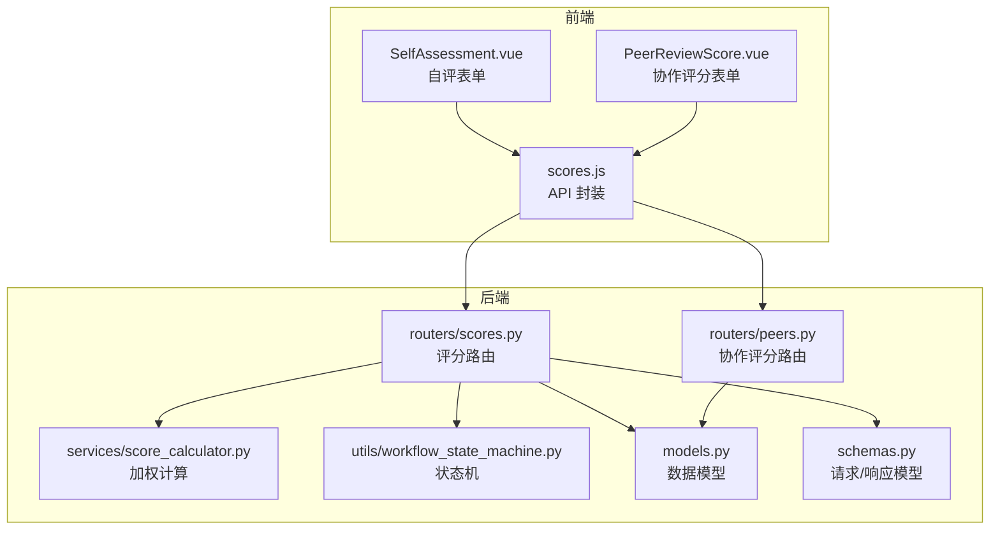
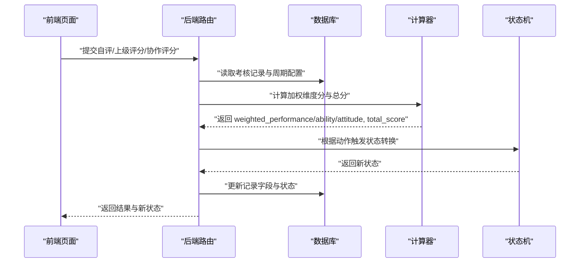
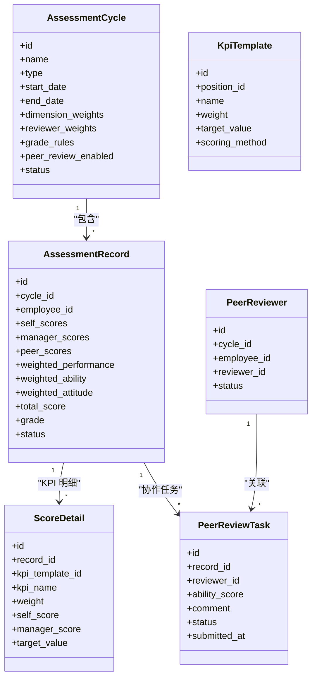
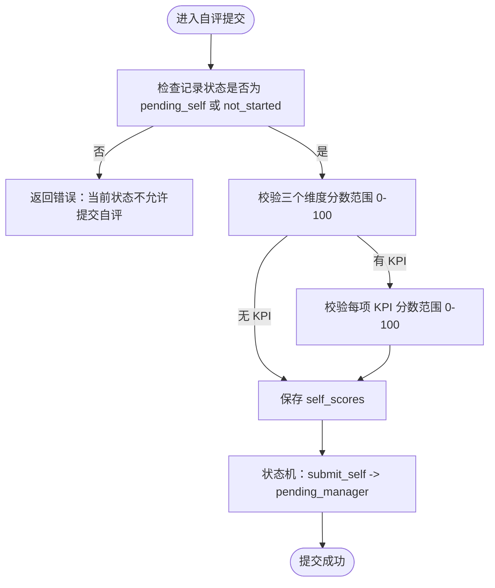
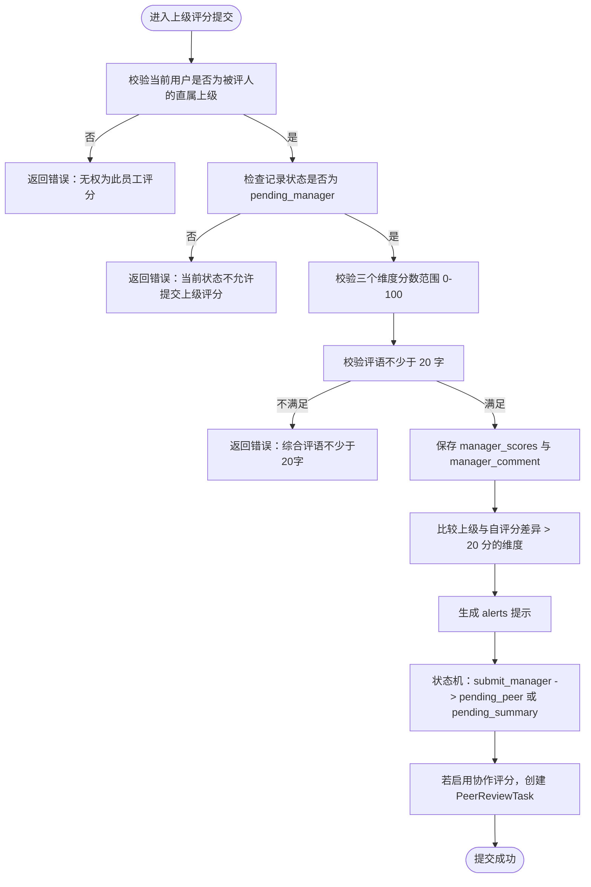
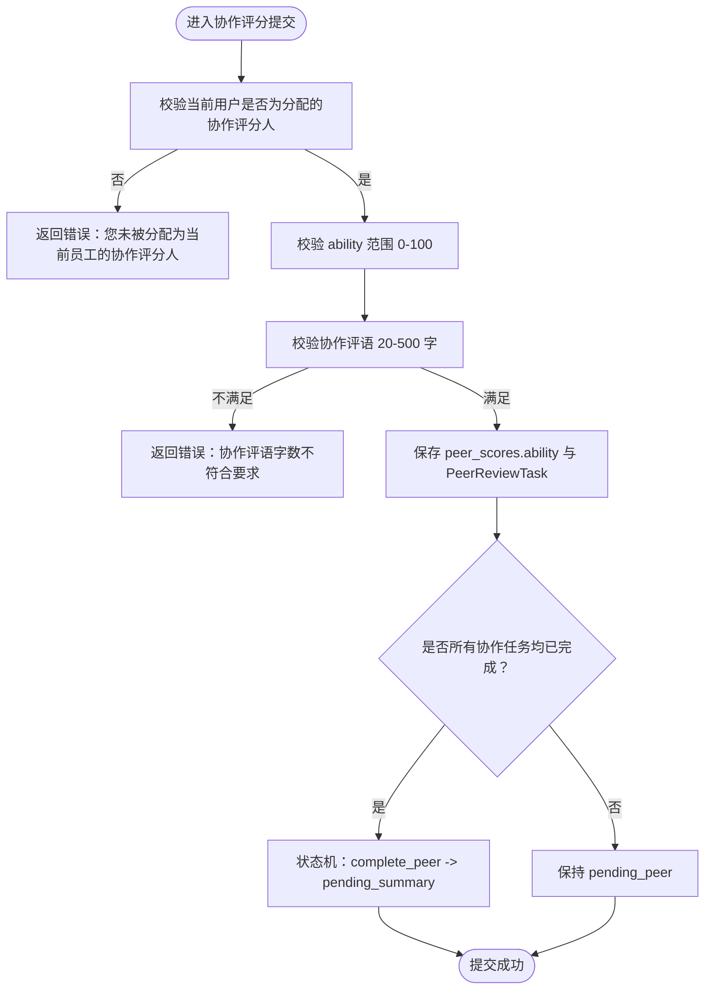
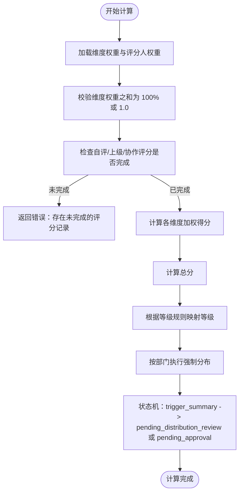
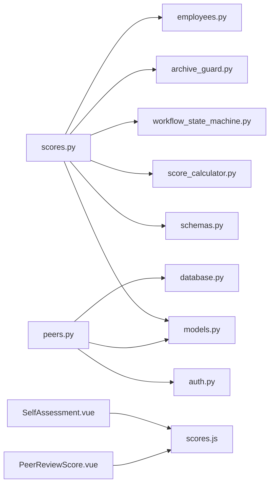

# 多维度评分模型

<cite>
**本文引用的文件**   
- [backend/app/models.py](file://backend/app/models.py)
- [backend/app/schemas.py](file://backend/app/schemas.py)
- [backend/app/routers/scores.py](file://backend/app/routers/scores.py)
- [backend/app/routers/peers.py](file://backend/app/routers/peers.py)
- [backend/app/services/score_calculator.py](file://backend/app/services/score_calculator.py)
- [backend/app/utils/workflow_state_machine.py](file://backend/app/utils/workflow_state_machine.py)
- [frontend/src/views/self-assessment/SelfAssessment.vue](file://frontend/src/views/self-assessment/SelfAssessment.vue)
- [frontend/src/views/peer-review/PeerReviewScore.vue](file://frontend/src/views/peer-review/PeerReviewScore.vue)
- [frontend/src/api/scores.js](file://frontend/src/api/scores.js)
</cite>

## 目录
1. [引言](#引言)
2. [项目结构](#项目结构)
3. [核心组件](#核心组件)
4. [架构总览](#架构总览)
5. [详细组件分析](#详细组件分析)
6. [依赖关系分析](#依赖关系分析)
7. [性能与扩展性](#性能与扩展性)
8. [故障排查指南](#故障排查指南)
9. [结论](#结论)
10. [附录：API 接口文档](#附录api-接口文档)

## 引言
本文件围绕“多维度评分模型”展开，重点说明自评、上级评分、协作评分三种评分类型的数据结构设计、维度定义与业务含义、权限控制、数据验证规则、状态流转机制，以及前端评分表单的实现要点。同时给出评分数据的 API 接口说明与使用示例，帮助开发者快速理解并正确集成评分功能。

## 项目结构
本项目采用前后端分离架构：
- 后端基于 FastAPI，提供评分相关 REST 接口，使用 SQLAlchemy ORM 管理数据库模型，Pydantic 做请求校验。
- 前端基于 Vue 3 + Element Plus，实现自评、协作评分等页面，调用后端 API 完成数据交互。

**图表来源**
- [backend/app/routers/scores.py:1-20](file://backend/app/routers/scores.py#L1-L20)
- [backend/app/routers/peers.py:1-11](file://backend/app/routers/peers.py#L1-L11)
- [backend/app/services/score_calculator.py:1-12](file://backend/app/services/score_calculator.py#L1-L12)
- [backend/app/utils/workflow_state_machine.py:10-20](file://backend/app/utils/workflow_state_machine.py#L10-L20)
- [backend/app/models.py:62-131](file://backend/app/models.py#L62-L131)
- [backend/app/schemas.py:474-511](file://backend/app/schemas.py#L474-L511)
- [frontend/src/views/self-assessment/SelfAssessment.vue:148-155](file://frontend/src/views/self-assessment/SelfAssessment.vue#L148-L155)
- [frontend/src/views/peer-review/PeerReviewScore.vue:140-147](file://frontend/src/views/peer-review/PeerReviewScore.vue#L140-L147)
- [frontend/src/api/scores.js:1-77](file://frontend/src/api/scores.js#L1-L77)

**章节来源**
- [backend/app/models.py:62-131](file://backend/app/models.py#L62-L131)
- [backend/app/schemas.py:474-511](file://backend/app/schemas.py#L474-L511)
- [frontend/src/api/scores.js:1-77](file://frontend/src/api/scores.js#L1-L77)

## 核心组件
- 数据模型层：考核周期、考核记录、KPI 模板、评分明细、协作评分任务等。
- 服务层：加权分数计算、强制分布执行、通知、操作日志。
- 路由层：自评提交、上级评分提交、协作评分提交、汇总计算、待评列表等。
- 前端视图：自评表单、协作评分表单，包含表单验证、草稿保存、实时提示。

**章节来源**
- [backend/app/models.py:62-131](file://backend/app/models.py#L62-L131)
- [backend/app/services/score_calculator.py:1-84](file://backend/app/services/score_calculator.py#L1-L84)
- [backend/app/routers/scores.py:340-554](file://backend/app/routers/scores.py#L340-L554)
- [backend/app/routers/peers.py:14-72](file://backend/app/routers/peers.py#L14-L72)
- [frontend/src/views/self-assessment/SelfAssessment.vue:148-389](file://frontend/src/views/self-assessment/SelfAssessment.vue#L148-L389)
- [frontend/src/views/peer-review/PeerReviewScore.vue:140-266](file://frontend/src/views/peer-review/PeerReviewScore.vue#L140-L266)

## 架构总览
评分系统以“考核记录”为核心实体，串联自评、上级评分、协作评分三类输入，通过加权计算得到各维度得分与总分，再结合等级规则与强制分布策略生成最终等级，并通过状态机驱动流程推进。

**图表来源**
- [backend/app/routers/scores.py:165-331](file://backend/app/routers/scores.py#L165-L331)
- [backend/app/services/score_calculator.py:4-84](file://backend/app/services/score_calculator.py#L4-L84)
- [backend/app/utils/workflow_state_machine.py:106-186](file://backend/app/utils/workflow_state_machine.py#L106-L186)

## 详细组件分析

### 数据模型与维度定义
- 维度定义：performance（业绩）、ability（能力）、attitude（态度）。
- 考核周期配置：
  - dimension_weights：维度权重，默认 performance=0.6、ability=0.2、attitude=0.2。
  - reviewer_weights：评分人权重，按维度分别配置 self/manager/peer 的权重比例。
  - grade_rules：等级区间与人数上限比例。
- 考核记录：
  - self_scores、manager_scores、peer_scores：JSON 存储三类评分。
  - weighted_performance、weighted_ability、weighted_attitude、total_score、grade：计算结果。
  - status：流程状态，如 pending_self、pending_manager、pending_peer、pending_summary 等。
- KPI 模板与评分明细：
  - KpiTemplate：岗位维度的 KPI 指标集合，含 weight、target_value、scoring_method。
  - ScoreDetail：每条 KPI 的权重与自评分、上级评分，用于计算加权 performance。

**图表来源**
- [backend/app/models.py:62-131](file://backend/app/models.py#L62-L131)
- [backend/app/models.py:133-144](file://backend/app/models.py#L133-L144)
- [backend/app/models.py:176-184](file://backend/app/models.py#L176-L184)
- [backend/app/models.py:255-265](file://backend/app/models.py#L255-L265)

**章节来源**
- [backend/app/models.py:62-131](file://backend/app/models.py#L62-L131)
- [backend/app/models.py:133-144](file://backend/app/models.py#L133-L144)
- [backend/app/models.py:176-184](file://backend/app/models.py#L176-L184)
- [backend/app/models.py:255-265](file://backend/app/models.py#L255-L265)

### 评分类型与业务规则

#### 自评
- 输入字段：performance、ability、attitude，可选 kpi_scores。
- 权限控制：仅被评员工本人可提交。
- 状态约束：仅当状态为 pending_self 或 not_started 时可提交。
- 数据验证：每个维度分数需在 0-100；若存在 KPI 评分，需逐项在 0-100。
- 提交后行为：写入 self_scores，触发状态机从 pending_self 到 pending_manager。

**图表来源**
- [backend/app/routers/scores.py:740-796](file://backend/app/routers/scores.py#L740-L796)

**章节来源**
- [backend/app/routers/scores.py:740-796](file://backend/app/routers/scores.py#L740-L796)

#### 上级评分
- 输入字段：performance、ability、attitude，可选 kpi_scores，必填 comment（不少于 20 字）。
- 权限控制：仅直属上级（下属链）可评分。
- 状态约束：仅当状态为 pending_manager 时可提交。
- 数据验证：每个维度分数需在 0-100；评语长度不少于 20 字。
- 差异预警：若某维度上级评分与自评分差超过 20 分，返回 alerts 提示。
- 提交后行为：写入 manager_scores 与 manager_comment，触发状态机 submit_manager；若启用协作评分则创建 PeerReviewTask。

**图表来源**
- [backend/app/routers/scores.py:434-554](file://backend/app/routers/scores.py#L434-L554)

**章节来源**
- [backend/app/routers/scores.py:434-554](file://backend/app/routers/scores.py#L434-L554)

#### 协作评分
- 输入字段：ability（工作能力），可选 comment（协作评语）。
- 权限控制：仅分配给该员工的协作评分人可评分。
- 状态约束：仅当记录处于协作评分阶段（pending_peer/pending_manager/pending_self）时允许协作评分。
- 数据验证：ability 需在 0-100；协作评语不少于 20 字且不超过 500 字。
- 提交后行为：写入 peer_scores 中的 ability，更新 PeerReviewTask 状态为 completed；所有协作任务完成后，记录状态推进至 pending_summary。

**图表来源**
- [backend/app/routers/scores.py:557-626](file://backend/app/routers/scores.py#L557-L626)
- [backend/app/routers/peers.py:14-72](file://backend/app/routers/peers.py#L14-L72)

**章节来源**
- [backend/app/routers/scores.py:557-626](file://backend/app/routers/scores.py#L557-L626)
- [backend/app/routers/peers.py:14-72](file://backend/app/routers/peers.py#L14-L72)

### 加权计算与等级映射
- 加权计算逻辑：
  - 对每个维度，按评分人权重（self/manager/peer）进行加权平均，中间结果保留两位小数。
  - 总分 = Σ(维度加权得分 × 维度权重)，最终总分保留一位小数。
  - 若存在 KPI 评分，则以 KPI 加权后的 performance 替代原始 self/manager performance。
- 等级映射：
  - 根据 grade_rules 的 min/max 区间将总分映射为 A/B/C/D。
- 强制分布：
  - 按部门独立核算，依据 grade_rules 的 ratio_limit 调整等级分布，必要时标记 override_candidates。

**图表来源**
- [backend/app/services/score_calculator.py:4-84](file://backend/app/services/score_calculator.py#L4-L84)
- [backend/app/routers/scores.py:165-331](file://backend/app/routers/scores.py#L165-L331)

**章节来源**
- [backend/app/services/score_calculator.py:4-84](file://backend/app/services/score_calculator.py#L4-L84)
- [backend/app/routers/scores.py:165-331](file://backend/app/routers/scores.py#L165-L331)

### 前端评分表单实现

#### 自评表单（SelfAssessment.vue）
- 展示维度说明与权重，支持锚点提示。
- 表单验证：
  - 维度分数必须在 0-100。
  - 若存在 KPI 评分，每项 KPI 分数必须在 0-100。
- 实时计算与提示：
  - 倒计时显示截止日期剩余天数。
  - 已提交自评时展示已提交分数。
- 草稿保存：
  - 支持保存 self 类型草稿，下次打开自动恢复。
- 提交流程：
  - 调用 submitSelfScore(recordId, data) 提交自评。
  - 成功后跳转到我的绩效页面。

**章节来源**
- [frontend/src/views/self-assessment/SelfAssessment.vue:148-389](file://frontend/src/views/self-assessment/SelfAssessment.vue#L148-L389)
- [frontend/src/api/scores.js:47-76](file://frontend/src/api/scores.js#L47-L76)

#### 协作评分表单（PeerReviewScore.vue）
- 展示被评人信息与参考评分（自评、上级评分）。
- 表单验证：
  - ability 必须在 0-100。
  - 协作评语不少于 20 字且不超过 500 字。
- 提交流程：
  - 调用 submitPeerReviewTask(taskId, data) 提交协作评分。
  - 成功后锁定表单并显示“评分已提交”。

**章节来源**
- [frontend/src/views/peer-review/PeerReviewScore.vue:140-266](file://frontend/src/views/peer-review/PeerReviewScore.vue#L140-L266)
- [frontend/src/api/scores.js:31-45](file://frontend/src/api/scores.js#L31-L45)

## 依赖关系分析
- 路由依赖：
  - scores.py 依赖 models、schemas、services、utils、archive_guard、employees。
  - peers.py 依赖 models、auth、database。
- 服务依赖：
  - score_calculator.py 纯函数，无外部依赖。
  - workflow_state_machine.py 依赖 exceptions、audit_logger。
- 前端依赖：
  - SelfAssessment.vue 依赖 scores.js API 与 constants。
  - PeerReviewScore.vue 依赖 scores.js API 与 constants。

**图表来源**
- [backend/app/routers/scores.py:1-20](file://backend/app/routers/scores.py#L1-L20)
- [backend/app/routers/peers.py:1-11](file://backend/app/routers/peers.py#L1-L11)
- [frontend/src/views/self-assessment/SelfAssessment.vue:148-155](file://frontend/src/views/self-assessment/SelfAssessment.vue#L148-L155)
- [frontend/src/views/peer-review/PeerReviewScore.vue:140-147](file://frontend/src/views/peer-review/PeerReviewScore.vue#L140-L147)

**章节来源**
- [backend/app/routers/scores.py:1-20](file://backend/app/routers/scores.py#L1-L20)
- [backend/app/routers/peers.py:1-11](file://backend/app/routers/peers.py#L1-L11)
- [frontend/src/api/scores.js:1-77](file://frontend/src/api/scores.js#L1-L77)

## 性能与扩展性
- 计算复杂度：
  - 加权计算为 O(D×R)，D 为维度数，R 为评分人数（self/manager/peer）。
  - KPI 加权 performance 为 O(N)，N 为 KPI 项数量。
- 可扩展点：
  - 新增维度或评分人角色时，需同步更新 reviewer_weights 与计算逻辑。
  - 强制分布策略可按部门或更大组织单元扩展。
- 建议优化：
  - 批量计算时缓存维度权重与评分人权重。
  - 对大部门强制分布进行分页处理，避免一次性全表扫描。

[本节为通用指导，不直接分析具体文件]

## 故障排查指南
- 常见错误与定位：
  - “当前状态不允许提交自评/上级评分”：检查 AssessmentRecord.status 是否符合预期。
  - “无权为此员工评分”：确认当前用户是否为被评人的直属上级或协作评分人。
  - “分数需在 0-100 之间”：检查前端输入与后端校验是否一致。
  - “综合评语不少于20字”：检查评语长度与后端校验规则。
  - “存在未完成的评分记录”：检查自评、上级评分、协作评分是否全部完成。
- 调试建议：
  - 查看操作日志与状态机日志，确认状态转换路径。
  - 检查周期配置的 dimension_weights、reviewer_weights、grade_rules 是否合法。
  - 核对 KPI 模板与 ScoreDetail 数据是否完整。

**章节来源**
- [backend/app/routers/scores.py:434-554](file://backend/app/routers/scores.py#L434-L554)
- [backend/app/routers/scores.py:740-796](file://backend/app/routers/scores.py#L740-L796)
- [backend/app/utils/workflow_state_machine.py:106-186](file://backend/app/utils/workflow_state_machine.py#L106-L186)

## 结论
本多维度评分模型通过清晰的数据结构与严格的业务规则，实现了自评、上级评分、协作评分三类评分的规范化流程。借助状态机与加权计算，系统能够稳定地推进考核流程并输出可解释的等级结果。前端表单提供了良好的用户体验与数据校验保障。建议在后续迭代中持续完善权限控制、异常处理与性能优化，以满足更复杂的组织需求。

[本节为总结性内容，不直接分析具体文件]

## 附录：API 接口文档

### 自评相关
- 获取我的考核记录
  - 方法：GET
  - 路径：/scores/my-assessment
  - 权限：employee、manager
  - 返回：包含 self_scores、manager_scores、peer_scores、status 等字段
- 提交自评
  - 方法：POST
  - 路径：/scores/self/{record_id}
  - 权限：employee
  - 请求体：{ performance, ability, attitude, kpi_scores? }
  - 返回：{ record_id, self_scores, status }

**章节来源**
- [backend/app/routers/scores.py:636-796](file://backend/app/routers/scores.py#L636-L796)
- [frontend/src/api/scores.js:60-76](file://frontend/src/api/scores.js#L60-L76)

### 上级评分相关
- 获取待评列表
  - 方法：GET
  - 路径：/scores/to-review
  - 权限：manager、admin、hr
  - 返回：包含 employee、department、position、self_scores、kpi_snapshot、status 等
- 提交上级评分
  - 方法：POST
  - 路径：/scores/manager/{record_id}
  - 权限：manager、admin、hr
  - 请求体：{ performance, ability, attitude, kpi_scores?, comment }
  - 返回：{ record_id, manager_scores, comment, alerts, status }

**章节来源**
- [backend/app/routers/scores.py:348-554](file://backend/app/routers/scores.py#L348-L554)
- [frontend/src/api/scores.js:3-17](file://frontend/src/api/scores.js#L3-L17)

### 协作评分相关
- 获取协作评分待办
  - 方法：GET
  - 路径：/peer-reviewers/my-reviews
  - 权限：peer
  - 返回：包含 cycle、employee、self_scores、manager_scores、peer_scores、status 等
- 提交协作评分
  - 方法：POST
  - 路径：/scores/peer/{record_id}
  - 权限：peer
  - 请求体：{ ability }
  - 返回：{ record_id, peer_scores, status }

**章节来源**
- [backend/app/routers/peers.py:14-72](file://backend/app/routers/peers.py#L14-L72)
- [backend/app/routers/scores.py:557-626](file://backend/app/routers/scores.py#L557-L626)
- [frontend/src/api/scores.js:31-45](file://frontend/src/api/scores.js#L31-L45)

### 汇总与计算
- 获取评分汇总
  - 方法：GET
  - 路径：/scores/summary/{cycle_id}
  - 权限：admin、hr、manager
  - 返回：包含 weighted_performance、weighted_ability、weighted_attitude、total_score、grade、status 等
- 计算评分
  - 方法：POST
  - 路径：/scores/calculate/{cycle_id}
  - 权限：admin、hr
  - 返回：{ calculated, abnormal_count, pending_distribution_review_count, pending_approval_count, status }

**章节来源**
- [backend/app/routers/scores.py:96-331](file://backend/app/routers/scores.py#L96-L331)
- [frontend/src/api/scores.js:23-29](file://frontend/src/api/scores.js#L23-L29)