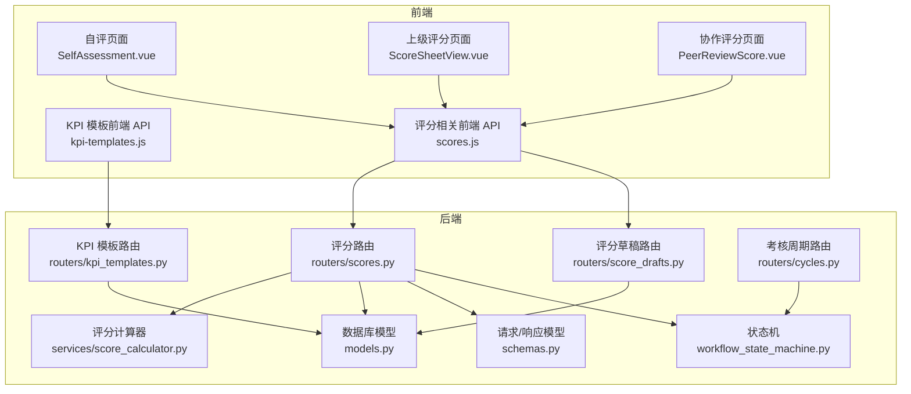
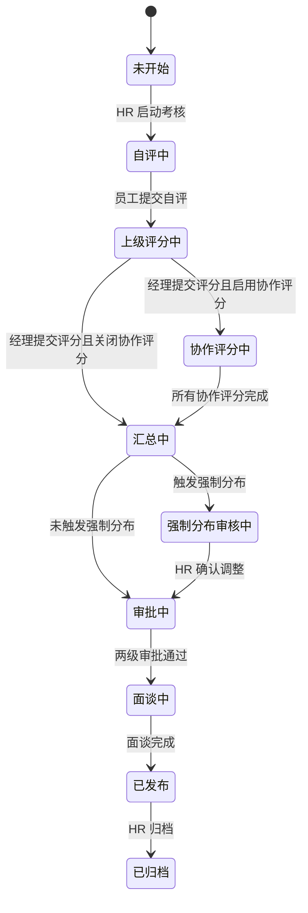
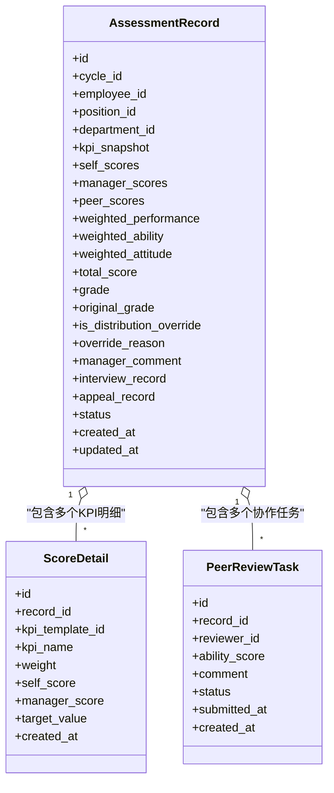
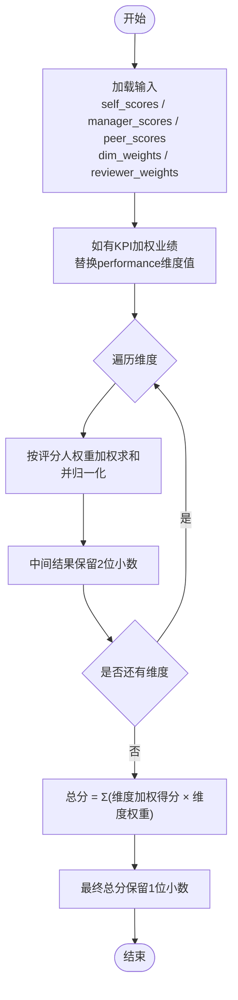
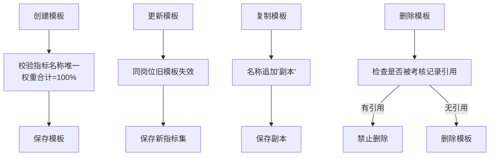
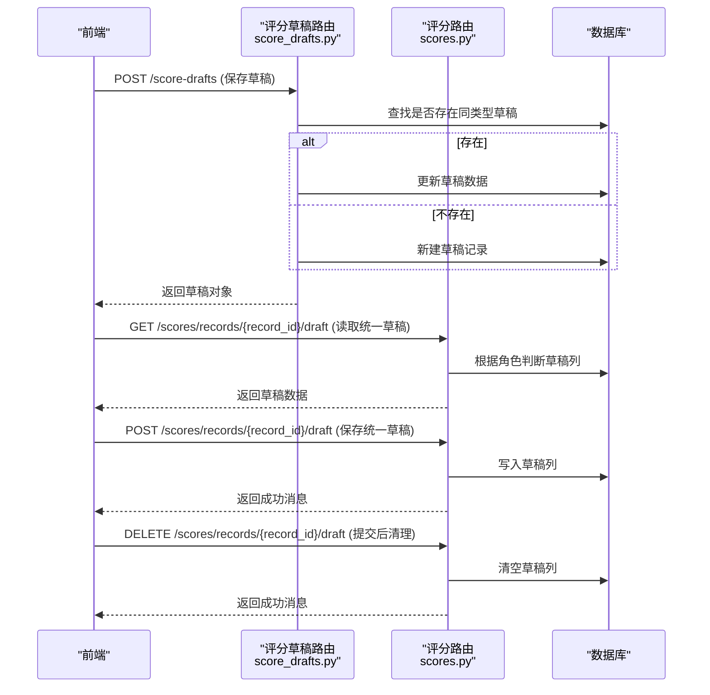
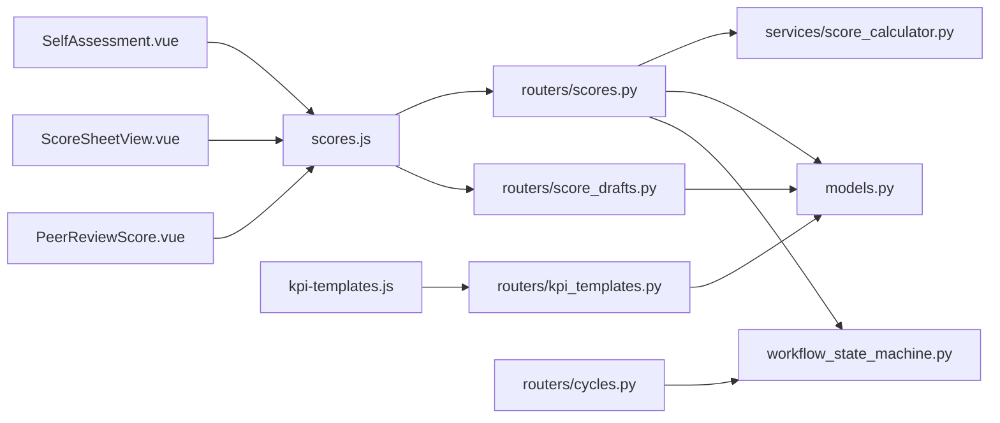

# 评分系统

<cite>
**本文引用的文件**   
- [PRD_绩效考核评分系统_v1.0.md](file://docs/PRD_绩效考核评分系统_v1.0.md)
- [models.py](file://backend/app/models.py)
- [schemas.py](file://backend/app/schemas.py)
- [score_calculator.py](file://backend/app/services/score_calculator.py)
- [scores.py](file://backend/app/routers/scores.py)
- [kpi_templates.py](file://backend/app/routers/kpi_templates.py)
- [score_drafts.py](file://backend/app/routers/score_drafts.py)
- [cycles.py](file://backend/app/routers/cycles.py)
- [workflow_state_machine.py](file://backend/app/utils/workflow_state_machine.py)
- [SelfAssessment.vue](file://frontend/src/views/self-assessment/SelfAssessment.vue)
- [ScoreSheetView.vue](file://frontend/src/views/score-sheet/ScoreSheetView.vue)
- [PeerReviewScore.vue](file://frontend/src/views/peer-review/PeerReviewScore.vue)
- [scores.js](file://frontend/src/api/scores.js)
- [kpi-templates.js](file://frontend/src/api/kpi-templates.js)
</cite>

## 更新摘要
**变更内容**   
- 改进了自评估提交的状态验证逻辑，现在要求HR必须先启动考核周期，员工才能进行自评估提交
- 增强了状态机验证，确保只有处于"pending_self"状态的记录才能提交自评
- 完善了考核周期启动流程，确保正确的业务顺序

## 目录
1. [引言](#引言)
2. [项目结构](#项目结构)
3. [核心组件](#核心组件)
4. [架构总览](#架构总览)
5. [详细组件分析](#详细组件分析)
6. [依赖关系分析](#依赖关系分析)
7. [性能与可扩展性](#性能与可扩展性)
8. [故障排查指南](#故障排查指南)
9. [结论](#结论)
10. [附录：API 与前端使用示例](#附录api-与前端使用示例)

## 引言
本文件面向"多维度绩效考核评分系统"，聚焦以下目标：
- 解释自评、上级评分、协作评分三种评分类型的数据结构与业务逻辑。
- 说明加权计算引擎的维度权重配置、评分人权重的数学计算、最终得分聚合算法。
- 介绍 KPI 模板管理（创建、指标定义、权重配置、模板复用）。
- 说明评分草稿机制（保存、恢复、版本与权限控制）。
- 提供评分结果可视化展示思路（分数详情、等级判定、趋势分析）。
- 给出评分计算的 API 接口文档与前端表单使用示例。

**重要更新**：系统现已强化自评估提交的验证逻辑，确保HR必须先启动考核周期，员工才能进行自评估提交，保证了业务流程的正确性和数据完整性。

## 项目结构
后端采用 FastAPI + SQLAlchemy，核心模块包括：
- 数据模型层：部门、岗位、员工、考核周期、KPI 模板、考核记录、评分明细、申诉、面谈、通知、协作任务等。
- 服务层：评分计算器、强制分布执行器、操作日志、通知服务等。
- 路由层：评分流程、KPI 模板、草稿、汇总计算、协作评分等 API。
- 前端 Vue 页面：自评、上级评分、协作评分、KPI 模板管理等。



图示来源
- [SelfAssessment.vue:1-636](file://frontend/src/views/self-assessment/SelfAssessment.vue#L1-L636)
- [ScoreSheetView.vue:1-700](file://frontend/src/views/score-sheet/ScoreSheetView.vue#L1-L700)
- [PeerReviewScore.vue:1-472](file://frontend/src/views/peer-review/PeerReviewScore.vue#L1-L472)
- [scores.js:1-77](file://frontend/src/api/scores.js#L1-L77)
- [kpi-templates.js:1-34](file://frontend/src/api/kpi-templates.js#L1-L34)
- [scores.py:1-1421](file://backend/app/routers/scores.py#L1-L1421)
- [kpi_templates.py:1-366](file://backend/app/routers/kpi_templates.py#L1-L366)
- [score_drafts.py:1-84](file://backend/app/routers/score_drafts.py#L1-L84)
- [cycles.py:1-1040](file://backend/app/routers/cycles.py#L1-L1040)
- [score_calculator.py:1-126](file://backend/app/services/score_calculator.py#L1-L126)
- [workflow_state_machine.py:1-207](file://backend/app/utils/workflow_state_machine.py#L1-L207)
- [models.py:1-266](file://backend/app/models.py#L1-L266)
- [schemas.py:1-541](file://backend/app/schemas.py#L1-L541)

章节来源
- [PRD_绩效考核评分系统_v1.0.md:367-511](file://docs/PRD_绩效考核评分系统_v1.0.md#L367-L511)

## 核心组件
- 多维度评分模型
  - 自评：员工对"工作业绩、工作能力、工作态度"三维度打分，并可为"工作业绩"填写 KPI 指标得分。
  - 上级评分：经理查看员工自评与 KPI 快照，逐项打分并填写评语；可分配协作人（若开启协作评分）。
  - 协作评分：协作人仅对"工作能力"维度打分，并填写协作评语。
- 加权计算引擎
  - 维度权重：按"工作业绩、工作能力、工作态度"配置权重。
  - 评分人权重：每个维度内自评、上级评、协作评的权重组合。
  - KPI 加权业绩：将 KPI 指标得分按指标权重加权后映射为"工作业绩"维度得分。
  - 总分聚合：先计算各维度加权分，再按维度权重求和得到总分，最后映射等级。
- KPI 模板管理
  - 模板创建/更新/复制/删除，指标名称唯一、权重合计为 100%。
  - 考核启动时生成 KPI 快照，确保周期内评价标准稳定。
- 评分草稿机制
  - 支持员工自评、上级评分、协作评分三类草稿。
  - 统一接口读写，基于角色权限校验，提交后清理草稿。
- 可视化与结果展示
  - 我的绩效列表、详情（含 KPI 明细、申诉、面谈）、等级判定、历史趋势。

**新增功能**：增强的状态验证机制确保业务流程的正确性，防止在考核周期未启动时进行自评估提交。

章节来源
- [PRD_绩效考核评分系统_v1.0.md:629-800](file://docs/PRD_绩效考核评分系统_v1.0.md#L629-L800)
- [models.py:85-131](file://backend/app/models.py#L85-L131)
- [schemas.py:118-187](file://backend/app/schemas.py#L118-L187)
- [score_calculator.py:1-126](file://backend/app/services/score_calculator.py#L1-L126)
- [score_drafts.py:1-84](file://backend/app/routers/score_drafts.py#L1-L84)

## 架构总览
评分系统以"考核周期"为时间容器，驱动"自评 → 上级评分 → 协作评分（可选）→ 汇总计算 → 强制分布 → 审批 → 面谈 → 发布 → 归档"的全流程。

**重要改进**：现在系统严格验证考核周期的启动状态，确保HR必须先启动考核周期，员工才能进行自评估提交。



图示来源
- [PRD_绩效考核评分系统_v1.0.md:446-474](file://docs/PRD_绩效考核评分系统_v1.0.md#L446-L474)
- [scores.py:165-331](file://backend/app/routers/scores.py#L165-L331)
- [workflow_state_machine.py:39-78](file://backend/app/utils/workflow_state_machine.py#L39-L78)

## 详细组件分析

### 多维度评分模型与数据结构
- 评估记录主表字段
  - self_scores、manager_scores、peer_scores：分别存储三类评分人的维度得分。
  - weighted_performance、weighted_ability、weighted_attitude：维度加权得分。
  - total_score、grade、original_grade：总分、等级、原始等级（用于强制分布对比）。
  - kpi_snapshot：KPI 快照（冻结模板内容）。
  - manager_comment、interview_record、appeal_record：评语、面谈、申诉信息。
  - status：状态机流转字段。
- 评分明细表
  - ScoreDetail：每条 KPI 指标的自评分与上级评分，配合 weight 计算 KPI 加权业绩。
- 协作任务表
  - PeerReviewTask：记录每位协作人的能力得分、评语、状态与提交时间。



图示来源
- [models.py:99-144](file://backend/app/models.py#L99-L144)
- [models.py:176-184](file://backend/app/models.py#L176-L184)
- [models.py:255-265](file://backend/app/models.py#L255-L265)

章节来源
- [models.py:99-144](file://backend/app/models.py#L99-L144)
- [models.py:176-184](file://backend/app/models.py#L176-L184)
- [models.py:255-265](file://backend/app/models.py#L255-L265)

### 加权计算引擎
- 输入
  - self_scores、manager_scores、peer_scores：各评分人的维度得分。
  - dim_weights：维度权重（如业绩 60%、能力 20%、态度 20%）。
  - reviewer_weights：评分人权重（如业绩维度自评 30%、上级 70%）。
  - kpi_weighted_self_performance、kpi_weighted_manager_performance：由 KPI 明细加权得到的业绩维度得分。
- 计算步骤
  - 对每个维度，按评分人权重加权求和，并按有效权重归一化。
  - 中间结果保留两位小数。
  - 总分 = Σ(维度加权得分 × 维度权重)，最终总分保留一位小数。
- KPI 加权业绩
  - 根据 ScoreDetail 列表，按指标权重加权计算业绩维度得分。



图示来源
- [score_calculator.py:4-84](file://backend/app/services/score_calculator.py#L4-L84)
- [score_calculator.py:87-126](file://backend/app/services/score_calculator.py#L87-L126)

章节来源
- [score_calculator.py:4-84](file://backend/app/services/score_calculator.py#L4-L84)
- [score_calculator.py:87-126](file://backend/app/services/score_calculator.py#L87-L126)

### KPI 模板管理系统
- 功能
  - 模板创建：批量或单条创建，指标名称唯一，权重合计为 100%。
  - 模板更新：覆盖式更新（同岗位旧模板失效），新增指标。
  - 模板复制：快速复制现有模板，名称自动加"副本"。
  - 模板删除：存在引用保护（已被考核记录引用不可删）。
  - KPI 调整申请：在考核期间可申请调整指标目标值，经审批后生效。
- 数据结构
  - KpiTemplate：岗位关联、指标名称、权重、目标值、计分方式、描述、是否激活。
  - KpiAdjustment：原 KPI、调整后 KPI、原因、状态。



图示来源
- [kpi_templates.py:68-172](file://backend/app/routers/kpi_templates.py#L68-L172)
- [kpi_templates.py:198-253](file://backend/app/routers/kpi_templates.py#L198-L253)
- [kpi_templates.py:256-366](file://backend/app/routers/kpi_templates.py#L256-L366)
- [schemas.py:118-187](file://backend/app/schemas.py#L118-L187)

章节来源
- [kpi_templates.py:68-172](file://backend/app/routers/kpi_templates.py#L68-L172)
- [kpi_templates.py:198-253](file://backend/app/routers/kpi_templates.py#L198-L253)
- [kpi_templates.py:256-366](file://backend/app/routers/kpi_templates.py#L256-L366)
- [schemas.py:118-187](file://backend/app/schemas.py#L118-L187)

### 评分草稿机制
- 支持三类草稿：self（自评）、manager（上级评分）、peer（协作评分）。
- 统一接口
  - GET /score-drafts/{record_id}?draft_type={type}：读取指定类型草稿。
  - POST /score-drafts：保存草稿（同一 record_id + draft_type 仅保留最新一条）。
- 统一草稿接口（评分路由内）
  - GET /scores/records/{record_id}/draft：根据角色返回对应草稿列。
  - POST /scores/records/{record_id}/draft：保存草稿。
  - DELETE /scores/records/{record_id}/draft：提交评分后清理草稿。
- 权限控制
  - 员工只能操作自己的记录。
  - 上级只能给下属评分。
  - 协作人需被分配为当前员工的协作评分人。



图示来源
- [score_drafts.py:13-83](file://backend/app/routers/score_drafts.py#L13-L83)
- [scores.py:876-1014](file://backend/app/routers/scores.py#L876-L1014)

章节来源
- [score_drafts.py:13-83](file://backend/app/routers/score_drafts.py#L13-L83)
- [scores.py:876-1014](file://backend/app/routers/scores.py#L876-L1014)

### 评分结果可视化与等级判定
- 我的绩效列表
  - 显示周期名称、截止日期、状态、自评分、上级评、协作评、加权维度分、总分、等级、经理评语、KPI 明细、申诉状态、发布时间等。
- 详情视图
  - 包含 KPI 明细、申诉记录、面谈记录，以及强制分布调整标记与原因。
- 等级判定
  - 根据 grade_rules 区间映射总分到等级（A/B/C/D）。
- 趋势分析
  - 个人近多周期等级与总分变化（前端图表展示，后端提供历史数据）。

章节来源
- [scores.py:636-737](file://backend/app/routers/scores.py#L636-L737)
- [scores.py:1017-1127](file://backend/app/routers/scores.py#L1017-L1127)
- [PRD_绩效考核评分系统_v1.0.md:779-800](file://docs/PRD_绩效考核评分系统_v1.0.md#L779-L800)

### 自评估提交状态验证增强

**新增功能**：系统现在实施了严格的自评估提交状态验证，确保业务流程的正确性。

#### 状态验证逻辑
- **前置条件检查**：员工只能对状态为"pending_self"的记录提交自评
- **周期启动验证**：如果考核周期尚未启动（状态为"not_started"），系统将拒绝自评估提交
- **状态机约束**：通过WorkflowStateMachine确保状态转换的合法性

#### 错误处理
- 当尝试在非"pending_self"状态下提交自评时，返回422状态码和相应错误消息
- 当尝试在未启动的考核周期中提交自评时，同样返回422状态码

#### 业务流程保障
- HR必须先通过 `/assessment-cycles/{cycle_id}/start` 接口启动考核周期
- 启动后，所有相关员工的考核记录状态变为"pending_self"
- 此时员工才能进行自评估提交

```mermaid
flowchart TD
A["员工尝试提交自评"] --> B{"检查记录状态"}
B --> |状态不是 pending_self| C["返回422错误<br/>当前状态不允许提交自评"]
B --> |状态是 pending_self| D{"检查考核周期状态"}
D --> |周期未启动(not_started)| E["返回422错误<br/>请先启动考核周期"]
D --> |周期已启动(pending_self)| F["允许提交自评"]
F --> G["状态转换为 pending_manager"]
```

图示来源
- [scores.py:748-803](file://backend/app/routers/scores.py#L748-L803)
- [workflow_state_machine.py:39-78](file://backend/app/utils/workflow_state_machine.py#L39-L78)
- [cycles.py:396-476](file://backend/app/routers/cycles.py#L396-L476)

章节来源
- [scores.py:748-803](file://backend/app/routers/scores.py#L748-L803)
- [workflow_state_machine.py:39-78](file://backend/app/utils/workflow_state_machine.py#L39-L78)
- [cycles.py:396-476](file://backend/app/routers/cycles.py#L396-L476)

## 依赖关系分析
- 路由与服务
  - scores.py 依赖 score_calculator.py 进行加权计算，依赖 distribution_enforcer.py 进行强制分布，依赖 workflow_state_machine.py 进行状态机流转。
  - kpi_templates.py 依赖 schemas.py 进行请求校验。
  - score_drafts.py 依赖 models.py 与 schemas.py。
  - cycles.py 依赖 workflow_state_machine.py 进行考核周期状态管理。
- 前端与后端
  - SelfAssessment.vue、ScoreSheetView.vue、PeerReviewScore.vue 通过 scores.js 调用后端评分相关 API。
  - KPI 模板前端通过 kpi-templates.js 调用后端模板管理 API。



图示来源
- [SelfAssessment.vue:1-636](file://frontend/src/views/self-assessment/SelfAssessment.vue#L1-L636)
- [ScoreSheetView.vue:1-700](file://frontend/src/views/score-sheet/ScoreSheetView.vue#L1-L700)
- [PeerReviewScore.vue:1-472](file://frontend/src/views/peer-review/PeerReviewScore.vue#L1-L472)
- [scores.js:1-77](file://frontend/src/api/scores.js#L1-L77)
- [kpi-templates.js:1-34](file://frontend/src/api/kpi-templates.js#L1-L34)
- [scores.py:1-1421](file://backend/app/routers/scores.py#L1-L1421)
- [kpi_templates.py:1-366](file://backend/app/routers/kpi_templates.py#L1-L366)
- [score_drafts.py:1-84](file://backend/app/routers/score_drafts.py#L1-L84)
- [cycles.py:1-1040](file://backend/app/routers/cycles.py#L1-L1040)
- [score_calculator.py:1-126](file://backend/app/services/score_calculator.py#L1-L126)
- [workflow_state_machine.py:1-207](file://backend/app/utils/workflow_state_machine.py#L1-L207)
- [models.py:1-266](file://backend/app/models.py#L1-L266)

章节来源
- [scores.py:1-1421](file://backend/app/routers/scores.py#L1-L1421)
- [kpi_templates.py:1-366](file://backend/app/routers/kpi_templates.py#L1-L366)
- [score_drafts.py:1-84](file://backend/app/routers/score_drafts.py#L1-L84)
- [cycles.py:1-1040](file://backend/app/routers/cycles.py#L1-L1040)
- [score_calculator.py:1-126](file://backend/app/services/score_calculator.py#L1-L126)
- [workflow_state_machine.py:1-207](file://backend/app/utils/workflow_state_machine.py#L1-L207)
- [models.py:1-266](file://backend/app/models.py#L1-L266)

## 性能与可扩展性
- 计算复杂度
  - 加权计算为 O(D×R)，其中 D 为维度数，R 为评分人数（通常为 2~3）。
  - KPI 加权业绩为 O(N)，N 为指标数量。
- 批量处理
  - 汇总计算按周期批量处理，建议分页或异步任务处理大规模数据。
- 扩展点
  - 维度与评分人权重可通过配置动态调整。
  - 强制分布规则可按部门独立核算，支持小部门豁免。
  - 模板复制与指标调整提升复用性与灵活性。
  - 状态机支持自定义校验函数注册，便于扩展业务逻辑。

[本节为通用指导，不直接分析具体文件]

## 故障排查指南
- 常见错误
  - 维度权重之和不为 100% 或 1.0：检查周期配置与校验逻辑。
  - 评分人权重之和不为 100%：检查 reviewer_weights 配置。
  - 协作评分未完成：检查 PeerReviewTask 状态与截止时间。
  - 权限不足：检查员工/上级/协作人关系与分配。
  - 草稿无法恢复：检查草稿类型与权限。
  - **自评估提交失败**：检查考核周期是否已启动，记录状态是否为"pending_self"。
- 定位方法
  - 查看操作日志与异常提示。
  - 检查数据库记录（assessment_records、score_details、peer_review_tasks、score_drafts）。
  - 核对前端表单校验与后端校验一致性。
  - **状态验证问题**：检查WorkflowStateMachine的状态转换规则和考核周期状态。

章节来源
- [scores.py:165-331](file://backend/app/routers/scores.py#L165-L331)
- [scores.py:434-554](file://backend/app/routers/scores.py#L434-L554)
- [scores.py:557-626](file://backend/app/routers/scores.py#L557-L626)
- [scores.py:748-803](file://backend/app/routers/scores.py#L748-L803)
- [score_drafts.py:13-83](file://backend/app/routers/score_drafts.py#L13-L83)
- [workflow_state_machine.py:136-186](file://backend/app/utils/workflow_state_machine.py#L136-L186)

## 结论
本评分系统实现了从多维度评分、KPI 模板管理、加权计算、强制分布到审批与归档的完整闭环。通过清晰的模型设计、严格的校验与权限控制、灵活的配置与模板复用，以及完善的草稿机制，保障了评分过程的公平、透明与可追溯。前端页面提供了直观的操作体验与结果展示，便于不同角色高效完成任务。

**重要改进**：最新的自评估提交状态验证机制确保了业务流程的正确性，防止了在不适当的时机进行自评估提交，提升了系统的可靠性和用户体验。

[本节为总结性内容，不直接分析具体文件]

## 附录：API 与前端使用示例

### 评分计算 API
- 获取评分汇总
  - GET /scores/summary/{cycle_id}?department_id={id}
  - 返回：员工记录、自评分、上级评、协作评、加权维度分、总分、等级、状态等。
- 触发汇总计算
  - POST /scores/calculate/{cycle_id}
  - 行为：校验权重与完整性，计算维度加权分与总分，映射等级，执行强制分布，推进状态机。
- 上级评分提交
  - POST /scores/manager/{record_id}
  - 输入：performance、ability、attitude、kpi_scores、comment。
  - 行为：校验分数与评语长度，保存 KPI 评分，比较差异提示，推进状态机，必要时创建协作任务。
- 协作评分提交
  - POST /scores/peer/review-tasks/{task_id}/submit
  - 输入：ability、comment。
  - 行为：校验分数与评语长度，更新任务与考核记录的 peer_scores，检查全部完成并推进状态机。
- 自评提交
  - POST /scores/self/{record_id}
  - 输入：performance、ability、attitude、kpi_scores。
  - 行为：校验分数，保存 KPI 评分，推进状态机。
  - **新增验证**：仅允许状态为"pending_self"的记录提交，否则返回422错误。

章节来源
- [scores.py:96-163](file://backend/app/routers/scores.py#L96-L163)
- [scores.py:165-331](file://backend/app/routers/scores.py#L165-L331)
- [scores.py:434-554](file://backend/app/routers/scores.py#L434-L554)
- [scores.py:748-803](file://backend/app/routers/scores.py#L748-L803)
- [scores.py:1256-1355](file://backend/app/routers/scores.py#L1256-L1355)
- [scores.py:740-796](file://backend/app/routers/scores.py#L740-L796)

### 前端评分表单使用示例
- 自评表单（SelfAssessment.vue）
  - 加载：getMyAssessment → getSelfAssessmentData，渲染维度权重、KPI 快照、已有自评分与草稿。
  - 提交：submitSelfScore，携带维度得分与 KPI 得分数组。
  - 草稿：createScoreDraft，保存 self 类型草稿。
  - **错误处理**：当收到422状态码时，显示相应的错误提示信息。
- 上级评分表单（ScoreSheetView.vue）
  - 加载：getToReviewList，选择被评人，加载草稿。
  - 提交：submitManagerScore，携带维度得分、KPI 得分数组与评语；提交后删除草稿。
  - 草稿：getManagerDraft/saveManagerDraft/deleteManagerDraft。
- 协作评分表单（PeerReviewScore.vue）
  - 加载：getPeerReviewList，选择任务，回显已提交数据。
  - 提交：submitPeerReviewTask，携带 ability 与 comment。

章节来源
- [SelfAssessment.vue:148-388](file://frontend/src/views/self-assessment/SelfAssessment.vue#L148-L388)
- [ScoreSheetView.vue:187-496](file://frontend/src/views/score-sheet/ScoreSheetView.vue#L187-L496)
- [PeerReviewScore.vue:140-265](file://frontend/src/views/peer-review/PeerReviewScore.vue#L140-L265)
- [scores.js:1-77](file://frontend/src/api/scores.js#L1-L77)

### KPI 模板前端 API
- 列表与详情
  - listKpiTemplates()、getKpiTemplate(id)
- 创建与更新
  - createKpiTemplate(data)、updateKpiTemplate(id, data)
  - createKpiTemplatesBatch(data)、updateKpiTemplatesBatch(id, data)
- 删除与复制
  - deleteKpiTemplate(id)、copyKpiTemplate(id)

章节来源
- [kpi-templates.js:1-34](file://frontend/src/api/kpi-templates.js#L1-L34)
- [kpi_templates.py:22-65](file://backend/app/routers/kpi_templates.py#L22-L65)
- [kpi_templates.py:68-172](file://backend/app/routers/kpi_templates.py#L68-L172)
- [kpi_templates.py:198-253](file://backend/app/routers/kpi_templates.py#L198-L253)

### 考核周期管理 API
- 启动考核周期
  - POST /assessment-cycles/{cycle_id}/start
  - 输入：employee_ids数组
  - 行为：创建考核记录，设置状态为"pending_self"，发送通知
  - **状态验证**：使用WorkflowStateMachine确保状态转换的合法性
- 查询周期进度
  - GET /assessment-cycles/{cycle_id}/progress
  - 返回：阶段状态、完成率、未完成人员名单等

章节来源
- [cycles.py:396-476](file://backend/app/routers/cycles.py#L396-L476)
- [cycles.py:580-721](file://backend/app/routers/cycles.py#L580-L721)
- [workflow_state_machine.py:39-78](file://backend/app/utils/workflow_state_machine.py#L39-L78)