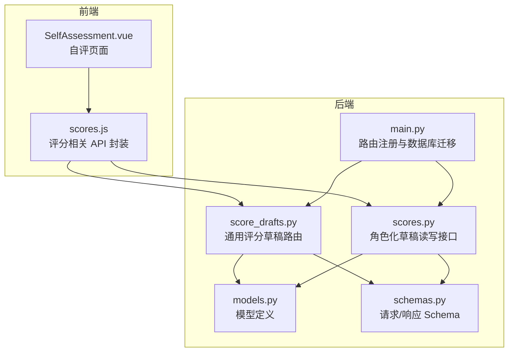
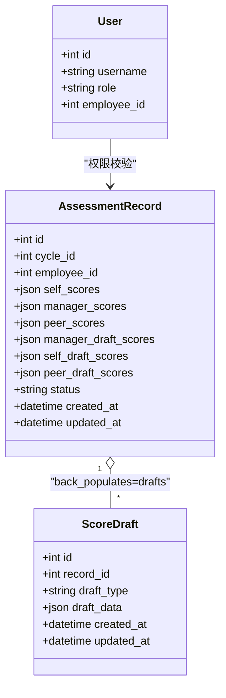
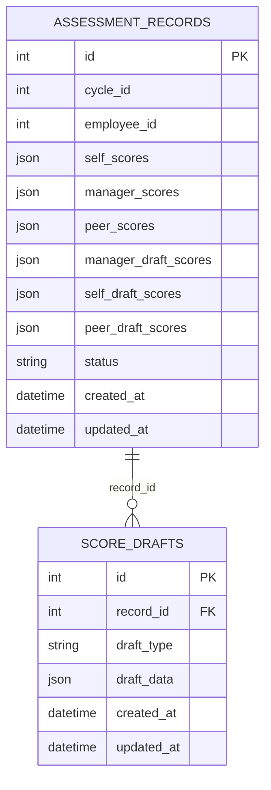
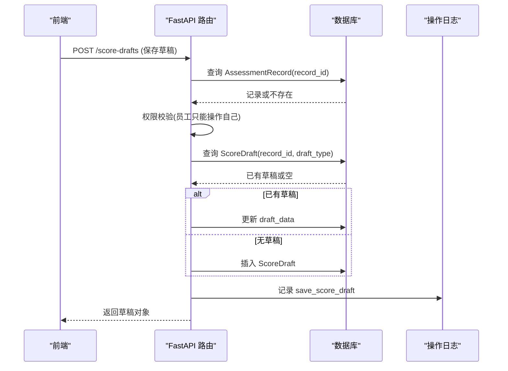
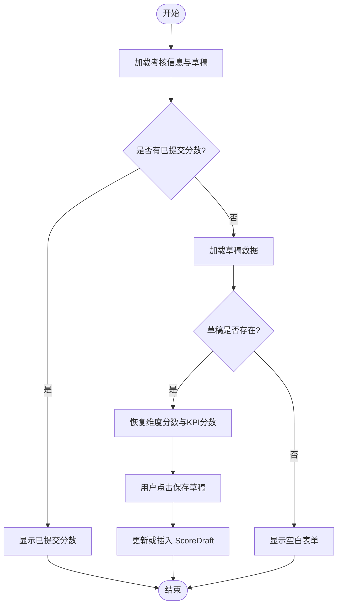
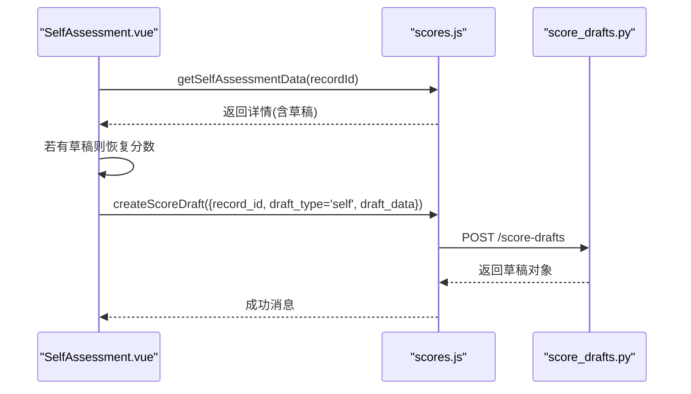
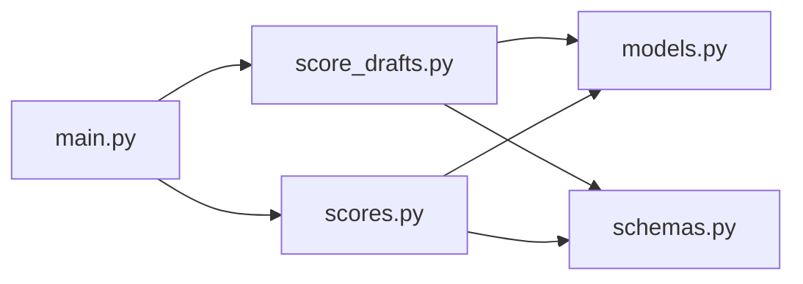

# 评分草稿系统

<cite>
**本文引用的文件**   
- [backend/app/routers/score_drafts.py](file://backend/app/routers/score_drafts.py)
- [backend/app/models.py](file://backend/app/models.py)
- [backend/app/schemas.py](file://backend/app/schemas.py)
- [backend/app/main.py](file://backend/app/main.py)
- [backend/app/routers/scores.py](file://backend/app/routers/scores.py)
- [frontend/src/views/self-assessment/SelfAssessment.vue](file://frontend/src/views/self-assessment/SelfAssessment.vue)
- [frontend/src/api/scores.js](file://frontend/src/api/scores.js)
</cite>

## 目录
1. [引言](#引言)
2. [项目结构中的草稿相关位置](#项目结构中的草稿相关位置)
3. [核心组件与职责](#核心组件与职责)
4. [架构总览](#架构总览)
5. [详细组件分析](#详细组件分析)
6. [依赖关系分析](#依赖关系分析)
7. [性能与扩展性考虑](#性能与扩展性考虑)
8. [故障排查指南](#故障排查指南)
9. [结论](#结论)
10. [附录：API 接口规范](#附录api-接口规范)

## 引言
本文件围绕“评分草稿系统”进行系统化技术文档整理，重点覆盖以下目标：
- 解释评分草稿的数据结构设计，包括独立草稿表与考核记录内嵌草稿字段并存的设计。
- 说明草稿保存、自动恢复、版本管理、权限控制等核心功能的技术实现。
- 梳理草稿状态流转机制，包括创建、更新、删除、恢复等操作的业务逻辑。
- 介绍前端自评页面中草稿功能的用户体验优化，包括自动恢复、进度提示、冲突处理建议。
- 提供草稿相关的 API 接口文档，包含请求参数、响应格式、错误码和权限约束。
- 给出草稿清理策略和数据迁移方案，帮助系统在演进过程中保持数据一致性。

## 项目结构中的草稿相关位置
评分草稿能力在前后端均有体现，后端通过 FastAPI 路由暴露接口，模型层定义草稿实体，前端通过 Vue 组件调用接口并展示草稿恢复体验。

**图表来源**
- [backend/app/main.py:61-108](file://backend/app/main.py#L61-L108)
- [backend/app/routers/score_drafts.py:1-84](file://backend/app/routers/score_drafts.py#L1-L84)
- [backend/app/routers/scores.py:807-999](file://backend/app/routers/scores.py#L807-L999)
- [backend/app/models.py:99-131](file://backend/app/models.py#L99-L131)
- [backend/app/models.py:230-241](file://backend/app/models.py#L230-L241)
- [backend/app/schemas.py:525-541](file://backend/app/schemas.py#L525-L541)
- [frontend/src/views/self-assessment/SelfAssessment.vue:148-388](file://frontend/src/views/self-assessment/SelfAssessment.vue#L148-L388)
- [frontend/src/api/scores.js:47-58](file://frontend/src/api/scores.js#L47-L58)

**章节来源**
- [backend/app/main.py:61-108](file://backend/app/main.py#L61-L108)
- [backend/app/routers/score_drafts.py:1-84](file://backend/app/routers/score_drafts.py#L1-L84)
- [backend/app/routers/scores.py:807-999](file://backend/app/routers/scores.py#L807-L999)
- [backend/app/models.py:99-131](file://backend/app/models.py#L99-L131)
- [backend/app/models.py:230-241](file://backend/app/models.py#L230-L241)
- [backend/app/schemas.py:525-541](file://backend/app/schemas.py#L525-L541)
- [frontend/src/views/self-assessment/SelfAssessment.vue:148-388](file://frontend/src/views/self-assessment/SelfAssessment.vue#L148-L388)
- [frontend/src/api/scores.js:47-58](file://frontend/src/api/scores.js#L47-L58)

## 核心组件与职责
- 草稿模型与关联关系
  - `ScoreDraft`：独立的评分草稿表，按 `record_id + draft_type` 唯一约束，存储结构化草稿数据。
  - `AssessmentRecord`：考核记录表，内嵌三个 JSON 字段分别承载不同角色的草稿快照，便于快速读取与提交流程使用。
- 草稿路由与服务
  - `score_drafts_router`：通用评分草稿接口，支持按 `record_id` 和可选 `draft_type` 查询，以及统一保存最新草稿。
  - `scores_router`：角色化草稿接口，支持上级评分草稿的专用读写，以及统一的草稿获取、保存、删除接口。
- 前端交互
  - 自评页面负责加载考核信息、维度权重、KPI 指标、已提交分数与草稿；用户点击“保存草稿”时调用后端接口。
  - 评分相关 API 封装统一发起 HTTP 请求，避免重复样板代码。

**章节来源**
- [backend/app/models.py:99-131](file://backend/app/models.py#L99-L131)
- [backend/app/models.py:230-241](file://backend/app/models.py#L230-L241)
- [backend/app/routers/score_drafts.py:1-84](file://backend/app/routers/score_drafts.py#L1-L84)
- [backend/app/routers/scores.py:807-999](file://backend/app/routers/scores.py#L807-L999)
- [frontend/src/views/self-assessment/SelfAssessment.vue:148-388](file://frontend/src/views/self-assessment/SelfAssessment.vue#L148-L388)
- [frontend/src/api/scores.js:47-58](file://frontend/src/api/scores.js#L47-L58)

## 架构总览
评分草稿系统采用“双轨设计”：
- 独立草稿表 `score_drafts`：用于长期保留历史草稿，支持按类型查询最新版本。
- 考核记录内嵌草稿字段：用于当前会话的快速读写，减少跨表查询开销，并在提交后清理。

**图表来源**
- [backend/app/models.py:99-131](file://backend/app/models.py#L99-L131)
- [backend/app/models.py:230-241](file://backend/app/models.py#L230-L241)

## 详细组件分析

### 数据模型与约束
- `ScoreDraft` 表
  - 关键字段：`record_id`、`draft_type`、`draft_data`、时间戳。
  - 唯一约束：`record_id + draft_type`，保证同一考核记录同类型草稿仅保留一条最新记录。
- `AssessmentRecord` 表
  - 草稿字段：`manager_draft_scores`、`self_draft_scores`、`peer_draft_scores`，均为 JSON 可空字段。
  - 与 `ScoreDraft` 的关系：一对多，级联删除，便于提交后清理草稿。

> 本图为局部关系片段，完整实体关系与约束以 [ER图设计.md](../系统架构/数据库架构设计/ER图设计.md) 为唯一权威来源。

**图表来源**
- [backend/app/models.py:99-131](file://backend/app/models.py#L99-L131)
- [backend/app/models.py:230-241](file://backend/app/models.py#L230-L241)

**章节来源**
- [backend/app/models.py:99-131](file://backend/app/models.py#L99-L131)
- [backend/app/models.py:230-241](file://backend/app/models.py#L230-L241)

### 后端草稿路由与业务逻辑
- 通用草稿接口（`score_drafts_router`）
  - 保存草稿：根据 `record_id + draft_type` 查找已有草稿，存在则更新 `draft_data`，不存在则新建。
  - 读取草稿：按 `record_id` 查询所有草稿，若指定 `draft_type`，返回该类型最新一条。
  - 权限校验：员工只能操作自己的考核记录。
  - 审计日志：记录保存操作的用户、动作、目标对象及新值。
- 角色化草稿接口（`scores_router`）
  - 上级评分草稿专用接口：获取/保存 `manager_draft_scores`。
  - 统一草稿接口：根据用户角色映射到对应草稿字段，支持获取、保存、删除。
  - 权限校验：依据角色与下属关系、协作评分人分配情况判断是否允许操作。
  - 审计日志：保存草稿时记录操作详情。

**图表来源**
- [backend/app/routers/score_drafts.py:13-58](file://backend/app/routers/score_drafts.py#L13-L58)
- [backend/app/routers/score_drafts.py:61-84](file://backend/app/routers/score_drafts.py#L61-L84)

**章节来源**
- [backend/app/routers/score_drafts.py:13-58](file://backend/app/routers/score_drafts.py#L13-L58)
- [backend/app/routers/score_drafts.py:61-84](file://backend/app/routers/score_drafts.py#L61-L84)
- [backend/app/routers/scores.py:807-999](file://backend/app/routers/scores.py#L807-L999)

### 草稿状态流转机制
- 草稿创建
  - 前端触发“保存草稿”，后端根据 `record_id + draft_type` 判断是否存在，存在则更新，不存在则新建。
- 草稿更新
  - 每次保存都会覆盖现有草稿数据，确保只保留最新版本。
- 草稿删除
  - 提交评分后调用删除接口，清空对应角色的草稿字段（如 `manager_draft_scores`），避免后续误用。
- 草稿恢复
  - 前端加载自评详情时，优先显示已提交的分数；若无提交，则尝试从草稿恢复维度分数与 KPI 分数，并提示“已自动恢复上次保存的草稿”。

**图表来源**
- [frontend/src/views/self-assessment/SelfAssessment.vue:235-300](file://frontend/src/views/self-assessment/SelfAssessment.vue#L235-L300)
- [frontend/src/views/self-assessment/SelfAssessment.vue:364-388](file://frontend/src/views/self-assessment/SelfAssessment.vue#L364-L388)
- [backend/app/routers/score_drafts.py:13-58](file://backend/app/routers/score_drafts.py#L13-L58)

**章节来源**
- [frontend/src/views/self-assessment/SelfAssessment.vue:235-300](file://frontend/src/views/self-assessment/SelfAssessment.vue#L235-L300)
- [frontend/src/views/self-assessment/SelfAssessment.vue:364-388](file://frontend/src/views/self-assessment/SelfAssessment.vue#L364-L388)
- [backend/app/routers/score_drafts.py:13-58](file://backend/app/routers/score_drafts.py#L13-L58)

### 前端草稿功能实现
- 本地存储与自动恢复
  - 页面挂载时加载自评详情，若存在草稿则自动填充维度分数与 KPI 分数，并提示用户。
- 进度提示
  - 保存草稿按钮带 loading 状态，成功后弹出成功消息；失败时显示错误信息。
- 冲突解决
  - 当前实现以“最新覆盖”策略为主，未实现并发冲突检测与合并；建议在后续版本引入版本号或时间戳比较，提示用户选择保留本地或服务器版本。

**图表来源**
- [frontend/src/views/self-assessment/SelfAssessment.vue:235-300](file://frontend/src/views/self-assessment/SelfAssessment.vue#L235-L300)
- [frontend/src/views/self-assessment/SelfAssessment.vue:364-388](file://frontend/src/views/self-assessment/SelfAssessment.vue#L364-L388)
- [frontend/src/api/scores.js:47-58](file://frontend/src/api/scores.js#L47-L58)
- [backend/app/routers/score_drafts.py:13-58](file://backend/app/routers/score_drafts.py#L13-L58)

**章节来源**
- [frontend/src/views/self-assessment/SelfAssessment.vue:235-300](file://frontend/src/views/self-assessment/SelfAssessment.vue#L235-L300)
- [frontend/src/views/self-assessment/SelfAssessment.vue:364-388](file://frontend/src/views/self-assessment/SelfAssessment.vue#L364-L388)
- [frontend/src/api/scores.js:47-58](file://frontend/src/api/scores.js#L47-L58)
- [backend/app/routers/score_drafts.py:13-58](file://backend/app/routers/score_drafts.py#L13-L58)

## 依赖关系分析
- 路由注册
  - `main.py` 将 `score_drafts_router` 注册到 `/score-drafts` 路径，同时为直接 API 也注册相同路由。
  - `main.py` 在启动时执行数据库迁移，为 `assessment_records` 表添加三个草稿字段（若不存在）。
- 模型依赖
  - `ScoreDraft` 依赖 `AssessmentRecord`，并通过外键关联。
  - `AssessmentRecord` 与 `ScoreDraft` 是一对多关系，级联删除。
- 权限依赖
  - 草稿接口依赖用户角色与员工关系，确保只有授权用户可操作对应草稿。

**图表来源**
- [backend/app/main.py:61-108](file://backend/app/main.py#L61-L108)
- [backend/app/routers/score_drafts.py:1-84](file://backend/app/routers/score_drafts.py#L1-L84)
- [backend/app/routers/scores.py:807-999](file://backend/app/routers/scores.py#L807-L999)
- [backend/app/models.py:99-131](file://backend/app/models.py#L99-L131)
- [backend/app/models.py:230-241](file://backend/app/models.py#L230-L241)
- [backend/app/schemas.py:525-541](file://backend/app/schemas.py#L525-L541)

**章节来源**
- [backend/app/main.py:61-108](file://backend/app/main.py#L61-L108)
- [backend/app/routers/score_drafts.py:1-84](file://backend/app/routers/score_drafts.py#L1-L84)
- [backend/app/routers/scores.py:807-999](file://backend/app/routers/scores.py#L807-L999)
- [backend/app/models.py:99-131](file://backend/app/models.py#L99-L131)
- [backend/app/models.py:230-241](file://backend/app/models.py#L230-L241)
- [backend/app/schemas.py:525-541](file://backend/app/schemas.py#L525-L541)

## 性能与扩展性考虑
- 查询性能
  - 使用 `updated_at DESC` 排序获取最新草稿，适合单条查询；若需批量查询多个记录的草稿，建议增加索引或缓存。
- 写入性能
  - 草稿保存为覆盖式更新，避免频繁插入导致表膨胀；提交后删除草稿可减少冗余数据。
- 扩展性
  - 当前草稿类型固定为 `self/manager/peer`，如需新增评分角色，可在 `draft_type` 枚举与权限映射中扩展。
  - 建议引入版本号或乐观锁字段，提升并发场景下的冲突处理能力。

[本节为通用指导，不直接分析具体文件]

## 故障排查指南
- 常见错误
  - 404 考核记录不存在：检查 `record_id` 是否正确，确认记录未被归档或删除。
  - 403 无权操作：确认用户角色与员工关系是否符合权限规则。
  - 草稿为空：检查是否已保存草稿，或是否已被提交后清理。
- 调试建议
  - 查看操作日志，确认保存草稿的动作是否被记录。
  - 检查数据库 `score_drafts` 表与 `assessment_records` 草稿字段是否一致。
  - 前端控制台查看网络请求与响应，确认草稿数据结构是否符合预期。

**章节来源**
- [backend/app/routers/score_drafts.py:20-27](file://backend/app/routers/score_drafts.py#L20-L27)
- [backend/app/routers/score_drafts.py:69-75](file://backend/app/routers/score_drafts.py#L69-L75)
- [backend/app/routers/scores.py:814-825](file://backend/app/routers/scores.py#L814-L825)
- [backend/app/routers/scores.py:924-938](file://backend/app/routers/scores.py#L924-L938)

## 结论
评分草稿系统通过独立草稿表与考核记录内嵌草稿字段的双轨设计，兼顾了历史版本保留与当前会话的高效读写。后端路由实现了基于角色的权限校验与审计日志，前端提供了良好的草稿恢复与保存体验。未来可在并发冲突处理、版本管理与草稿清理策略方面进一步增强，以提升系统的健壮性与可维护性。

[本节为总结性内容，不直接分析具体文件]

## 附录：API 接口规范

### 通用评分草稿接口
- 保存草稿
  - 方法：POST
  - 路径：`/score-drafts`
  - 请求体：
    - `record_id`: 整数
    - `draft_type`: 字符串，取值 `self`、`manager`、`peer`
    - `draft_data`: 对象，包含维度分数与 KPI 分数等
  - 响应：返回草稿对象，包含 `id`、`record_id`、`draft_type`、`draft_data`、时间戳
  - 错误：
    - 404：考核记录不存在
    - 403：员工无权操作此考核记录
- 读取草稿
  - 方法：GET
  - 路径：`/score-drafts/{record_id}`
  - 查询参数：
    - `draft_type`: 可选，字符串
  - 响应：返回草稿列表或指定类型的最新草稿
  - 错误：
    - 404：考核记录不存在
    - 403：员工无权查看此考核记录

**章节来源**
- [backend/app/routers/score_drafts.py:13-58](file://backend/app/routers/score_drafts.py#L13-L58)
- [backend/app/routers/score_drafts.py:61-84](file://backend/app/routers/score_drafts.py#L61-L84)
- [backend/app/schemas.py:525-541](file://backend/app/schemas.py#L525-L541)

### 角色化草稿接口（上级评分）
- 获取上级评分草稿
  - 方法：GET
  - 路径：`/scores/manager-draft/{record_id}`
  - 权限：manager/admin/hr
  - 响应：返回 `record_id`、`draft`、`has_draft`
  - 错误：
    - 404：考核记录不存在
    - 403：无权为此员工评分
- 保存上级评分草稿
  - 方法：POST
  - 路径：`/scores/manager-draft/{record_id}`
  - 请求体：包含维度分数、KPI 分数、评语等
  - 权限：manager/admin/hr
  - 响应：返回 `record_id`、`draft`、`message`
  - 错误：
    - 404：考核记录不存在
    - 403：无权为此员工评分

**章节来源**
- [backend/app/routers/scores.py:807-865](file://backend/app/routers/scores.py#L807-L865)

### 统一草稿接口（employee/manager/peer）
- 获取评分草稿
  - 方法：GET
  - 路径：`/scores/records/{record_id}/draft`
  - 权限：根据角色映射到对应草稿字段
  - 响应：返回 `record_id`、`draft`、`has_draft`、`draft_type`
  - 错误：
    - 404：考核记录不存在
    - 403：无权操作此考核记录
- 保存评分草稿
  - 方法：POST
  - 路径：`/scores/records/{record_id}/draft`
  - 请求体：包含维度分数、KPI 分数、评语等
  - 权限：根据角色映射到对应草稿字段
  - 响应：返回 `record_id`、`draft`、`draft_type`、`message`
  - 错误：
    - 404：考核记录不存在
    - 403：无权操作此考核记录
- 删除评分草稿
  - 方法：DELETE
  - 路径：`/scores/records/{record_id}/draft`
  - 权限：根据角色映射到对应草稿字段
  - 响应：返回成功消息
  - 错误：
    - 404：考核记录不存在
    - 403：无权操作此考核记录

**章节来源**
- [backend/app/routers/scores.py:917-999](file://backend/app/routers/scores.py#L917-L999)

### 前端 API 封装
- 获取自评详情：`getSelfAssessmentData(recordId)`
- 创建草稿：`createScoreDraft(data)`
- 获取草稿列表：`getScoreDrafts(recordId, draftType)`

**章节来源**
- [frontend/src/api/scores.js:47-58](file://frontend/src/api/scores.js#L47-L58)

### 数据迁移与清理策略
- 数据迁移
  - 启动时检查 `assessment_records` 表是否包含 `manager_draft_scores`、`self_draft_scores`、`peer_draft_scores` 字段，若不存在则添加。
- 清理策略
  - 提交评分后调用删除接口，清空对应角色的草稿字段，避免冗余数据。
  - 定期清理 `score_drafts` 表中已提交且过期的草稿，建议结合考核周期归档策略执行。

**章节来源**
- [backend/app/main.py:103-117](file://backend/app/main.py#L103-L117)
- [backend/app/routers/scores.py:980-999](file://backend/app/routers/scores.py#L980-L999)