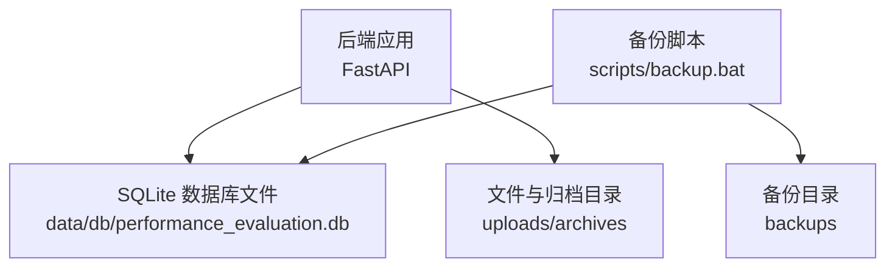
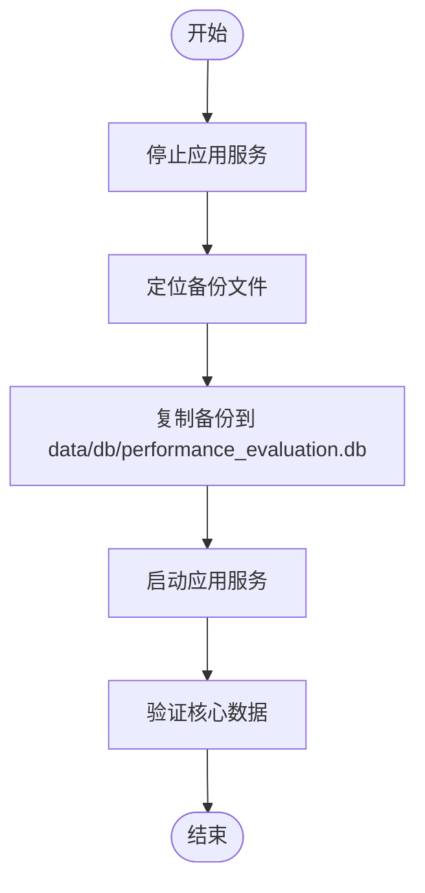
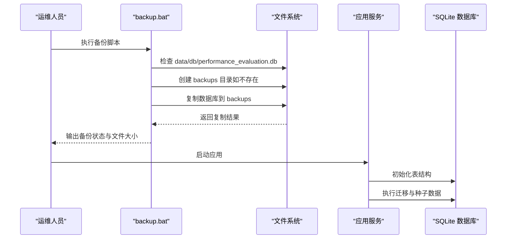
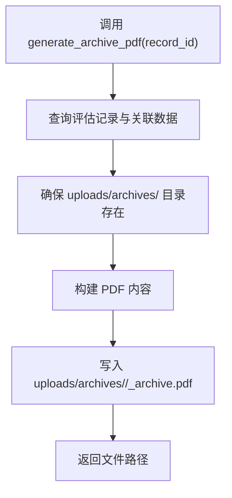

# 备份恢复

<cite>
**本文引用的文件**   
- [scripts/backup.bat](file://scripts/backup.bat)
- [backend/app/database.py](file://backend/app/database.py)
- [backend/app/main.py](file://backend/app/main.py)
- [backend/app/services/pdf_archive_generator.py](file://backend/app/services/pdf_archive_generator.py)
</cite>

## 目录
1. [简介](#简介)
2. [项目结构与数据位置](#项目结构与数据位置)
3. [备份范围与频率策略](#备份范围与频率策略)
4. [自动备份脚本使用方法](#自动备份脚本使用方法)
5. [数据恢复流程](#数据恢复流程)
6. [备份存储与安全策略](#备份存储与安全策略)
7. [备份验证与测试方法](#备份验证与测试方法)
8. [依赖关系分析](#依赖关系分析)
9. [性能与容量规划](#性能与容量规划)
10. [故障排查指南](#故障排查指南)
11. [最佳实践与常见问题](#最佳实践与常见问题)
12. [结论](#结论)

## 简介
本文件面向运维、开发与系统管理员，说明绩效考核评分系统的备份与恢复策略。内容覆盖数据库备份、文件上传与归档备份、配置文件备份的备份范围与频率；提供自动备份脚本的使用说明、定时任务配置建议、命名规范与存储空间管理；给出完全恢复、部分恢复与灾难恢复的操作步骤；并补充备份存储位置、安全管理、备份验证与测试方法，以及最佳实践和常见问题解决方案。

## 项目结构与数据位置
当前仓库采用前后端分离结构，关键数据与脚本分布如下：
- 数据库文件位于项目根目录下的 data/db 目录，默认文件名为 performance_evaluation.db。
- 应用启动时初始化数据库表结构，并在首次启动时创建默认管理员等基础数据。
- 系统生成的 PDF 档案默认写入 uploads/archives 目录，按考核周期子目录组织。
- 根目录存在 backups 目录，用于存放数据库备份文件。
- Windows 环境提供 scripts/backup.bat 脚本，用于复制数据库文件到 backups 目录。

**图表来源**
- [backend/app/database.py:7-11](file://backend/app/database.py#L7-L11)
- [backend/app/main.py:126-129](file://backend/app/main.py#L126-L129)
- [backend/app/services/pdf_archive_generator.py:64-70](file://backend/app/services/pdf_archive_generator.py#L64-L70)
- [scripts/backup.bat:5-9](file://scripts/backup.bat#L5-L9)

**章节来源**
- [backend/app/database.py:7-11](file://backend/app/database.py#L7-L11)
- [backend/app/main.py:126-129](file://backend/app/main.py#L126-L129)
- [backend/app/services/pdf_archive_generator.py:64-70](file://backend/app/services/pdf_archive_generator.py#L64-L70)
- [scripts/backup.bat:5-9](file://scripts/backup.bat#L5-L9)

## 备份范围与频率策略
### 备份范围
- 数据库备份
  - 目标：data/db/performance_evaluation.db
  - 说明：包含所有业务数据（员工、部门、岗位、考核周期、评分、审批、申诉、面试、日志等）。
- 文件上传与归档备份
  - 目标：uploads 目录（尤其是 uploads/archives）
  - 说明：包含系统生成的 PDF 档案等文件。若未来扩展其他上传类型，应一并纳入备份。
- 配置文件备份
  - 目标：系统配置项（如等级规则、开关配置等）
  - 说明：当前配置以数据库记录形式持久化，因此数据库备份已包含配置快照；如需额外保存运行时配置或环境变量清单，建议单独导出为文本或 JSON 文件。

### 推荐频率
- 数据库
  - 开发/测试环境：每日一次或每次部署前。
  - 生产环境：至少每日一次；在重大变更（上线、批量导入、结构调整）前增加一次。
- 文件与归档
  - 与数据库保持一致频率；如果归档生成频繁，可考虑每小时增量备份。
- 配置
  - 配置变更后立即备份；常规频率可与数据库一致。

[本节为策略性说明，不直接分析具体代码文件]

## 自动备份脚本使用方法
### 脚本功能
- 检查数据库文件是否存在。
- 确保 backups 目录存在，不存在则自动创建。
- 使用 PowerShell 获取时间戳，生成带时间戳的备份文件名。
- 将数据库文件复制到 backups 目录。
- 输出备份结果与文件大小信息。

### 执行方式
- 在 Windows 环境中双击运行 scripts/backup.bat，或在命令行中执行该脚本。
- 成功时返回退出码 0；失败时返回非零退出码。

### 备份文件命名规范
- 命名格式：performance_evaluation_YYYYMMDD_HHMMSS.db
- 示例：performance_evaluation_20250101_120000.db
- 时间戳由脚本通过 PowerShell 生成，保证同一秒内多次执行也不会覆盖。

### 定时任务配置建议
- Windows Task Scheduler
  - 新建计划任务，触发器设置为每日固定时间（例如 02:00）。
  - 操作指向 scripts/backup.bat。
  - 勾选“无论用户是否登录都运行”和“使用最高权限”。
- Linux/Cron（如需迁移）
  - 可在 cron 中添加类似条目：0 2 * * * /path/to/scripts/backup.sh
  - 需将脚本转换为 shell 版本并赋予执行权限。

### 存储空间管理
- 保留策略
  - 建议保留最近 7 天的全量备份，超过 30 天的备份进行压缩归档或删除。
- 清理脚本
  - 可编写辅助脚本，根据时间戳删除旧备份，避免磁盘占满。
- 监控告警
  - 监控 backups 目录大小与剩余空间，达到阈值时发送告警。

**章节来源**
- [scripts/backup.bat:5-39](file://scripts/backup.bat#L5-L39)

## 数据恢复流程
### 完全恢复
适用场景：数据库损坏、误删全部数据、需要回滚到某个时间点。

操作步骤：
1. 停止应用服务，避免写入新的数据。
2. 确认要恢复的备份文件路径（backups 目录下对应时间戳的 .db 文件）。
3. 将备份文件复制回 data/db/performance_evaluation.db（先备份当前损坏文件以便回退）。
4. 启动应用服务，应用会执行 init_db 与迁移逻辑，确保表结构正确。
5. 验证核心数据是否恢复（如管理员账号、基础部门与岗位）。

[本图为概念流程图，无需图表来源]

### 部分恢复
适用场景：仅恢复某张表或某段数据（SQLite 不支持在线热备，需谨慎）。

操作步骤：
1. 在隔离环境（测试库）中恢复完整备份。
2. 使用 SQLite 工具从备份库中提取所需数据（导出 SQL 或 CSV）。
3. 将提取的数据导入到生产库的目标表中。
4. 校验数据一致性与关联完整性。

注意：
- 直接替换单个表文件可能导致外键不一致，务必在测试环境验证。
- 建议在低峰期执行，并提前备份当前生产库。

[本节为通用流程说明，不直接分析具体代码文件]

### 灾难恢复
适用场景：服务器不可用、磁盘损坏、多副本丢失后的重建。

操作步骤：
1. 准备新服务器或虚拟机，安装必要依赖（Python、SQLite、ReportLab 等）。
2. 部署应用代码，确保 data/db 与 uploads 目录结构存在。
3. 从远程或离线介质恢复最新的数据库备份到 data/db/performance_evaluation.db。
4. 恢复必要的文件归档到 uploads/archives。
5. 启动应用服务，执行 init_db 与迁移逻辑。
6. 进行健康检查与核心业务流程验证。

[本节为通用流程说明，不直接分析具体代码文件]

## 备份存储与安全策略
### 本地存储
- 主备份目录：backups
- 数据库文件目录：data/db
- 文件归档目录：uploads/archives

### 远程存储
- 建议将 backups 目录同步至远程对象存储（如 S3、OSS、NAS），实现异地容灾。
- 可使用 rsync、rclone 或云厂商提供的同步工具定期推送备份。

### 加密存储
- 对备份文件进行加密后再传输与落盘，推荐使用 AES-256 加密。
- 密钥管理与访问控制应与备份策略分离，遵循最小权限原则。

### 访问控制
- 限制 backups 目录的读写权限，仅允许运维账户访问。
- 在生产环境中禁用公开访问，避免敏感数据泄露。

[本节为通用安全策略说明，不直接分析具体代码文件]

## 备份验证与测试方法
### 备份可用性验证
- 文件大小检查：确认备份文件大小大于 0。
- 文件完整性：对备份文件计算哈希值（如 SHA-256），并与预期值比对。
- 可恢复性演练：在测试环境恢复备份，验证应用能正常启动与查询数据。

### 自动化测试建议
- 在 CI/CD 中加入备份脚本调用与结果断言。
- 模拟数据库损坏后执行恢复流程，验证恢复成功率。
- 对 uploads/archives 中的 PDF 归档进行抽样打开与内容校验。

### 人工巡检
- 定期检查 backups 目录的备份数量与大小。
- 核对备份时间戳是否符合预期频率。
- 抽查恢复演练报告，确保 RTO/RPO 满足要求。

[本节为通用验证方法说明，不直接分析具体代码文件]

## 依赖关系分析
### 应用启动与数据库初始化
- 应用启动时会调用 init_db 创建表结构。
- 同时执行简单迁移逻辑，确保新增列存在。
- 首次启动会创建默认管理员、HR、经理等基础用户与部门、岗位数据。

**图表来源**
- [scripts/backup.bat:16-39](file://scripts/backup.bat#L16-L39)
- [backend/app/main.py:126-129](file://backend/app/main.py#L126-L129)
- [backend/app/database.py:29-31](file://backend/app/database.py#L29-L31)

### 归档文件生成
- PDF 归档生成函数会根据记录 ID 查询相关数据，并在 uploads/archives 下按周期目录生成 PDF 文件。
- 该过程涉及数据库读取与文件系统写入，属于备份范围中的文件归档部分。

**图表来源**
- [backend/app/services/pdf_archive_generator.py:50-70](file://backend/app/services/pdf_archive_generator.py#L50-L70)
- [backend/app/services/pdf_archive_generator.py:294-301](file://backend/app/services/pdf_archive_generator.py#L294-L301)

**章节来源**
- [backend/app/main.py:126-129](file://backend/app/main.py#L126-L129)
- [backend/app/database.py:29-31](file://backend/app/database.py#L29-L31)
- [backend/app/services/pdf_archive_generator.py:50-70](file://backend/app/services/pdf_archive_generator.py#L50-L70)
- [scripts/backup.bat:16-39](file://scripts/backup.bat#L16-L39)

## 性能与容量规划
- 数据库体积增长
  - 随着员工、评分、审批、日志等数据积累，数据库文件会持续增长。
  - 建议定期评估数据库大小，必要时进行历史数据归档或分区。
- 备份窗口
  - 备份期间应避免高并发写入，以减少锁竞争与数据不一致风险。
  - 可将备份安排在业务低峰时段。
- I/O 影响
  - 备份与归档生成均涉及磁盘 I/O，建议将 backups 与 uploads 放置在不同磁盘或 SSD 以提升性能。
- 压缩与去重
  - 对长期保留的备份进行压缩与去重，降低存储成本。

[本节为通用性能建议，不直接分析具体代码文件]

## 故障排查指南
### 备份脚本失败
- 现象：脚本输出“Database file not found”或“Backup failed”。
- 排查：
  - 确认 data/db/performance_evaluation.db 是否存在且可读。
  - 确认 backups 目录是否存在且有写权限。
  - 检查磁盘空间是否充足。
  - 查看脚本退出码与错误输出。

**章节来源**
- [scripts/backup.bat:16-33](file://scripts/backup.bat#L16-L33)

### 应用启动异常
- 现象：应用无法启动或表结构不一致。
- 排查：
  - 检查 init_db 是否执行成功。
  - 检查迁移逻辑是否添加缺失列。
  - 确认数据库文件未被锁定或损坏。

**章节来源**
- [backend/app/main.py:126-129](file://backend/app/main.py#L126-L129)
- [backend/app/database.py:29-31](file://backend/app/database.py#L29-L31)

### 归档文件未生成
- 现象：uploads/archives 下缺少 PDF 档案。
- 排查：
  - 检查 generate_archive_pdf 调用是否成功。
  - 确认 uploads/archives 目录存在且有写权限。
  - 检查数据库记录是否存在且关联数据完整。

**章节来源**
- [backend/app/services/pdf_archive_generator.py:50-70](file://backend/app/services/pdf_archive_generator.py#L50-L70)
- [backend/app/services/pdf_archive_generator.py:294-301](file://backend/app/services/pdf_archive_generator.py#L294-L301)

## 最佳实践与常见问题
### 最佳实践
- 多副本策略
  - 本地 + 远程双副本，至少保留 7 天全量备份。
- 定期恢复演练
  - 每季度进行一次恢复演练，验证 RTO/RPO。
- 备份命名与索引
  - 使用统一命名规范，并维护备份清单（含时间戳、大小、哈希值）。
- 权限最小化
  - 仅授权运维账户访问备份目录与密钥。
- 监控与告警
  - 监控备份成功率、文件大小、磁盘空间与恢复演练结果。

### 常见问题
- 问：备份期间应用仍在写入，数据是否一致？
  - 答：SQLite 不支持在线热备，建议在备份前短暂停止写入或进入只读模式。
- 问：如何快速定位最近的可用备份？
  - 答：按时间戳排序 backups 目录，优先选择最新且大小正常的备份。
- 问：归档文件过大导致备份缓慢？
  - 答：可对 uploads/archives 进行增量备份，或对历史归档进行压缩归档。

[本节为通用实践与建议，不直接分析具体代码文件]

## 结论
本备份恢复策略围绕 SQLite 数据库、文件归档与系统配置展开，结合现有脚本与应用行为，提供了明确的备份范围、频率、自动化执行方式与恢复流程。通过多副本、加密、权限控制与定期演练，可有效保障数据安全与业务连续性。建议持续完善监控与自动化能力，确保备份与恢复流程稳定可靠。

[本节为总结性内容，不直接分析具体代码文件]