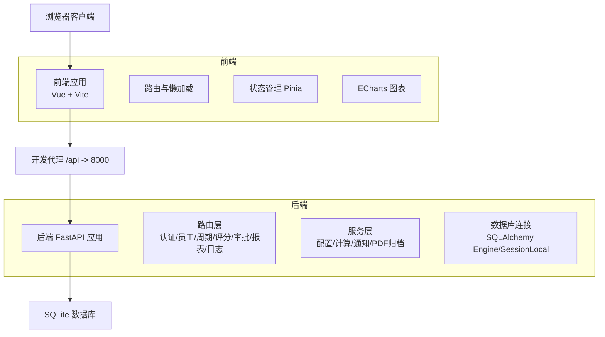
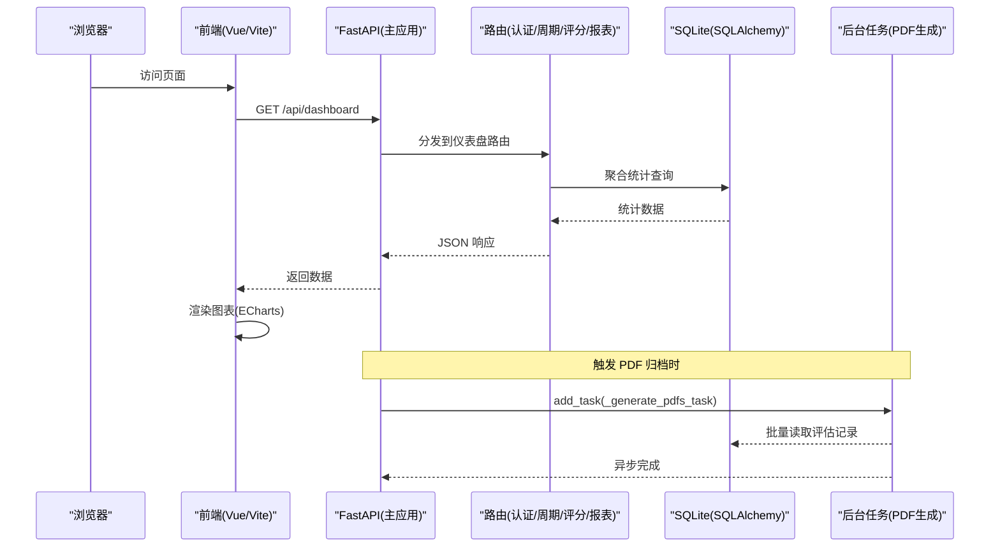
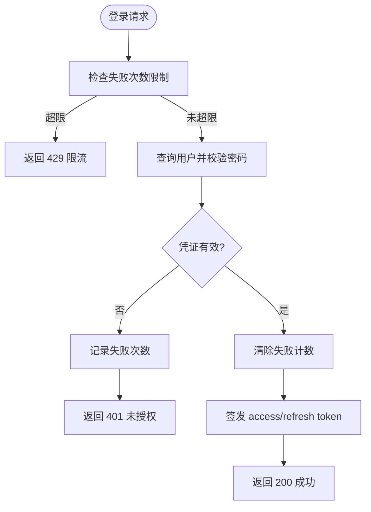
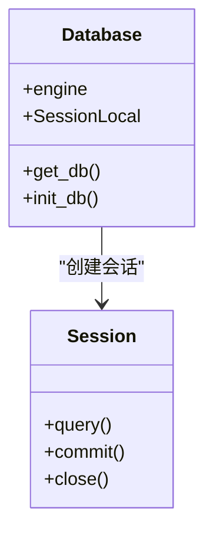
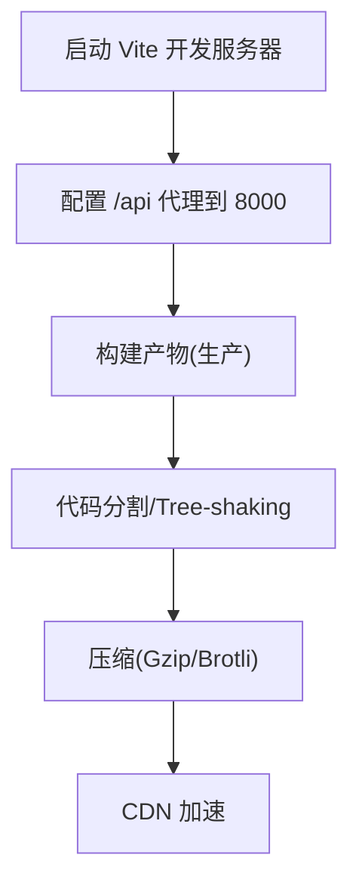
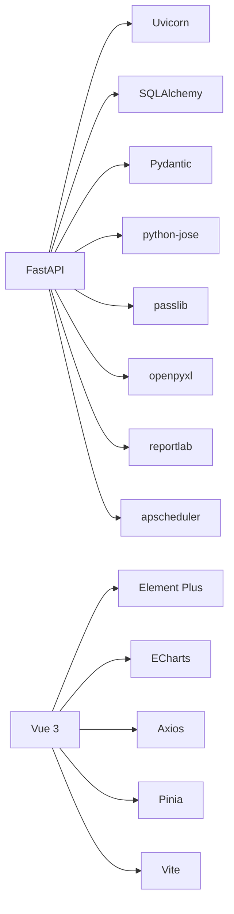

# 性能调优

<cite>
**本文引用的文件**   
- [backend/app/main.py](file://backend/app/main.py)
- [backend/app/database.py](file://backend/app/database.py)
- [backend/requirements.txt](file://backend/requirements.txt)
- [frontend/package.json](file://frontend/package.json)
- [frontend/vite.config.js](file://frontend/vite.config.js)
- [backend/app/routers/auth.py](file://backend/app/routers/auth.py)
- [backend/app/routers/cycles.py](file://backend/app/routers/cycles.py)
- [backend/app/services/config_service.py](file://backend/app/services/config_service.py)
- [docs/PRD_绩效考核评分系统_v1.0.md](file://docs/PRD_绩效考核评分系统_v1.0.md)
- [tests/design/TEST_DESIGN_绩效考核评分系统_v1.0.md](file://tests/design/TEST_DESIGN_绩效考核评分系统_v1.0.md)
- [tests/cases/TEST_CASES_绩效考核评分系统_v1.0.md](file://tests/cases/TEST_CASES_绩效考核评分系统_v1.0.md)
</cite>

## 目录
1. [引言](#引言)
2. [项目结构](#项目结构)
3. [核心组件](#核心组件)
4. [架构总览](#架构总览)
5. [详细组件分析](#详细组件分析)
6. [依赖关系分析](#依赖关系分析)
7. [性能考虑与优化策略](#性能考虑与优化策略)
8. [故障排查指南](#故障排查指南)
9. [结论](#结论)
10. [附录：性能测试与基准](#附录性能测试与基准)

## 引言
本文件面向“绩效考核评分系统”的性能调优，覆盖后端 FastAPI、数据库、缓存、异步处理、前端构建与加载、以及企业级部署（反向代理、负载均衡、高可用）等关键维度。文档基于仓库现有实现与需求文档，给出可落地的监控指标、分析方法、优化手段与测试方法，帮助在真实业务规模下稳定达成性能目标。

## 项目结构
本项目采用前后端分离架构：
- 后端：FastAPI + SQLAlchemy + SQLite（开发期），提供 RESTful API，包含认证、员工、部门、考核周期、评分、审批、报表、日志等模块。
- 前端：Vue 3 + Vite + Element Plus，通过 Axios 调用后端 API，使用 ECharts 渲染图表。
- 测试：Pytest（后端）、Vitest（前端单元）、Playwright（端到端）。

**图示来源**
- [backend/app/main.py:9-71](file://backend/app/main.py#L9-L71)
- [backend/app/database.py:13-18](file://backend/app/database.py#L13-L18)
- [frontend/vite.config.js:12-21](file://frontend/vite.config.js#L12-L21)

**章节来源**
- [backend/app/main.py:9-71](file://backend/app/main.py#L9-L71)
- [backend/app/database.py:13-18](file://backend/app/database.py#L13-L18)
- [frontend/vite.config.js:12-21](file://frontend/vite.config.js#L12-L21)

## 核心组件
- FastAPI 应用入口与中间件：注册 CORS、审计日志、异常处理器，挂载多组路由。
- 数据库连接：SQLAlchemy Engine 与 SessionLocal，当前为 SQLite，适合开发与轻量场景。
- 认证与安全：JWT 鉴权、登录失败次数限制、密码复杂度校验。
- 异步任务：PDF 归档生成使用 BackgroundTasks 异步执行。
- 前端构建：Vite 开发服务器与代理，Element Plus 组件库与 ECharts 图表。

**章节来源**
- [backend/app/main.py:9-71](file://backend/app/main.py#L9-L71)
- [backend/app/database.py:13-18](file://backend/app/database.py#L13-L18)
- [backend/app/routers/auth.py:31-93](file://backend/app/routers/auth.py#L31-L93)
- [backend/app/routers/cycles.py:742-783](file://backend/app/routers/cycles.py#L742-L783)
- [frontend/package.json:17-26](file://frontend/package.json#L17-L26)

## 架构总览
下图展示请求从浏览器到后端再到数据库的完整链路，并标注了关键性能点：CORS/审计中间件、认证限流、数据库查询、异步任务、前端代理与资源加载。

**图示来源**
- [backend/app/main.py:9-71](file://backend/app/main.py#L9-L71)
- [backend/app/routers/cycles.py:742-783](file://backend/app/routers/cycles.py#L742-L783)

## 详细组件分析

### 后端 FastAPI 应用优化
- 中间件与异常处理：统一异常格式便于前端快速降级；审计中间件可用于追踪慢请求。
- 路由组织：按功能拆分路由，避免单文件过大导致启动与热重载变慢。
- 并发模型：FastAPI 基于 uvicorn，生产环境建议多 worker 进程配合反向代理。

优化建议
- 引入请求耗时中间件，统计 P95/P99 响应时间，输出到日志或指标系统。
- 对热点接口增加限流与熔断保护，防止雪崩。
- 将大体积初始化逻辑（如种子数据）拆分为按需加载或独立脚本。

**章节来源**
- [backend/app/main.py:15-28](file://backend/app/main.py#L15-L28)
- [backend/app/main.py:31-46](file://backend/app/main.py#L31-L46)

### 认证与限流
- 登录接口内置内存态失败次数限制，超过阈值锁定 30 分钟，有效抵御暴力破解。
- JWT 签发与刷新流程清晰，用户信息最小化返回。

优化建议
- 将失败计数迁移至 Redis，支持多实例共享与持久化。
- 对登录接口增加验证码或人机校验，降低恶意请求压力。
- 对高频只读接口启用短 TTL 缓存，减少重复鉴权与查询。

**图示来源**
- [backend/app/routers/auth.py:35-93](file://backend/app/routers/auth.py#L35-L93)

**章节来源**
- [backend/app/routers/auth.py:31-93](file://backend/app/routers/auth.py#L31-L93)

### 数据库连接与查询
- 当前使用 SQLite，Engine 创建时关闭线程安全检查，SessionLocal 用于依赖注入。
- 设计文档提出连接池大小与等待时间目标，但当前 SQLite 不支持传统连接池。

优化建议
- 生产环境切换至 PostgreSQL/MySQL，启用 SQLAlchemy 连接池（pool_size、max_overflow、pool_recycle）。
- 针对高频查询建立合适索引，避免 N+1 查询，使用 eager loading 或批量查询。
- 对复杂报表使用物化视图或预聚合表，缩短查询路径。

**图示来源**
- [backend/app/database.py:13-30](file://backend/app/database.py#L13-L30)

**章节来源**
- [backend/app/database.py:13-30](file://backend/app/database.py#L13-L30)
- [docs/PRD_绩效考核评分系统_v1.0.md:1683-1719](file://docs/PRD_绩效考核评分系统_v1.0.md#L1683-L1719)

### 缓存策略
- 配置服务中提及缓存失效逻辑，但未看到具体缓存实现（如 Redis）。
- 设计文档建议仪表盘数据缓存 5 分钟，提升并发查看体验。

优化建议
- 引入 Redis 作为分布式缓存，缓存键按角色/周期/维度组合，设置合理过期时间。
- 对写操作后主动失效相关缓存键，保证一致性。
- 对热点配置项（等级规则、权重）进行短 TTL 缓存，降低频繁读取。

**章节来源**
- [backend/app/services/config_service.py:37-37](file://backend/app/services/config_service.py#L37-L37)
- [docs/PRD_绩效考核评分系统_v1.0.md:1683-1719](file://docs/PRD_绩效考核评分系统_v1.0.md#L1683-L1719)

### 异步处理优化
- PDF 归档生成通过 BackgroundTasks 异步执行，避免阻塞主请求。
- 对于大批量导出与计算，建议结合任务队列（Celery/RQ）与重试机制。

优化建议
- 将 PDF 生成任务拆分为分片并行，减少单次任务时长。
- 增加任务进度回调或轮询接口，前端显示进度条。
- 对失败任务进行重试与告警，保障可靠性。

**章节来源**
- [backend/app/routers/cycles.py:742-783](file://backend/app/routers/cycles.py#L742-L783)

### 前端性能优化
- 使用 Vite 构建，开发阶段通过代理转发 /api 到后端。
- 依赖 Element Plus 与 ECharts，注意按需引入与懒加载。

优化建议
- 开启代码分割与路由懒加载，减少首屏体积。
- 静态资源压缩与 CDN 加速，启用 Gzip/Brotli。
- 大数据表格使用虚拟滚动，图表数据分页与增量更新。

**图示来源**
- [frontend/vite.config.js:12-21](file://frontend/vite.config.js#L12-L21)

**章节来源**
- [frontend/vite.config.js:12-21](file://frontend/vite.config.js#L12-L21)
- [frontend/package.json:17-26](file://frontend/package.json#L17-L26)

## 依赖关系分析
后端依赖 FastAPI、uvicorn、SQLAlchemy、Alembic、Pydantic、JWT、Excel/PDF 工具等；前端依赖 Vue、Element Plus、ECharts、Axios、Pinia、Vite、Vitest、Playwright。

**图示来源**
- [backend/requirements.txt:1-15](file://backend/requirements.txt#L1-L15)
- [frontend/package.json:17-39](file://frontend/package.json#L17-L39)

**章节来源**
- [backend/requirements.txt:1-15](file://backend/requirements.txt#L1-L15)
- [frontend/package.json:17-39](file://frontend/package.json#L17-L39)

## 性能考虑与优化策略

### 关键性能指标与监控
- CPU 使用率：关注 FastAPI 进程与子进程峰值，识别热点接口与计算瓶颈。
- 内存占用：监控 Python 进程与 Node 进程，排查泄漏与大图/大表渲染。
- 数据库查询：慢查询日志、连接池等待时间、锁等待与死锁检测。
- API 响应时间：P50/P95/P99，错误率与超时率。

实施建议
- 接入 APM（如 Prometheus + Grafana、SkyWalking、APM Agent），采集 HTTP 耗时、JVM/Python 指标、DB 指标。
- 对关键接口埋点，输出结构化日志（trace_id、user_id、role、cycle_id）。
- 设置告警阈值，自动扩容或降级。

### 后端优化要点
- FastAPI 应用：
  - 生产环境使用多 worker 进程（uvicorn workers > 1），结合反向代理（Nginx/Traefik）。
    - **前置条件**：当前 `config_service._CACHE`（配置缓存）、登录失败计数等状态均在进程内存，默认只能单 worker（`workers=1`）；开放多 worker 前需先迁移到共享数据库 + 集中式缓存/限流，否则会出现配置不一致与限流失效。
  - 禁用不必要的调试中间件，减少序列化开销。
- 数据库：
  - 切换到关系型数据库并启用连接池，调整 pool_size、max_overflow、pool_recycle。
  - 针对高频查询加索引，避免全表扫描与排序。
  - 复杂报表使用物化视图或预聚合表。
- 缓存：
  - 引入 Redis，缓存热点配置与仪表盘统计，TTL 按业务设定。
  - 写后失效，保证一致性。
- 异步：
  - 大任务走任务队列，支持重试、优先级与监控。
  - 前端轮询进度，避免长时间阻塞。

### 前端优化要点
- 代码分割与懒加载：路由级与组件级按需加载，减少首屏体积。
- 资源压缩与 CDN：启用 Gzip/Brotli，静态资源上 CDN。
- 列表与图表：虚拟滚动、分页加载、增量更新图表数据。
- 网络优化：合并请求、缓存策略（ETag/Cache-Control）、重试与退避。

### 数据库优化要点
- 索引优化：为常用过滤字段、关联字段、排序字段建立索引。
- 查询优化：避免 N+1，使用 join/eager loading，批量写入。
- 连接池配置：根据并发与延迟目标调整池大小与回收策略。
- 表结构设计：规范化与反规范化平衡，冷热数据分离，历史数据归档。

### 负载均衡与高可用
- 反向代理：Nginx/Traefik 配置健康检查、负载均衡、限流、TLS 终止。
- 会话共享：无状态后端 + JWT，或使用集中式会话存储（Redis）。
- 故障转移：多实例部署，自动重启与优雅退出，数据库主从/读写分离。

[本节为通用指导，不直接分析具体文件]

## 故障排查指南
- 登录失败与限流：
  - 现象：频繁 429 或 401。
  - 排查：检查失败次数计数器是否跨实例共享；确认 IP/用户名限流策略。
  - 参考：登录限流与失败计数逻辑。
- 数据库连接问题：
  - 现象：连接耗尽、查询缓慢。
  - 排查：连接池参数、慢查询日志、索引缺失、事务过长。
  - 参考：数据库引擎与会话创建。
- 异步任务堆积：
  - 现象：PDF 生成延迟、任务队列积压。
  - 排查：任务粒度、并发度、失败重试、资源竞争。
  - 参考：BackgroundTasks 使用位置。

**章节来源**
- [backend/app/routers/auth.py:31-93](file://backend/app/routers/auth.py#L31-L93)
- [backend/app/database.py:13-30](file://backend/app/database.py#L13-L30)
- [backend/app/routers/cycles.py:742-783](file://backend/app/routers/cycles.py#L742-L783)

## 结论
本项目已具备清晰的 FastAPI 架构与基础性能能力。为达到企业级性能目标，建议在生产环境引入连接池数据库、Redis 缓存、任务队列与 APM 监控，并结合反向代理与多实例部署实现高可用。前端侧通过代码分割、懒加载与资源压缩提升首屏与交互体验。通过持续压测与基线对比，逐步收敛性能瓶颈，确保在大规模并发与大数据量场景下的稳定性与响应速度。

[本节为总结性内容，不直接分析具体文件]

## 附录：性能测试与基准

### 性能目标与测试方法
- 并发在线评分：50 人同时提交，前端响应 < 2 秒。
- 并发查看仪表盘：20 人同时查看，接口响应 < 1.5 秒。
- 数据库连接池：支持 100 并发连接，连接等待 < 500ms。
- 汇总计算（500 人）：< 3 秒；强制分布（500 人）：< 2 秒。
- 报表导出（500 人）：< 5 秒；PDF 生成（单条）：< 1 秒。
- 前端首屏加载：< 3 秒（含懒加载）；页面切换 < 1 秒；1000 行表格不卡顿；图表渲染 < 1 秒。

**章节来源**
- [docs/PRD_绩效考核评分系统_v1.0.md:1683-1719](file://docs/PRD_绩效考核评分系统_v1.0.md#L1683-L1719)

### API 响应性能用例
- 员工列表查询（50/500 人）：< 200ms / < 500ms。
- 登录接口：< 300ms。
- 提交评分接口：< 300ms。
- 汇总计算（50/500 人）：< 3s / < 5s。
- 等级分布报表查询：< 500ms。
- 历史趋势查询（8 周期）：< 300ms。

**章节来源**
- [tests/design/TEST_DESIGN_绩效考核评分系统_v1.0.md:364-384](file://tests/design/TEST_DESIGN_绩效考核评分系统_v1.0.md#L364-L384)

### 专项性能测试用例
- 慢查询监控：慢查询日志为空或均有优化建议，无 N+1，复杂报表 EXPLAIN 走索引。
- 前端长列表渲染：1000 条数据滚动帧率 ≥ 55 FPS，无白屏卡顿，内存稳定。
- 内存泄漏检测：连续运行 24 小时，内存增长 < 10%，GC 后回落，无 OOM。
- 缓存命中率：高频查询缓存命中率 ≥ 80%。

**章节来源**
- [tests/cases/TEST_CASES_绩效考核评分系统_v1.0.md:1522-1576](file://tests/cases/TEST_CASES_绩效考核评分系统_v1.0.md#L1522-L1576)

### 基准测试工具与实践
- 后端压测：Locust/JMeter 模拟并发用户，采集 P95/P99 与错误率。
- 前端性能：Lighthouse 审计首屏与可交互时间，Chrome DevTools Performance 面板录制。
- 数据库性能：慢查询日志、EXPLAIN 分析、连接池监控。
- 缓存性能：Redis 监控命中率、延迟与内存使用。

[本节为通用实践，不直接分析具体文件]