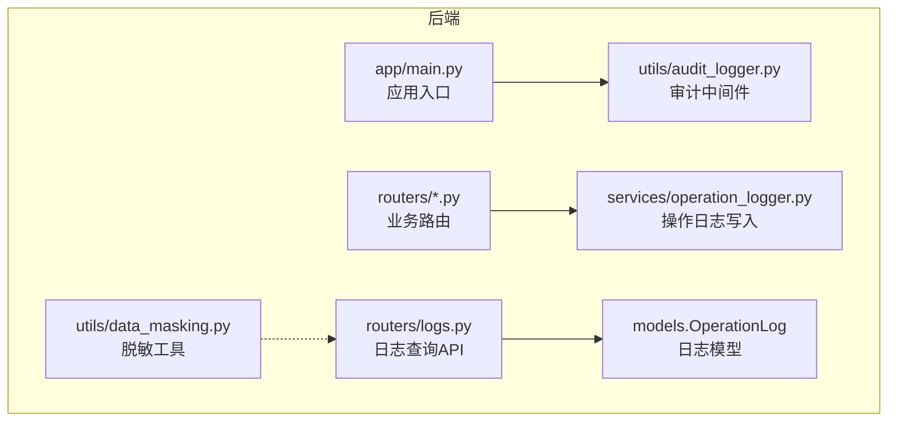
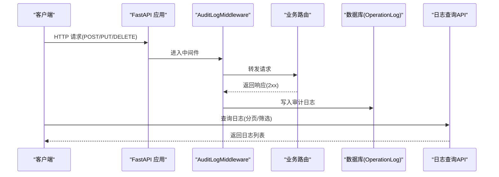
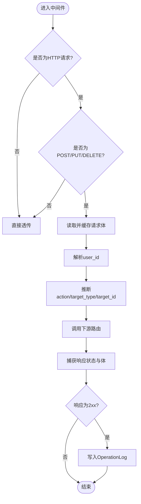
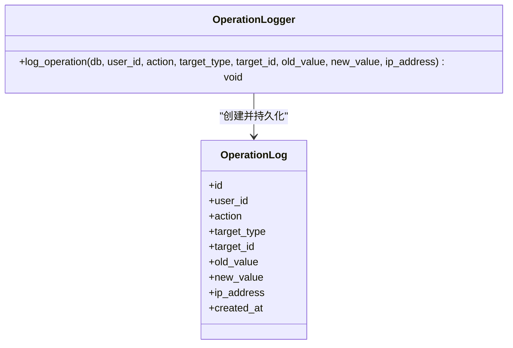
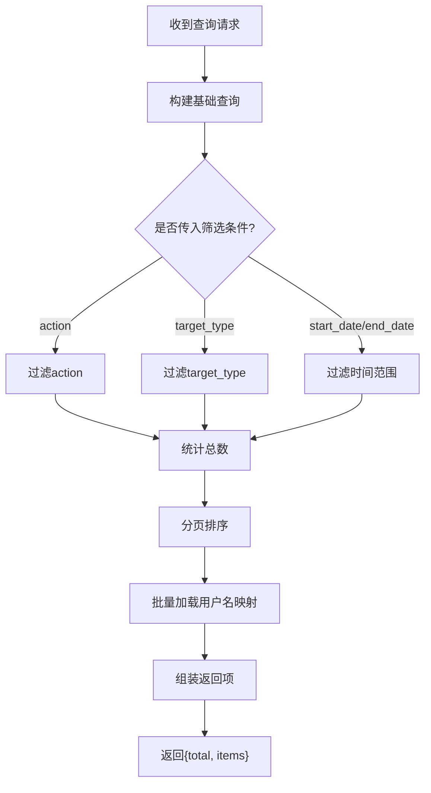
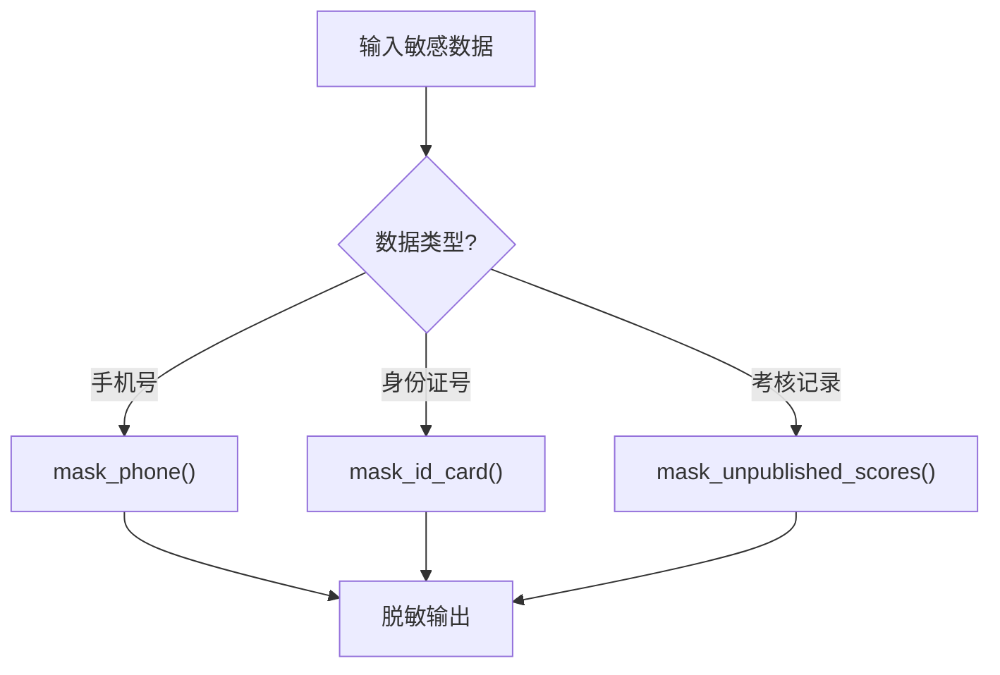
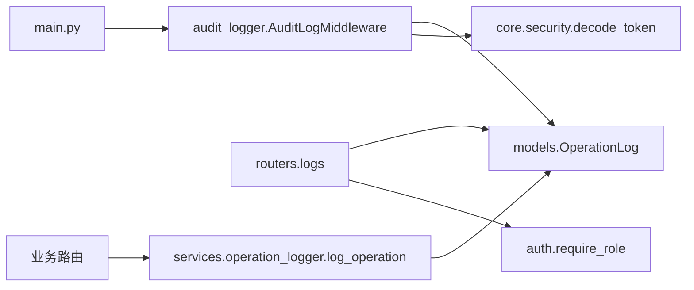

# 日志管理

<cite>
**本文引用的文件**   
- [audit_logger.py](file://backend/app/utils/audit_logger.py)
- [operation_logger.py](file://backend/app/services/operation_logger.py)
- [logs.py](file://backend/app/routers/logs.py)
- [main.py](file://backend/app/main.py)
- [data_masking.py](file://backend/app/utils/data_masking.py)
</cite>

## 目录
1. [简介](#简介)
2. [项目结构](#项目结构)
3. [核心组件](#核心组件)
4. [架构总览](#架构总览)
5. [详细组件分析](#详细组件分析)
6. [依赖关系分析](#依赖关系分析)
7. [性能与容量规划](#性能与容量规划)
8. [故障排查指南](#故障排查指南)
9. [结论](#结论)
10. [附录](#附录)

## 简介
本文件面向“绩效考核评分系统”的日志子系统，系统性说明审计日志、操作日志与错误日志的分类与用途，给出日志级别配置建议、日志轮转与清理策略、日志分析与集中化方案、安全脱敏与访问控制要点，并提供常见问题排查方法与性能优化建议。文档内容严格基于仓库现有实现进行归纳与扩展，便于不同技术背景的读者理解与实践。

## 项目结构
后端日志相关代码主要分布在以下位置：
- 中间件与通用审计能力：backend/app/utils/audit_logger.py
- 业务侧操作日志写入服务：backend/app/services/operation_logger.py
- 日志查询接口（分页、筛选）：backend/app/routers/logs.py
- 应用启动与中间件注册：backend/app/main.py
- 敏感信息脱敏工具：backend/app/utils/data_masking.py

**图表来源**
- [main.py:23-26](file://backend/app/main.py#L23-L26)
- [audit_logger.py:104-188](file://backend/app/utils/audit_logger.py#L104-L188)
- [operation_logger.py:7-40](file://backend/app/services/operation_logger.py#L7-L40)
- [logs.py:14-83](file://backend/app/routers/logs.py#L14-L83)
- [data_masking.py:1-26](file://backend/app/utils/data_masking.py#L1-L26)

**章节来源**
- [main.py:23-26](file://backend/app/main.py#L23-L26)
- [audit_logger.py:104-188](file://backend/app/utils/audit_logger.py#L104-L188)
- [operation_logger.py:7-40](file://backend/app/services/operation_logger.py#L7-L40)
- [logs.py:14-83](file://backend/app/routers/logs.py#L14-L83)
- [data_masking.py:1-26](file://backend/app/utils/data_masking.py#L1-L26)

## 核心组件
- 审计中间件（AuditLogMiddleware）
  - 自动拦截 POST/PUT/DELETE 请求，解析用户身份、目标资源与动作，捕获响应状态与体，仅对成功请求（2xx）落库记录审计日志。
  - 通过数据库会话写入 OperationLog 表，失败时记录错误日志。
- 操作日志服务（log_operation）
  - 提供统一的操作日志写入方法，供各业务路由在关键流程中显式记录变更前后快照。
- 日志查询接口（logs.py）
  - 提供分页与多条件筛选（操作类型、目标类型、时间范围），并返回用户名映射。
- 脱敏工具（data_masking.py）
  - 提供手机号、身份证号等字段的脱敏函数，以及未发布分数数据的字段遮蔽逻辑。

**章节来源**
- [audit_logger.py:15-53](file://backend/app/utils/audit_logger.py#L15-L53)
- [audit_logger.py:104-188](file://backend/app/utils/audit_logger.py#L104-L188)
- [operation_logger.py:7-40](file://backend/app/services/operation_logger.py#L7-L40)
- [logs.py:14-83](file://backend/app/routers/logs.py#L14-L83)
- [data_masking.py:1-26](file://backend/app/utils/data_masking.py#L1-L26)

## 架构总览
系统日志架构由三层组成：
- 采集层
  - 中间件自动采集写类请求的上下文与结果；业务代码在关键路径调用 log_operation 补充结构化变更快照。
- 存储层
  - 所有日志统一写入 OperationLog 表，包含操作人、动作、目标类型/ID、变更前后值、IP、时间戳等。
- 消费层
  - 日志查询 API 支持分页与多维筛选；前端可据此构建审计视图。

**图表来源**
- [audit_logger.py:104-188](file://backend/app/utils/audit_logger.py#L104-L188)
- [logs.py:14-83](file://backend/app/routers/logs.py#L14-L83)

## 详细组件分析

### 审计中间件（AuditLogMiddleware）
职责与行为：
- 仅处理 HTTP 请求，且只对 POST/PUT/DELETE 生效。
- 读取并缓存请求体，允许下游再次消费。
- 从 Authorization 头解析 token 获取 user_id。
- 从 URL 推断 action 与 target_type，尝试提取 target_id。
- 捕获响应状态码与响应体，仅对 2xx 成功请求落库。
- 使用独立 SessionLocal 写入日志，异常时记录错误日志。

**图表来源**
- [audit_logger.py:104-188](file://backend/app/utils/audit_logger.py#L104-L188)

**章节来源**
- [audit_logger.py:56-101](file://backend/app/utils/audit_logger.py#L56-L101)
- [audit_logger.py:104-188](file://backend/app/utils/audit_logger.py#L104-L188)

### 操作日志服务（log_operation）
职责与行为：
- 接收结构化参数（用户ID、动作、目标类型/ID、变更前后快照、IP）。
- 将 old_value/new_value 序列化为 JSON 字符串后持久化。
- 使用 flush 确保事务内可见性，适合与业务事务保持一致提交节奏。

**图表来源**
- [operation_logger.py:7-40](file://backend/app/services/operation_logger.py#L7-L40)

**章节来源**
- [operation_logger.py:7-40](file://backend/app/services/operation_logger.py#L7-L40)

### 日志查询接口（logs.py）
职责与行为：
- 支持分页（page/size）、按 action/target_type 筛选、按日期范围筛选。
- 批量加载涉及的用户名映射，减少 N+1 查询。
- 返回 total 与 items 的结构化响应。

**图表来源**
- [logs.py:14-83](file://backend/backend/app/routers/logs.py#L14-L83)

**章节来源**
- [logs.py:14-83](file://backend/app/routers/logs.py#L14-L83)

### 敏感信息脱敏（data_masking.py）
- 手机号与身份证号脱敏：保留前缀与后缀，中间以星号替换。
- 未发布分数数据遮蔽：对非 published/archived 状态的记录，将总分与等级置空。

**图表来源**
- [data_masking.py:1-26](file://backend/app/utils/data_masking.py#L1-L26)

**章节来源**
- [data_masking.py:1-26](file://backend/app/utils/data_masking.py#L1-L26)

## 依赖关系分析
- 中间件依赖
  - 依赖 FastAPI Request/Response 流式处理机制。
  - 依赖数据库会话（SessionLocal）与 OperationLog 模型。
  - 依赖鉴权模块 decode_token 解析用户身份。
- 路由依赖
  - 日志查询接口依赖 get_db、require_role 权限校验。
  - 依赖 User 模型进行用户名映射。
- 业务路由依赖
  - 多个业务路由通过 import 引入 log_operation，用于关键操作的显式审计。

**图表来源**
- [main.py:23-26](file://backend/app/main.py#L23-L26)
- [audit_logger.py:104-188](file://backend/app/utils/audit_logger.py#L104-L188)
- [logs.py:14-83](file://backend/app/routers/logs.py#L14-L83)
- [operation_logger.py:7-40](file://backend/app/services/operation_logger.py#L7-L40)

**章节来源**
- [main.py:23-26](file://backend/app/main.py#L23-L26)
- [audit_logger.py:104-188](file://backend/app/utils/audit_logger.py#L104-L188)
- [logs.py:14-83](file://backend/app/routers/logs.py#L14-L83)
- [operation_logger.py:7-40](file://backend/app/services/operation_logger.py#L7-L40)

## 性能与容量规划
- 写入路径
  - 中间件仅在 2xx 响应时落库，避免无效写入。
  - 业务侧 log_operation 使用 flush，配合事务边界控制，降低锁竞争。
- 查询路径
  - 日志查询采用分页与批量加载用户名映射，避免 N+1 问题。
- 容量规划建议
  - 根据日均请求量估算日志增量，结合磁盘空间与保留策略制定滚动归档计划。
  - 对高频操作（如打分、审批）建议拆分索引或分区表，提升查询效率。
- I/O 优化
  - 在高并发场景下，可将日志写入改为异步队列（如 Celery/RQ）+ 批量入库，降低主链路延迟。
  - 对 old_value/new_value 大对象考虑压缩或外存（对象存储）引用。

[本节为通用指导，不直接分析具体文件]

## 故障排查指南
- 审计日志未生成
  - 检查请求是否为 POST/PUT/DELETE，且响应状态码为 2xx。
  - 确认中间件已在应用启动时注册。
  - 查看应用日志中是否存在“Failed to write audit log”的错误记录。
- 日志查询缓慢
  - 检查是否使用了分页与必要筛选条件。
  - 评估 created_at、action、target_type 等字段的索引覆盖情况。
- 敏感信息泄露风险
  - 对外暴露的日志详情需经脱敏处理，尤其是 old_value/new_value 中的个人身份信息。
  - 对未发布的考核分数，应遵循 mask_unpublished_scores 的策略进行遮蔽。
- 权限越权访问
  - 日志查询接口要求 admin/hr 角色，请确认 require_role 校验生效。

**章节来源**
- [audit_logger.py:186-188](file://backend/app/utils/audit_logger.py#L186-L188)
- [logs.py:23-24](file://backend/app/routers/logs.py#L23-L24)
- [data_masking.py:19-25](file://backend/app/utils/data_masking.py#L19-L25)

## 结论
本系统的日志体系以中间件自动采集与业务显式记录相结合，统一落库至 OperationLog，并通过受限的查询接口对外提供审计能力。建议在现有基础上完善日志级别配置、日志轮转与清理策略，并结合脱敏与权限控制强化安全性；在多实例部署场景下，推荐引入集中式日志平台以实现统一检索与分析。

[本节为总结性内容，不直接分析具体文件]

## 附录

### 日志分类与用途
- 审计日志
  - 来源：中间件自动采集写类请求的上下文与结果。
  - 用途：合规审计、责任追溯、异常回溯。
- 操作日志
  - 来源：业务路由在关键流程中调用 log_operation 记录的变更快照。
  - 用途：业务流程追踪、变更对比、问题定位。
- 错误日志
  - 来源：应用框架与自定义异常处理产生的错误日志。
  - 用途：系统监控、告警、排障。

[本节为概念性说明，不直接分析具体文件]

### 日志级别配置建议
- DEBUG：开发环境开启，记录详细调试信息；生产环境关闭。
- INFO：记录常规业务事件（如登录、关键操作完成）。
- WARNING：记录潜在风险（如慢查询、重试、降级）。
- ERROR：记录不可恢复错误（如数据库连接失败、第三方服务异常）。
- 建议
  - 通过环境变量或配置文件区分环境，动态调整级别。
  - 对审计与操作日志单独设置更严格的级别阈值，避免噪声干扰。

[本节为通用指导，不直接分析具体文件]

### 日志轮转与清理策略
- 文件大小限制
  - 单文件上限（如 100MB~500MB），达到阈值触发轮转。
- 保留期限
  - 审计日志建议保留 180~365 天；操作日志建议 90~180 天；错误日志建议 30~90 天。
- 自动清理
  - 定时任务删除过期日志文件，或对历史日志进行归档压缩。
- 高吞吐优化
  - 使用异步写入与批量落库；对大对象进行压缩或外存化。

[本节为通用指导，不直接分析具体文件]

### 日志分析与常用技巧
- 搜索与过滤
  - 按用户、动作、目标类型、时间范围组合筛选。
  - 对 old_value/new_value 进行关键字匹配，快速定位变更点。
- 统计与报表
  - 按日/周统计操作量、成功率、失败率。
  - 针对高风险动作（如删除、覆盖）建立专项报表。
- 可视化
  - 将日志指标接入监控系统（如 Prometheus/Grafana），设置阈值告警。

[本节为通用指导，不直接分析具体文件]

### 日志聚合与集中化管理
- 方案选型
  - 轻量级：Filebeat/Fluent Bit 收集本地日志，推送至 Elasticsearch/OpenSearch。
  - 企业级：Kafka + Logstash/Elasticsearch 或云厂商日志服务。
- 多实例部署
  - 为每个实例分配唯一标识（instance_id），便于聚合与分片。
  - 统一日志格式（JSON），包含 trace_id、span_id、level、message、fields。
- 查询与分析
  - 建立索引策略（按时间、实例、级别、模块）。
  - 提供统一检索界面，支持复杂查询与导出。

[本节为通用指导，不直接分析具体文件]

### 日志安全与合规
- 敏感信息脱敏
  - 对手机号、身份证号、银行卡号等进行掩码处理。
  - 对未发布数据（如分数、等级）进行字段遮蔽。
- 访问权限控制
  - 日志查询接口限制 admin/hr 角色访问。
  - 对敏感字段增加二次授权或审批流程。
- 传输与存储加密
  - 日志传输使用 TLS；静态存储启用加密。
- 审计与合规
  - 保留必要的元数据（操作人、时间、IP），满足合规审计要求。

**章节来源**
- [data_masking.py:1-26](file://backend/app/utils/data_masking.py#L1-L26)
- [logs.py:23-24](file://backend/app/routers/logs.py#L23-L24)