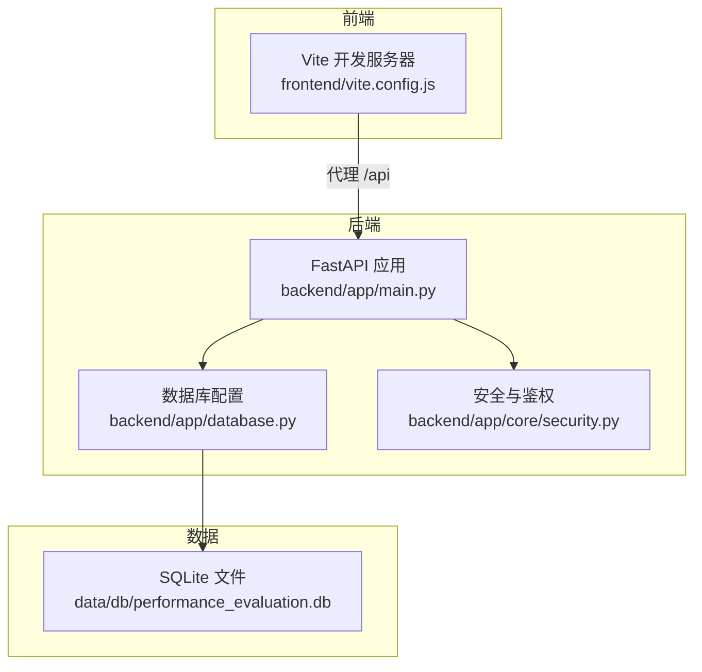
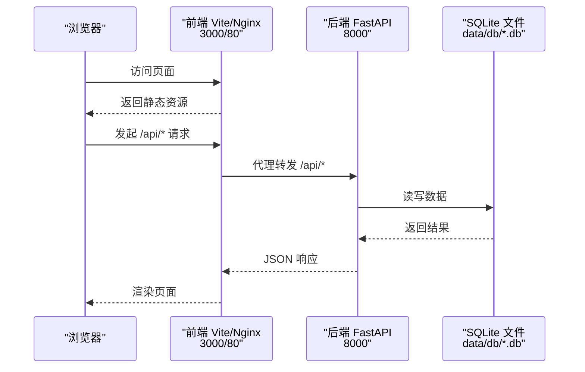
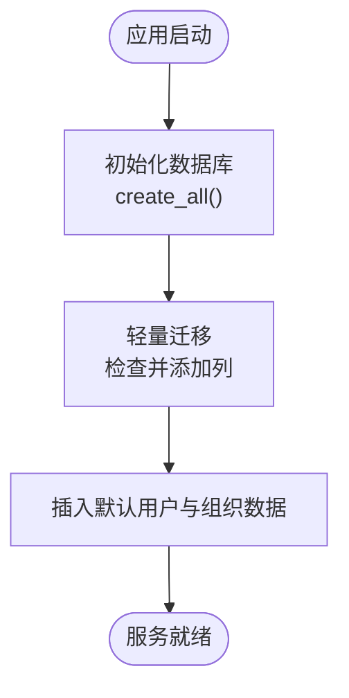
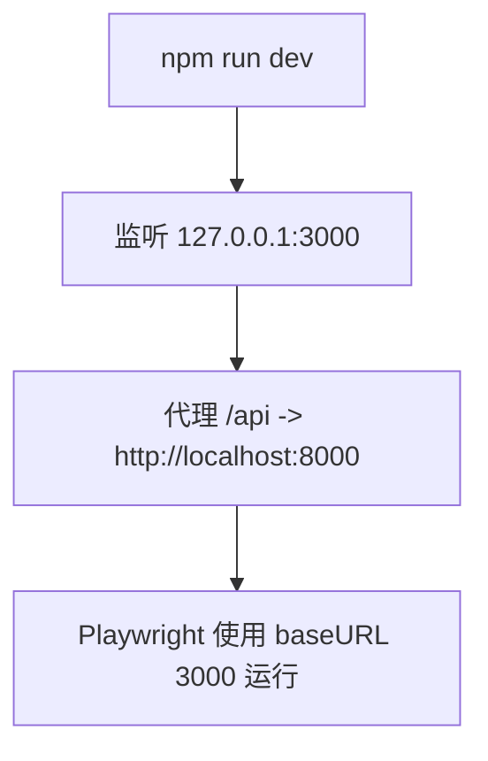

# 环境部署

<cite>
**本文引用的文件**   
- [backend/requirements.txt](file://backend/requirements.txt)
- [frontend/package.json](file://frontend/package.json)
- [backend/app/main.py](file://backend/app/main.py)
- [backend/app/database.py](file://backend/app/database.py)
- [backend/app/core/security.py](file://backend/app/core/security.py)
- [frontend/vite.config.js](file://frontend/vite.config.js)
- [frontend/playwright.config.ts](file://frontend/playwright.config.ts)
- [scripts/restart.bat](file://scripts/restart.bat)
- [restart-services.bat](file://restart-services.bat)
- [backend/restart.sh](file://backend/restart.sh)
- [backend/restart.bat](file://backend/restart.bat)
</cite>

## 更新摘要
**变更内容**   
- 更新后端服务端口配置为8000（替代之前的8014/8015）
- 统一前后端开发环境端口配置
- 修正所有相关脚本和配置文件中的端口引用
- 更新故障排查指南中的端口冲突解决方案

## 目录
1. [简介](#简介)
2. [项目结构](#项目结构)
3. [核心组件](#核心组件)
4. [架构总览](#架构总览)
5. [详细组件分析](#详细组件分析)
6. [依赖关系分析](#依赖关系分析)
7. [性能与容量建议](#性能与容量建议)
8. [故障排查指南](#故障排查指南)
9. [结论](#结论)
10. [附录：部署清单](#附录部署清单)

## 简介
本文件面向生产环境部署，覆盖以下目标：
- 服务器基础环境要求（操作系统、Python、Node.js）
- 后端 Python 依赖与前端 Node.js 依赖安装流程
- 数据库配置与环境变量设置（SQLite 路径、连接参数、安全相关配置）
- 前后端服务启动指南（开发环境与生产环境、端口、进程管理）
- 容器化部署方案（Docker 镜像构建、docker-compose 编排思路）
- 常见部署问题排查方法与解决方案

本项目采用 FastAPI + SQLAlchemy + SQLite 作为后端技术栈，Vue 3 + Vite 作为前端技术栈。后端默认使用 SQLite 文件型数据库，数据文件统一存放在仓库根目录的 data/db 下；前端通过 Vite 开发服务器代理 /api 请求到后端 8000 端口。

**更新** 后端服务端口已统一调整为8000，替代之前的8014/8015端口配置，确保开发环境的一致性。

## 项目结构
从部署视角，关键目录与职责如下：
- backend：FastAPI 后端应用，包含路由、模型、数据库初始化、鉴权与安全等
- frontend：Vue 3 + Vite 前端应用，提供静态资源与开发代理
- data/db：SQLite 数据库文件存放目录（由后端自动创建）
- logs：日志输出目录（可按需扩展）
- scripts：运维脚本（如初始化、备份等）

**图表来源**
- [backend/app/main.py:1-71](file://backend/app/main.py#L1-L71)
- [backend/app/database.py:1-31](file://backend/app/database.py#L1-L31)
- [backend/app/core/security.py:1-16](file://backend/app/core/security.py#L1-L16)
- [frontend/vite.config.js:12-21](file://frontend/vite.config.js#L12-L21)

**章节来源**
- [backend/app/main.py:1-71](file://backend/app/main.py#L1-L71)
- [backend/app/database.py:1-31](file://backend/app/database.py#L1-L31)
- [frontend/vite.config.js:12-21](file://frontend/vite.config.js#L12-L21)

## 核心组件
- 后端 API 服务：基于 FastAPI，内置 CORS、审计中间件、异常处理，并挂载多个业务路由
- 数据库层：SQLAlchemy + SQLite，自动创建表，提供会话工厂与初始化函数
- 安全模块：JWT Token 签发与校验、密码哈希与校验、当前用户解析
- 前端开发服务器：Vite 提供热重载，并将 /api 请求代理至后端 8000 端口

**更新** 所有服务现在统一使用端口8000作为后端服务端口，简化了开发和部署配置。

**章节来源**
- [backend/app/main.py:1-71](file://backend/app/main.py#L1-L71)
- [backend/app/database.py:1-31](file://backend/app/database.py#L1-L31)
- [backend/app/core/security.py:1-16](file://backend/app/core/security.py#L1-L16)
- [frontend/vite.config.js:12-21](file://frontend/vite.config.js#L12-L21)

## 架构总览
下图展示前后端在开发与生产中的典型交互方式：
- 开发环境：前端 Vite dev server 监听 3000 端口，将 /api 请求转发到后端 8000 端口
- 生产环境：前端静态资源由反向代理（如 Nginx/Caddy）托管，后端 FastAPI 由进程管理器（如 systemd/supervisor/gunicorn）托管

**图表来源**
- [frontend/vite.config.js:12-21](file://frontend/vite.config.js#L12-L21)
- [backend/app/database.py:1-31](file://backend/app/database.py#L1-L31)

## 详细组件分析

### 后端服务（FastAPI）
- 入口与路由挂载：应用标题、版本、CORS、审计中间件、全局异常处理器，以及 /api/v1 与兼容路由
- 启动事件：初始化数据库、执行轻量迁移、插入默认管理员与测试账号
- 数据库：统一 SQLite 文件路径，线程安全参数开启，提供 get_db 依赖注入
- 安全：JWT 密钥、算法、过期时间、密码哈希与校验、Token 解码与当前用户解析

**图表来源**
- [backend/app/main.py:97-129](file://backend/app/main.py#L97-L129)
- [backend/app/database.py:29-31](file://backend/app/database.py#L29-L31)

**章节来源**
- [backend/app/main.py:1-129](file://backend/app/main.py#L1-L129)
- [backend/app/database.py:1-31](file://backend/app/database.py#L1-L31)
- [backend/app/core/security.py:13-16](file://backend/app/core/security.py#L13-L16)

### 前端服务（Vite）
- 开发服务器：host 为 127.0.0.1，port 为 3000
- 代理规则：将 /api 请求转发到 http://localhost:8000
- 端到端测试：Playwright 以 http://127.0.0.1:3000 为基础地址运行

**图表来源**
- [frontend/vite.config.js:12-21](file://frontend/vite.config.js#L12-L21)
- [frontend/playwright.config.ts:32-34](file://frontend/playwright.config.ts#L32-L34)

**章节来源**
- [frontend/vite.config.js:12-21](file://frontend/vite.config.js#L12-L21)
- [frontend/playwright.config.ts:32-34](file://frontend/playwright.config.ts#L32-L34)

## 依赖关系分析

### 后端 Python 依赖
- Web 框架：FastAPI
- ASGI 服务器：Uvicorn
- ORM：SQLAlchemy
- 迁移工具：Alembic
- 数据校验：Pydantic
- 认证：python-jose (cryptography)、passlib (bcrypt)
- 文件上传：python-multipart
- Excel 处理：openpyxl
- 报表生成：reportlab
- 测试：pytest、httpx
- 自动化测试：playwright
- 定时任务：apscheduler

安装命令（在项目根或 backend 目录执行）：
- python -m pip install -r backend/requirements.txt

**章节来源**
- [backend/requirements.txt:1-15](file://backend/requirements.txt#L1-L15)

### 前端 Node.js 依赖
- 运行时依赖：Vue 3、Element Plus、Axios、Pinia、Vue Router、ECharts 等
- 开发依赖：Vite、Vitest、Playwright、Sass、xlsx 等

安装命令（在 frontend 目录执行）：
- npm install

**章节来源**
- [frontend/package.json:1-42](file://frontend/package.json#L1-L42)

## 性能与容量建议
- 数据库：SQLite 适合单机小中型场景；高并发写入建议评估迁移至 PostgreSQL/MySQL
- 进程管理：生产环境建议使用 gunicorn + uvicorn 多 worker 模式，配合系统级进程守护（systemd/supervisor）
- 静态资源：前端构建产物由 Nginx/Caddy 托管，启用 gzip/brotli 压缩与缓存策略
- 日志与监控：集中收集应用日志与错误堆栈，接入 APM 或日志平台

[本节为通用建议，不直接分析具体文件]

## 故障排查指南

### 常见问题与定位
- 端口冲突
  - 现象：后端 8000 或前端 3000 端口被占用
  - 排查：查看进程占用情况，修改 vite.config.js 中前端端口或后端启动参数
  - 参考：前端默认端口 3000，代理目标 8000
  - **更新** 所有服务现在统一使用端口8000，避免了之前8014/8015端口切换的问题
- 跨域失败
  - 现象：前端调用后端报 CORS 错误
  - 排查：确认后端已启用 CORS 中间件；生产环境确保反向代理正确转发 Origin
  - 参考：后端已添加 CORSMiddleware
- 数据库初始化失败
  - 现象：启动时报错无法创建表或写入 SQLite 文件
  - 排查：确认 data/db 目录存在且可写；检查权限与磁盘空间
  - 参考：数据库路径与初始化逻辑
- 登录鉴权失败
  - 现象：Token 无效或用户不存在
  - 排查：检查 JWT 密钥是否被修改；确认默认用户是否成功插入
  - 参考：安全模块中的密钥与 Token 校验逻辑

**更新** 端口冲突问题现已简化，因为所有配置都统一使用8000端口，减少了端口切换带来的复杂性。

**章节来源**
- [frontend/vite.config.js:12-21](file://frontend/vite.config.js#L12-L21)
- [backend/app/main.py:15-21](file://backend/app/main.py#L15-L21)
- [backend/app/database.py:7-16](file://backend/app/database.py#L7-L16)
- [backend/app/core/security.py:13-16](file://backend/app/core/security.py#L13-L16)

## 结论
本项目的部署要点包括：
- 准备 Python 与 Node.js 环境，分别安装后端与前端依赖
- 使用 SQLite 作为默认数据库，注意 data/db 目录权限与备份
- 开发环境通过 Vite 代理 /api 到后端 8000 端口
- 生产环境建议对前端静态资源与后端 API 分别进行反向代理与进程管理
- 安全方面需替换默认 JWT 密钥，并在生产环境收紧 CORS 与访问控制

**更新** 端口配置现已统一为8000，简化了部署流程和故障排查。

[本节为总结性内容，不直接分析具体文件]

## 附录：部署清单

### 服务器基础环境要求
- 操作系统：Linux（推荐 Ubuntu/CentOS）、macOS、Windows（开发）
- Python：3.9+（满足 FastAPI/SQLAlchemy 生态）
- Node.js：18+（满足 Vite/Vitest/Playwright 生态）
- 可选：Nginx/Caddy（静态资源与反向代理）、Gunicorn（WSGI/ASGI 进程管理）

### 依赖包安装流程
- 后端
  - 进入 backend 目录
  - 执行：python -m pip install -r requirements.txt
- 前端
  - 进入 frontend 目录
  - 执行：npm install

**章节来源**
- [backend/requirements.txt:1-15](file://backend/requirements.txt#L1-L15)
- [frontend/package.json:1-42](file://frontend/package.json#L1-L42)

### 数据库配置与环境变量
- SQLite 路径
  - 默认路径：项目根目录下的 data/db/performance_evaluation.db
  - 后端会自动创建该目录与数据库文件
- 连接参数
  - connect_args.check_same_thread=False（多线程访问 SQLite）
- 安全配置
  - JWT 密钥：请替换默认值，避免硬编码
  - CORS：开发允许所有来源，生产应限制为可信域名
  - 密码哈希：使用 bcrypt

**章节来源**
- [backend/app/database.py:7-16](file://backend/app/database.py#L7-L16)
- [backend/app/core/security.py:13-16](file://backend/app/core/security.py#L13-L16)

### 前后端服务启动指南
- 开发环境
  - 后端：uvicorn app.main:app --host 0.0.0.0 --port 8000（在 backend 目录执行）
  - 前端：npm run dev（在 frontend 目录执行，默认 3000 端口）
- 生产环境
  - 后端：使用 gunicorn + uvicorn 多 worker 模式，并由 systemd/supervisor 守护
  - 前端：npm run build 构建静态资源，交由 Nginx/Caddy 托管
  - 反向代理：将 /api 转发到后端 8000 端口

**更新** 所有启动脚本和配置文件现在都统一使用端口8000，包括：
- `scripts/restart.bat`：后端重启脚本使用端口8000
- `restart-services.bat`：服务管理脚本配置后端端口8000
- `backend/restart.sh`：Linux环境下重启脚本使用端口8000
- `backend/restart.bat`：Windows环境下重启脚本使用端口8000

**章节来源**
- [frontend/vite.config.js:12-21](file://frontend/vite.config.js#L12-L21)
- [scripts/restart.bat:5](file://scripts/restart.bat#L5)
- [restart-services.bat:6](file://restart-services.bat#L6)
- [backend/restart.sh:5](file://backend/restart.sh#L5)
- [backend/restart.bat:5](file://backend/restart.bat#L5)

### 容器化部署方案（思路）
- Docker 镜像
  - 后端镜像：基于 Python 官方镜像，复制 backend 代码，安装 requirements.txt，暴露 8000 端口
  - 前端镜像：基于 Node 镜像构建静态资源，再复制到 Nginx/Caddy 镜像
- docker-compose 编排
  - 定义 web（前端）、api（后端）、db（可选外部数据库）服务
  - 挂载 data/db 目录持久化 SQLite 文件
  - 环境变量：SECRET_KEY、数据库 URL（若切换数据库）
- 健康检查
  - 后端：/health 或 /api/v1/health
  - 前端：静态资源可达

[本节为概念性说明，未映射到具体源码文件]