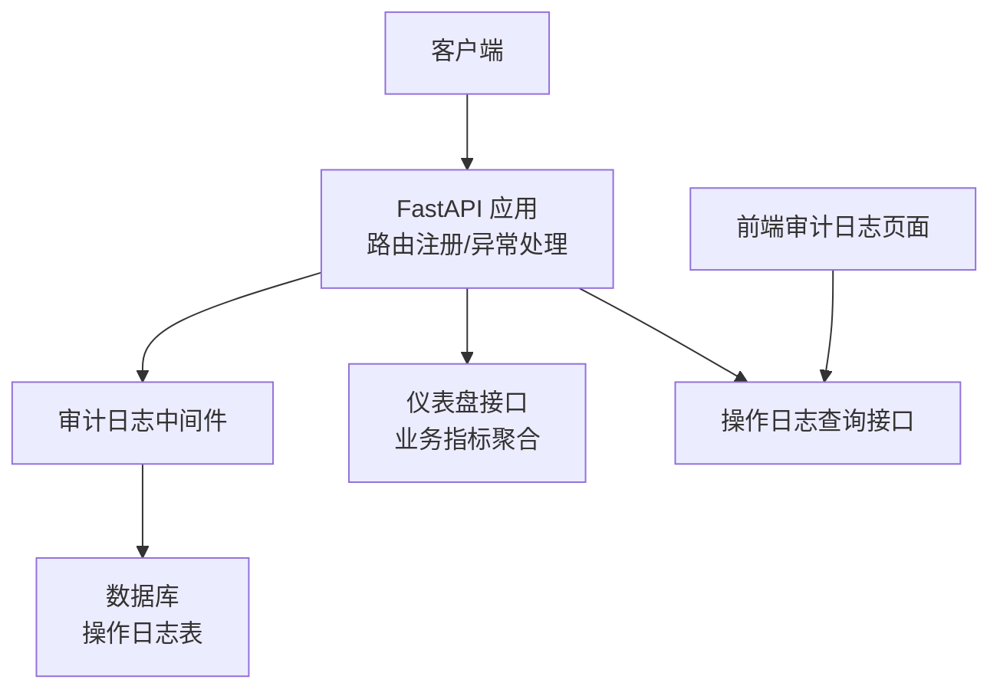
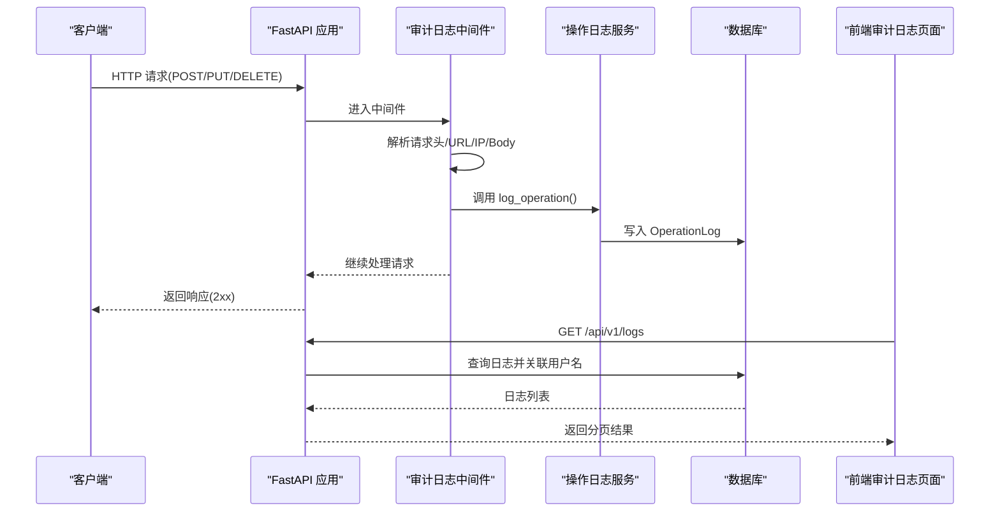
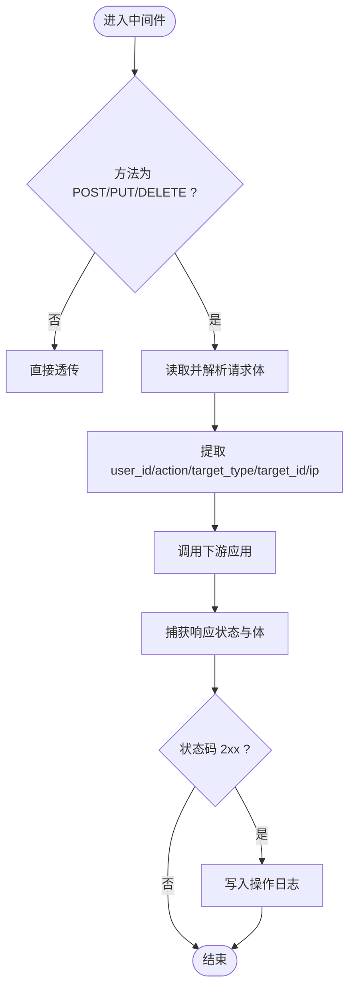
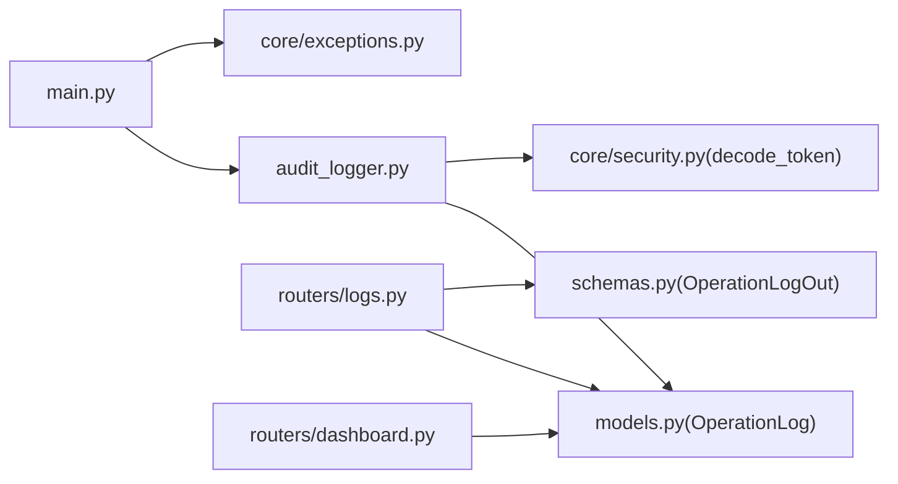

# 监控告警

<cite>
**本文引用的文件**   
- [backend/app/main.py](file://backend/app/main.py)
- [backend/app/utils/audit_logger.py](file://backend/app/utils/audit_logger.py)
- [backend/app/services/operation_logger.py](file://backend/app/services/operation_logger.py)
- [backend/app/routers/logs.py](file://backend/app/routers/logs.py)
- [backend/app/models.py](file://backend/app/models.py)
- [backend/app/schemas.py](file://backend/app/schemas.py)
- [backend/app/core/exceptions.py](file://backend/app/core/exceptions.py)
- [backend/app/routers/dashboard.py](file://backend/app/routers/dashboard.py)
- [frontend/src/views/audit/OperationLog.vue](file://frontend/src/views/audit/OperationLog.vue)
</cite>

## 目录
1. [简介](#简介)
2. [项目结构](#项目结构)
3. [核心组件](#核心组件)
4. [架构总览](#架构总览)
5. [详细组件分析](#详细组件分析)
6. [依赖关系分析](#依赖关系分析)
7. [性能与指标](#性能与指标)
8. [错误监控与告警配置](#错误监控与告警配置)
9. [业务指标监控](#业务指标监控)
10. [监控工具集成方案](#监控工具集成方案)
11. [仪表板与告警通知示例](#仪表板与告警通知示例)
12. [故障排查指南](#故障排查指南)
13. [结论](#结论)

## 简介
本文件面向“绩效考核评分系统”的监控与告警能力，系统化说明：
- 内置日志记录机制：审计日志、操作日志、错误日志的记录格式与存储位置。
- 性能监控指标：API 响应时间、数据库查询性能、内存使用等关键指标的采集与分析建议。
- 错误监控与告警：异常捕获、错误上报、告警规则设置。
- 业务指标监控：用户活跃度、考核完成率、审批效率等关键业务指标跟踪。
- 监控工具集成：Prometheus、Grafana、ELK Stack 等主流平台的接入方法与配置要点。
- 仪表板与告警通知：可视化示例与通知渠道设置建议。

## 项目结构
后端采用 FastAPI 应用，通过中间件自动拦截写操作并写入审计日志；提供操作日志查询 API；模型层定义操作日志表结构；前端提供审计日志查看页面。仪表盘接口聚合多维度业务统计，可作为业务指标监控的数据源。

**图示来源**
- [backend/app/main.py:9-28](file://backend/app/main.py#L9-L28)
- [backend/app/utils/audit_logger.py:104-188](file://backend/app/utils/audit_logger.py#L104-L188)
- [backend/app/routers/logs.py:14-67](file://backend/app/routers/logs.py#L14-L67)
- [backend/app/models.py:186-196](file://backend/app/models.py#L186-L196)
- [backend/app/routers/dashboard.py:15-136](file://backend/app/routers/dashboard.py#L15-L136)

**章节来源**
- [backend/app/main.py:9-28](file://backend/app/main.py#L9-L28)
- [backend/app/models.py:186-196](file://backend/app/models.py#L186-L196)
- [backend/app/routers/dashboard.py:15-136](file://backend/app/routers/dashboard.py#L15-L136)

## 核心组件
- 审计日志中间件：自动拦截 POST/PUT/DELETE 请求，提取用户、动作、目标对象、IP，并记录成功请求（2xx）的请求体与响应体快照到数据库。
- 操作日志服务：提供统一写入操作日志的方法，供业务代码显式调用。
- 操作日志查询接口：支持分页、按动作类型/目标类型/时间范围筛选，返回用户名映射后的列表。
- 仪表盘接口：按角色聚合业务统计，作为业务指标监控的数据源。
- 异常处理器：统一业务异常与通用异常的结构化返回，便于错误监控与告警。

**章节来源**
- [backend/app/utils/audit_logger.py:15-53](file://backend/app/utils/audit_logger.py#L15-L53)
- [backend/app/services/operation_logger.py:7-40](file://backend/app/services/operation_logger.py#L7-L40)
- [backend/app/routers/logs.py:14-83](file://backend/app/routers/logs.py#L14-L83)
- [backend/app/routers/dashboard.py:15-402](file://backend/app/routers/dashboard.py#L15-L402)
- [backend/app/core/exceptions.py:6-107](file://backend/app/core/exceptions.py#L6-L107)

## 架构总览
下图展示从请求进入、审计日志记录、到日志查询与前端展示的完整链路。

**图示来源**
- [backend/app/utils/audit_logger.py:104-188](file://backend/app/utils/audit_logger.py#L104-L188)
- [backend/app/services/operation_logger.py:7-40](file://backend/app/services/operation_logger.py#L7-L40)
- [backend/app/routers/logs.py:14-67](file://backend/app/routers/logs.py#L14-L67)

## 详细组件分析

### 审计日志中间件
- 功能要点
  - 仅对 POST/PUT/DELETE 生效。
  - 读取并重新包装 request body，确保下游可再次消费。
  - 从 Authorization 头解析 user_id，从 URL 推断 action/target_type/target_id，获取客户端 IP。
  - 捕获 response，仅记录状态码为 2xx 的成功请求。
  - 将请求体与响应体以 JSON 序列化后持久化。
  - 失败时记录错误日志，不影响主流程。
- 数据流
  - 入参：Request、SessionLocal、OperationLog 模型。
  - 出参：无（副作用为写入数据库）。
- 复杂度
  - 每次写请求额外一次 DB 写入；JSON 序列化开销与请求/响应体大小相关。
- 优化建议
  - 对大体积 Body/Response 进行截断或采样。
  - 异步写入队列（如 Celery/RQ）降低主路径延迟。
  - 增加采样率控制与敏感字段脱敏。

**图示来源**
- [backend/app/utils/audit_logger.py:104-188](file://backend/app/utils/audit_logger.py#L104-L188)

**章节来源**
- [backend/app/utils/audit_logger.py:15-53](file://backend/app/utils/audit_logger.py#L15-L53)
- [backend/app/utils/audit_logger.py:56-102](file://backend/app/utils/audit_logger.py#L56-L102)
- [backend/app/utils/audit_logger.py:104-188](file://backend/app/utils/audit_logger.py#L104-L188)

### 操作日志服务
- 功能要点
  - 封装 OperationLog 创建逻辑，支持 old_value/new_value 的 JSON 序列化。
  - 提供 flush 提交，便于事务内批量写入。
- 使用场景
  - 在需要精确记录业务动作（如审批、评分提交、KPI 调整）时显式调用。

**章节来源**
- [backend/app/services/operation_logger.py:7-40](file://backend/app/services/operation_logger.py#L7-L40)

### 操作日志查询接口
- 功能要点
  - 分页查询，支持 action/target_type/start_date/end_date 过滤。
  - 批量加载用户名映射，减少 N+1 查询。
  - 暴露 actions 枚举接口用于前端下拉筛选。
- 权限控制
  - 仅 admin/hr 可访问。

**章节来源**
- [backend/app/routers/logs.py:14-83](file://backend/app/routers/logs.py#L14-L83)

### 仪表盘接口（业务指标数据源）
- 功能要点
  - 按角色聚合统计：员工数、部门数、周期数、待审批、待申诉、覆盖率、平均分、强制调整人数等。
  - 高管视图提供等级分布、部门平均分对比、近季度趋势、强制调整人员列表。
  - 管理者/协作人/普通员工视图提供各自维度的待办与进度统计。
- 用途
  - 作为业务指标监控的数据源，可对接 Prometheus/Grafana 或直接在前端渲染。

**章节来源**
- [backend/app/routers/dashboard.py:15-402](file://backend/app/routers/dashboard.py#L15-L402)

### 异常处理器（错误日志基础）
- 功能要点
  - BizError 及其子类统一业务异常结构 {code, message, data}。
  - 全局 Exception 处理器兜底，返回 500 标准结构。
  - main.py 中注册 HTTPException 与 RequestValidationError 的统一返回。
- 用途
  - 为错误监控与告警提供结构化错误信息。

**章节来源**
- [backend/app/core/exceptions.py:6-107](file://backend/app/core/exceptions.py#L6-L107)
- [backend/app/main.py:31-46](file://backend/app/main.py#L31-L46)

### 前端审计日志页面
- 功能要点
  - 调用 logs API 分页查询，支持动作类型、目标类型、日期范围筛选。
  - 展示日志列表与分页控件。

**章节来源**
- [frontend/src/views/audit/OperationLog.vue:70-112](file://frontend/src/views/audit/OperationLog.vue#L70-L112)

## 依赖关系分析
- 模块耦合
  - main.py 注册中间件与异常处理器，依赖 audit_logger 与 exceptions。
  - audit_logger 依赖 database.SessionLocal、models.OperationLog、security.decode_token。
  - routers/logs.py 依赖 models.OperationLog、schemas.OperationLogOut、auth.require_role。
  - dashboard.py 依赖多个业务模型进行统计聚合。
- 外部依赖
  - FastAPI、Starlette、SQLAlchemy、Pydantic。

**图示来源**
- [backend/app/main.py:23-28](file://backend/app/main.py#L23-L28)
- [backend/app/utils/audit_logger.py:8-10](file://backend/app/utils/audit_logger.py#L8-L10)
- [backend/app/routers/logs.py:6-9](file://backend/app/routers/logs.py#L6-L9)
- [backend/app/routers/dashboard.py:7-10](file://backend/app/routers/dashboard.py#L7-L10)

**章节来源**
- [backend/app/main.py:23-28](file://backend/app/main.py#L23-L28)
- [backend/app/utils/audit_logger.py:8-10](file://backend/app/utils/audit_logger.py#L8-L10)
- [backend/app/routers/logs.py:6-9](file://backend/app/routers/logs.py#L6-L9)
- [backend/app/routers/dashboard.py:7-10](file://backend/app/routers/dashboard.py#L7-L10)

## 性能与指标
- API 响应时间
  - 建议在中间件或自定义中间件中添加计时器，记录每个接口的耗时，并输出到日志或推送到指标系统。
  - 结合仪表盘接口的聚合查询，关注慢查询与热点接口。
- 数据库查询性能
  - 仪表盘接口存在多次 count/avg 聚合，建议对高频字段建立索引（如 status、created_at、employee_id、cycle_id）。
  - 对大表查询考虑物化视图或预聚合缓存（如 Redis），降低实时压力。
- 内存使用
  - 审计日志中间件会缓存请求/响应体，建议限制最大体大小并对大响应进行采样或截断。
  - 避免一次性加载过多日志到内存，保持分页与按需加载。
- 并发与连接池
  - 文档要求连接池支持 100 并发，需监控连接等待时间与泄漏情况。
  - 对导出/PDF 生成等耗时任务采用异步任务队列，避免阻塞主线程。

[本节为通用指导，不直接分析具体文件]

## 错误监控与告警配置
- 异常捕获
  - 使用 BizError 及其子类抛出业务异常，统一返回 {code, message, data}。
  - 全局 Exception 处理器兜底，保证未预期异常也能返回标准结构。
- 错误上报
  - 建议将异常信息（含 trace_id、user_id、path、method、status_code、message）发送到集中式日志平台（如 ELK）。
  - 对高频错误（如认证失败、参数校验失败）设置阈值告警。
- 告警规则设置
  - 基于错误率（如 5xx 比例）、特定错误码频次、慢接口超时率设置阈值。
  - 结合审计日志中的失败重试、重复操作等模式识别潜在风险。

**章节来源**
- [backend/app/core/exceptions.py:6-107](file://backend/app/core/exceptions.py#L6-L107)
- [backend/app/main.py:31-46](file://backend/app/main.py#L31-L46)

## 业务指标监控
- 用户活跃度
  - 通过仪表盘接口统计活跃周期、员工覆盖数、待办任务数。
  - 结合登录日志（可扩展）统计日活/周活。
- 考核完成率
  - 使用 AssessmentRecord 的状态分布计算完成比例。
  - 高管视图提供覆盖率与平均分趋势。
- 审批效率
  - 统计 ApprovalRecord 的待审批数量与平均处理时长（可扩展）。
- 指标采集建议
  - 定时任务拉取仪表盘统计数据，转换为 Prometheus 指标（如 gauge/histogram）。
  - 对关键指标设置基线与阈值，触发告警。

**章节来源**
- [backend/app/routers/dashboard.py:15-402](file://backend/app/routers/dashboard.py#L15-L402)

## 监控工具集成方案
- Prometheus
  - 暴露 /metrics 端点（可通过 prometheus-fastapi-instrumentor 或自定义中间件实现）。
  - 指标分类：HTTP 请求计数、响应时间直方图、数据库查询耗时、审计日志写入量、错误计数。
  - 配置 scrape_interval 与 retention，配合 Alertmanager 发送告警。
- Grafana
  - 导入仪表盘模板，展示 API 响应时间、错误率、审计日志趋势、业务指标（覆盖率、平均分、待审批数）。
  - 配置数据源为 Prometheus，设置刷新频率与时间范围。
- ELK Stack
  - Filebeat/Fluent Bit 收集应用日志（包括审计日志与异常日志）。
  - Logstash 进行清洗与富化（添加 trace_id、环境标签）。
  - Kibana 构建日志检索面板与告警规则（基于关键字与频次）。

[本节为通用指导，不直接分析具体文件]

## 仪表板与告警通知示例
- 仪表板配置示例
  - API 响应时间：P50/P95/P99 折线图，按接口维度拆分。
  - 错误率：5xx 占比与 Top 错误消息词云。
  - 审计日志：每日写入量、按 action 分类占比。
  - 业务指标：覆盖率、平均分、待审批数、等级分布饼图。
- 告警通知渠道
  - 邮件、企业微信、钉钉、Slack 等。
  - 告警规则示例：
    - 5xx 错误率 > 1% 持续 5 分钟。
    - 审计日志写入失败次数 > 10 次/小时。
    - 覆盖率下降超过 5% 且持续 1 天。

[本节为通用指导，不直接分析具体文件]

## 故障排查指南
- 审计日志未写入
  - 检查中间件是否启用、请求是否为 POST/PUT/DELETE、响应是否为 2xx。
  - 检查数据库连接与 OperationLog 表结构是否正确。
  - 查看中间件内部错误日志（logger.error）。
- 操作日志查询缓慢
  - 检查分页参数与过滤条件是否合理。
  - 确认是否存在 N+1 查询问题（当前已批量加载用户名映射）。
  - 为 created_at、action、target_type 等字段建立索引。
- 仪表盘数据不准确
  - 核对角色权限与可见范围逻辑。
  - 检查状态枚举与聚合 SQL 是否符合业务语义。
- 错误上报缺失
  - 确认异常处理器已注册。
  - 检查日志输出配置（控制台/文件/远程收集器）。

**章节来源**
- [backend/app/utils/audit_logger.py:186-188](file://backend/app/utils/audit_logger.py#L186-L188)
- [backend/app/routers/logs.py:47-67](file://backend/app/routers/logs.py#L47-L67)
- [backend/app/routers/dashboard.py:15-136](file://backend/app/routers/dashboard.py#L15-L136)
- [backend/app/core/exceptions.py:84-107](file://backend/app/core/exceptions.py#L84-L107)

## 结论
本系统已具备完善的审计日志与操作日志能力，并通过仪表盘接口提供丰富的业务指标数据源。结合 Prometheus/Grafana/ELK 等工具，可实现全面的性能监控、错误监控与业务指标可视化。建议在生产环境中引入指标采集、日志集中化与告警自动化，以提升系统的可观测性与稳定性。