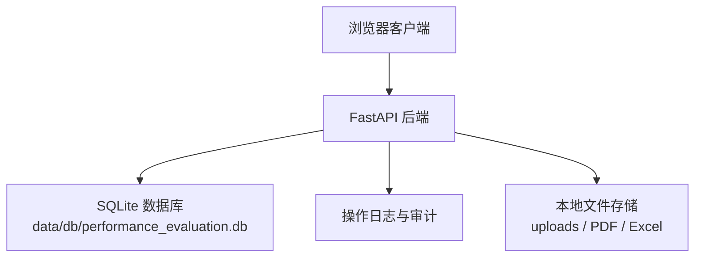
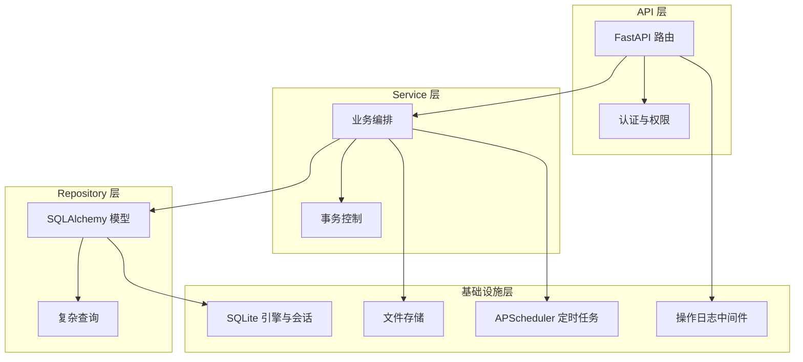
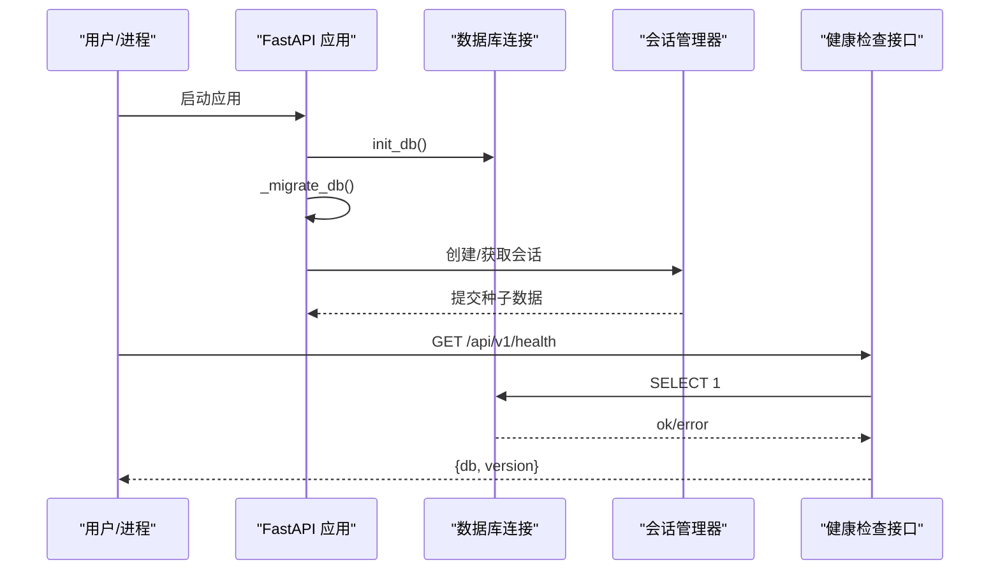
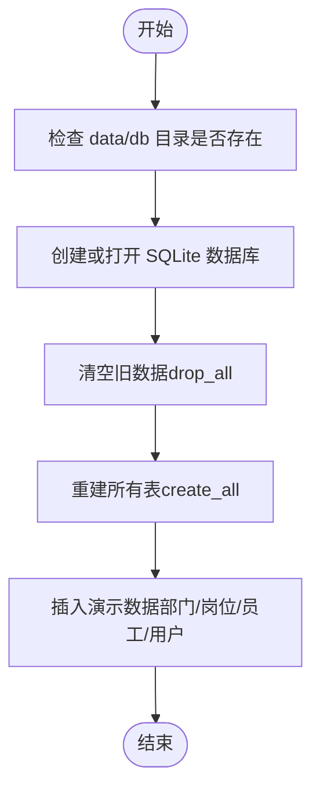
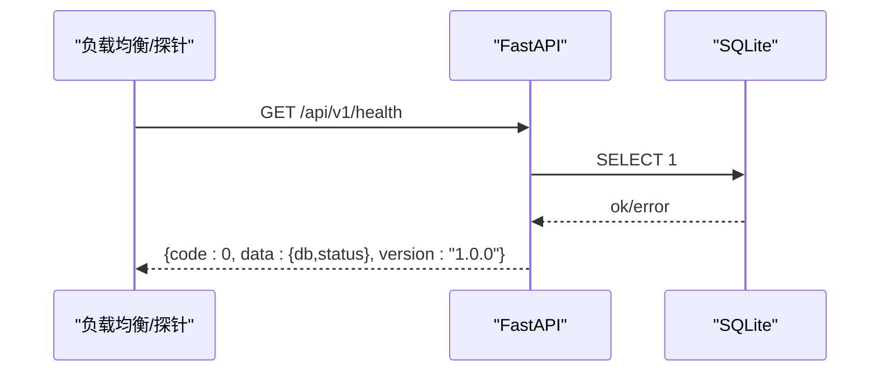
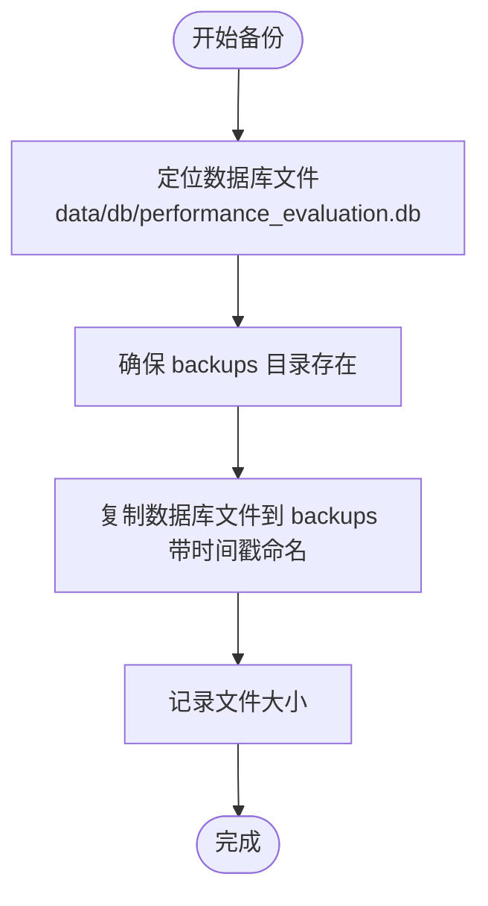
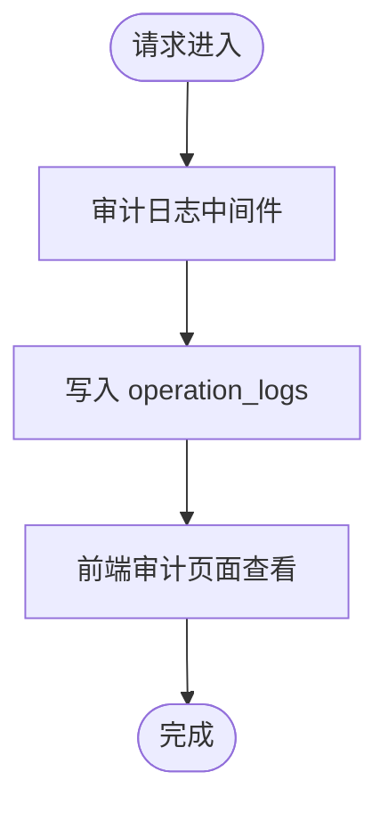
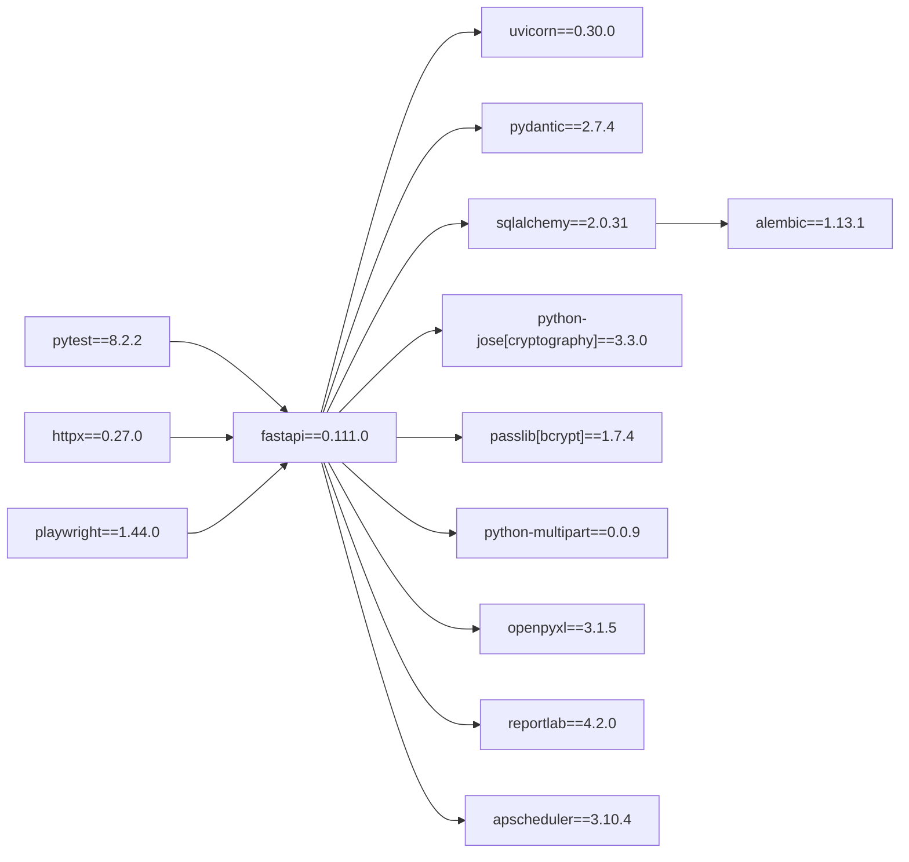

# 部署与运维

<cite>
**本文引用的文件**   
- [backend/app/main.py](file://backend/app/main.py)
- [backend/app/database.py](file://backend/app/database.py)
- [backend/requirements.txt](file://backend/requirements.txt)
- [backend/scripts/init_db.py](file://backend/scripts/init_db.py)
- [scripts/backup.bat](file://scripts/backup.bat)
- [backend/app/routers/health.py](file://backend/app/routers/health.py)
- [docs/TECH_绩效考核评分系统_v1.0.md](file://docs/TECH_绩效考核评分系统_v1.0.md)
</cite>

## 目录
1. [简介](#简介)
2. [项目结构](#项目结构)
3. [核心组件](#核心组件)
4. [架构总览](#架构总览)
5. [详细组件分析](#详细组件分析)
6. [依赖关系分析](#依赖关系分析)
7. [性能考虑](#性能考虑)
8. [故障排查指南](#故障排查指南)
9. [结论](#结论)
10. [附录](#附录)

## 简介
本文件面向生产环境的部署与运维，覆盖服务器环境准备、依赖安装、数据库配置、服务启动、容器化方案、监控告警、备份恢复、日志管理、性能调优与安全加固等。系统采用前后端分离架构：后端基于 FastAPI + SQLAlchemy + SQLite（MVP），前端为 Vue 3 + Vite；默认使用单文件 SQLite 数据库，便于内网 MVP 快速部署，后续可平滑迁移至 MySQL/PostgreSQL。

## 项目结构
- 后端位于 backend 目录，包含 FastAPI 应用、路由、模型、数据库连接、脚本与测试。
- 数据库文件统一放置在 data/db/performance_evaluation.db，便于备份与运维。
- 根目录 scripts 提供备份脚本 backup.bat，用于复制 SQLite 文件到 backups 目录。
- 文档 docs 中包含技术方案与技术选型说明，明确 MVP 阶段使用 SQLite 与 APScheduler 定时任务。

[本图为概念性架构图，不直接映射具体源码文件]

**章节来源**
- [backend/app/database.py:7-11](file://backend/app/database.py#L7-L11)
- [docs/TECH_绩效考核评分系统_v1.0.md:26-31](file://docs/TECH_绩效考核评分系统_v1.0.md#L26-L31)
- [docs/TECH_绩效考核评分系统_v1.0.md:112-124](file://docs/TECH_绩效考核评分系统_v1.0.md#L112-L124)

## 核心组件
- FastAPI 应用入口：定义中间件、异常处理、路由挂载、启动事件与数据初始化。
- 数据库连接：SQLAlchemy Engine 与 SessionLocal，统一数据库路径与线程安全参数。
- 健康检查接口：返回数据库状态、版本信息，供负载均衡与健康探针使用。
- 依赖清单：Python 包版本固定，便于构建稳定镜像与可重复部署。
- 初始化脚本：创建演示数据与预置账号，便于快速验证流程。

**章节来源**
- [backend/app/main.py:9-28](file://backend/app/main.py#L9-L28)
- [backend/app/main.py:49-71](file://backend/app/main.py#L49-L71)
- [backend/app/main.py:126-129](file://backend/app/main.py#L126-L129)
- [backend/app/database.py:13-18](file://backend/app/database.py#L13-L18)
- [backend/app/routers/health.py:10-25](file://backend/app/routers/health.py#L10-L25)
- [backend/requirements.txt:1-15](file://backend/requirements.txt#L1-L15)
- [backend/scripts/init_db.py:25-54](file://backend/scripts/init_db.py#L25-L54)

## 架构总览
系统采用经典三层架构：
- API 层：FastAPI Router 定义 REST 端点，Pydantic Schema 校验，JWT 鉴权与 RBAC 权限守卫。
- Service 层：业务逻辑编排（状态机流转、加权计算、强制分布）、事务控制、跨模块协调。
- Repository 层：SQLAlchemy Model 定义，基础 CRUD 封装，复杂查询（聚合统计、关联查询、分页）。
- 基础设施层：SQLite 数据库连接与会话管理、文件系统（PDF/Excel 读写）、后台任务调度（APScheduler）、操作日志自动记录（Middleware）。

**图表来源**
- [docs/TECH_绩效考核评分系统_v1.0.md:125-152](file://docs/TECH_绩效考核评分系统_v1.0.md#L125-L152)

**章节来源**
- [docs/TECH_绩效考核评分系统_v1.0.md:125-152](file://docs/TECH_绩效考核评分系统_v1.0.md#L125-L152)

## 详细组件分析

### 后端服务启动与初始化流程
FastAPI 应用在启动时执行数据库初始化、简单迁移与种子数据注入，确保运行环境就绪。

**图表来源**
- [backend/app/main.py:126-129](file://backend/app/main.py#L126-L129)
- [backend/app/main.py:97-118](file://backend/app/main.py#L97-L118)
- [backend/app/database.py:29-30](file://backend/app/database.py#L29-L30)
- [backend/app/routers/health.py:10-25](file://backend/app/routers/health.py#L10-L25)

**章节来源**
- [backend/app/main.py:9-28](file://backend/app/main.py#L9-L28)
- [backend/app/main.py:49-71](file://backend/app/main.py#L49-L71)
- [backend/app/main.py:126-129](file://backend/app/main.py#L126-L129)
- [backend/app/routers/health.py:10-25](file://backend/app/routers/health.py#L10-L25)

### 数据库配置与初始化
- 数据库路径统一在 data/db/performance_evaluation.db，便于备份与运维。
- Engine 使用 check_same_thread=False，适配多线程并发访问 SQLite。
- 初始化脚本会清空旧数据并重建表结构，随后插入部门、岗位、员工、用户等演示数据。

**图表来源**
- [backend/app/database.py:7-11](file://backend/app/database.py#L7-L11)
- [backend/app/database.py:13-18](file://backend/app/database.py#L13-L18)
- [backend/scripts/init_db.py:25-54](file://backend/scripts/init_db.py#L25-L54)
- [backend/scripts/init_db.py:60-97](file://backend/scripts/init_db.py#L60-L97)
- [backend/scripts/init_db.py:102-189](file://backend/scripts/init_db.py#L102-L189)
- [backend/scripts/init_db.py:216-234](file://backend/scripts/init_db.py#L216-L234)

**章节来源**
- [backend/app/database.py:7-18](file://backend/app/database.py#L7-L18)
- [backend/scripts/init_db.py:25-54](file://backend/scripts/init_db.py#L25-L54)
- [backend/scripts/init_db.py:60-97](file://backend/scripts/init_db.py#L60-L97)
- [backend/scripts/init_db.py:102-189](file://backend/scripts/init_db.py#L102-L189)
- [backend/scripts/init_db.py:216-234](file://backend/scripts/init_db.py#L216-L234)

### 健康检查与可用性探测
健康检查接口返回数据库状态与版本号，适合用于 Kubernetes Liveness/Readiness 探针或负载均衡器健康检测。

**图表来源**
- [backend/app/routers/health.py:10-25](file://backend/app/routers/health.py#L10-L25)

**章节来源**
- [backend/app/routers/health.py:10-25](file://backend/app/routers/health.py#L10-L25)

### 备份与恢复策略
- 数据库备份：使用 scripts/backup.bat 将 SQLite 文件复制到 backups 目录，带时间戳命名。
- 恢复策略：停止服务后替换 data/db/performance_evaluation.db 为目标备份文件，重启服务。
- 文件备份：建议同时备份 uploads 目录中的导入模板、PDF 档案与导出报表。

**图表来源**
- [scripts/backup.bat:5-9](file://scripts/backup.bat#L5-L9)
- [scripts/backup.bat:16-24](file://scripts/backup.bat#L16-L24)
- [scripts/backup.bat:26-36](file://scripts/backup.bat#L26-L36)

**章节来源**
- [scripts/backup.bat:5-9](file://scripts/backup.bat#L5-L9)
- [scripts/backup.bat:16-24](file://scripts/backup.bat#L16-L24)
- [scripts/backup.bat:26-36](file://scripts/backup.bat#L26-L36)

### 日志管理与分析方法
- 操作日志：通过中间件自动记录 POST/PUT/DELETE 等操作，便于审计与排障。
- 日志级别与轮转：技术方案中建议使用 Python logging.handlers.TimedRotatingFileHandler 实现按时间轮转的日志文件。
- 日志分析：结合系统提供的操作日志接口与前端审计页面进行检索与筛选。

**图表来源**
- [backend/app/main.py:23-26](file://backend/app/main.py#L23-L26)
- [docs/TECH_绩效考核评分系统_v1.0.md:2919](file://docs/TECH_绩效考核评分系统_v1.0.md#L2919)

**章节来源**
- [backend/app/main.py:23-26](file://backend/app/main.py#L23-L26)
- [docs/TECH_绩效考核评分系统_v1.0.md:2919](file://docs/TECH_绩效考核评分系统_v1.0.md#L2919)

### 监控告警体系建议
- 性能监控：采集接口响应时间、错误率、数据库连接池使用率、CPU/内存占用。
- 错误日志收集：集中收集应用错误与异常堆栈，设置阈值告警（如 5xx 比例上升）。
- 业务指标监控：考核周期进度、待办数量、申诉数量、归档完成率等关键业务指标。
- 健康检查：利用 /api/v1/health 作为存活与就绪探针，结合外部监控系统（如 Prometheus/Grafana）进行可视化展示。

[本节为通用运维建议，不直接分析具体源码文件]

### 容器化部署方案（概念性）
- Docker 镜像构建：以 Python 基础镜像为基础，安装 requirements.txt 依赖，拷贝后端代码，暴露端口，设置启动命令 uvicorn。
- 容器编排：使用 Docker Compose 或 Kubernetes Deployment/Service/ConfigMap/Secret 管理多实例与配置。
- 服务发现：Kubernetes Service 提供内部 DNS 解析；对外通过 Ingress/Nginx 暴露。
- 配置管理：环境变量注入数据库 URL、JWT 密钥、日志级别等敏感配置。
- 存储卷：持久化 data/db 与 uploads 目录，确保数据与文件不随容器销毁丢失。
- 健康检查：容器 liveness/readiness 探针调用 /api/v1/health。

[本节为概念性部署方案，不直接映射具体源码文件]

## 依赖关系分析
后端依赖包括 FastAPI、Uvicorn、SQLAlchemy、Alembic、Pydantic、JWT、密码哈希、文件上传、Excel 处理、测试框架、HTTP 客户端、PDF 生成、E2E 测试与定时任务调度。

**图表来源**
- [backend/requirements.txt:1-15](file://backend/requirements.txt#L1-L15)

**章节来源**
- [backend/requirements.txt:1-15](file://backend/requirements.txt#L1-L15)

## 性能考虑
- 数据库连接池：SQLite 单文件适合 MVP，但高并发场景需评估连接竞争；必要时迁移至 MySQL/PostgreSQL 并使用连接池优化。
- 异步处理：FastAPI 原生异步，避免阻塞 I/O；对耗时任务（PDF 生成、批量导入）使用 APScheduler 或消息队列异步处理。
- 缓存策略：对热点数据（部门树、KPI 模板、配置项）引入缓存层（Redis）降低数据库压力。
- 静态资源：前端构建产物由 Nginx/Apache 托管，减少后端负载。
- 限流与熔断：对认证与高频接口实施限流，防止恶意刷量与雪崩效应。

[本节为通用性能建议，不直接分析具体源码文件]

## 故障排查指南
- 健康检查失败：检查 /api/v1/health 返回的 db 状态是否为 error，确认数据库文件存在且可写。
- 数据库初始化失败：确认 data/db 目录权限与磁盘空间；检查 init_db.py 是否成功创建表与种子数据。
- 备份失败：检查 scripts/backup.bat 是否能定位数据库文件与 backups 目录；确认无文件占用锁。
- 日志缺失：确认审计中间件已启用；检查日志轮转配置与磁盘空间。
- 服务不可用：检查 Uvicorn 进程状态、端口占用、防火墙规则与反向代理配置。

**章节来源**
- [backend/app/routers/health.py:10-25](file://backend/app/routers/health.py#L10-L25)
- [backend/app/database.py:7-18](file://backend/app/database.py#L7-L18)
- [backend/scripts/init_db.py:25-54](file://backend/scripts/init_db.py#L25-L54)
- [scripts/backup.bat:5-9](file://scripts/backup.bat#L5-L9)
- [backend/app/main.py:23-26](file://backend/app/main.py#L23-L26)

## 结论
本项目在 MVP 阶段采用 FastAPI + SQLite 的轻量架构，具备快速部署与易维护的优势。通过统一数据库路径、健康检查接口与备份脚本，形成基础的运维闭环。建议在后续演进中引入容器化编排、集中式日志与监控平台，并逐步迁移至企业级数据库以提升稳定性与扩展性。

[本节为总结性内容，不直接分析具体源码文件]

## 附录

### 生产环境部署步骤（参考）
- 服务器环境准备：安装 Python 3.x、Node.js（如需前端构建）、Nginx（可选）。
- 依赖安装：cd backend && pip install -r requirements.txt。
- 数据库配置：确认 data/db 目录存在且可写；如需更换数据库类型，修改 database.py 中的 SQLALCHEMY_DATABASE_URL。
- 服务启动：uvicorn app.main:app --host 0.0.0.0 --port 8000。
- 健康检查：curl http://localhost:8000/api/v1/health。
- 备份策略：定期执行 scripts/backup.bat，或将 SQLite 文件纳入系统备份计划。

**章节来源**
- [backend/requirements.txt:1-15](file://backend/requirements.txt#L1-L15)
- [backend/app/database.py:7-18](file://backend/app/database.py#L7-L18)
- [backend/app/routers/health.py:10-25](file://backend/app/routers/health.py#L10-L25)
- [scripts/backup.bat:5-9](file://scripts/backup.bat#L5-L9)