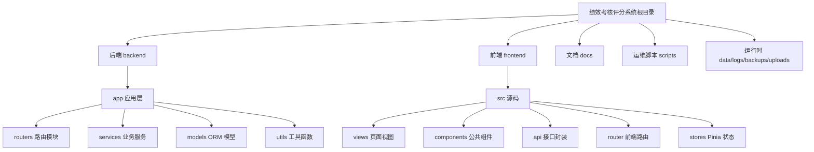
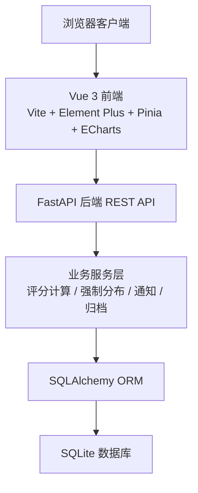
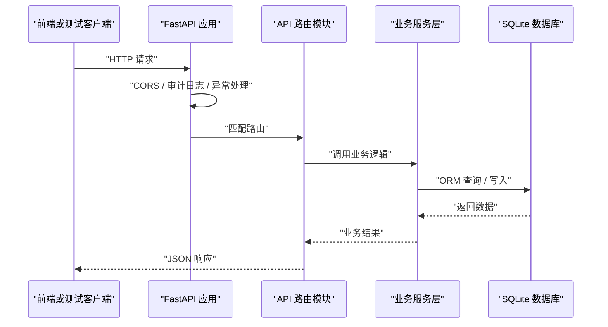
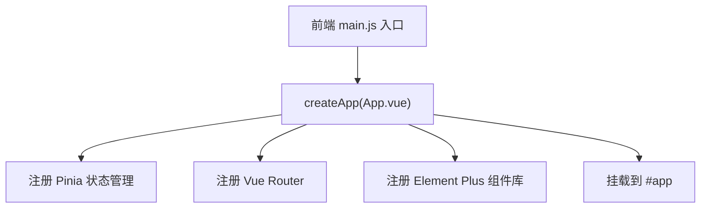
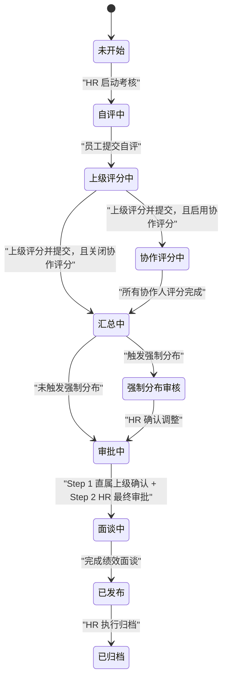
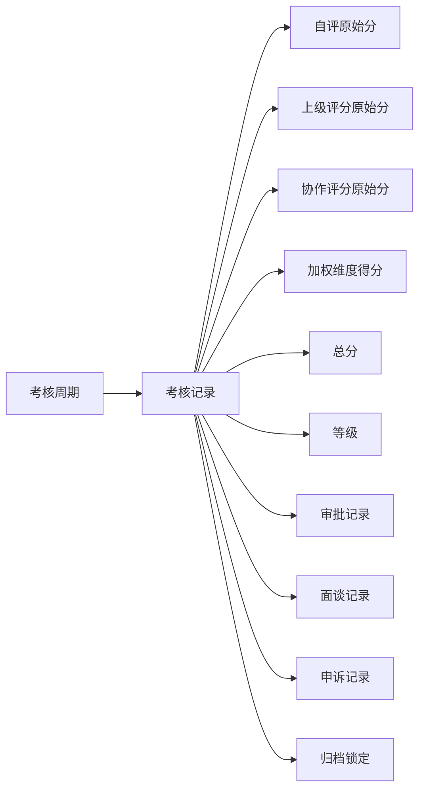
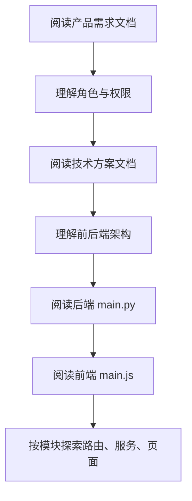

# 项目概述

<cite>
**本文引用的文件**   
- [PRD_绩效考核评分系统_v1.0.md](file://docs/PRD_绩效考核评分系统_v1.0.md)
- [TECH_绩效考核评分系统_v1.0.md](file://docs/TECH_绩效考核评分系统_v1.0.md)
- [main.py](file://backend/app/main.py)
- [main.js](file://frontend/src/main.js)
</cite>

## 目录
1. [引言](#引言)
2. [项目结构](#项目结构)
3. [核心目标与业务价值](#核心目标与业务价值)
4. [主要功能模块](#主要功能模块)
5. [技术架构总览](#技术架构总览)
6. [前后端协作模式](#前后端协作模式)
7. [技术选型与原因](#技术选型与原因)
8. [用户角色与权限边界](#用户角色与权限边界)
9. [多维度绩效考核流程](#多维度绩效考核流程)
10. [数据流向与关键实体](#数据流向与关键实体)
11. [开发者快速理解建议](#开发者快速理解建议)
12. [结论](#结论)

## 引言
本项目的核心目标是把公司原本依赖纸质表格、人工汇总的季度绩效考核流程，升级为可配置、可追溯、可分析、可归档的数字化系统。系统围绕“考核周期 + 评分表 + 加权计算 + 强制分布 + 审批 + 面谈 + 申诉 + 归档”的全链路闭环展开，支持自评、上级评分、协作评分等多种评分主体，并通过仪表盘、趋势图、报表导出等能力，帮助 HR、部门经理、普通员工和高管在不同阶段完成各自职责。

从产品需求文档可以看出，系统最初是为一家公司的真实业务场景设计：以工作业绩、工作能力、工作态度三个维度为基础，结合 KPI 模板、权重配置、等级规则、强制分布、申诉复核和 PDF 档案生成，形成一套完整的绩效考核解决方案。技术方案文档进一步明确了前后端分离、FastAPI + Vue 3 + SQLite 的技术路线，以及按角色划分的页面导航、状态机驱动的流程控制、SQLite 单文件数据库等实现约束。

**章节来源**
- [PRD_绩效考核评分系统_v1.0.md:10-26](file://docs/PRD_绩效考核评分系统_v1.0.md#L10-L26)
- [TECH_绩效考核评分系统_v1.0.md:11-36](file://docs/TECH_绩效考核评分系统_v1.0.md#L11-L36)

## 项目结构
项目采用典型的前后端分离结构：
- `backend`：Python FastAPI 后端，包含路由、模型、服务、工具、测试等。
- `frontend`：Vue 3 前端，包含页面、组件、路由、状态管理、接口封装、测试等。
- `docs`：产品需求、技术方案、验收报告、知识库等文档。
- `scripts`：初始化、备份、路径更新、验证脚本等运维辅助工具。
- `data`、`logs`、`backups`、`uploads`：运行时数据、日志、备份和上传文件目录。

**图表来源**
- [TECH_绩效考核评分系统_v1.0.md:2538-2736](file://docs/TECH_绩效考核评分系统_v1.0.md#L2538-L2736)

**章节来源**
- [TECH_绩效考核评分系统_v1.0.md:2538-2736](file://docs/TECH_绩效考核评分系统_v1.0.md#L2538-L2736)

## 核心目标与业务价值
系统要解决的核心问题包括：
- 评分标准不统一：通过内置评分锚点、KPI 模板和权重配置，减少不同评分人的主观差异。
- 汇总耗时：线上评分 + 自动加权计算，替代 HR 手工汇总纸质表。
- 过程不透明：评分过程留痕，计算逻辑可追溯，支持申诉与复核。
- 历史无法追溯：保存多周期考核记录，提供个人与部门趋势分析。
- KPI 与实际脱节：支持岗位 KPI 模板，并在考核启动时生成快照，避免中途修改影响已启动周期。

这些目标直接对应 PRD 中列出的痛点与解决方案，也体现在后端的服务层（如分数计算、强制分布、通知、归档）和前端的可视化页面（仪表盘、趋势图、审批工作台、申诉管理等）。

**章节来源**
- [PRD_绩效考核评分系统_v1.0.md:10-26](file://docs/PRD_绩效考核评分系统_v1.0.md#L10-L26)
- [PRD_绩效考核评分系统_v1.0.md:367-416](file://docs/PRD_绩效考核评分系统_v1.0.md#L367-L416)

## 主要功能模块
根据产品需求文档的功能模块划分，系统可以抽象为四大模块：
- **系统配置模块**：等级规则、维度权重、评价人权重、小部门豁免、协作评分开关、岗位 KPI 模板、部门与岗位管理、员工信息导入。
- **考核管理模块**：考核周期创建、启动、进度监控、状态流转、部门级协作开关。
- **评分管理模块**：评分表生成、自评、上级评分、协作评分、评语填写、草稿暂存、差异校验。
- **结果管理模块**：分数汇总、等级划分、强制分布处理、审批流程、绩效面谈、申诉处理、归档与导出、趋势分析。

```mermaid
flowchart TD
Start["绩效考核评分系统"] --> Config["系统配置模块"]
Start --> Cycle["考核管理模块"]
Start --> Score["评分管理模块"]
Start --> Result["结果管理模块"]
Config --> LevelRule["等级规则"]
Config --> DimWeight["维度权重"]
Config --> ReviewerWeight["评价人权重"]
Config --> PeerSwitch["协作评分开关"]
Config --> KPITemplate["岗位 KPI 模板"]
Config --> Org["部门与岗位 / 员工导入"]
Cycle --> CreateCycle["创建考核周期"]
Cycle --> StartCycle["启动考核"]
Cycle --> Monitor["进度监控"]
Score --> SelfAssess["自评"]
Score --> ManagerScore["上级评分"]
Score --> PeerScore["协作评分"]
Score --> Draft["草稿与锁定"]
Result --> Calc["加权计算"]
Result --> Grade["等级划分"]
Result --> Distribution["强制分布"]
Result --> Approval["审批流程"]
Result --> Interview["绩效面谈"]
Result --> Appeal["申诉处理"]
Result --> Archive["归档与导出"]
Result --> Trend["趋势分析"]
```

**图表来源**
- [PRD_绩效考核评分系统_v1.0.md:367-416](file://docs/PRD_绩效考核评分系统_v1.0.md#L367-L416)

**章节来源**
- [PRD_绩效考核评分系统_v1.0.md:367-416](file://docs/PRD_绩效考核评分系统_v1.0.md#L367-L416)

## 技术架构总览
系统采用经典前后端分离 B/S 架构：
- 前端使用 Vue 3、Vite、Element Plus、Pinia、ECharts，负责页面渲染、交互、图表展示和状态管理。
- 后端使用 Python FastAPI、SQLAlchemy、Alembic、Uvicorn，负责 REST API、认证鉴权、业务编排、数据库访问和文件操作。
- 数据库 MVP 阶段使用 SQLite 单文件，便于内网部署和迁移；后续可平滑迁移到 MySQL 或 PostgreSQL。

**图表来源**
- [TECH_绩效考核评分系统_v1.0.md:39-79](file://docs/TECH_绩效考核评分系统_v1.0.md#L39-L79)

**章节来源**
- [TECH_绩效考核评分系统_v1.0.md:39-79](file://docs/TECH_绩效考核评分系统_v1.0.md#L39-L79)

## 前后端协作模式
### 后端入口与路由组织
后端 FastAPI 应用在启动时注册全局中间件、异常处理器，并挂载多个业务路由模块，例如认证、员工、部门、考核周期、KPI 模板、系统配置、仪表盘、申诉、评分、审批、面谈、协作评分、日志、通知和健康检查。同时为了兼容测试，还额外挂载了不带 `/api/v1` 前缀的路由集合。

**图表来源**
- [main.py:1-71](file://backend/app/main.py#L1-L71)

### 前端入口与依赖注册
前端 Vue 应用入口注册 Pinia、Element Plus、图标库、路由和全局样式，然后挂载到 DOM。这说明前端是一个标准的 SPA 应用，所有页面和状态都通过 Vue Router 和 Pinia 管理，并通过 `api/` 下的接口模块调用后端 REST API。

**图表来源**
- [main.js:1-23](file://frontend/src/main.js#L1-L23)

**章节来源**
- [main.py:1-94](file://backend/app/main.py#L1-L94)
- [main.js:1-23](file://frontend/src/main.js#L1-L23)

## 技术选型与原因
### 前端技术栈
- **Vue 3**：渐进式框架，中文生态丰富，适合企业后台管理系统。
- **Vite**：启动快、热更新快、配置简单，提升开发体验。
- **Element Plus**：企业级 UI 组件库，表格、表单、图表、弹窗等能力成熟。
- **Pinia**：Vue 官方推荐的状态管理方案，比 Vuex 更简洁，TypeScript 支持好。
- **ECharts**：趋势图、分布图、饼图等图表能力成熟，中文文档完善。

### 后端技术栈
- **Python FastAPI**：现代异步框架，自动生成 API 文档，内置 Pydantic 数据校验和依赖注入，测试友好。
- **SQLAlchemy**：Python 事实标准 ORM，支持 SQLite → MySQL 无缝迁移。
- **SQLite**：MVP 阶段零配置、单文件、内网桌面或服务器均可运行。
- **Alembic**：数据库版本化迁移工具。
- **pytest**：Python 标准测试框架，FastAPI 内置 TestClient 配合良好。
- **Uvicorn**：ASGI 服务器，单命令启动，Windows 环境友好。

### 不选 Java/Django 的原因
- Spring Boot 需要 Maven/Gradle，启动慢，对 MVP 来说过重。
- Django 模板引擎耦合度高，前后端分离不如 FastAPI 纯粹；MVP 不需要 Django Admin 的复杂度。

**章节来源**
- [TECH_绩效考核评分系统_v1.0.md:11-36](file://docs/TECH_绩效考核评分系统_v1.0.md#L11-L36)

## 用户角色与权限边界
系统定义了六个核心角色，每个角色有明确的职责和权限边界：

| 角色 | 中文名称 | 主要职责 | 权限边界 |
|------|----------|----------|----------|
| `admin` | 系统管理员 | 配置等级规则、维度权重、评价人权重、协作评分开关、岗位 KPI 模板 | 全局配置权限 |
| `hr` | HR 专员 | 发起考核、监控进度、处理申诉、汇总分析、生成绩效报表 | 考核管理 + 数据查询 + 报表导出 |
| `manager` | 部门经理 | 给下属评分、确认审批、撰写评语、进行绩效面谈 | 评分 + 审批 + 团队管理 |
| `employee` | 普通员工 | 自评、查看本人绩效结果与历史趋势、发起申诉 | 自评 + 查询本人 |
| `peer` | 协作人 | 对协作员工进行跨部门协作评分 | 仅协作评分权限 |
| `executive` | 高管 | 查看公司/部门绩效分布、趋势分析 | 全局只读，不参与评分、审批、配置 |

此外，系统还区分“岗位身份”，例如直属上级和 HR 负责人，用于在审批链中动态判断当前步骤应由谁执行。高管角色不参与任何审批、评分或配置，只用于战略决策视角的数据查看。

**章节来源**
- [PRD_绩效考核评分系统_v1.0.md:29-62](file://docs/PRD_绩效考核评分系统_v1.0.md#L29-L62)

## 多维度绩效考核流程
系统的核心业务流程围绕“准备 → 评分 → 汇总 → 审批 → 面谈 → 发布与归档”展开，并支持可选的协作评分环节。

**图表来源**
- [PRD_绩效考核评分系统_v1.0.md:446-474](file://docs/PRD_绩效考核评分系统_v1.0.md#L446-L474)

### 自评
- 员工在「自评」页面填写三维度得分，并可填写事实描述佐证评分合理性。
- 支持草稿保存，提交后评分数据锁定，状态变为待上级评分。

### 上级评分
- 部门经理查看员工自评结果，填写 KPI 实际得分和三维度得分，填写综合评语。
- 若启用协作评分，需分配协作人；若关闭协作评分，则直接进入汇总阶段。
- 上级评分与自评分差异较大时，系统给出提示但不阻止提交。

### 协作评分
- 协作人只能对「工作能力」维度评分，不能给自己评分。
- 所有协作人评分完成后，状态进入汇总阶段。

### 汇总与强制分布
- HR 触发加权计算，系统根据维度权重和评分人权重计算总分与等级。
- 若某部门等级人数超过上限，系统标记强制分布降级，HR 确认后进入审批。

### 审批与面谈
- 默认两级审批：直属上级确认 → HR 负责人最终审批。
- 审批通过后进入绩效面谈，面谈完成后结果发布。

### 发布、申诉与归档
- 结果发布后，员工可查看总分、等级、维度得分、评语和历史趋势。
- 员工可对结果发起申诉，HR 复核后可维持或修改结果。
- HR 执行归档后，考核记录锁定，不可再修改。

**章节来源**
- [PRD_绩效考核评分系统_v1.0.md:446-474](file://docs/PRD_绩效考核评分系统_v1.0.md#L446-L474)
- [PRD_绩效考核评分系统_v1.0.md:629-778](file://docs/PRD_绩效考核评分系统_v1.0.md#L629-L778)

## 数据流向与关键实体
系统以“考核记录”为核心实体，贯穿整个生命周期。一条考核记录从创建到归档，会经历评分草稿、KPI 快照、协作评分关系、加权分数、等级、审批记录、面谈记录、申诉记录和归档锁定等多个数据节点。

**图表来源**
- [TECH_绩效考核评分系统_v1.0.md:82-110](file://docs/TECH_绩效考核评分系统_v1.0.md#L82-L110)

关键数据流说明：
- 评分草稿先写入草稿表，提交后才转正为正式评分明细。
- 上级评分提交时，若启用协作评分且尚未分配协作人，先生成协作评分关系，再提交评分。
- 汇总阶段若触发强制分布调整，系统生成调整记录，HR 确认后更新最终等级。
- 通知在周期启动、催促、审批通过/驳回、结果发布、申诉复核等节点生成。
- 归档后所有关联考核记录锁定，任何评分、审批、申诉修改接口均拒绝操作。

**章节来源**
- [TECH_绩效考核评分系统_v1.0.md:82-110](file://docs/TECH_绩效考核评分系统_v1.0.md#L82-L110)

## 开发者快速理解建议
如果你是第一次接触这个项目，建议按以下顺序阅读：
1. 先看产品需求文档中的“目标用户与角色”和“核心功能详细说明”，理解业务目标和主要模块。
2. 再看技术方案文档中的“技术选型”和“系统架构”，理解前后端分离、FastAPI + Vue 3 + SQLite 的整体设计。
3. 接着看后端 `main.py`，了解 FastAPI 应用如何注册路由、中间件和异常处理。
4. 最后看前端 `main.js`，了解 Vue 应用如何注册 Pinia、Element Plus 和路由。

**图表来源**
- [PRD_绩效考核评分系统_v1.0.md:29-62](file://docs/PRD_绩效考核评分系统_v1.0.md#L29-L62)
- [TECH_绩效考核评分系统_v1.0.md:39-79](file://docs/TECH_绩效考核评分系统_v1.0.md#L39-L79)
- [main.py:1-71](file://backend/app/main.py#L1-L71)
- [main.js:1-23](file://frontend/src/main.js#L1-L23)

## 结论
绩效考核评分系统是一个面向真实企业场景的完整业务系统。它通过“考核周期 + 多维度评分 + 加权计算 + 强制分布 + 审批 + 面谈 + 申诉 + 归档”的闭环流程，解决了传统纸质考核中标准不统一、汇总耗时、过程不透明、历史不可追溯等问题。技术上采用 FastAPI + Vue 3 + SQLite 的组合，兼顾开发效率、测试友好性和内网部署便利性；业务上通过清晰的六类用户角色和严格的状态机流程，确保 HR、部门经理、普通员工、协作人和高管都能在合适的位置参与绩效考核。

对于开发者而言，理解这个系统的关键在于把握三条主线：
- 业务主线：角色 → 流程 → 状态。
- 数据主线：考核周期 → 考核记录 → 评分明细 → 加权分数 → 等级 → 审批 → 归档。
- 技术主线：前端页面 → 接口封装 → FastAPI 路由 → 业务服务 → ORM → SQLite。